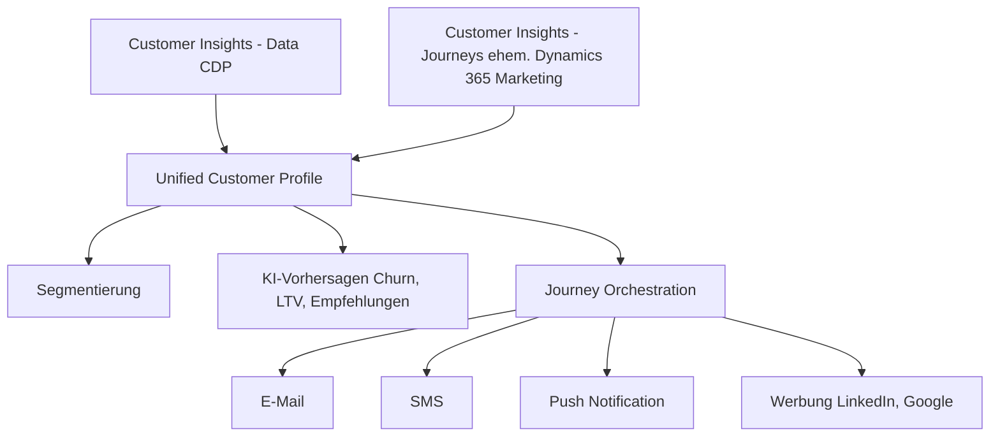
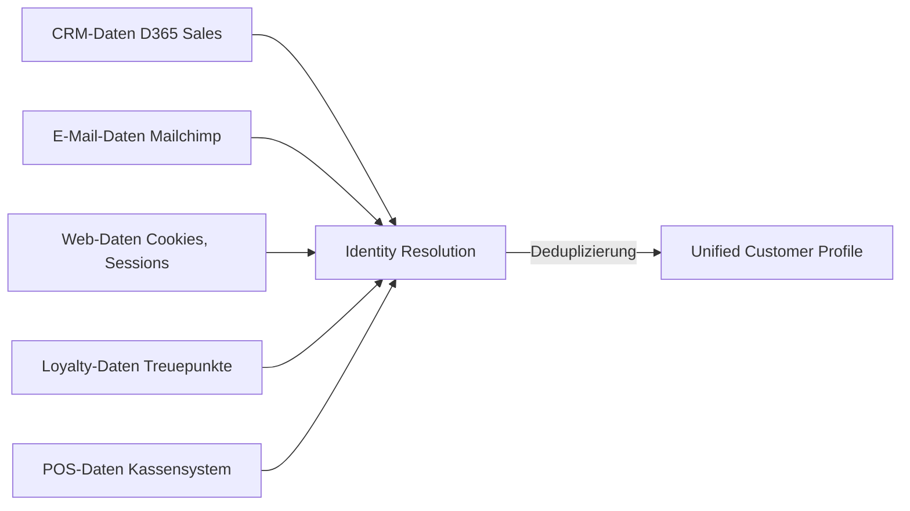
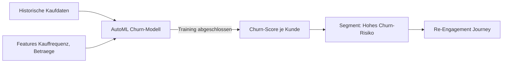
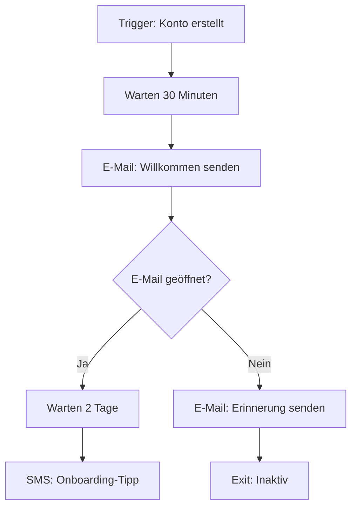
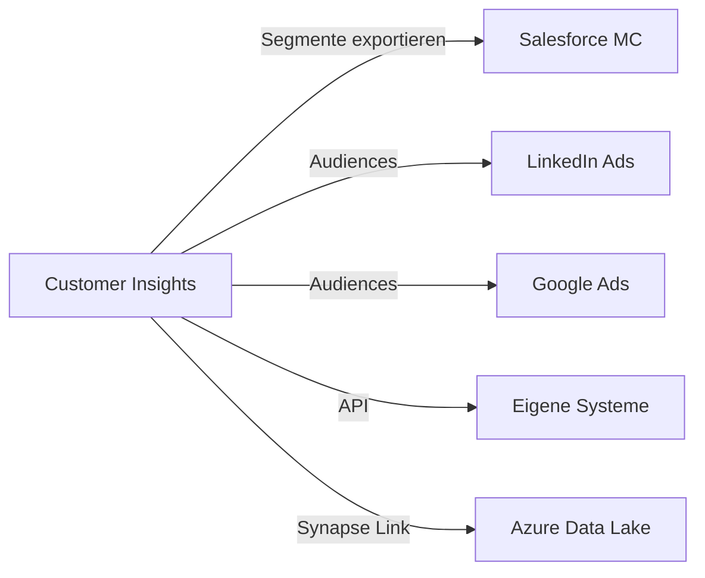

---
tags:
  - dynamics365
  - customer-insights
  - cdp
  - marketing
  - journeys
  - segmentierung
  - copilot
  - customer-data-platform
aliases:
  - D365 Customer Insights
  - Dynamics 365 Marketing
  - D365 CDP
  - Real-time Journeys
---

# Dynamics 365 Customer Insights

> [!ABSTRACT] TL;DR
> Dynamics 365 Customer Insights ist Microsofts Customer Data Platform (CDP). Es vereint Kundendaten aus allen Quellen in einem **Unified Customer Profile** und ermöglicht über Real-time Journeys personalisierte Customer Experiences. Copilot erstellt Segmente und Journeys per natürlicher Sprache.

---

## Zwei Komponenten: Data + Journeys

Customer Insights besteht aus zwei eng verzahnten Modulen:



---

## Customer Data Platform (CDP): Customer Insights - Data

### Datenquellen und Ingestion

| Datenquellentyp | Beispiele |
|----------------|---------|
| **Microsoft** | Dynamics 365, Dataverse, Power Platform |
| **Cloud Storage** | Azure Data Lake, Azure Blob Storage |
| **Datenbanken** | Azure SQL, Synapse Analytics |
| **SaaS-Quellen** | Salesforce, SAP, HubSpot |
| **Echtzeit-Daten** | Azure Event Hubs, API |
| **Webanalyse** | Azure Monitor, GA4 (via Connector) |
| **Loyalty Systems** | Treueprogramme, Point-of-Sale |
| **IoT** | Gerätedaten, Sensordaten |

### Unified Customer Profile

Das Unified Customer Profile führt alle Kundendaten in einem 360°-Profil zusammen:



**Identity Resolution:**
- Verknüpfung per E-Mail, Telefonnummer, Kundennummer
- Machine Learning erkennt gleiche Personen aus verschiedenen Quellen
- Konfidenzgrade für unsichere Zuordnungen

**Profil-Felder (Beispiel):**
```json
{
  "CustomerId": "UC-12345",
  "Name": "Maria Musterfrau",
  "Email": "maria@example.com",
  "Telefon": "+49 123 456789",
  "Adresse": "Musterstraße 1, 80331 München",
  "Quellen": ["D365 Sales", "Newsletter-System", "Online-Shop"],
  "Letzte Interaktion": "2024-10-15",
  "LTV-Score": 8750,
  "Churn-Risiko": "Mittel (35%)",
  "Bevorzugter Kanal": "E-Mail",
  "Segmente": ["Premium-Kunden", "München", "Newsletter-Aktiv"]
}
```

---

## Segmentierung

### Segment-Typen

| Typ | Beschreibung | Aktualisierung |
|-----|-------------|----------------|
| **Statisch** | Manuelle Liste | Manuell |
| **Dynamisch** | Regelbasiert | Automatisch (täglich/stündlich) |
| **Predictive** | KI-basiert (Churn, Kaufwahrscheinlichkeit) | Nach Modell-Update |
| **Lookalike** | Ähnlich zu bestehendem Segment | Automatisch |

### Segmentierung mit Copilot

```
Marketing-Manager schreibt:
"Erstelle ein Segment mit Kunden aus Deutschland, die in 
den letzten 3 Monaten keinen Kauf getätigt haben, aber 
im letzten Jahr mehr als 500€ ausgegeben haben"

Copilot generiert automatisch:
├── Filterbedingung: Land = Deutschland
├── Filterbedingung: Letzter Kauf > 90 Tage alt
├── Filterbedingung: Umsatz letztes Jahr > 500€
└── Ergebnis: 2.847 Kontakte im Segment
```

### Measures (KPIs)

Measures sind berechnete Kennzahlen auf Profilebene:

```
Measure: "Customer Lifetime Value"
Formel: Summe aller Käufe der letzten 3 Jahre
Verfügbar als: Profilattribut, Segmentierungsfeld

Measure: "Tage seit letztem Kauf"  
Formel: Heute - Datum letzter Kauf
Nutzung: Identifikation inaktiver Kunden
```

---

## KI-Vorhersagen

### Verfügbare Vorhersagemodelle

| Modell | Vorhersage | Anwendung |
|--------|-----------|----------|
| **Churn Prediction** | Abwanderungswahrscheinlichkeit | Re-Engagement-Kampagnen |
| **Customer Lifetime Value** | Zukünftiger Kundenwert | Priorisierung, Investitionen |
| **Product Recommendations** | Welche Produkte passen? | Cross-/Upsell-Kampagnen |
| **Transactional Churn** | Wiederkaufwahrscheinlichkeit | Retention-Programme |

### Churn-Modell Konfiguration



---

## Journeys: Real-time Journeys

Real-time Journeys (ehemals Dynamics 365 Marketing) ermöglicht automatisierte, kanalübergreifende Kundenreisen.

### Journey-Typen

| Typ | Beschreibung | Beispiel |
|-----|-------------|---------|
| **Trigger-basiert** | Durch Ereignis ausgelöst | Neukunden-Willkommensmail |
| **Segment-basiert** | Für ein Segment | Monatlicher Newsletter |
| **One-time** | Einmalige Kampagne | Produktlaunch-Ankündigung |

### Journey-Builder



### Unterstützte Kanäle

| Kanal | Beschreibung |
|-------|-------------|
| **E-Mail** | Personalisierte HTML-E-Mails |
| **SMS** | Text-Nachrichten weltweit |
| **Push Notification** | Mobile App-Benachrichtigungen |
| **WhatsApp** | WhatsApp Business API |
| **Custom Channel** | Eigene Kanäle über Webhooks |
| **In-App** | Nachrichten in Web-/Mobile-Apps |

### Real-time vs. Outbound Marketing

> [!IMPORTANT] Outbound wird eingestellt
> Microsoft empfiehlt die Migration zu **Real-time Journeys**. Outbound Marketing erhält ab 2025 keine neuen Features mehr. Migration sollte zeitnah geplant werden.

| Merkmal | Real-time Journeys | Outbound Marketing |
|---------|-------------------|-------------------|
| **Trigger** | Echtzeit-Ereignisse | Geplante Batches |
| **Segmentierung** | Unified Profile | Dynamics 365 Kontakte |
| **Personalisierung** | Tief, KI-gestützt | Standard-Tokens |
| **Copilot** | ✅ Vollständig | ❌ Nicht vorhanden |
| **Status** | Aktiv entwickelt | Feature-Freeze 2025 |

---

## Copilot in Customer Insights

### Segmente per natürlicher Sprache

```
"Erstelle ein Segment aller Kunden, die mehr als 1.000€ 
pro Jahr ausgeben, in Bayern wohnen und in letzten 
6 Monaten keine E-Mail-Kampagne erhalten haben"

→ Copilot übersetzt in Segmentregeln und zeigt Vorschau
```

### Journey-Vorschläge

Copilot analysiert das Ziel einer Kampagne und schlägt eine Journey vor:

```
Kampagnenziel: "Re-Engagement inaktiver Premium-Kunden"

Copilot schlägt vor:
Journey "Win-Back Premium":
1. Tag 1: Personalisierte E-Mail mit Exklusiv-Angebot
2. Tag 3: Wenn nicht geöffnet → SMS-Erinnerung
3. Tag 7: Wenn kein Kauf → LinkedIn-Anzeige aktivieren
4. Tag 14: Wenn kein Kauf → Abonnement pausieren
```

### Content Ideas

- Betreffzeilen für E-Mails generieren (A/B-Test-Varianten)
- E-Mail-Body-Entwürfe erstellen
- CTA-Texte vorschlagen

### Query Assist

Natürlichsprachliche Suche im Unified Customer Profile:
- "Zeige mir alle Kunden mit Churn-Risiko über 70%"
- "Wie viele Kunden haben in Q3 2024 mehr als zweimal gekauft?"

---

## Integration und Datenaustausch

### Microsoft-Ökosystem

| Integration | Nutzung |
|-------------|---------|
| **D365 Sales** | Segmente als Lead-Listen exportieren |
| **D365 Customer Service** | Kundenhistorie im Agenten-Kontext |
| **Power BI** | Kundenanalysen und Dashboards |
| **Microsoft Teams** | Kampagnen-Benachrichtigungen |
| **Microsoft Purview** | Data Governance, Compliance |

### Externe Systeme



---

## Preise und Lizenzierung (2024/2025)

| Lizenz | Preis | Beschreibung |
|--------|-------|-------------|
| **Customer Insights** | $1.700/Tenant/Monat | Basis-Abonnement |
| **Customer Insights Attach** | $1.000/Tenant/Monat | Mit anderer D365-Lizenz |
| **Zusätzliche Profile** | Nach Kapazitätspakt | Über Grundkontingent |
| **Zusätzliche Interaktionen** | Nach Kapazitätspakt | E-Mails, SMS |

> [!NOTE] Tenant-basierte Lizenzierung
> Customer Insights ist **pro Tenant** lizenziert, nicht per User. Das Grundkontingent enthält eine bestimmte Anzahl Unified Customer Profiles und Interaktionen (E-Mails, SMS). Über Add-on-Packs erweiterbar.

---

## Via Dynamics 365 Customer Insights (UI)

Customer Insights ist unter [customerinsights.ai.dynamics.com](https://customerinsights.ai.dynamics.com) erreichbar. Die Oberfläche gliedert sich in zwei Hauptbereiche: **Data** (für das CDP / Unified Profile) und **Journeys** (für Kampagnen und Marketingautomatisierung).

### Datenquelle verbinden

**Navigation:** `Data` → `Data sources` → `+ Add data source`

1. Im linken Menü **Data** → **Data sources** öffnen
2. **+ Add data source** klicken
3. Datenquellentyp auswählen:

| Typ | Beispiele | Verbindungsart |
|-----|----------|----------------|
| **Microsoft** | Dataverse, Azure Data Lake | Managed Identity / OAuth |
| **Import** | CSV, Excel | Datei-Upload |
| **Azure** | Azure SQL, Synapse | Verbindungszeichenfolge |
| **Power Query** | Salesforce, SAP, REST API | Power Query Connector |
| **Real-time** | Azure Event Hubs | Verbindungszeichenfolge |

4. Verbindungsparameter eingeben und **Weiter** klicken
5. Im Power Query-Editor die relevanten Tabellen auswählen und ggf. Daten transformieren
6. **Speichern** → erste Dateningestion startet automatisch (Dauer je nach Datenmenge 5–60 Min.)
7. Status unter **Data sources** verfolgen: `Wird aktualisiert` → `Erfolgreich`

> [!TIP] Datenaktualisierung planen
> Nach der ersten Verbindung unter den **Einstellungen** der Datenquelle einen **Aktualisierungsplan** einrichten (täglich, stündlich). Ohne Zeitplan werden die Daten nur manuell aktualisiert.

---

### Kundenprofil erstellen und Segment definieren

**Navigation:** `Data` → `Unify` → danach `Segments` → `+ New`

**Daten vereinheitlichen (einmalige Einrichtung):**
1. Im Menü **Data** → **Unify** → **Customer columns** öffnen
2. Felder aus verschiedenen Quellen als Identifikatoren markieren (E-Mail, Telefon, Kundennummer)
3. Im Schritt **Matching rules** festlegen, wie Datensätze aus verschiedenen Quellen zusammengeführt werden
4. **Run** klicken → Unified Customer Profiles werden berechnet

**Segment anlegen:**
1. Im Menü **Segments** → **+ New** → **Build your own** klicken
2. Im Segment Builder Bedingungen hinzufügen:

| Beispielbedingung | Einstellung |
|-------------------|------------|
| Land/Region | `= Deutschland` |
| Letzter Kauf | `vor mehr als 90 Tagen` |
| Jahresumsatz | `> 500 €` |
| Churn-Score | `> 60 %` |

3. Bedingungen mit **UND / ODER** verknüpfen
4. **Vorschau ausführen** → geschätzte Segmentgröße wird angezeigt
5. **Name** vergeben → **Speichern und ausführen**
6. Segment steht nach Berechnung für Journeys und Exporte bereit

> [!NOTE] Segmentaktualisierung
> Dynamische Segmente werden nach jedem Datenaktualisierungslauf neu berechnet. Die Aktualisierungsfrequenz hängt vom Datenquellen-Zeitplan ab. Im Segment unter **Details** ist der Zeitpunkt der letzten Berechnung sichtbar.

---

### Journey erstellen

**Navigation:** `Real-time journeys` → `+ New` → Journey-Typ wählen

1. Im linken Menü **Real-time journeys** → **+ New** klicken
2. Journey-Typ auswählen:
   - **Trigger-basiert**: Startet wenn ein Ereignis eintritt (z. B. Konto erstellt, Formular ausgefüllt)
   - **Segment-basiert**: Startet für alle Mitglieder eines Segments zu einem festen Zeitpunkt
3. Für **Trigger-basiert**: Trigger auswählen (z. B. `Contact created`) → **Erstellen**
4. Im Journey-Designer Schritte per Drag-and-Drop hinzufügen:

| Element | Beschreibung |
|---------|-------------|
| **Send an email** | E-Mail-Versand mit personalisierten Inhalten |
| **Send a text message** | SMS-Versand |
| **Wait** | Wartezeit (z. B. 2 Tage) |
| **If/then branch** | Bedingung (z. B. E-Mail geöffnet: Ja/Nein) |
| **Exit** | Journey beenden |

5. Jeden E-Mail-Schritt mit einer **E-Mail-Vorlage** verknüpfen (unter **Assets → Emails** erstellt)
6. Oben rechts **Validate** klicken → Fehler und Warnungen prüfen
7. **Go live** klicken → Journey ist aktiv und startet für neue Trigger-Ereignisse

> [!IMPORTANT] E-Mail-Adressen vor Go-Live prüfen
> Vor dem Aktivieren sicherstellen, dass alle verlinkten E-Mail-Vorlagen den Status **Live** haben und die Journey-Einstellungen (Kontakteinwilligung, Abmeldelink) DSGVO-konform konfiguriert sind.

---

## Verwandte Notizen

- [[Dynamics 365 Überblick]]
- [[Dynamics 365 Sales]]
- [[Dynamics 365 Customer Service]]
- [[Dynamics 365 Administration]]
