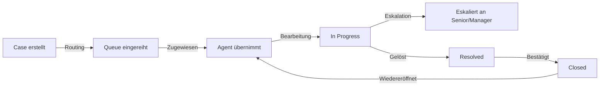
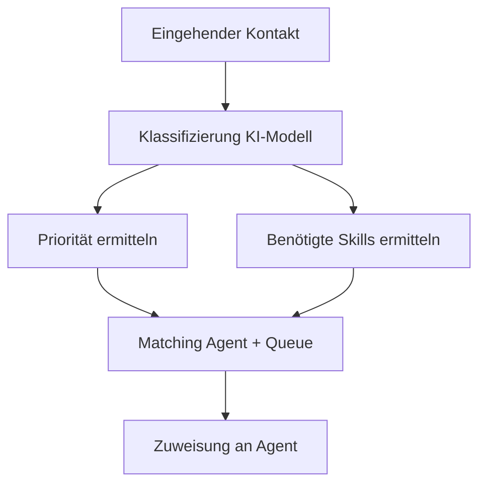
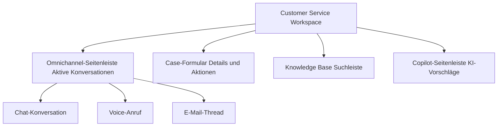
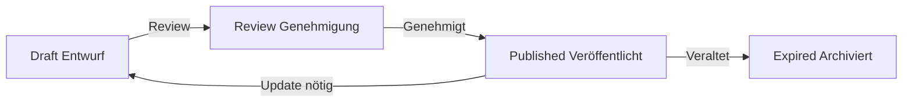

---
tags:
  - dynamics365
  - customer-service
  - crm
  - omnichannel
  - support
  - copilot
  - case-management
aliases:
  - D365 Customer Service
  - Dynamics 365 Support
  - Omnichannel Customer Service
---

# Dynamics 365 Customer Service

> [!ABSTRACT] TL;DR
> Dynamics 365 Customer Service bietet umfassendes Case Management, Omnichannel-Support (Chat, Voice, SMS, E-Mail, WhatsApp) und KI-gestützte Agenten-Unterstützung durch Copilot. SLAs, Entitlements und Knowledge Management bilden das Fundament für erstklassigen Kundendienst.

---

## Case Management

### Case-Lebenszyklus



### Case-Felder und Konfiguration

| Feld | Beschreibung |
|------|-------------|
| **Case Title** | Kurze Beschreibung des Problems |
| **Priority** | Normal, Hoch, Kritisch |
| **Case Type** | Frage, Problem, Anfrage |
| **Origin** | E-Mail, Telefon, Chat, Web, Social |
| **Customer** | Verknüpfter Account/Contact |
| **Entitlement** | Verfügbare Supportleistungen |
| **SLA** | Zugewiesene Service Level Agreement |

---

## Queues und Routing

### Queue-Typen

| Queue-Typ | Beschreibung | Nutzung |
|-----------|-------------|---------|
| **Basic Queue** | Manuelle Zuweisung | Kleine Teams |
| **Priority Queue** | Reihenfolge nach Priorität | Standard-Support |
| **Round Robin** | Gleichmäßige Verteilung | Großteams |
| **Skill-basiert** | Nach Agenten-Kompetenz | Spezialisierter Support |

### Unified Routing (Intelligentes Routing)

Unified Routing nutzt KI für die automatische Weiterleitung:



**Routing-Regeln basieren auf:**
- Sprache des Kunden
- Produkt/Thema der Anfrage
- Kundensegment (VIP, Standard)
- Agenten-Skills und Verfügbarkeit
- Aktuelle Warteschlangenlänge

---

## SLAs (Service Level Agreements)

SLAs definieren, innerhalb welcher Zeit ein Agent auf einen Case reagieren und ihn lösen muss.

### SLA-Typen

| SLA-Typ | Beschreibung |
|---------|-------------|
| **Standard SLA** | Grundlegende Zeit-Tracking |
| **Enhanced SLA** | Mit Pause/Fortsetzen-Funktion, KPIs, Eskalation |

### SLA-Konfiguration

```json
{
  "SLA-Name": "Premium Support SLA",
  "Antwortzeit": "2 Stunden",
  "Lösungszeit": "8 Stunden",
  "Eskalation-bei": "80% der Zeit verbraucht",
  "Gilt-für": "Priority = Hoch oder Kritisch",
  "Erfolg": "Case-Status = Gelöst",
  "Warnung-bei": "1,5 Stunden (Antwort)"
}
```

> [!WARNING] SLA-Uhren und Geschäftszeiten
> SLAs können an **Customer Service Schedule** (Geschäftszeiten) gebunden werden. Außerhalb der Geschäftszeiten wird die SLA-Uhr angehalten. Für 24/7-Support müssen entsprechende Zeitpläne konfiguriert werden.

---

## Entitlements

Entitlements definieren, welche Supportleistungen ein Kunde in Anspruch nehmen darf:

| Entitlement-Typ | Beispiel |
|-----------------|---------|
| **Anzahl Cases** | 10 Support-Cases pro Jahr |
| **Stunden** | 40 Supportstunden pro Quartal |
| **Unbegrenzt** | Unlimitierter Support für Premium-Kunden |

**Entitlement-Kanäle:** Können auf bestimmte Kanäle beschränkt werden (z.B. nur E-Mail-Support für Standard, Telefon nur für Premium).

---

## Omnichannel for Customer Service

Omnichannel ermöglicht einheitliche Kundenkommunikation über alle Kanäle in einer einzigen Agenten-Oberfläche.

### Unterstützte Kanäle

| Kanal | Beschreibung |
|-------|-------------|
| **Chat** | Live-Chat auf Website/Portal |
| **Voice** | Telefonintegration (Azure Communication Services) |
| **SMS** | Textnachrichten via Azure Communication Services |
| **E-Mail** | E-Mail-Handling direkt in D365 |
| **WhatsApp** | WhatsApp Business API Integration |
| **Facebook Messenger** | Social-Media-Support |
| **LINE** | Asiatischer Markt |
| **Twitter/X DMs** | Direkte Nachrichten |
| **WeChat** | Chinesischer Markt |
| **Custom Channel** | Eigene Kanäle via Direct Line API |

### Agenten-Oberfläche (Customer Service Workspace)



**Agenten-Kapazität:**
- Jeder Agent hat eine **Kapazitätseinheit**
- Chat = 1 Einheit, Voice = 5 Einheiten
- Agenten können mehrere Chats gleichzeitig führen (konfigurierbar)

### Voice-Kanal

> [!NOTE] Azure Communication Services
> Der Voice-Kanal basiert auf Azure Communication Services und erfordert keine separate Telefonanlage. Rufnummern werden direkt in Azure bereitgestellt.

**Voice-Features:**
- Inbound/Outbound Calls
- IVR (Interactive Voice Response) via Power Virtual Agents
- Call Recording für Compliance und Coaching
- Echtzeit-Transkription durch Azure Cognitive Services
- Supervisor-Dashboard für Live-Queue-Überwachung

---

## Knowledge Management

### Knowledge-Artikel-Lifecycle



### Knowledge-Konfiguration

| Feature | Beschreibung |
|---------|-------------|
| **Kategorien** | Hierarchische Strukturierung der Artikel |
| **Schlüsselwörter** | Tags für bessere Auffindbarkeit |
| **Bewertung** | Agenten und Kunden können Artikel bewerten |
| **Feedback** | Kommentare und Verbesserungsvorschläge |
| **Externe Portale** | Artikel in Customer Self-Service Portal veröffentlichen |

### KI-gestützte Knowledge-Vorschläge

Während ein Agent einen Case bearbeitet, schlägt D365 automatisch relevante Knowledge-Artikel vor:

```
Case: "Drucker druckt nicht nach Windows-Update"
→ Copilot schlägt vor:
  1. KB0001234: "Druckertreiber nach Windows-Update aktualisieren"
  2. KB0001456: "Drucker-Spooler-Dienst neu starten"
  3. KB0001789: "USB-Drucker nach Update nicht erkannt"
```

---

## Customer Service Insights und Dashboards

### Omnichannel Historical Analytics

| Dashboard | Enthält |
|-----------|---------|
| **Summary** | Case-Volumen, Lösungsrate, SLA-Compliance |
| **Agent** | Agent-Performance, Handhabungszeit, CSAT |
| **Bot** | Bot-Eskalationsrate, selbst gelöste Cases |
| **Queue** | Warteschlangenlänge, Wartezeiten, Overflow |

### Customer Service Insights (KI-Analysen)

- **Trendanalyse:** Automatische Erkennung von aufkommenden Case-Themen
- **Root Cause Analysis:** KI identifiziert häufigste Problemursachen
- **Topic Clustering:** Ähnliche Cases werden automatisch gruppiert
- **Resolution Time Prediction:** Vorhergesagte Lösungszeit pro Case-Typ

---

## Via Dynamics 365 Customer Service (UI)

Die Dynamics 365 Customer Service-Oberfläche ist unter `https://[tenant].crm.dynamics.com` verfügbar. Die primäre Agenten-App heißt **Customer Service Hub** oder (für Omnichannel-Agenten) **Customer Service workspace**.

### Case erstellen

**Navigation:** `Customer Service Hub` → `Cases` → `+ Neu`

1. In der App **Customer Service Hub** das Menü **Service** aufklappen → **Cases** wählen
2. In der Listenansicht **+ Neu** klicken
3. Das Case-Formular öffnet sich – folgende Felder befüllen:

| Feld | Wert (Beispiel) |
|------|----------------|
| **Case-Titel** | `Drucker nicht erreichbar nach Update` |
| **Kunde** | `Contoso AG` (Account oder Kontakt) |
| **Betreff** | `Druckerproblem` |
| **Priorität** | `Hoch` |
| **Case-Typ** | `Problem` |
| **Herkunft** | `Telefon` |
| **Beschreibung** | Detaillierte Problembeschreibung |

4. Im Abschnitt **SLA** wird nach dem Speichern automatisch die zutreffende SLA angezeigt (Countdown sichtbar)
5. Unter **Aktivitäten** können Aufgaben, Anrufe und E-Mails ergänzt werden
6. **Speichern** → Case erhält eine eindeutige Case-Nummer (z. B. `CAS-00012345`)

> [!TIP] Case direkt aus E-Mail erstellen
> Über die Dynamics 365 App for Outlook lassen sich Cases direkt aus einem Kunden-E-Mail heraus erstellen. Der E-Mail-Inhalt wird automatisch als Beschreibung übernommen und der Kontakt verknüpft.

---

### Queue verwalten

**Navigation:** `Service` → `Queues` → Queue auswählen → `Queue-Elemente`

1. Im Menü **Service** → **Queues** öffnen
2. In der Listenansicht die gewünschte Queue auswählen (z. B. `Deutsch – Level 1 Support`)
3. Es öffnet sich die Queue-Detailansicht mit allen enthaltenen Cases und Aktivitäten
4. Einzelne Queue-Elemente können per **Übernehmen** einem Agenten zugewiesen werden:
   - **Mir zuweisen**: Agent übernimmt den Case selbst
   - **Jemandem zuweisen**: Auswahl eines bestimmten Agenten oder Teams
5. Reihenfolge der Elemente wird durch Priorität und SLA-Fälligkeit bestimmt
6. Über **Elemente freigeben** kann ein Case zurück in die Queue gegeben werden

| Spalte | Bedeutung |
|--------|----------|
| **Titel** | Case-Beschreibung |
| **Eingegangen** | Zeitpunkt der Einreihung |
| **Bearbeitet von** | Zugewiesener Agent |
| **SLA-Status** | In Zeit / Gefährdet / Verletzt |

> [!WARNING] Queue-Kapazität überwachen
> Zu lange Queues führen zu SLA-Verletzungen. Im Supervisor Dashboard (Customer Service Workspace → Omnichannel) ist die Queue-Länge in Echtzeit sichtbar. Bei Überlauf können temporäre Umleitungsregeln konfiguriert werden.

---

### SLA-Status prüfen

**Navigation:** Case öffnen → Abschnitt `SLA` **oder** `Service` → `Dashboards` → `Tier 1 Dashboard`

1. Einen Case öffnen → im Formular nach unten scrollen zum Abschnitt **SLA**
2. Die SLA-KPI-Übersicht zeigt:

| KPI | Bedeutung |
|-----|----------|
| **Erste Antwort bis** | Frist für die erste Agentenantwort |
| **Lösungszeit bis** | Frist für die vollständige Lösung |
| **Status** | `In Bearbeitung`, `Gefährdet`, `Verletzt`, `Erfüllt` |
| **Verbleibende Zeit** | Countdown bis zur Fälligkeit |

3. Für eine Gesamtübersicht: Im Menü **Service** → **Dashboards** → **Tier 1 Dashboard** öffnen
4. Das Dashboard zeigt alle Cases nach SLA-Status gruppiert:
   - Grün = innerhalb der SLA
   - Gelb = SLA gefährdet (< 20 % Zeit verbleibend)
   - Rot = SLA verletzt
5. Durch Klick auf eine Zahl wird die gefilterte Case-Liste geöffnet

> [!NOTE] SLA-Uhr pausieren bei Kundenrückfrage
> Wenn auf eine Kundenantwort gewartet wird, kann die SLA-Uhr manuell pausiert werden (sofern in der SLA-Konfiguration aktiviert). Dazu im Case-Formular den Status auf `Warten auf Kunde` setzen.

---

## Copilot in Customer Service

### Copilot-Features für Agenten

**Case-Zusammenfassung:**
```
Case #00012345 geöffnet → Copilot zeigt:
  ├── Problembeschreibung: "Benutzer kann sich nicht anmelden"
  ├── Betroffenes System: Portal-Login
  ├── Bereits versucht: Passwort-Reset (erfolglos)
  ├── Kundenhistorie: 3 ähnliche Cases in letzten 6 Monaten
  └── Empfohlener nächster Schritt: MFA-Status prüfen
```

**Draft Emails:**
- Copilot erstellt E-Mail-Antworten basierend auf Case-Kontext
- Bezieht Knowledge-Artikel automatisch ein
- Tonalität anpassbar (formell, empathisch, technisch)

**Knowledge Search:**
```powershell
# Copilot-Suche: Natürliche Sprache statt Keywords
"Warum kann der Kunde sein Passwort nicht zurücksetzen?"
→ D365 Copilot durchsucht Knowledge Base und gibt strukturierte Antwort
```

**Konversations-Zusammenfassungen:**
- Am Ende eines Chats/Calls erstellt Copilot eine Zusammenfassung
- Wird automatisch in den Case-Timeline geschrieben
- Reduziert After-Call-Work-Zeit erheblich

> [!TIP] Copilot-Akzeptanzrate messen
> Im Omnichannel Analytics Dashboard kann verfolgt werden, wie oft Agenten Copilot-Vorschläge akzeptieren. Hilft beim ROI-Nachweis.

---

## Supervisor und Manager Tools

### Live-Überwachung

- **Supervisor Dashboard:** Echtzeitübersicht über alle Queues und Agenten
- **Agent Monitoring:** Supervisor kann Konversationen in Echtzeit beobachten
- **Whisper/Barge-in:** Bei Voice-Kanal: Supervisor kann Hinweise geben oder übernehmen

### Workforce Intelligence

| Metrik | Beschreibung |
|--------|-------------|
| **AHT** | Average Handle Time (Durchschnittliche Bearbeitungszeit) |
| **FCR** | First Contact Resolution Rate |
| **CSAT** | Customer Satisfaction Score |
| **NPS** | Net Promoter Score |
| **SLA Compliance** | % der Cases innerhalb SLA-Grenzen |

---

## Preise und Lizenzierung

| Lizenz | Preis/User/Monat | Enthält |
|--------|-----------------|---------|
| **Customer Service Professional** | $50 | Basis Case Management |
| **Customer Service Enterprise** | $105 | + Omnichannel, Unified Routing, Copilot |
| **Customer Service Attach** | $40 | Mit anderer D365-Lizenz |
| **Chat Add-on** | $90/Monat/Kanal | Für Professional-Kunden |
| **Voice Add-on** | Extra | Azure Communication Services |

---

## Verwandte Notizen

- [[Dynamics 365 Überblick]]
- [[Dynamics 365 Sales]]
- [[Dynamics 365 Field Service]]
- [[Dynamics 365 Administration]]
