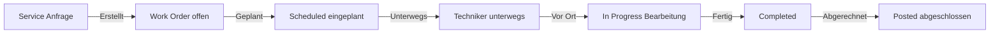
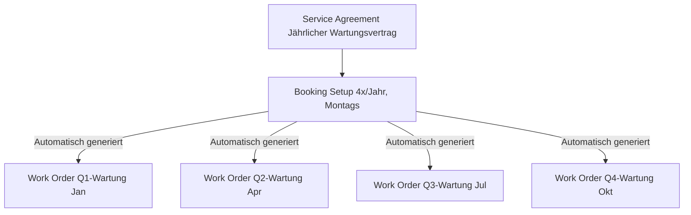
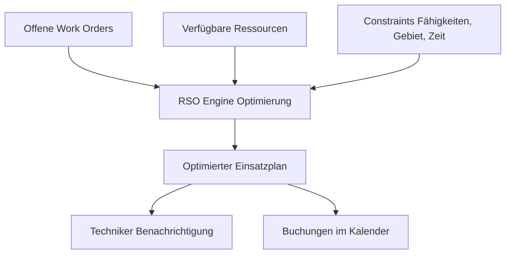
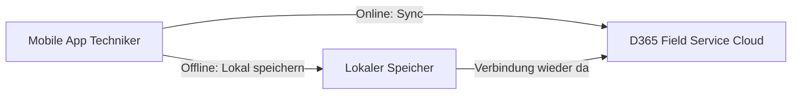

---
tags:
  - dynamics365
  - field-service
  - außendienst
  - work-orders
  - iot
  - rso
  - copilot
aliases:
  - D365 Field Service
  - Dynamics 365 Außendienst
  - Connected Field Service
---

# Dynamics 365 Field Service

> [!ABSTRACT] TL;DR
> Dynamics 365 Field Service automatisiert Außendienstprozesse vom Work Order bis zur Abrechnung. Resource Scheduling Optimization (RSO) plant Techniker-Einsätze KI-gestützt, IoT-Integration ermöglicht vorausschauende Wartung, und Copilot unterstützt Disponenten und Techniker in Echtzeit.

---

## Work Orders und Incidents

### Work Order-Lebenszyklus



### Work Order-Komponenten

| Komponente | Beschreibung |
|-----------|-------------|
| **Incident Type** | Vorlagendefinition für häufige Servicearten |
| **Service Tasks** | Checkliste der durchzuführenden Aufgaben |
| **Products** | Benötigte Ersatzteile und Materialien |
| **Services** | Abzurechnende Arbeitsleistungen |
| **Notes & Bilder** | Dokumentation durch Techniker |
| **Time Entries** | Reise- und Arbeitszeit |

### Incident Types (Vorlagen)

Incident Types sind Vorlagen, die automatisch Work Orders mit vordefinierten Inhalten befüllen:

```json
{
  "Incident Type": "Klimaanlage Wartung",
  "Standardaufgaben": [
    "Filter prüfen und reinigen",
    "Kühlmittelstand prüfen",
    "Elektrische Verbindungen prüfen",
    "Testlauf durchführen"
  ],
  "Standardprodukte": ["Luftfilter", "Reinigungsmittel"],
  "Geschätzte Dauer": "2 Stunden",
  "Benötigte Skills": ["HVAC-Zertifizierung"]
}
```

---

## Service Agreements und Wartungsverträge

### Entitlement-Typen für Field Service

| Typ | Beschreibung |
|-----|-------------|
| **Service Agreement** | Regelmäßige Wartungsverträge (monatlich, quartalsweise) |
| **Incident-basiert** | X Einsätze pro Vertragslaufzeit |
| **Zeit-basiert** | X Stunden pro Vertragslaufzeit |

### Agreement Booking Setup

Service Agreements generieren automatisch Work Orders nach Zeitplan:



---

## Resource Scheduling Optimization (RSO)

RSO ist die KI-gestützte automatische Terminplanung, die Techniker-Einsätze optimiert.

### RSO-Planungsprozess



### Optimierungsziele

| Ziel | Beschreibung |
|------|-------------|
| **Reisedistanz minimieren** | Kürzeste Route für alle Techniker |
| **Überstunden minimieren** | Gleichmäßige Auslastung |
| **SLA-Compliance maximieren** | Kritische Work Orders priorisieren |
| **Ressourcenauslastung maximieren** | Leerlaufzeiten reduzieren |

### Scheduling Board

Das interaktive Planungsboard ermöglicht:
- Drag-and-Drop von Work Orders auf Techniker
- Karten- und Listenansicht
- Echtzeitanzeige von Techniker-Standorten (GPS)
- Manuelle Überschreibung von RSO-Vorschlägen

> [!TIP] RSO-Simulationen
> RSO kann Optimierungsläufe simulieren, bevor sie auf echte Buchungen angewendet werden. So lassen sich verschiedene Szenarien vergleichen.

---

## IoT-Integration: Connected Field Service

Connected Field Service verbindet physische Geräte über Azure IoT Hub mit Dynamics 365.

### Architektur


### IoT-Alert-Konfiguration

```json
{
  "Gerät": "Kompressor-001",
  "Sensor": "Temperatur",
  "Schwellenwert": "> 85°C",
  "Aktion": "Work Order erstellen",
  "Work Order Typ": "Notfalleinsatz",
  "Priorität": "Kritisch",
  "Incident Type": "Überhitzung Kompressor"
}
```

**Vorausschauende Wartung (Predictive Maintenance):**
- Azure Machine Learning-Modelle analysieren Sensordaten
- Vorhersage: Wann wird ein Gerät wahrscheinlich ausfallen?
- Proaktive Work Orders werden erstellt, bevor der Ausfall eintritt

---

## Copilot-Features in Field Service

### Copilot Dispatcher Assistant

Der Copilot-Assistent für Disponenten:

```
Disponent fragt: "Wer kann Work Order #WO-4521 heute noch 
übernehmen? Benötigt HVAC-Zertifizierung, Standort München-Nord"

Copilot antwortet:
├── Techniker Schmidt: 15 Min entfernt, HVAC-zertifiziert, 
│   aktueller Auftrag endet um 14:00 Uhr
├── Techniker Meyer: 28 Min entfernt, HVAC-zertifiziert,
│   nächster Auftrag erst morgen früh
└── Empfehlung: Techniker Schmidt (kürzer Weg + früher frei)
```

**Work Order Zusammenfassungen:**
- Copilot erstellt Briefings für Techniker vor dem Einsatz
- Zusammenfassung der Kundenhistorie und bisherigen Einsätze
- Checkliste der Aufgaben und Hinweise

**In Outlook:**
- Work Order-Zusammenfassungen direkt in Meeting-Einladungen
- "Prepare for Visit" Button zeigt alle relevanten Infos

---

## Mobile App für Techniker

Die Field Service Mobile App ist für iOS und Android verfügbar.

### Mobile-Features

| Feature | Beschreibung |
|---------|-------------|
| **Offline-Modus** | Vollständige Funktionalität ohne Internetverbindung |
| **Barcode-Scanner** | Seriennummern und Ersatzteile scannen |
| **Kamera** | Fotos und Videos direkt im Work Order |
| **GPS-Tracking** | Automatische Ankunfts-/Abfahrtserkennung |
| **Digitale Unterschrift** | Kundenunterschrift auf Abnahmeprotokoll |
| **Push-Notifications** | Neue Aufträge, Änderungen in Echtzeit |
| **Inspektionen** | Checklisten mit Foto-Beweisen |

### Offline-Synchronisation



---

## Frontline Worker Features

### Teams-Integration für Techniker

- **Remote Assist:** Video-Call mit Experten während des Einsatzes
- **Guides:** Schritt-für-Schritt-Anleitungen via HoloLens oder Smartphone
- **Teams Mobile:** Echtzeit-Kommunikation mit Disponenten und Kollegen

### Inspections (Inspektionen)

Inspektionen sind digitale Formulare für strukturierte Prüfungen:

```json
{
  "Inspektion": "Jährliche Sicherheitsinspektion",
  "Fragen": [
    {
      "Frage": "Sind alle Notausgänge frei?",
      "Typ": "Ja/Nein",
      "Pflichtfeld": true
    },
    {
      "Frage": "Zustand der Feuerlöscher",
      "Typ": "Auswahl",
      "Optionen": ["Gut", "Beschädigt", "Abgelaufen"]
    },
    {
      "Frage": "Foto des Sicherheitsbereichs",
      "Typ": "Bild",
      "Pflichtfeld": true
    }
  ]
}
```

---

## Remote Assist Integration

Microsoft Remote Assist ermöglicht Fernsupport via Mixed Reality:

| Szenario | Beschreibung |
|----------|-------------|
| **Video-Diagnose** | Experte sieht durch die Kamera des Technikers |
| **HoloLens** | Anmerkungen in der realen Umgebung |
| **Teams-Integration** | Call direkt aus Field Service Mobile |
| **Anrufaufzeichnung** | Für Schulung und Dokumentation |

> [!IMPORTANT] Lizenz für Remote Assist
> Microsoft Remote Assist erfordert eine separate Lizenz ($65/User/Monat) oder ist in Microsoft 365 F3 (Frontline Workers) enthalten.

---

## Preise und Lizenzierung

| Lizenz | Preis/User/Monat | Enthält |
|--------|-----------------|---------|
| **Field Service** | $105 | Work Orders, Scheduling, Mobile App |
| **Field Service Contractor** | $50 | Externe Techniker, eingeschränkt |
| **Resource Scheduling Optimization** | Add-on ~$30 | Automatische Optimierung |
| **Remote Assist** | $65 | Mixed Reality Fernsupport |

---

## Via Dynamics 365 Field Service (UI)

Dynamics 365 Field Service ist unter `https://[tenant].crm.dynamics.com` erreichbar. Die Hauptapp heißt **Field Service**. Für die Einsatzplanung wird das **Schedule Board** verwendet, das direkt im Browser läuft.

### Work Order erstellen

**Navigation:** `Field Service` → `Work Orders` → `+ Neu`

1. Im linken Menü **Field Service** → **Work Orders** öffnen
2. In der Listenansicht **+ Neu** klicken
3. Das Work-Order-Formular öffnet sich – Pflichtfelder befüllen:

| Feld | Wert (Beispiel) |
|------|----------------|
| **Zusammenfassung** | `Klimaanlage Wartung Q1 2025` |
| **Serviceaccount** | `Mustermann Industrie GmbH` |
| **Servicestandort** | `Werk München-Nord` |
| **Incident Type** | `Klimaanlage Wartung` (lädt Aufgaben automatisch) |
| **Priorität** | `Normal` |
| **Systemstatus** | `Offen – Nicht geplant` |
| **Bevorzugtes Datum** | `15.02.2025` |
| **Bezug auf Agreement** | Wartungsvertrag verknüpfen (optional) |

4. Nach Auswahl des **Incident Type** werden Service Tasks, Produkte und die geschätzte Dauer automatisch befüllt
5. Im Tab **Produkte** benötigte Ersatzteile prüfen und ggf. ergänzen
6. **Speichern** → Work Order erhält eine Nummer (z. B. `WO-00004521`)

> [!TIP] Incident Types für häufige Servicefälle anlegen
> Gut gepflegte Incident Types sparen bei der Work Order-Erstellung erheblich Zeit. Alle Standard-Servicefälle (z. B. „Jährliche Brandschutzinspektion") sollten als Incident Type mit vordefinierten Tasks, Produkten und Dauer hinterlegt sein.

---

### Ressource einplanen

**Navigation:** `Field Service` → `Schedule Board`

1. Im linken Menü **Field Service** → **Scheduling** → **Schedule Board** öffnen
2. Das Board zeigt horizontal die Zeit (Tages-/Wochenansicht) und vertikal alle verfügbaren Ressourcen (Techniker)
3. Unten im Bereich **Anforderungen** erscheinen alle offenen, noch nicht geplanten Work Orders
4. Eine Work Order per **Drag-and-Drop** auf einen Techniker und Zeitslot ziehen
5. Alternativ: Work Order in der **Anforderungsliste** markieren → **Buchen** klicken → Assistenten nutzen:
   - Filterkriterien setzen: Skills, Gebiet, Verfügbarkeit
   - Empfohlene Ressourcen werden nach Eignung sortiert angezeigt
6. Nach der Buchung ändert sich der Work-Order-Status automatisch auf `Geplant`

| Ansichtstyp | Beschreibung |
|-------------|-------------|
| **Täglich** | Detailansicht für heute und morgen |
| **Wöchentlich** | Überblick über die ganze Woche |
| **Monatlich** | Langfristige Kapazitätsplanung |
| **Karte** | Geografische Ansicht mit Techniker-Standorten |

> [!NOTE] Filter für das Schedule Board
> Das Schedule Board kann nach Territorium, Team und Skills gefiltert werden. Für große Disponenten-Teams empfiehlt sich je ein eigenes Board-Tab pro Region oder Servicebereich.

---

### Techniker-Einsatz abschließen

**Navigation:** Field Service Mobile App **oder** Work Order öffnen → Status ändern

**Im Browser (Disponent):**
1. Work Order öffnen → Status auf `Abgeschlossen` setzen
2. Im Tab **Buchungen** die Buchung öffnen → **Enddatum/-uhrzeit** eintragen
3. Reisezeit und tatsächliche Arbeitszeit im Tab **Zeiterfassung** prüfen
4. Verbrauchte Produkte im Tab **Produkte** auf **Verwendet** setzen und Menge anpassen
5. **Speichern** → Work Order kann jetzt fakturiert werden (Status `Gebucht`)

**In der Mobile App (Techniker):**
1. App öffnen → **Mein Tag** → Work Order antippen
2. Statuswechsel: `Unterwegs` → `In Bearbeitung` → `Abgeschlossen`
3. Service Tasks als erledigt markieren (Häkchen setzen)
4. Fotos und Notizen hinzufügen
5. Kundenunterschrift auf dem Touchscreen einholen
6. **Abschließen** tippen → Daten werden mit D365 synchronisiert

> [!IMPORTANT] Lagerbestand bei Produktverbrauch buchen
> Werden Ersatzteile verbraucht, muss der Lagerbestand manuell oder über die Mobile App angepasst werden. Nur so bleibt der Lagersaldo korrekt und Nachbestellungen werden ausgelöst.

---

## Verwandte Notizen

- [[Dynamics 365 Überblick]]
- [[Dynamics 365 Customer Service]]
- [[Dynamics 365 Supply Chain Management]]
- [[Dynamics 365 Administration]]
