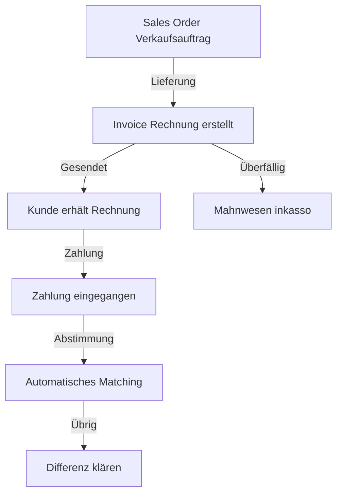
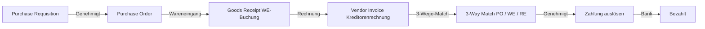
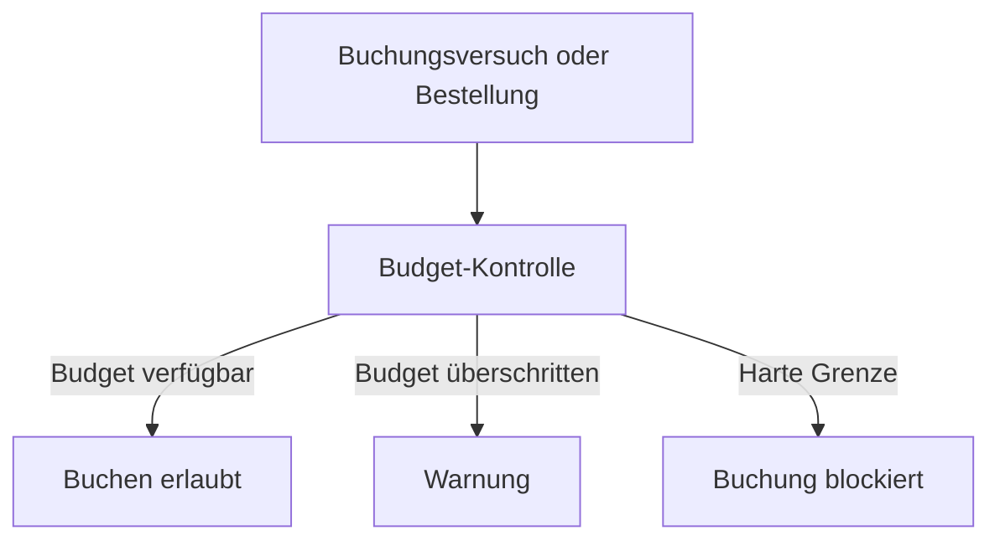
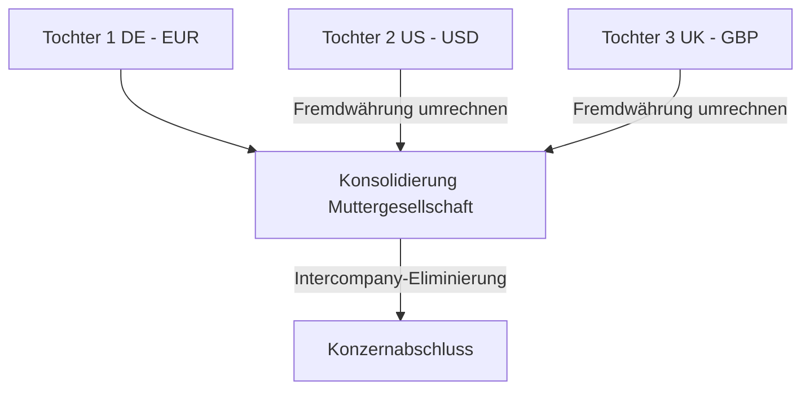
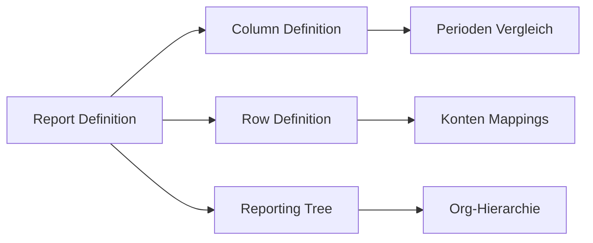

---
tags:
  - dynamics365
  - finance
  - erp
  - buchhaltung
  - hauptbuch
  - debitoren
  - kreditoren
  - copilot
aliases:
  - D365 Finance
  - Dynamics 365 Finanzen
  - Dynamics Finance Operations
---

# Dynamics 365 Finance

> [!ABSTRACT] TL;DR
> Dynamics 365 Finance ist die Cloud-ERP-Lösung für Finanzabteilungen. Es bietet Hauptbuch, Debitoren-/Kreditorenbuchhaltung, Budgetierung, Kostenrechnung, Steuerverwaltung und globale Konsolidierung. Copilot unterstützt bei Abweichungsanalysen und der Automatisierung von Routineaufgaben.

---

## Hauptbuch (General Ledger)

### Kontenplan (Chart of Accounts)

Der Kontenplan ist das Herzstück der Finanzbuchhaltung in D365 Finance:

| Segment | Beschreibung | Beispiel |
|---------|-------------|---------|
| **Hauptkonto** | Bilanz-/GuV-Konto | 1100 Kasse, 4000 Umsatzerlöse |
| **Geschäftseinheit** | Business Unit/Abteilung | 001 Vertrieb, 002 Entwicklung |
| **Kostenstelle** | Kostenverfolgung | CC-100 München |
| **Projekt** | Projektbezogene Buchungen | PRJ-2024-001 |
| **Produkt** | Produktlinienverfolgung | PROD-A, PROD-B |

**Finanzdimensionen** ermöglichen mehrdimensionale Analyse:

```
Buchung: 4000-001-CC100-PRJ001
         |    |   |      └── Projekt
         |    |   └── Kostenstelle
         |    └── Geschäftseinheit
         └── Hauptkonto (Umsatz)
```

### Buchungsschichten (Posting Layers)

D365 Finance unterstützt mehrere Buchungsschichten für verschiedene Zwecke:

| Schicht | Zweck | Beispiel |
|---------|-------|---------|
| **Current** | Operative Buchungen | Tagesgeschäft |
| **Tax** | Steuerbuchungen | Nur für Steuerzwecke |
| **Operations** | Betriebliche Anpassungen | Abgrenzungen |
| **Regulatory** | Gesetzliche Anforderungen | Lokale Vorschriften |

> [!NOTE] Buchungsschichten und Berichte
> Finanzberichte können gefiltert werden, um nur bestimmte Buchungsschichten einzubeziehen. So lassen sich steuerliche und handelsrechtliche Abschlüsse separat erstellen.

### Buchungsperioden und Abschlüsse


---

## Debitoren (Accounts Receivable)

### AR-Prozesse



### Debitorenverwaltung

| Feature | Beschreibung |
|---------|-------------|
| **Kreditlimit** | Automatische Prüfung bei Auftragsanlage |
| **Zahlungsbedingungen** | 30/60/90 Tage netto, Skonto |
| **Mahnwesen** | Automatische Mahnstufen (1.-3. Mahnung) |
| **Zinsen** | Automatische Zinsberechnung bei Verzug |
| **Inkasso** | Übergabe an Inkasso-Management |

### Bankabstimmung

```powershell
# Automatische Bankabstimmung in D365 Finance
# 1. Kontoauszug importieren (BAI2, MT940, OFX)
# 2. Automatisches Matching startet
#    - Betrag + Referenz → vollständiges Match
#    - Nur Betrag → mögliches Match (manuell bestätigen)
#    - Kein Match → manuell zuordnen oder neuen Datensatz erstellen

# Import per Azure Blob Storage
# Container: bank-statements
# Format: MT940 (SWIFT)
```

> [!TIP] KI-gestützte Bankabstimmung
> D365 Finance nutzt ML-Modelle, um auf Basis historischer Muster Zahlungen automatisch zuzuordnen. Business Central und Finance verfügen beide über diese Funktion.

---

## Kreditoren (Accounts Payable)

### P2P-Prozess (Purchase-to-Pay)



**3-Wege-Match:**
- Bestellmenge (PO) = Wareneingangsmenge (GR) = Rechnungsmenge (Invoice)
- Toleranzen konfigurierbar (z.B. ±2% Preisabweichung)

### Zahlungsvorschlag

```json
{
  "Zahlungslauf": "ZL-2024-11",
  "Kriterien": {
    "Fälligkeitsdatum": "bis 30.11.2024",
    "Skonto-Ausnutzung": true,
    "Mindestbetrag": "€100",
    "Zahlungsweg": "SEPA-Überweisung"
  },
  "Vorschläge": 47,
  "Gesamtbetrag": "€284.500",
  "Skontoeinsparung": "€3.200"
}
```

---

## Budgetierung

### Budgettypen

| Typ | Beschreibung | Nutzung |
|-----|-------------|---------|
| **Original Budget** | Genehmigtes Jahresbudget | Planungsbasis |
| **Budget Revision** | Angepasstes Budget | Unterjährige Änderungen |
| **Budget Transfer** | Umverteilung zwischen Konten | Flexibilitätsbedarf |
| **Encumbrance** | Vorläufige Budgetbindung | Offene Bestellungen |

### Budget-Kontrolle

D365 Finance kann Buchungen und Bestellungen gegen das Budget prüfen:



---

## Kostenrechnung (Cost Accounting)

### Konzepte

| Konzept | Beschreibung |
|---------|-------------|
| **Kostenelement** | Kostenart (Personal, Material, Miete) |
| **Kostenträger** | Wofür entstehen Kosten (Produkt, Projekt) |
| **Kostenstelle** | Wo entstehen Kosten (Abteilung) |
| **Umlage** | Verteilung von Gemeinkosten |

### Overhead-Kalkulation

```
Gemeinkosten IT-Abteilung: €120.000/Monat
Umlageschlüssel: Anzahl Mitarbeiter

Vertrieb: 30 MA → 30% → €36.000
Produktion: 50 MA → 50% → €60.000
Verwaltung: 20 MA → 20% → €24.000
```

---

## Steuerverwaltung

### Mehrwertsteuer (VAT)

D365 Finance unterstützt globale Steueranforderungen:

| Feature | Beschreibung |
|---------|-------------|
| **Steuercodes** | Steuersätze je Land/Kategorie |
| **Steuergruppen** | Kunden/Lieferanten nach Steuertyp |
| **Artikel-Steuergruppen** | Produkte nach Steuersatz |
| **Reverse Charge** | Automatische Umkehrung bei EU-Lieferungen |
| **EU-Listenanmeldung** | Zusammenfassende Meldung (ZM) |
| **MwSt-Abrechnung** | Automatische UStVA-Vorbereitung |

### Quellensteuer (Withholding Tax)

Für internationale Zahlungen (Lizenzgebühren, Dividenden):
- Automatische Berechnung und Einbehaltung
- Länderspezifische Steuersätze und DBA-Abkommen
- Steuerbescheinigungen für Lieferanten

---

## Finanzkonsolidierung

### Konzernabschluss



**Konsolidierungsmethoden:**
- **Vollkonsolidierung:** 100% Einbeziehung
- **Quotenkonsolidierung:** Proportionale Einbeziehung (Joint Ventures)
- **Equity-Methode:** Nur Beteiligungsanteil

### Fremdwährungsumrechnung

| Wechselkurstyp | Anwendung |
|----------------|-----------|
| **Stichtagskurs** | Bilanzpositionen |
| **Durchschnittskurs** | GuV-Positionen |
| **Historischer Kurs** | Eigenkapitalpositionen |

---

## Financial Reporting (Management Reporter)

### Berichtstypen

| Berichtstyp | Beschreibung |
|-------------|-------------|
| **Bilanz** | Aktiva/Passiva |
| **GuV** | Gewinne und Verluste |
| **Kapitalflussrechnung** | Cash Flow |
| **Eigenkapitalveränderung** | Eigenkapitalentwicklung |
| **Segmentbericht** | Nach Geschäftsbereich |

### Berichtsdesign



---

## Copilot in Finance

### Copilot-Features

**Abweichungsanalysen:**
```
Manager fragt: "Warum ist unser Betriebsergebnis im Oktober 
um €120.000 unter Plan?"

Copilot analysiert und antwortet:
├── Umsatz: €80.000 unter Plan (Schlüsselkunde ausgefallen)
├── Personalkosten: €30.000 über Plan (Überstunden Q3)
├── Reisekosten: €10.000 über Plan (Messebesuch)
└── Empfehlung: Vertriebsprognose für Q4 anpassen
```

**Finanzberichte in natürlicher Sprache:**
- "Zeige mir die Top 10 überfälligen Rechnungen"
- "Wie ist unser Working Capital im Vergleich zum Vorjahr?"
- "Welche Kostenstellen haben ihr Budget überschritten?"

**Journal-Automatisierung:**
- Copilot erkennt Buchungsmuster und schlägt Automatisierung vor
- Wiederkehrende Buchungen (Abgrenzungen, Abschreibungen) automatisieren
- Fehler in Journalen erkennen und Korrekturen vorschlagen

> [!IMPORTANT] Finance + Operations Lizenz
> Dynamics 365 Finance ist ein **Finance + Operations** Produkt, d.h. es läuft auf einer anderen Infrastruktur als die CRM-Apps. Lizenz: $210/User/Monat (ab Oktober 2024).

---

## Preise und Lizenzierung

| Lizenz | Preis/User/Monat | Enthält |
|--------|-----------------|---------|
| **Finance** | $210 | Buchhaltung, AR/AP, Budget |
| **Finance + Supply Chain** | $210 + Attach | ERP-Komplett |
| **Finance Attach** | $40 | Mit anderer D365-Lizenz als Base |
| **Team Members** | $8 | Lesezugriff, einfache Eingaben |

---

## Verwandte Notizen

- [[Dynamics 365 Überblick]]
- [[Dynamics 365 Supply Chain Management]]
- [[Dynamics 365 Business Central]]
- [[Dynamics 365 Administration]]
