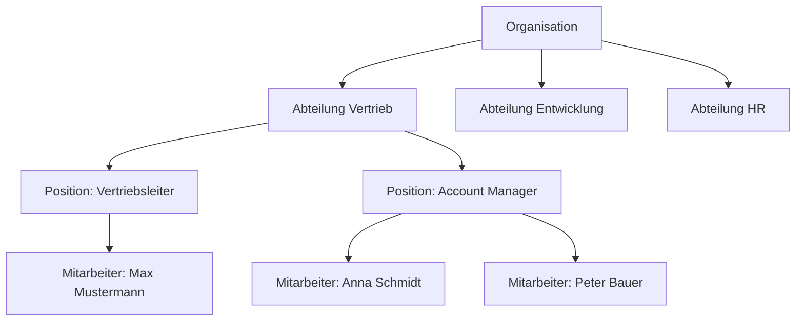
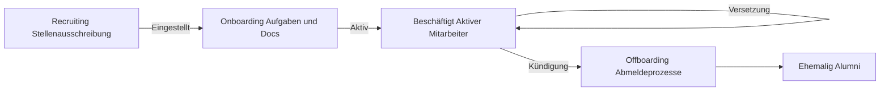
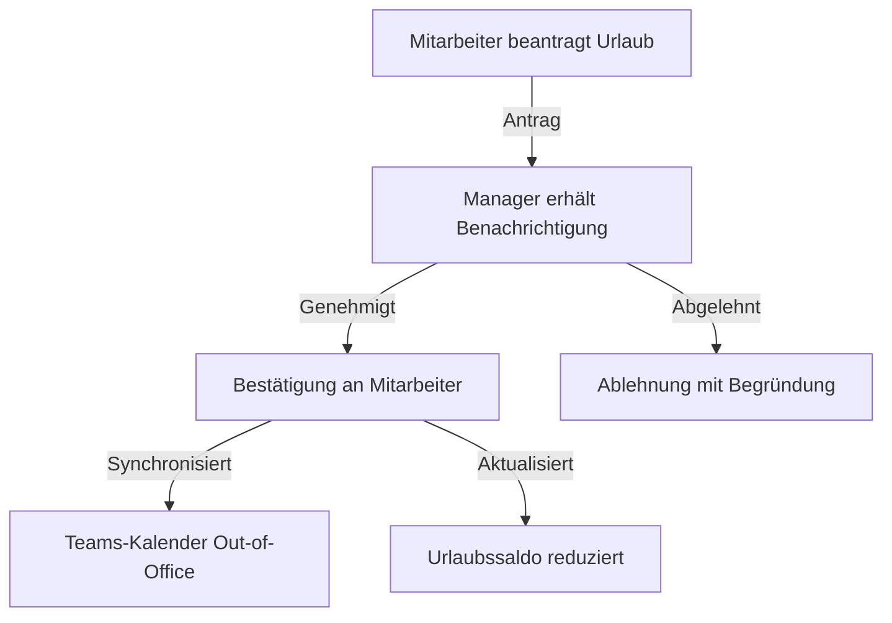
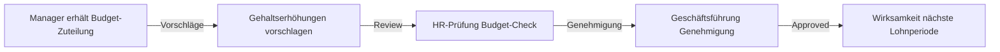

---
tags:
  - dynamics365
  - hr
  - personalwesen
  - human-resources
  - mitarbeiter
  - urlaub
  - vergütung
  - payroll
aliases:
  - D365 HR
  - Dynamics 365 Human Resources
  - D365 Personalwesen
---

# Dynamics 365 HR

> [!ABSTRACT] TL;DR
> Dynamics 365 Human Resources ist die Cloud-HR-Lösung von Microsoft. Es deckt Mitarbeiterverwaltung, Urlaubs- und Abwesenheitsmanagement, Benefits, Vergütungsmanagement, Lernen und Leistungsbeurteilung ab. Über Employee Self-Service und den Teams HR-Bot können Mitarbeiter viele Anfragen selbst erledigen.

---

## Mitarbeiterverwaltung

### Organisationsstruktur



**Positionsverwaltung:**
- Jede Position gehört zu einer Abteilung und einem Job
- Positionen haben Stellenbeschreibungen und Anforderungsprofile
- Vakante Positionen können im Recruitment-Modul ausgeschrieben werden

### Personalaktionen (Personnel Actions)

Personalaktionen dokumentieren alle mitarbeiterrelevanten Vorgänge mit Genehmigungsworkflow:

| Aktionstyp | Beschreibung | Workflow |
|-----------|-------------|---------|
| **Einstellung (Hire)** | Neuer Mitarbeiter wird eingestellt | HR → Manager → Genehmigung |
| **Versetzung (Transfer)** | Abteilungs-/Standortwechsel | Manager → HR → Genehmigung |
| **Beförderung (Promotion)** | Neue Position / höhere Vergütung | Manager → HR → Geschäftsführung |
| **Kündigung (Terminate)** | Austritt des Mitarbeiters | Manager → HR → Offboarding-Flow |
| **Wiedereintritt (Rehire)** | Ehemaliger Mitarbeiter kehrt zurück | HR-Genehmigung |

### Mitarbeiter-Lebenszyklus



---

## Urlaubs- und Abwesenheitsmanagement

### Abwesenheitstypen

| Typ | Beschreibung | Bezahlt |
|-----|-------------|---------|
| **Jahresurlaub** | Regulärer Erholungsurlaub | Ja |
| **Krankheit** | Krankmeldungen | Ja (nach Lohnfortzahlungsgesetz) |
| **Elternzeit** | Mutterschutz, Elternzeit | Teilweise |
| **Sonderurlaub** | Hochzeit, Beerdigung | Ja |
| **Unbezahlter Urlaub** | Auf Antrag | Nein |
| **Zeitausgleich** | Abbau von Überstunden | Ja |
| **Fortbildung** | Externe Schulungen | Ja |

### Richtlinien und Akkumulation

**Urlaubsanspruch-Konfiguration:**
```json
{
  "Urlaubsplan": "Standard Deutschland",
  "Anspruch pro Jahr": 30,
  "Akkumulations-Typ": "Monatlich",
  "Akkumulation pro Monat": 2.5,
  "Maximaler Übertrag": 10,
  "Verfalldatum": "31.03. des Folgejahres",
  "Wartezeit": "0 Monate (sofort)"
}
```

### Genehmigungsworkflow



**Teams HR Bot für Urlaubsanträge:**
```
Mitarbeiter: "@HR Bot Ich möchte vom 23.12. bis 27.12. Urlaub nehmen"
HR Bot: "Urlaubsantrag für 23.12.-27.12.2024 (3 Arbeitstage) 
         erstellt. Ihr aktueller Saldo: 12 Tage.
         Ihr Manager wurde zur Genehmigung benachrichtigt."
```

### Abwesenheitskalender und Teamübersicht

- Manager sehen Abwesenheiten des Teams in einer Kalenderansicht
- Konflikterkennung: Zu viele Mitarbeiter gleichzeitig abwesend?
- Integration in Microsoft Teams Kalender

---

## Benefits-Verwaltung

### Benefits-Typen

| Benefit | Beschreibung |
|---------|-------------|
| **Krankenversicherung** | Gesundheitspläne (Einzel-/Familientarif) |
| **Altersvorsorge** | Betriebliche Altersversorgung (bAV) |
| **Lebensversicherung** | Gruppen-Lebensversicherung |
| **Firmenwagen** | Fahrzeug-Benefit |
| **Jobticket** | ÖPNV-Zuschuss |
| **Kinderbetreuung** | Zuschuss zur Kinderbetreuung |
| **Flexible Spending** | Essensgutscheine, Sachbezüge |

### Open Enrollment (Jahresauswahl)

Mitarbeiter können Benefits jährlich neu auswählen:

```mermaid
graph TD
    OPEN[Enrollment-Periode öffnet (z.B. Oktober)] --> NOTI[Benachrichtigung an alle Mitarbeiter]
    NOTI --> SEL[Mitarbeiter wählt Benefits im Self-Service]
    SEL -->|Bestätigt| CONF2[Bestätigung und Wirksamkeitsdatum]
    CONF2 -->|01.01.| EFFECT[Benefits aktiv ab 01.01.]
```

---

## Vergütungsmanagement (Compensation Management)

### Vergütungsstrukturen

| Typ | Beschreibung | Beispiel |
|-----|-------------|---------|
| **Fixed Plan** | Festes Grundgehalt in Gehaltsband | Tarifgehalt nach Gruppe |
| **Variable Plan** | Bonus und Provision | 10% Jahresbonus |
| **Band** | Gehaltsband je Stufe/Level | Junior, Senior, Lead |

### Gehaltsband-Verwaltung

```
Level Senior Software Engineer:
├── Minimum: €75.000
├── Midpoint: €90.000
└── Maximum: €105.000

Compa-Ratio = (Gehalt / Midpoint) × 100
├── < 85%: Unter Midpoint → Erhöhungsbedarf
├── 85-115%: Im Band → Normal
└── > 115%: Über Band → Risiko (Budget/Compliance)
```

### Gehaltsrunden (Merit Process)



---

## Lernen (Learning)

### Learning-Features

| Feature | Beschreibung |
|---------|-------------|
| **Kurse** | Interne und externe Schulungen |
| **Lernpfade** | Strukturierte Entwicklungsprogramme |
| **Zertifizierungen** | Pflicht-Zertifizierungen tracken |
| **Viva Learning** | Integration mit LinkedIn Learning, Microsoft Learn |
| **Compliance-Training** | Pflichtschulungen (DSGVO, IT-Sicherheit) |

### Viva Learning Integration

D365 HR ist mit **Microsoft Viva Learning** integriert:
- LinkedIn Learning-Kurse direkt in Teams
- Microsoft Learn-Inhalte
- Externe Lernplattformen (Coursera, Skillsoft)
- Eigene interne Kurse

---

## Leistungsbeurteilung (Performance Review)

### Beurteilungszyklus

```mermaid
graph LR
    GOAL[Ziele setzen (Jahresanfang)] -->|Midyear| MID[Halbjahrsgespräch Fortschritt prüfen]
    MID -->|Jahresende| SELF[Selbstbeurteilung Mitarbeiter]
    SELF -->|Manager| MREV[Manager-Beurteilung]
    MREV -->|360°| PEER[Peer-Feedback optional]
    PEER -->|Kalibrierung| CAL2[Kalibrier-Meeting HR + Manager]
    CAL2 -->|Final| RTNG[Rating und Feedback-Gespräch]
```

### Performance-Ratings

| Rating | Bedeutung | Anteil (typisch) |
|--------|----------|-----------------|
| **5 - Exceptional** | Übertrifft alle Erwartungen | 10% |
| **4 - Exceeds** | Übertrifft Erwartungen | 20% |
| **3 - Meets** | Erfüllt alle Erwartungen | 50% |
| **2 - Below** | Teilweise nicht erfüllt | 15% |
| **1 - Unsatisfactory** | Erwartungen nicht erfüllt | 5% |

---

## Via Dynamics 365 Human Resources (UI)

Dynamics 365 Human Resources ist unter `https://[tenant].hr.dynamics.com` oder über die HR-App im Power Platform-Portal erreichbar. Die Hauptnavigation gliedert sich in die Bereiche **Mitarbeiter**, **Urlaub und Abwesenheit**, **Vergütung** und **Leistung**.

### Mitarbeiter anlegen

**Navigation:** `Mitarbeiter` → `Mitarbeiter` → `+ Neu`

1. Im linken Menü **Mitarbeiter** → **Mitarbeiter** öffnen
2. **+ Neu** klicken → das Mitarbeiter-Formular öffnet sich
3. Im Tab **Allgemein** die Stammdaten befüllen:

| Feld | Wert (Beispiel) |
|------|----------------|
| **Vorname** | `Anna` |
| **Nachname** | `Schmidt` |
| **Bekannter Name** | `Anna Schmidt` |
| **Personalnummer** | automatisch aus Nummernserie |
| **Einstellungsdatum** | `01.02.2025` |
| **Abteilung** | `Vertrieb` |
| **Position** | `Account Manager` |
| **Manager** | `Max Mustermann` |
| **Beschäftigungstyp** | `Vollzeit` |

4. Im Tab **Persönliche Informationen** Kontakt- und Adressdaten ergänzen
5. Im Tab **Vergütung** den **Fixen Vergütungsplan** zuweisen und Gehalt eintragen
6. Im Tab **Urlaub** automatisch den Urlaubsplan zuweisen (sofern konfiguriert)
7. **Speichern** → Mitarbeiter erscheint in der Liste
8. Optional: **Onboarding-Checkliste** über **Aufgaben** zuweisen

> [!TIP] Personalaktions-Workflow für Compliance
> Für eine revisionssichere Dokumentation den Mitarbeitereintritt als **Personalaktion** mit Genehmigungsworkflow konfigurieren (unter Einstellungen → Personalaktionstypen). Dadurch wird jede Einstellung mit Genehmiger, Datum und Begründung protokolliert.

---

### Urlaub genehmigen

**Navigation:** `Urlaub und Abwesenheit` → `Genehmigungen` **oder** direkt aus der Teams-Benachrichtigung

**Als Manager in der HR-App:**
1. Im linken Menü **Urlaub und Abwesenheit** → **Genehmigungen** öffnen
2. Alle offenen Urlaubsanträge des eigenen Teams werden angezeigt
3. Antrag anklicken → Details des Antrags prüfen:

| Information | Details |
|------------|---------|
| **Mitarbeiter** | Antragsteller |
| **Zeitraum** | Von – Bis Datum |
| **Anzahl Tage** | Arbeitstage (Feiertage herausgerechnet) |
| **Abwesenheitstyp** | Jahresurlaub, Sonderurlaub, etc. |
| **Aktueller Saldo** | Verbleibende Urlaubstage vor Antrag |
| **Kommentar** | Anmerkung des Mitarbeiters |

4. **Genehmigen** oder **Ablehnen** klicken
5. Bei Ablehnung: Pflichtfeld **Begründung** ausfüllen
6. Nach Genehmigung erhält der Mitarbeiter automatisch eine Benachrichtigung
7. Der Urlaubssaldo des Mitarbeiters wird sofort aktualisiert

> [!NOTE] Kalenderkonflikt-Prüfung
> Vor der Genehmigung prüfen ob andere Teammitglieder im gleichen Zeitraum abwesend sind. Im HR-Modul unter **Urlaub und Abwesenheit → Teamkalender** ist die Teamverfügbarkeit übersichtlich dargestellt.

---

### Leistungsbeurteilung starten

**Navigation:** `Leistung` → `Beurteilungen` → `+ Neu`

1. Im linken Menü **Leistung** → **Beurteilungen** öffnen
2. **+ Neu** klicken → Beurteilungsvorlage auswählen (z. B. `Jahresgespräch 2025`)
3. Im Formular die Basisinformationen eintragen:

| Feld | Wert (Beispiel) |
|------|----------------|
| **Mitarbeiter** | `Anna Schmidt` |
| **Beurteilungsperiode** | `01.01.2025 – 31.12.2025` |
| **Vorlage** | `Standardbeurteilung` |
| **Beurteilungstyp** | `Jahresgespräch` |
| **Status** | `In Bearbeitung` |

4. Im Tab **Ziele** die vereinbarten Jahresziele hinzufügen oder aus dem Vorjahr übernehmen:
   - Zielname, Beschreibung, Gewichtung (%) und Bewertungsskala festlegen
5. **Speichern** → Beurteilung ist angelegt
6. Über die Schaltfläche **Mitarbeiterselbstbeurteilung senden** erhält der Mitarbeiter den Zugang zur Selbsteinschätzung im **Employee Self-Service Portal**
7. Nach Abschluss der Selbstbeurteilung erscheint die Beurteilung in der **Manager-Ansicht** zur Bewertung
8. Nach der Manager-Bewertung: **Abschlussgespräch** vereinbaren und Status auf `Abgeschlossen` setzen

> [!TIP] Ziele aus dem Vorjahr übernehmen
> Statt Ziele manuell neu einzugeben, über **Ziele kopieren** aus der Vorjahresbeurteilung übernehmen und anpassen. Das spart Zeit und sorgt für Kontinuität in der Mitarbeiterentwicklung.

---

## Payroll-Integration

D365 HR enthält keine native Lohnbuchhaltung — Integration mit externen Lohnanbietern:

### Unterstützte Payroll-Systeme

| Anbieter | Integration | Region |
|---------|-------------|--------|
| **Ceridian Dayforce** | Native API-Integration | USA, Kanada |
| **ADP Workforce Now** | Native API-Integration | USA, global |
| **DATEV** | Export/Import | Deutschland |
| **SAP HCM** | Integration via API | Global |
| **Lohnsteuer-Kompakt** | Partner-Lösung | Deutschland |

### Payroll-Datenexport

```powershell
# Beispiel: Payroll-Daten aus D365 HR exportieren
# Enthaltene Informationen:
# - Mitarbeiter-ID und Stammdaten
# - Gehaltsänderungen im Zeitraum
# - Neue/austretende Mitarbeiter
# - Abwesenheitsdaten (Urlaub, Krankheit)
# - Benefits-Abzüge
# - Überstunden (aus Zeiterfassung)

# Export als CSV oder via API-Integration
```

---

## Employee Self-Service Portal

### Self-Service-Funktionen

| Funktion | Beschreibung |
|---------|-------------|
| **Persönliche Daten** | Adresse, Bankverbindung, Notfallkontakte aktualisieren |
| **Urlaubsanträge** | Anträge stellen, Saldo einsehen |
| **Gehaltsabrechnungen** | Download aktueller und historischer Abrechnungen |
| **Benefits** | Aktuelle Benefits einsehen, open Enrollment |
| **Schulungsanträge** | Weiterbildungen beantragen |
| **Dokumente** | Arbeitsvertrag, Zeugnisse einsehen |

### Teams HR Bot

```
Teams-Konversation mit HR Bot:
├── "Wie viele Urlaubstage habe ich noch?" 
│   → Bot: "12 Tage verbleibend in 2024"
├── "Wer ist heute abwesend?"
│   → Bot: "3 Kollegen aus Ihrem Team sind heute abwesend"
├── "Ich möchte morgen von zuhause arbeiten"
│   → Bot: Homeoffice-Antrag erstellt
└── "Zeige mir meine letzten 3 Gehaltsabrechnungen"
    → Bot: PDF-Links zu Abrechnungen
```

---

## Preise und Lizenzierung

| Lizenz | Preis/User/Monat | Enthält |
|--------|-----------------|---------|
| **Human Resources** | $120 | Vollständiges HR-Modul |
| **HR Attach** | $40 | Mit anderer D365-Lizenz |
| **Team Members** | $8 | Lesezugriff und ESS-Portal |

---

## Verwandte Notizen

- [[Dynamics 365 Überblick]]
- [[Dynamics 365 Finance]]
- [[Dynamics 365 Administration]]
