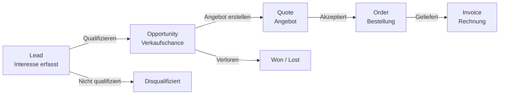
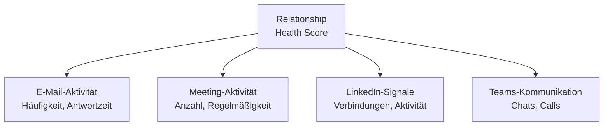
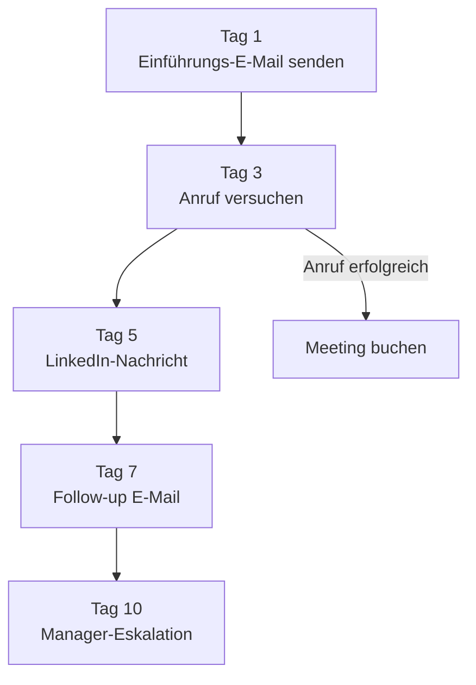
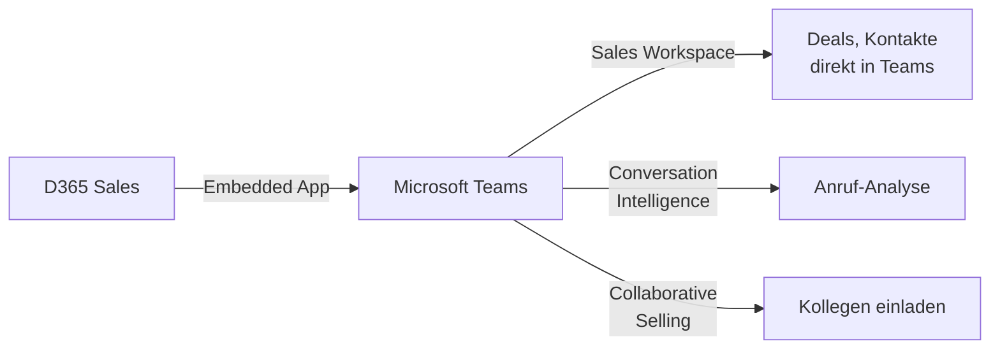

---
tags:
  - dynamics365
  - sales
  - crm
  - vertrieb
  - copilot
  - leads
  - opportunities
aliases:
  - D365 Sales
  - Dynamics CRM Sales
  - Dynamics 365 Vertrieb
---

# Dynamics 365 Sales

> [!ABSTRACT] TL;DR
> Dynamics 365 Sales ist die CRM-Lösung für Vertriebsteams. Sie unterstützt den gesamten Verkaufsprozess von Lead bis Rechnung, bietet KI-gestützte Einblicke durch Copilot und ist tief in Teams, Outlook und LinkedIn Sales Navigator integriert.

---

## Sales-Pipeline: Von Lead bis Invoice

Der typische Vertriebsprozess in Dynamics 365 Sales folgt einem strukturierten Fluss:



### Lead Management

**Lead-Felder:**
- Kontakt- und Unternehmensdaten
- Lead-Quelle (Web, Messe, Empfehlung, LinkedIn)
- Lead-Score (KI-basiert durch Sales Insights)
- Eigentümer und Zuweisung

**Lead-Qualifizierung:**
```
Lead qualifizieren → erstellt automatisch:
  ├── Contact (Ansprechpartner)
  ├── Account (Unternehmen)
  └── Opportunity (Verkaufschance)
```

> [!TIP] Lead-Scoring mit KI
> Dynamics 365 Sales nutzt KI-Modelle, um Leads automatisch nach Abschlusswahrscheinlichkeit zu bewerten. Faktoren: Interaktionshistorie, Unternehmensgröße, Engagement-Signale.

### Opportunity Management

| Feld | Beschreibung |
|------|-------------|
| **Estimated Revenue** | Geschätzter Umsatz |
| **Close Date** | Erwartetes Abschlussdatum |
| **Probability** | Abschlusswahrscheinlichkeit (%) |
| **Sales Stage** | Stufe im Verkaufsprozess |
| **Competitors** | Eingetragene Mitbewerber |
| **Products** | Verknüpfte Produktzeilen |

---

## Relationship Intelligence

Relationship Intelligence nutzt Daten aus Outlook, Teams und LinkedIn, um Beziehungsqualität zu messen.

### Relationship Health Score



**Score-Kategorien:**
- 🟢 **Gut (70-100):** Aktive, regelmäßige Kommunikation
- 🟡 **Fair (40-69):** Gelegentliche Interaktionen
- 🔴 **Schlecht (0-39):** Wenig bis keine Aktivität

### Who Knows Whom

Zeigt an, welche Mitarbeiter in der eigenen Organisation Verbindungen zu Kontakten beim Kunden haben — ideal für Warm Introductions.

---

## Sequence Designer

Sequences sind vordefinierte Aktivitätsketten, die Verkäufer durch einen strukturierten Kontaktprozess führen.

### Sequence-Aufbau



**Sequence-Typen:**
- **Lead-Nurturing:** Erste Kontaktaufnahme bis Qualifizierung
- **Opportunity-Progression:** Durch die Sales-Stages führen
- **Re-Engagement:** Inaktive Kontakte reaktivieren
- **Post-Sale:** Onboarding und Upsell

> [!NOTE] Sequences erfordern Sales Premium
> Der Sequence Designer und erweiterte Automatisierung sind in **Sales Enterprise** und **Sales Premium** verfügbar. Sales Professional hat eingeschränkte Sequencing-Funktionen.

---

## Conversation Intelligence

Conversation Intelligence analysiert aufgezeichnete Verkaufsgespräche (Telefon, Teams-Calls) mit KI.

### Analysierte Aspekte

| Metrik | Beschreibung |
|--------|-------------|
| **Talk/Listen Ratio** | Verhältnis Redezeit Verkäufer zu Kunde |
| **Keyword-Tracking** | Erwähnungen von Produkten, Mitbewerbern, Preisen |
| **Sentiment-Analyse** | Stimmung im Gespräch (positiv/negativ/neutral) |
| **Engagement-Level** | Wie aktiv der Kunde im Gespräch war |
| **Action Items** | Automatisch erkannte Aufgaben und Zusagen |
| **Next Steps** | Vorgeschlagene Folgeaktivitäten |

### Integration in Coaching

Manager können Gesprächsaufzeichnungen nutzen, um:
- Best-Practice-Beispiele für Schulungen zu markieren
- Verkäufer-Performance objektiv zu bewerten
- Coaching-Prioritäten datengestützt zu setzen

---

## Copilot in Dynamics 365 Sales

Microsoft Copilot ist nativ in die Sales-Oberfläche integriert und bietet KI-Unterstützung im täglichen Vertriebsalltag.

### Copilot-Features im Detail

**Meeting-Zusammenfassungen:**
```
Teams-Meeting beendet → Copilot generiert automatisch:
  ├── Zusammenfassung der besprochenen Themen
  ├── Erkannte Action Items mit zugewiesenen Verantwortlichen
  ├── Nächste Schritte
  └── Direkte Aktualisierung der Opportunity in D365
```

**E-Mail-Entwürfe:**
- Kontextbezogene E-Mail-Vorschläge basierend auf CRM-Daten
- Einwandbehandlung: Copilot schlägt Antworten auf Kundenbedenken vor
- Tonalität anpassbar (formal, freundlich, dringend)

**Prognose-Erklärungen:**
- Copilot erklärt, warum sich eine Prognose verändert hat
- Identifiziert Deals mit Risikosignalen
- Schlägt Korrekturmaßnahmen vor

**Action Items aus Outlook:**
```powershell
# Beispiel: Copilot schlägt vor, wenn eine E-Mail aussteht
# "Ihr letzter Kontakt mit Contoso war vor 14 Tagen.
#  Empfohlene Aktion: Follow-up E-Mail senden"
```

---

## Sales Insights und Forecasting

### Forecast (Umsatzprognose)

Dynamics 365 Sales ermöglicht präzise Umsatzprognosen:

| Prognose-Typ | Beschreibung |
|--------------|-------------|
| **Manuell** | Verkäufer schätzt manuell |
| **Rollup** | Summe aller Opportunities im Zeitraum |
| **KI-Prognose** | ML-Modell auf Basis historischer Daten |
| **Deal Flow** | Visualisierung der Pipeline-Bewegungen |

**Prognose-Hierarchie:**
```
CEO
└── Sales Director
    ├── Regional Manager West
    │   ├── Verkäufer A
    │   └── Verkäufer B
    └── Regional Manager East
        └── Verkäufer C
```

### Territory Management

Gebietsmanagement ermöglicht:
- Zuweisung von Accounts/Leads nach Region, Branche oder Umsatzgröße
- Automatische Datensatz-Zuweisung an den zuständigen Verkäufer
- Analyse der Performance nach Gebiet in Power BI

---

## Integration: Teams, Outlook und LinkedIn

### Microsoft Teams Integration



**Teams-Features:**
- **D365 Sales in Teams:** CRM-Daten direkt in Teams-Kanälen
- **Deal Rooms:** Dedizierte Teams-Kanäle pro Opportunity
- **Real-time Record Sharing:** D365-Datensätze in Chats teilen

### Outlook Integration (D365 App for Outlook)

Die Dynamics 365 App for Outlook erscheint direkt im Outlook-Postfach:

- E-Mails mit CRM-Kontakten/Leads verknüpfen
- Neue Leads und Kontakte direkt aus E-Mails erstellen
- Opportunity-Details und Aktivitätshistorie einsehen
- Meeting-Einladungen mit CRM synchronisieren

```
Outlook → E-Mail öffnen → D365-Seitenleiste zeigt:
  ├── Kontakt: Max Mustermann (Account: Contoso AG)
  ├── Aktuelle Opportunity: Lizenzvertrag 2025 ($45.000)
  ├── Letzte Aktivitäten
  └── Empfohlene Aktionen (Copilot)
```

### LinkedIn Sales Navigator Integration

> [!IMPORTANT] Lizenz erforderlich
> LinkedIn Sales Navigator erfordert eine separate LinkedIn-Lizenz ($79-99/User/Monat).

**Integration-Features:**
- **InMail direkt aus D365** senden
- LinkedIn-Profildetails in Kontakt/Lead-Formular eingebettet
- **TeamLink:** Verbindungen über das gesamte Unternehmen nutzen
- **Smart Links:** Geteilte Inhalte tracken

---

## Preise und Lizenzierung

| Lizenz | Preis/User/Monat | Enthaltene Features |
|--------|-----------------|---------------------|
| **Sales Professional** | $65 | Basis-CRM, Standard-Reports |
| **Sales Enterprise** | $105 | + Sequences, Forecasting, Copilot |
| **Sales Premium** | $150 | + Conversation Intelligence, RSO |
| **Sales Insights Add-on** | $45 | Insights als Ergänzung zu Professional |

---

## Verwandte Notizen

- [[Dynamics 365 Überblick]]
- [[Dynamics 365 Customer Service]]
- [[Dynamics 365 Customer Insights]]
- [[Dynamics 365 Administration]]
