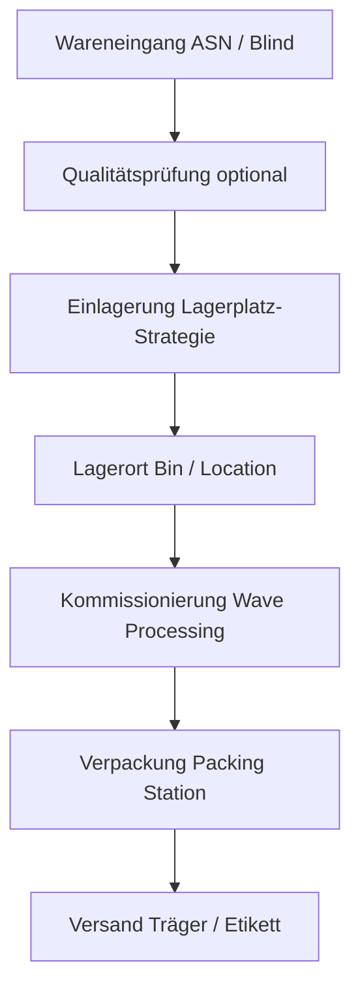
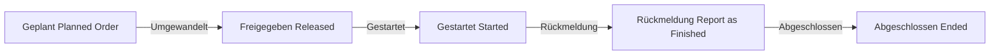
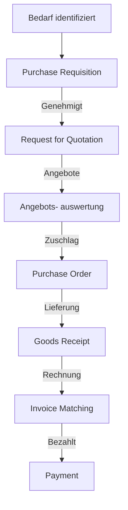
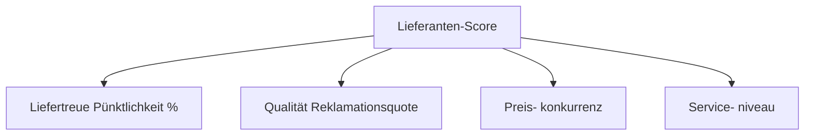
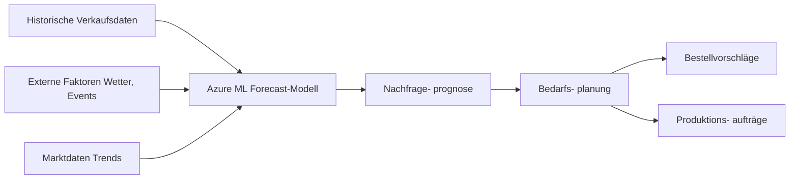
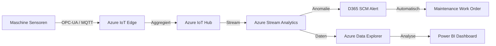

---
tags:
  - dynamics365
  - supply-chain
  - erp
  - lagerverwaltung
  - produktion
  - beschaffung
  - copilot
  - iot
aliases:
  - D365 SCM
  - Dynamics 365 Lieferkette
  - Supply Chain Management D365
---

# Dynamics 365 Supply Chain Management

> [!ABSTRACT] TL;DR
> Dynamics 365 Supply Chain Management (SCM) deckt Lagerverwaltung, Produktionssteuerung, Beschaffung, Lieferantenmanagement und KI-gestützte Bedarfsplanung ab. IoT-Integration mit Azure IoT Hub und Copilot-Funktionen ermöglichen eine intelligente, vorausschauende Lieferkette.

---

## Lagerverwaltung (Warehouse Management System)

### WMS-Kernfunktionen



### Lagerstruktur

| Ebene | Beschreibung | Beispiel |
|-------|-------------|---------|
| **Standort (Site)** | Werk / Betrieb | Werk München |
| **Lager (Warehouse)** | Gebäude / Halle | Lager 01 |
| **Gang (Aisle)** | Regalgasse | A, B, C |
| **Regal (Rack)** | Regalreihe | 01-20 |
| **Fach (Shelf)** | Regalfach | 01-05 |
| **Lagerplatz (Bin)** | Konkrete Position | A-01-03-02 |

### Lagerprozesse

**Einlagerungsstrategien:**
- FIFO (First In, First Out) — Standard für Lebensmittel
- LIFO (Last In, First Out)
- FEFO (First Expired, First Out) — Chargenware
- Feste Lagerplatzzuordnung
- Dynamische Zuordnung (höchste Raumdichte)

**Wave Processing (Wellenbearbeitung):**


---

## Produktionssteuerung (Manufacturing Execution)

### Produktionstypen

| Typ | Beschreibung | Nutzung |
|-----|-------------|---------|
| **Diskrete Fertigung** | Einzelne, zählbare Einheiten | Maschinenbau, Elektronik |
| **Prozessfertigung** | Formeln und Chargen | Chemie, Lebensmittel |
| **Lean Manufacturing** | Kanban-basiert | Automotive |
| **Projektfertigung** | Einmalige Aufträge | Sondermaschinenbau |

### Produktionsauftrag-Lifecycle



**Stückliste (Bill of Materials - BOM):**
```json
{
  "Fertigprodukt": "Laptop-Modell-XY",
  "BOM-Version": "2024-v2",
  "Komponenten": [
    {"Artikel": "CPU-001", "Menge": 1, "Einheit": "Stück"},
    {"Artikel": "RAM-16GB", "Menge": 2, "Einheit": "Stück"},
    {"Artikel": "SSD-512", "Menge": 1, "Einheit": "Stück"},
    {"Artikel": "DISP-15", "Menge": 1, "Einheit": "Stück"},
    {"Artikel": "BAT-001", "Menge": 1, "Einheit": "Stück"}
  ],
  "Arbeitsplan": "AP-Laptop-Assembly",
  "Kapazitätsbedarf": "4 Stunden / Einheit"
}
```

---

## Beschaffung und Sourcing (Procure-to-Pay)

### P2P-Prozess



### Lieferantenmanagement

**Lieferantenzertifizierung:**
| Status | Beschreibung |
|--------|-------------|
| **Approved** | Freigegeben für Bestellungen |
| **Preferred** | Bevorzugter Lieferant |
| **Blocked** | Gesperrt (Qualitätsprobleme) |
| **One-time** | Einmallieferant |

**Lieferanten-Scoreboard:**


**Vendor Portal (Lieferantenportal):**
- Lieferanten können POs bestätigen und Liefertermine angeben
- Rechnungen direkt im Portal einreichen
- Lagerbestandsanfragen (VMI - Vendor Managed Inventory)

---

## Bedarfsplanung und Forecasting

### Master Planning (Hauptplanung)

D365 SCM nutzt das **Planning Optimization Add-in** für skalierbare Bedarfsplanung:

| Planungsart | Beschreibung |
|------------|-------------|
| **MRP** | Material Requirements Planning |
| **MPS** | Master Production Schedule |
| **DRP** | Distribution Requirements Planning |
| **CTP** | Capable to Promise |

**Planungshorizont:**
```
Heute → 2 Wochen → Frozen Zone (keine auto. Änderungen)
       → 3 Monate → Normal Planning Horizon
       → 12 Monate → Long-term Planning
```

### KI-gestütztes Demand Forecasting



**Forecast-Genauigkeit:**
- Algorithmen: ARIMA, Exponential Smoothing, Neural Networks
- Saisonalitätserkennung automatisch
- Ausreißer werden automatisch identifiziert und gefiltert

---

## Asset Management (Anlagenverwaltung)

### Wartungsmanagement

| Feature | Beschreibung |
|---------|-------------|
| **Assets** | Maschinen, Fahrzeuge, Gebäude |
| **Maintenance Plans** | Präventive Wartungspläne |
| **Work Orders** | Wartungsaufträge (intern/extern) |
| **Failure Causes** | Ursachenanalyse bei Ausfällen |
| **Spare Parts** | Ersatzteilmanagement |
| **KPIs** | OEE, MTBF, MTTR |

---

## Copilot in Supply Chain Management

### Copilot-Features im Detail

**Demand Insights:**
```
Supply Planner fragt: "Welche Artikel haben ein hohes 
Stockout-Risiko im nächsten Monat?"

Copilot antwortet:
├── Artikel A-1234: 85% Stockout-Wahrscheinlichkeit
│   Grund: Saisonale Nachfrage + Lieferverzug Lieferant
│   Empfehlung: Notbestellung bei Lieferant B
├── Artikel B-5678: 72% Wahrscheinlichkeit
│   Grund: Nachfrage +40% über Prognose
│   Empfehlung: Bestellmenge erhöhen
```

**Lieferanten-Kommunikation:**
- Automatische Entwürfe für Bestellbestätigungen
- Lieferverzug-Kommunikation mit Lösungsvorschlägen
- RFQ-Nachrichten per Copilot verfassen

**Produktionsplanung:**
```powershell
# Copilot-gestützte Produktionsanalyse
# "Welche Produktionsaufträge sind aufgrund von 
#  Materialengpässen gefährdet?"
# Copilot listet betroffene Aufträge + Alternativen
```

**Supply Chain Insights Dashboard:**
- Proaktive Warnungen bei Lieferkettenstörungen
- "What-if"-Szenarien: Was passiert wenn Lieferant X ausfällt?
- Echtzeit-Sichtbarkeit über den gesamten Bestand

---

## Integration mit Azure IoT Hub

### Connected Manufacturing



### IoT-Szenarien in SCM

| Szenario | Beschreibung |
|----------|-------------|
| **Predictive Maintenance** | Maschinenausfall vorhersagen |
| **Quality Monitoring** | Produktqualität in Echtzeit überwachen |
| **Energy Management** | Energieverbrauch optimieren |
| **Track & Trace** | Chargenverfolgung in Echtzeit |
| **Inventory Sensing** | Automatische Bestandserfassung |

---

## Power BI Integration

### SCM-Analysen in Power BI

| Dashboard | KPIs |
|-----------|-----|
| **Inventory Performance** | Turnover, Days on Hand, Stockouts |
| **Procurement Analytics** | PO-Cycle-Time, Lieferantentreue |
| **Production Performance** | OEE, Scrap Rate, Cycle Time |
| **Demand Accuracy** | MAPE, Forecast Bias |
| **Supply Chain Risk** | Risk Score, Lieferantenabhängigkeit |

---

## Preise und Lizenzierung

| Lizenz | Preis/User/Monat | Enthält |
|--------|-----------------|---------|
| **Supply Chain Management** | $210 | WMS, Production, Procurement |
| **SCM Attach** | $40 | Mit anderer D365-Lizenz als Base |
| **Commerce** | $180 | Retail-Erweiterungen |
| **Planning Optimization** | Add-on | Erweiterte MRP/MPS |

---

## Verwandte Notizen

- [[Dynamics 365 Überblick]]
- [[Dynamics 365 Finance]]
- [[Dynamics 365 Field Service]]
- [[Dynamics 365 Administration]]
