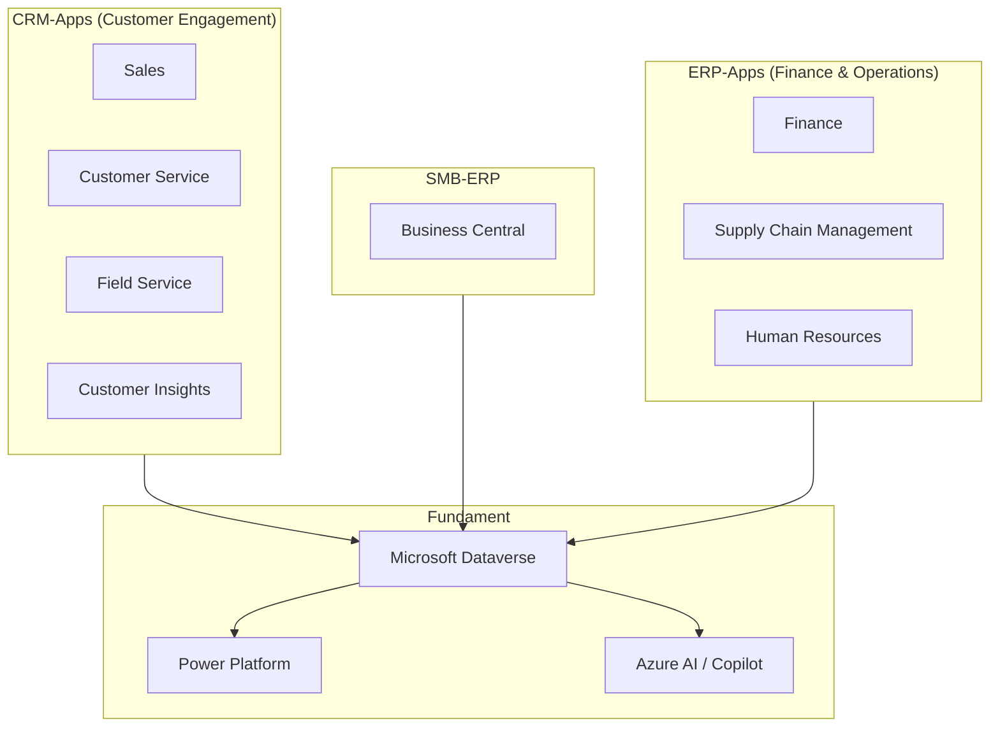
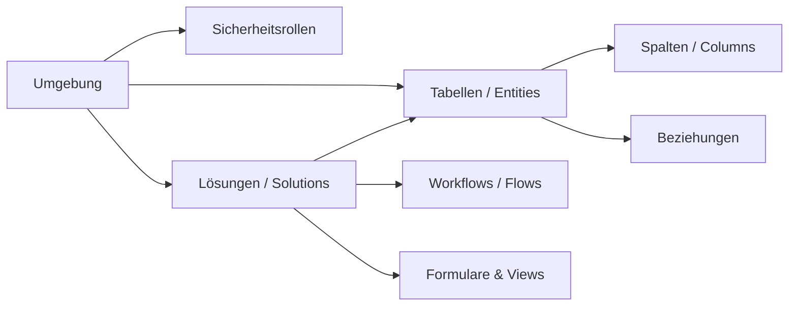
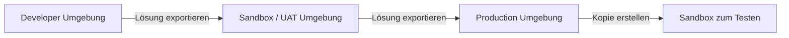
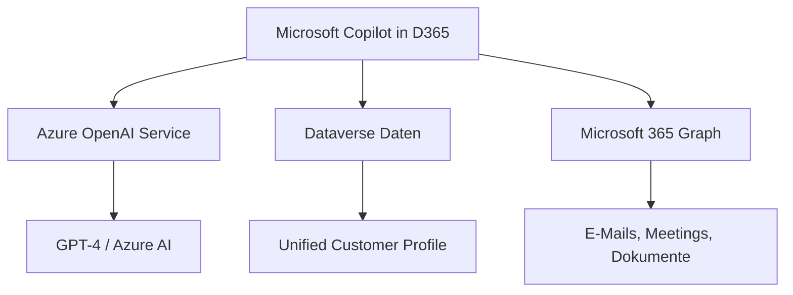

---
tags:
  - dynamics365
  - überblick
  - crm
  - erp
  - microsoft365
  - dataverse
  - power-platform
  - copilot
aliases:
  - D365 Überblick
  - Dynamics 365 Einführung
  - Microsoft Dynamics
---

# Dynamics 365 Überblick

> [!ABSTRACT] TL;DR
> Dynamics 365 ist Microsofts modulare Cloud-Plattform für CRM und ERP. Alle Apps bauen auf **Microsoft Dataverse** als gemeinsame Datenbasis auf und sind tief in Microsoft 365, Teams, Azure und die Power Platform integriert. Das Lizenzmodell besteht aus Base Licenses und günstigen Attach Licenses.

---

## Was ist Dynamics 365?

Dynamics 365 ist eine Familie von intelligenten Geschäftsanwendungen, die CRM- und ERP-Funktionen in der Cloud bereitstellen. Die Plattform vereint Vertriebs-, Service-, Finanz-, Lieferketten- und HR-Prozesse in einem einheitlichen Ökosystem.

**Kernmerkmale:**
- Modularer Aufbau — nur benötigte Apps lizenzieren
- Gemeinsame Datenbasis über **Microsoft Dataverse**
- Native Integration mit Microsoft 365 (Teams, Outlook, Excel)
- KI-Funktionen durch **Microsoft Copilot** in allen Apps
- Erweiterbar über **Power Platform** (Power Apps, Power Automate, Power BI)
- Deployment: ausschließlich Cloud (SaaS) für die meisten Apps

---

## App-Landschaft und Architektur



### App-Kategorien im Überblick

| Kategorie | App | Zielgruppe |
|-----------|-----|------------|
| **CRM** | Sales | Vertriebsteams |
| **CRM** | Customer Service | Support-Agenten |
| **CRM** | Field Service | Außendienst-Techniker |
| **CRM** | Customer Insights | Marketing / CDP |
| **ERP** | Finance | Finanzabteilungen |
| **ERP** | Supply Chain Management | Logistik, Produktion |
| **ERP** | Human Resources | Personalwesen |
| **SMB-ERP** | Business Central | KMU (alle Bereiche) |

---

## Microsoft Dataverse als Fundament

Dataverse ist die gemeinsame Datenbankplattform hinter allen Dynamics 365 CRM-Apps und Power Platform.

### Dataverse vs. Azure SQL

| Merkmal | Microsoft Dataverse | Azure SQL |
|---------|---------------------|-----------|
| **Verwaltung** | Vollständig managed (SaaS) | Managed (PaaS), mehr Kontrolle |
| **Datenmodell** | Entities/Tabellen mit Metadaten | Relationale Tabellen |
| **Sicherheit** | Row-Level Security, Business Units | SQL-Server-Authentifizierung |
| **Erweiterbarkeit** | Low-Code (Power Apps, Plugins) | Volle SQL-Kontrolle |
| **API-Zugriff** | Web API (OData), Dataverse SDK | T-SQL, JDBC, ODBC |
| **Replikation** | Azure Synapse Link | Azure Data Factory |
| **Lizenz** | In D365/Power Platform inkludiert | Separate Azure-Lizenz |
| **Ideal für** | Business-Apps, Power Platform | Komplexe Abfragen, BI |

### Dataverse-Kernkonzepte



**Wichtige Dataverse-Konzepte:**
- **Tabellen:** Accounts, Contacts, Leads, Opportunities (Standard) + Custom Entities
- **Lösungen:** Container für Anpassungen (Managed/Unmanaged)
- **Business Units:** Hierarchische Organisationsstruktur für Datenzugriff
- **Plugins:** Server-seitiger C#-Code, der bei Datenbankoperationen ausgelöst wird

---

## Lizenzmodell

### Lizenztypen

| Lizenztyp | Beschreibung | Beispiel |
|-----------|-------------|---------|
| **Full User License** | Vollzugriff auf eine App | Sales Enterprise |
| **Attach License** | Zweite App zum reduzierten Preis | Customer Service Attach |
| **Team Member** | Lesezugriff, einfache Aufgaben | $8/User/Monat |
| **Device License** | Für gemeinsam genutzte Geräte | Kiosk-Terminals |

### Base + Attach Prinzip

Das Lizenzmodell ermöglicht, eine Base License zu kaufen und weitere Apps als günstige Attach-Lizenzen hinzuzufügen:

```
Sales Enterprise ($105) + Customer Service Attach ($40-50) 
= deutlich günstiger als zwei separate Lizenzen
```

> [!TIP] Attach-Lizenzen sparen Kosten
> Wer mehrere Dynamics 365-Apps benötigt, sollte die teuerste als Base License nehmen und weitere als Attach-Lizenzen. Attach-Preise sind i.d.R. 40-50% günstiger.

### Aktuelle Preise (Oktober 2024 – 2025)

| App | Preis/User/Monat | Attach-Preis |
|-----|-----------------|--------------|
| **Sales Professional** | $65 | — |
| **Sales Enterprise** | $105 | $40 |
| **Customer Service Enterprise** | $105 | $40 |
| **Field Service** | $105 | $40 |
| **Finance** | $210 | $40 |
| **Supply Chain Management** | $210 | $40 |
| **Human Resources** | $120 | $40 |
| **Business Central Essentials** | $70 | — |
| **Business Central Premium** | $100 | — |
| **Team Members** | $8 | — |

> [!IMPORTANT] Preiserhöhung Oktober 2024
> Microsoft hat ab Oktober 2024 die Preise für die meisten Dynamics 365-Apps erhöht. Sales/Customer Service: $95 → $105, Finance: $180 → $210. Business Central-Preise bleiben unverändert.

---

## Umgebungstypen (Environments)

Jede Dynamics 365-Instanz läuft in einer **Umgebung** (Environment) im Power Platform Admin Center.

| Umgebungstyp | Zweck | Besonderheiten |
|--------------|-------|----------------|
| **Production** | Livebetrieb | Volle Kapazität, kein kostenloses Reset |
| **Sandbox** | Test & Entwicklung | Kann auf Production kopiert werden |
| **Developer** | Einzelentwickler | Kostenlos, keine SLA |
| **Trial** | 30-Tage-Test | Automatisch gelöscht nach Ablauf |
| **Default** | Initiale Umgebung | Für alle User im Tenant zugänglich |



---

## Power Platform Integration

Dynamics 365 und Power Platform sind eng verzahnt:

| Power Platform Tool | Nutzung in D365 |
|---------------------|-----------------|
| **Power Apps** | Custom Model-Driven und Canvas Apps auf Dataverse |
| **Power Automate** | Automatisierte Workflows (Genehmigungen, Benachrichtigungen) |
| **Power BI** | Eingebettete Analysen und Dashboards direkt in D365 |
| **Power Pages** | Externe Portale (Kunden-, Partner-Portale) |
| **Copilot Studio** | Custom AI-Bots für D365 Customer Service, Field Service |

---

## Microsoft Copilot in Dynamics 365

Microsoft Copilot ist in alle Dynamics 365-Apps eingebettet und nutzt generative KI auf Basis von Azure OpenAI.

### Copilot-Fähigkeiten nach App

| App | Copilot-Features |
|-----|-----------------|
| **Sales** | Meeting-Zusammenfassungen, E-Mail-Entwürfe, Prognose-Erklärungen |
| **Customer Service** | Case-Zusammenfassungen, Draft Emails, Knowledge Search |
| **Field Service** | Work Order Summaries, Dispatcher Assistant, Mobile Insights |
| **Finance** | Finanzberichte, Abweichungsanalysen, Journal-Automation |
| **Supply Chain** | Demand Forecasting, Lieferanten-Kommunikation |
| **Business Central** | Marketing Text, Bank Reconciliation, E-Mail-Entwürfe |
| **Customer Insights** | Segmente per Sprache erstellen, Journey-Vorschläge |

### Copilot Voraussetzungen

> [!NOTE] Copilot-Verfügbarkeit
> Copilot-Features sind in den meisten Dynamics 365-Lizenzen enthalten, können aber regional und je nach Release Wave variieren. Für volle Copilot-Nutzung wird Microsoft 365 Copilot ($30/User/Monat) empfohlen.



---

## Deployment-Strategie und Governance

### Mandantenstruktur

```
Microsoft Entra ID Tenant
└── Power Platform / D365 Tenant
    ├── Production Environment (CRM)
    ├── Production Environment (Finance)
    ├── Sandbox Environment (Test)
    └── Developer Environments (je Entwickler)
```

### Best Practices

1. **Separate Umgebungen** für Production, UAT und Development
2. **ALM-Pipeline** mit Azure DevOps oder GitHub Actions
3. **Managed Solutions** für deploybare Anpassungen
4. **DLP-Policies** im Power Platform Admin Center
5. **Dataverse Audit Logging** für Compliance aktivieren
6. **Business Units** für Datenmandantentrennung nutzen

---

## Integration mit Microsoft-Ökosystem

| Produkt | Integrationsart |
|---------|-----------------|
| **Microsoft Teams** | Eingebettete D365-Ansichten, Collaborative Selling |
| **Outlook** | D365 App for Outlook, E-Mail-Tracking |
| **Excel** | Datenexport, Power Query Connector |
| **SharePoint** | Dokumentenverwaltung für D365-Datensätze |
| **Azure** | Azure IoT Hub, Azure ML, Application Insights |
| **Power BI** | Native Dashboards in D365-Oberflächen |
| **LinkedIn** | Sales Navigator Integration (Sales) |

---

## Via Power Platform Admin Center (UI)

Das Power Platform Admin Center ([admin.powerplatform.microsoft.com](https://admin.powerplatform.microsoft.com)) ist der zentrale Einstiegspunkt für alle tenant-weiten Einstellungen, Lizenzübersichten und Umgebungsverwaltung – auch wenn keine spezifische Dynamics 365-App verwaltet werden soll.

### Umgebungen anzeigen und verwalten

**Navigation:** `Environments` → Umgebung auswählen

1. Im linken Menü **Environments** öffnen — alle vorhandenen Umgebungen werden tabellarisch angezeigt
2. Spalten der Liste:

| Spalte | Beschreibung |
|--------|-------------|
| **Name** | Anzeigename der Umgebung |
| **Type** | Production, Sandbox, Developer, Trial |
| **Region** | Azure-Rechenzentrumsregion |
| **State** | Ready, Preparing, Deleting |
| **Created** | Erstellungsdatum |

3. Auf eine Umgebung klicken → Detailbereich öffnet sich mit:
   - **Settings** (Sicherheitsrollen, Funktionen, Audit)
   - **Resources** (installierte Apps, Flows, Connectors)
   - **History** (Lösung-Imports, Backups)
4. Über **Copy** kann die Umgebung als Sandbox-Kopie dupliziert werden

> [!TIP] Umgebungsfilter nutzen
> Bei vielen Umgebungen den Suchfilter oben verwenden oder nach **Type** filtern. So lassen sich Production- und Sandbox-Umgebungen schnell trennen.

---

### Lizenzübersicht abrufen

**Navigation:** `Billing` → `Licenses`

1. Im linken Menü **Billing** → **Licenses** öffnen
2. Die Übersicht zeigt alle im Tenant zugewiesenen Dynamics 365- und Power Platform-Lizenzen
3. Relevante Spalten:

| Spalte | Bedeutung |
|--------|----------|
| **Product** | Lizenzname (z. B. Dynamics 365 Sales Enterprise) |
| **Licenses purchased** | Erworbene Lizenzmenge |
| **Licenses assigned** | Aktuell zugewiesene Lizenzen |
| **Available** | Noch nicht vergebene Lizenzen |

4. Klick auf ein Produkt → Detailansicht mit Auflistung der zugewiesenen Benutzer
5. Von hier direkter Link ins **Microsoft 365 Admin Center** für die Lizenzverwaltung

> [!IMPORTANT] Lizenz-Zuweisung erfolgt im M365 Admin Center
> Das PPAC zeigt nur die Übersicht. Die eigentliche Lizenz-Zuweisung an Benutzer erfolgt im Microsoft 365 Admin Center unter `Users → Active users → Lizenzen und Apps`.

---

### App-Nutzung analysieren

**Navigation:** `Analytics` → `Power Apps` oder `Power Automate`

1. Im linken Menü **Analytics** öffnen
2. Unter **Power Apps** werden Nutzungsdaten für alle Canvas- und Model-Driven Apps angezeigt:
   - Aktive Benutzer (täglich, wöchentlich, monatlich)
   - Sitzungsanzahl je App
   - Fehlerrate
3. Unter **Dataverse** zeigt die **Capacity**-Ansicht den Storage-Verbrauch je Umgebung
4. Den Zeitraum über den Datumsselektor oben rechts anpassen (7, 30, 90 Tage)
5. Exportfunktion: **Download** → CSV für weitere Auswertung in Excel oder Power BI

> [!NOTE] Analysedaten haben einen Verzug
> Die Nutzungsdaten im PPAC werden nicht in Echtzeit aktualisiert — typischer Verzug beträgt 24–48 Stunden. Für Echtzeit-Monitoring empfiehlt sich Azure Application Insights.

---

## Verwandte Notizen

- [[Dynamics 365 Sales]]
- [[Dynamics 365 Customer Service]]
- [[Dynamics 365 Field Service]]
- [[Dynamics 365 Finance]]
- [[Dynamics 365 Supply Chain Management]]
- [[Dynamics 365 Business Central]]
- [[Dynamics 365 Customer Insights]]
- [[Dynamics 365 HR]]
- [[Dynamics 365 Administration]]
