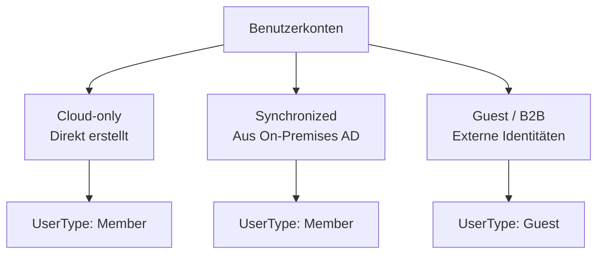
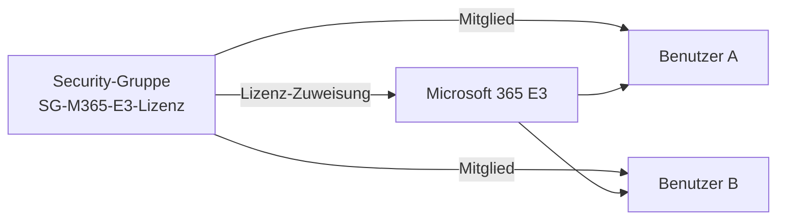
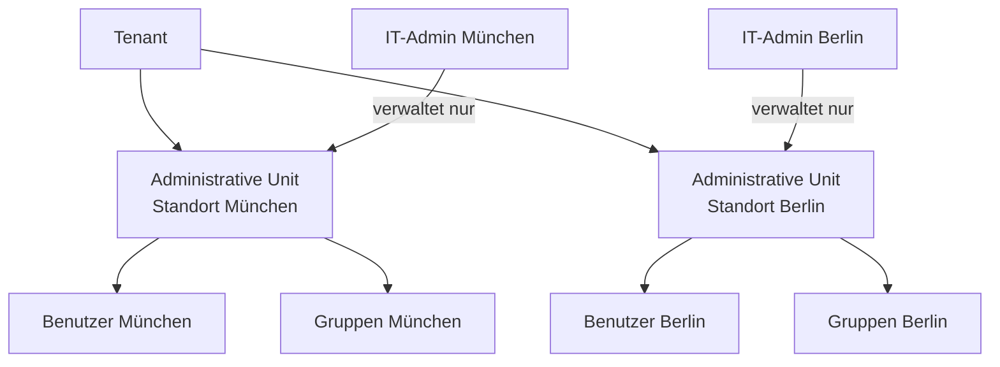

---
tags:
  - entra-id
  - benutzer
  - gruppen
  - identity-management
  - microsoft-365
aliases:
  - Entra Benutzer
  - Azure AD Gruppen
  - User Management
---

# Benutzer und Gruppen

> [!ABSTRACT] TL;DR
> Entra ID verwaltet Benutzerkonten (Cloud, Sync, Gast) und verschiedene Gruppentypen (Security, M365, Distribution). Dynamische Gruppen automatisieren Mitgliedschaften regelbasiert. Administrative Units ermöglichen dezentrale Verwaltung ohne globale Admin-Rechte.

---

## Benutzerkonten in Entra ID

### Benutzertypen

Entra ID unterscheidet drei grundlegende Benutzertypen:



| Typ | Quelle | UPN-Suffix | Verwaltung |
|-----|--------|-----------|-----------|
| **Cloud-only** | Entra ID Portal / Graph API | `@firma.onmicrosoft.com` oder Custom Domain | Nur in Entra ID |
| **Synchronized** | On-Premises AD über Entra Connect | Custom Domain | Nur im On-Premises AD |
| **Guest (B2B)** | Einladung aus anderem Tenant | `user_externaldomain.com#EXT#@firma.onmicrosoft.com` | Im eigenen Tenant + Quelle |

> [!NOTE] Synchronized User – Wo ändern?
> Attribute synchronisierter Benutzer müssen **im On-Premises Active Directory** geändert werden. Änderungen direkt in Entra ID werden beim nächsten Sync-Zyklus überschrieben.

---

## Benutzer erstellen

### Einzelnen Benutzer im Portal erstellen

Entra ID Portal → Benutzer → Neuer Benutzer → Benutzer erstellen:
- **Anzeigename**: Vor- und Nachname
- **Benutzerprinzipalname (UPN)**: `vorname.nachname@firma.de`
- **Kennwort**: Automatisch generiert oder manuell gesetzt
- **Eigenschaften**: Abteilung, Titel, Manager, Telefon

### Benutzer per PowerShell erstellen

```powershell
# Neuen Benutzer erstellen
$PasswordProfile = @{
    Password = "TempP@ssword123!"
    ForceChangePasswordNextSignIn = $true
}

New-MgUser -DisplayName "Max Mustermann" `
           -UserPrincipalName "max.mustermann@firma.de" `
           -PasswordProfile $PasswordProfile `
           -AccountEnabled $true `
           -MailNickname "max.mustermann" `
           -Department "IT" `
           -JobTitle "Systemadministrator"
```

### Bulk-Operationen

```powershell
# Massenimport aus CSV
$Users = Import-Csv -Path "C:\users.csv" -Encoding UTF8
# CSV-Spalten: DisplayName, UserPrincipalName, Department, JobTitle

foreach ($User in $Users) {
    $PasswordProfile = @{
        Password = "TempP@ssword123!"
        ForceChangePasswordNextSignIn = $true
    }
    New-MgUser -DisplayName $User.DisplayName `
               -UserPrincipalName $User.UserPrincipalName `
               -PasswordProfile $PasswordProfile `
               -AccountEnabled $true `
               -MailNickname ($User.UserPrincipalName.Split("@")[0]) `
               -Department $User.Department `
               -JobTitle $User.JobTitle
    Write-Host "Erstellt: $($User.DisplayName)"
}
```

> [!TIP] Bulk-Upload im Portal
> Das Entra-ID-Portal bietet eine CSV-Upload-Funktion für Massenimporte: Benutzer → Massenoperationen → Massenerstellung. Eine Vorlagen-CSV kann direkt heruntergeladen werden.

---

## Gastbenutzer einladen

```powershell
# Gastbenutzer einladen
New-MgInvitation `
    -InvitedUserEmailAddress "partner@externefirma.de" `
    -InviteRedirectUrl "https://myapps.microsoft.com" `
    -InvitedUserDisplayName "Externe Partnerin" `
    -SendInvitationMessage $true `
    -InvitedUserMessageInfo @{
        CustomizedMessageBody = "Willkommen in unserem Tenant! Bitte nehmen Sie die Einladung an."
    }
```

---

## Gruppentypen

### Übersicht aller Gruppentypen

| Gruppentyp | E-Mail-fähig | Zugriffssteuerung | Lizenzverteilung | Teams/SharePoint |
|-----------|-------------|-------------------|-----------------|-----------------|
| **Security** | ❌ | ✅ | ✅ | ❌ |
| **Mail-enabled Security** | ✅ | ✅ | ❌ | ❌ |
| **Microsoft 365** | ✅ | ✅ | ❌ | ✅ |
| **Distribution** | ✅ | ❌ | ❌ | ❌ |

### Security-Gruppe

Standard-Gruppe für Zugriffssteuerung:
- Azure-Ressourcen, SharePoint, Anwendungszuweisung
- Lizenz-Zuweisung (Gruppen-basiert)
- Kein gemeinsames Postfach, kein Teams

### Microsoft 365-Gruppe (früher: Office 365-Gruppe)

Kollaborationsgruppe mit geteilten Ressourcen:
- Gemeinsames Postfach + Kalender
- SharePoint-Team-Website
- Teams-Kanal (optional)
- OneNote-Notizbuch
- Planner-Board

> [!NOTE] M365-Gruppe vs. Teams
> Wenn ein Team in Microsoft Teams erstellt wird, wird automatisch eine M365-Gruppe im Hintergrund erstellt. Das Löschen der Gruppe löscht das Team.

---

## Gruppen erstellen

```powershell
# Security-Gruppe erstellen
New-MgGroup -DisplayName "SG-IT-Admins" `
            -Description "IT-Administratoren" `
            -MailEnabled $false `
            -SecurityEnabled $true `
            -MailNickname "SG-IT-Admins"

# Microsoft 365-Gruppe erstellen
New-MgGroup -DisplayName "MG-Projektteam-Alpha" `
            -Description "Projektteam Alpha" `
            -MailEnabled $true `
            -SecurityEnabled $false `
            -GroupTypes @("Unified") `
            -MailNickname "projektteam-alpha"
```

---

## Dynamische Mitgliedschaft (Dynamic Groups)

Dynamische Gruppen füllen ihre Mitgliedschaft **automatisch** basierend auf Benutzer- oder Geräteattributen. Keine manuelle Zuweisung nötig.

> [!IMPORTANT] Lizenzanforderung
> Dynamische Gruppen erfordern **Entra ID P1** (oder höher) für jeden Benutzer, der durch dynamische Mitgliedschaft in einer Gruppe ist.

### Regelbeispiele

```bash
# Alle Benutzer der Abteilung IT
(user.department -eq "IT")

# Alle Benutzer mit einer bestimmten Lizenz
(user.assignedPlans -any (assignedPlan.servicePlanId -eq "EXCHANGE_S_ENTERPRISE" -and assignedPlan.capabilityStatus -eq "Enabled"))

# Externe Gastbenutzer
(user.userType -eq "Guest")

# Benutzer in Deutschland mit Berufsbezeichnung "Manager"
(user.country -eq "DE") -and (user.jobTitle -contains "Manager")

# Alle Windows 10-Geräte (Gerätegruppe)
(device.operatingSystem -eq "Windows") -and (device.operatingSystemVersion -startsWith "10")
```

### Dynamische Gruppe erstellen

```powershell
# Dynamische Sicherheitsgruppe erstellen
$DynamicRule = '(user.department -eq "IT")'

New-MgGroup -DisplayName "DG-IT-Abteilung" `
            -Description "Alle IT-Mitarbeiter (dynamisch)" `
            -MailEnabled $false `
            -SecurityEnabled $true `
            -MailNickname "DG-IT-Abteilung" `
            -GroupTypes @("DynamicMembership") `
            -MembershipRule $DynamicRule `
            -MembershipRuleProcessingState "On"
```

> [!WARNING] Verarbeitungszeit
> Die Verarbeitung dynamischer Mitgliedschaften kann nach Attribut-Änderungen bis zu **24 Stunden** dauern. Für sofortige Aktualisierungen ist eine manuelle Verarbeitung im Portal möglich.

---

## Gruppen-basierte Lizenzierung

Security-Gruppen können verwendet werden, um Lizenzen automatisch zuzuweisen:



```powershell
# Lizenz-SKU ermitteln
Get-MgSubscribedSku | Select-Object SkuPartNumber, SkuId, ConsumedUnits

# Gruppen-basierte Lizenz zuweisen (über Portal oder Graph)
# Portal: Entra ID → Gruppen → [Gruppe] → Lizenzen → Zuweisungen
$LicenseParams = @{
    AddLicenses = @(@{SkuId = "xxxxxxxx-xxxx-xxxx-xxxx-xxxxxxxxxxxx"})
    RemoveLicenses = @()
}
Set-MgGroupLicense -GroupId "gruppe-id" -BodyParameter $LicenseParams
```

> [!TIP] Lizenzierungsfehler prüfen
> Bei Lizenzierungsfehlern (z. B. keine verfügbaren Lizenzen): Entra ID → Gruppen → [Gruppe] → Lizenzen → Fehler anzeigen.

---

## Nested Groups (Verschachtelte Gruppen)

Entra ID unterstützt verschachtelte Gruppen mit wichtigen Einschränkungen:

| Szenario | Unterstützt? |
|----------|-------------|
| Security-Gruppe in Security-Gruppe | ✅ |
| M365-Gruppe in M365-Gruppe | ❌ |
| Security-Gruppe als Mitglied von M365-Gruppe | ❌ (nur Personen) |
| Nested Groups für Conditional Access | ✅ (Gruppen-Mitgliedschaft wird aufgelöst) |
| Nested Groups für dynamische Gruppen als Quelle | ❌ |

> [!WARNING] Einschränkung bei Gruppen-basierter Lizenzierung
> Verschachtelte Gruppen werden bei der gruppen-basierten Lizenzierung **nicht** unterstützt. Nur direkte Mitglieder erhalten Lizenzen.

---

## Administrative Units (Verwaltungseinheiten)

Administrative Units ermöglichen es, den Verwaltungsbereich von Administratoren einzuschränken – ohne globale Admin-Rechte zu vergeben.



```powershell
# Administrative Unit erstellen
New-MgDirectoryAdministrativeUnit -DisplayName "AU-Standort-Muenchen" `
                                   -Description "Benutzer am Standort München"

# Mitglied hinzufügen
New-MgDirectoryAdministrativeUnitMember -AdministrativeUnitId "au-id" `
    -BodyParameter @{"@odata.id" = "https://graph.microsoft.com/v1.0/users/user-id"}

# Scoped-Rolle zuweisen (User Administrator nur für diese AU)
New-MgDirectoryAdministrativeUnitScopedRoleMember `
    -AdministrativeUnitId "au-id" `
    -RoleId "user-administrator-role-id" `
    -BodyParameter @{roleMemberInfo = @{id = "admin-user-id"}}
```

---

## Namensrichtlinien für Gruppen

Gruppennamensrichtlinien (Group Naming Policies) erzwingen Präfix/Suffix für Gruppennamen:

```powershell
# Aktuelle Namensrichtlinie abrufen
Get-MgDirectorySetting | Where-Object {$_.DisplayName -eq "Group.Unified"} |
    Select-Object -ExpandProperty Values

# Richtlinie konfigurieren (JSON-Body für Graph API)
# Präfix "GRP-", Suffix "-[Department]" erzwingen
```

Konfiguration im Portal: Entra ID → Gruppen → Namensrichtlinie

Mögliche Konfigurationen:
- **Präfix/Suffix**: Feste Strings oder Benutzerattribute (`[Department]`, `[Company]`, `[Country]`)
- **Blockierte Wörter**: Liste verbotener Wörter in Gruppennamen

---

## Benutzer suchen und auflisten

```powershell
# Alle Benutzer einer Abteilung
Get-MgUser -Filter "department eq 'IT'" -All |
    Select-Object DisplayName, UserPrincipalName, JobTitle

# Deaktivierte Konten finden
Get-MgUser -Filter "accountEnabled eq false" -All |
    Select-Object DisplayName, UserPrincipalName

# Benutzer ohne Anmeldeaktivität (letzte 90 Tage)
$Cutoff = (Get-Date).AddDays(-90).ToString("yyyy-MM-ddTHH:mm:ssZ")
Get-MgUser -Filter "signInActivity/lastSignInDateTime le $Cutoff" -All |
    Select-Object DisplayName, UserPrincipalName
```

---

## Troubleshooting

### Häufige Probleme

| Problem | Ursache | Lösung |
|---------|---------|--------|
| Dynamische Gruppe aktualisiert nicht | Attribut wurde nicht synchronisiert oder Regel falsch | Regel im Portal testen, Sync-Status prüfen |
| Gruppen-basierte Lizenzierung schlägt fehl | Keine verfügbaren Lizenzen | Lizenz-Kontingent prüfen, Lizenzanzahl erhöhen |
| Benutzer fehlt in Gruppe nach Sync | Nested Group oder Filterregel schlägt fehl | Direkte Mitgliedschaft und Sync-Log prüfen |
| Gastbenutzer kann Ressource nicht zugreifen | Fehlende Gruppenzuweisung oder CA-Block | Gruppenmitgliedschaft und CA-Richtlinie prüfen |
| Admin kann Benutzer nicht bearbeiten | Benutzer in anderer Administrative Unit | AU-Scope des Admins prüfen |

```powershell
# Gruppenmitgliedschaft eines Benutzers prüfen
Get-MgUserMemberOf -UserId "user@firma.de" |
    Where-Object {$_.'@odata.type' -eq '#microsoft.graph.group'} |
    Select-Object DisplayName, Id

# Gruppenbesitzer anzeigen
Get-MgGroupOwner -GroupId "gruppe-id" |
    Select-Object DisplayName, UserPrincipalName
```

---

## Verwandte Notizen

- [[Microsoft Entra ID Grundlagen]]
- [[Conditional Access]]
- [[Privileged Identity Management]]
- [[Hybrid Identity Entra Connect]]
- [[External Identities B2B]]
