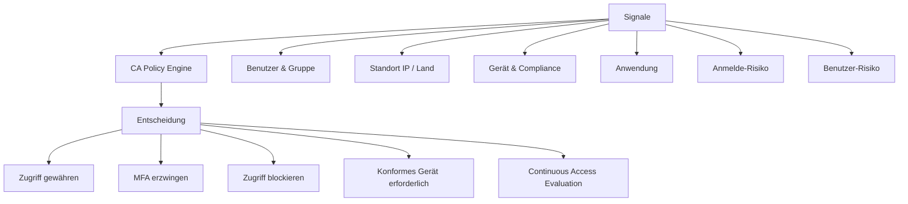
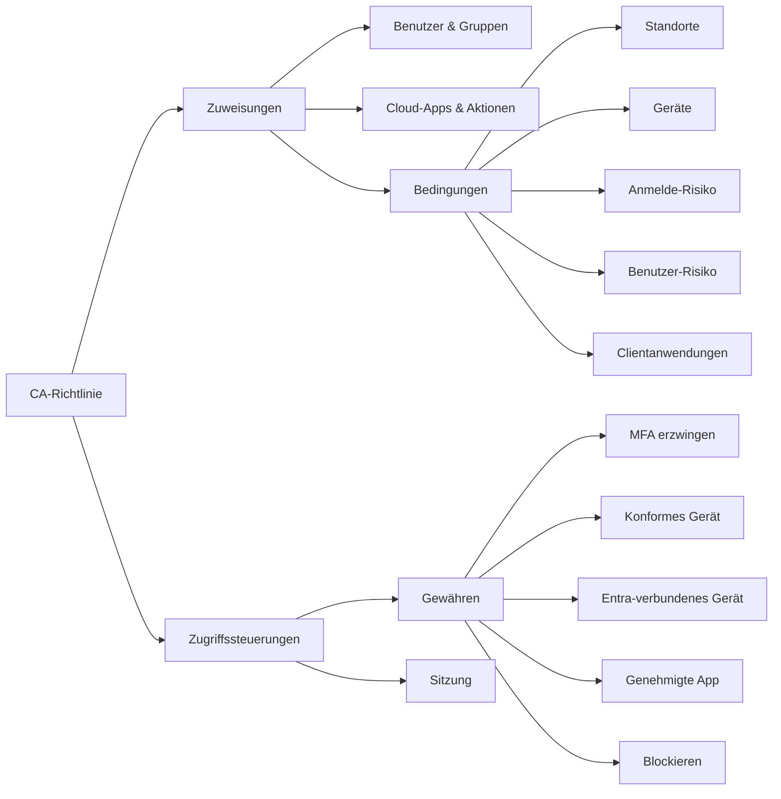
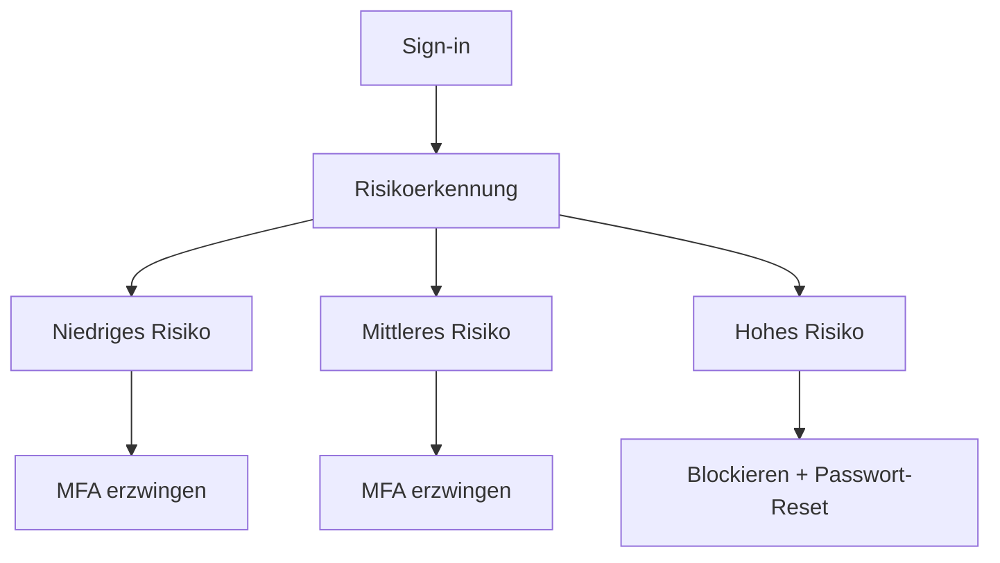

---
tags:
  - entra-id
  - conditional-access
  - zero-trust
  - sicherheit
  - microsoft-365
aliases:
  - CA
  - Bedingter Zugriff
  - Zero Trust Policy
---

# Conditional Access

> [!ABSTRACT] TL;DR
> Conditional Access ist das Zero-Trust-Steuerungssystem von Entra ID. Richtlinien evaluieren Signale (Benutzer, Gerät, Standort, Risiko) und entscheiden: Zugriff gewähren, MFA erzwingen oder blockieren. Report-Only-Modus ermöglicht sicheres Testen vor dem Rollout.

---

## Was ist Conditional Access?

Conditional Access (CA) ist der **Richtlinien-Engine** von Entra ID. Er implementiert das Zero-Trust-Prinzip "Niemals vertrauen, immer prüfen" durch dynamische Zugriffsentscheidungen basierend auf Echtzeit-Signalen.

> [!IMPORTANT] Lizenzanforderung
> Conditional Access erfordert **Entra ID P1** (oder höher). In Entra ID Free sind nur Security Defaults verfügbar.



---

## Policy-Struktur

Jede CA-Richtlinie besteht aus **Zuweisungen** (Bedingungen) und **Zugriffssteuerungen**:



### Zuweisungen (Bedingungen)

#### Benutzer und Gruppen

```powershell
# Richtlinie gilt für:
# - Bestimmte Benutzer oder Gruppen (einschließen)
# - Ausnahmen (ausschließen) - immer Break-Glass-Konto ausschließen!
# - Alle Benutzer
# - Gastbenutzer (Externe Identitäten)
# - Verzeichnisrollen (z.B. nur für Global Admins)
```

#### Cloud Apps und Aktionen

Welche Anwendungen die Richtlinie betrifft:
- **Alle Cloud-Apps**: Breite Abdeckung
- **Ausgewählte Apps**: Granulare Steuerung (z. B. nur für Exchange Online)
- **Benutzeraktionen**: Sicherheitsinfo registrieren, Azure-Ressourcen verwalten

#### Standorte (Named Locations)

```powershell
# Named Location für vertrauenswürdiges Netz erstellen
$Body = @{
    "@odata.type" = "#microsoft.graph.ipNamedLocation"
    displayName = "Firmennetz-Hauptstandort"
    isTrusted = $true
    ipRanges = @(
        @{"@odata.type" = "#microsoft.graph.iPv4CidrRange"; cidrAddress = "203.0.113.0/24"}
    )
} | ConvertTo-Json -Depth 5

# Länder-basierte Named Location
$CountryLocation = @{
    "@odata.type" = "#microsoft.graph.countryNamedLocation"
    displayName = "Erlaubte Laender"
    countriesAndRegions = @("DE", "AT", "CH")
    includeUnknownCountriesAndRegions = $false
} | ConvertTo-Json

Invoke-MgGraphRequest -Method POST `
    -Uri "https://graph.microsoft.com/v1.0/identity/conditionalAccess/namedLocations" `
    -Body $CountryLocation
```

#### Gerätestatus und Gerätefilter

```powershell
# Filter for Devices - Beispiele:
# Nur für verwaltete Geräte (hybrid joined ODER compliant)
# device.isCompliant -eq True
# device.trustType -eq "ServerAD"  (Hybrid Entra Joined)
# device.model -startsWith "Surface"
# device.operatingSystem -eq "Windows"
```

---

## Zugriffssteuerungen

### Grant Controls (Gewähren)

| Steuerung | Beschreibung |
|-----------|-------------|
| **Zugriff blockieren** | Vollständige Sperrung |
| **MFA erzwingen** | Mehrstufige Authentifizierung erforderlich |
| **Gerät als konform markiert** | Intune-Compliance erforderlich |
| **Hybrid-Azure-AD-verbundenes Gerät** | Domain-joined Gerät erforderlich |
| **Genehmigte Client-App** | Nur Outlook, Teams etc. (kein Browser) |
| **App-Schutzrichtlinie** | Intune App Protection Policy |
| **Kennwortänderung erforderlich** | Bei Benutzer-Risiko |

Steuerungen können kombiniert werden:
- **Alle gewählten Steuerungen**: AND-Verknüpfung (alle müssen erfüllt sein)
- **Eine der gewählten Steuerungen**: OR-Verknüpfung

### Session Controls (Sitzungssteuerung)

| Steuerung | Beschreibung |
|-----------|-------------|
| **App-erzwungene Einschränkungen** | SharePoint/Exchange entscheiden über Zugriff |
| **Conditional Access App Control (MCAS)** | Defender for Cloud Apps als Proxy |
| **Anmeldehäufigkeit** | Erzwingt erneute Anmeldung nach X Stunden/Tagen |
| **Persistente Browsersitzung** | Steuert "Angemeldet bleiben" |
| **Kontinuierliche Zugriffsevaluierung** | Sofortige Token-Widerrufung |

---

## Sign-in Risk und User Risk

Integration mit Identity Protection (erfordert **P2**):

| Risikolevel | Bedeutung | Empfohlene Reaktion |
|-------------|-----------|-------------------|
| **Kein Risiko** | Normales Anmeldeverhalten | Keine zusätzliche Aktion |
| **Niedrig** | Leicht ungewöhnlich | MFA erzwingen |
| **Mittel** | Verdächtige Aktivität | MFA erzwingen |
| **Hoch** | Hohes Kompromittierungsrisiko | Blockieren oder Passwort-Reset erzwingen |



---

## Named Locations für Conditional Access

```powershell
# Alle Named Locations auflisten
Get-MgIdentityConditionalAccessNamedLocation |
    Select-Object DisplayName, Id, "@odata.type"

# IP-basierte Named Location
$IPLocation = @{
    "@odata.type" = "#microsoft.graph.ipNamedLocation"
    displayName = "VPN-Exit-Node"
    isTrusted = $true
    ipRanges = @(
        @{
            "@odata.type" = "#microsoft.graph.iPv4CidrRange"
            cidrAddress = "198.51.100.0/24"
        }
    )
}

New-MgIdentityConditionalAccessNamedLocation -BodyParameter $IPLocation
```

---

## Conditional Access für externe Benutzer

Gastbenutzer haben oft andere Anforderungen:

```powershell
# CA-Richtlinie nur für Gäste
# Zuweisungen → Benutzer → Gastbenutzer und externe Benutzer → B2B Collaboration
# Typische Konfiguration für Gäste:
# - MFA immer erzwingen (auch aus vertrautem Netz)
# - Zugriff nur auf bestimmte Apps (nicht alle Cloud-Apps)
# - Keine persistente Sitzung
```

> [!NOTE] Gast-MFA-Haftung
> Standardmäßig ist der Gast-Tenant für die MFA-Anforderung verantwortlich. Mit der Einstellung **MFA-Vertrauen für inbound vertrauenswürdige MFA** kann der Resource-Tenant die MFA des Home-Tenants vertrauen.

---

## Report-Only Modus

> [!TIP] Immer Report-Only zuerst!
> Neue Richtlinien sollten **immer zuerst im Report-Only-Modus** getestet werden, bevor sie aktiviert werden. Im Report-Only-Modus werden Richtlinien evaluiert, aber **nicht erzwungen**.

```powershell
# Richtlinie im Report-Only-Modus erstellen
$Policy = @{
    displayName = "CA-Test-MFA-Alle-Apps"
    state = "enabledForReportingButNotEnforced"  # Report-Only!
    conditions = @{
        users = @{includeUsers = @("All")}
        applications = @{includeApplications = @("All")}
    }
    grantControls = @{
        operator = "OR"
        builtInControls = @("mfa")
    }
}

New-MgIdentityConditionalAccessPolicy -BodyParameter ($Policy | ConvertTo-Json -Depth 10)
```

### Report-Only Ergebnisse lesen

Im Sign-in-Log erscheinen Report-Only-Richtlinien mit Status:
- `reportOnlySuccess`: Richtlinie wäre erfüllt worden
- `reportOnlyFailure`: Richtlinie wäre fehlgeschlagen
- `reportOnlyNotApplied`: Richtlinie wäre nicht angewendet worden

---

## What-If Tool

Das What-If-Tool simuliert CA-Policy-Auswertungen ohne echte Anmeldung:

Portal: Entra ID → Sicherheit → Conditional Access → **What If**

Eingaben:
- Benutzer
- Cloud-App
- IP-Adresse oder Named Location
- Geräteplattform
- Gerätecompliance
- Anmelde-Risiko

Ausgabe: Welche Richtlinien würden gelten und welche Steuerungen würden greifen.

---

## Break-Glass-Konto (Notfallzugriff)

> [!DANGER] Break-Glass ist kritisch
> Ohne ein Break-Glass-Konto kann eine fehlerhafte CA-Richtlinie alle Admins – einschließlich globaler Admins – aus dem Tenant aussperren.

### Best Practices für Break-Glass

```powershell
# Break-Glass-Konto erstellen
$BreakGlass = New-MgUser `
    -DisplayName "Break-Glass Emergency Account" `
    -UserPrincipalName "breakglass@firma.onmicrosoft.com" `
    -AccountEnabled $true `
    -PasswordProfile @{
        Password = "SEHR-LANGES-ZUFAELLIGES-PASSWORT"
        ForceChangePasswordNextSignIn = $false
    } `
    -MailNickname "breakglass"

# Global Administrator zuweisen
$GlobalAdminRole = Get-MgDirectoryRole -Filter "DisplayName eq 'Global Administrator'"
New-MgDirectoryRoleMember -DirectoryRoleId $GlobalAdminRole.Id `
    -BodyParameter @{"@odata.id" = "https://graph.microsoft.com/v1.0/users/$($BreakGlass.Id)"}
```

**Empfehlungen:**
- Kein MFA für das Break-Glass-Konto (oder FIDO2-Key in Safe)
- Aus **ALLEN** CA-Richtlinien ausschließen
- Starkes Zufallspasswort (32+ Zeichen), physisch gesichert aufbewahren
- Anmeldungen des Break-Glass-Kontos per Alert überwachen
- Regelmäßige Tests (min. quartalsweise)

---

## Best Practices: CA-Richtliniendesign

### Empfohlene Basis-Richtlinien (Microsoft Secure Score)

| Richtlinie | Priorität |
|-----------|-----------|
| MFA für Administratoren erzwingen | Kritisch |
| Ältere Authentifizierungsprotokolle blockieren | Kritisch |
| MFA bei Anmelde-Risiko "Hoch" | Hoch |
| Passwort-Reset bei Benutzer-Risiko "Hoch" | Hoch |
| MFA für alle Benutzer (alle Apps) | Hoch |
| Compliant Device für alle Geräte | Mittel |
| Keine persistente Sitzung auf nicht verwalteten Geräten | Mittel |

### Legacy-Authentifizierung blockieren

```powershell
# Richtlinie: Legacy-Authentifizierung blockieren
$LegacyAuthPolicy = @{
    displayName = "CA-Block-Legacy-Auth"
    state = "enabled"
    conditions = @{
        users = @{includeUsers = @("All"); excludeUsers = @("breakglass-user-id")}
        applications = @{includeApplications = @("All")}
        clientAppTypes = @("exchangeActiveSync", "other")  # Legacy Auth
    }
    grantControls = @{
        operator = "OR"
        builtInControls = @("block")
    }
}
```

> [!WARNING] Legacy Auth blockieren
> Legacy-Authentifizierungsprotokolle (Basic Auth, POP3, IMAP ohne Modern Auth) unterstützen kein MFA und sind ein häufiges Angriffsziel. Vor dem Blockieren sicherstellen, dass keine Geräte oder Apps noch Basic Auth verwenden (Sign-in-Logs prüfen).

---

## Troubleshooting

### CA-Richtlinie greift nicht

```powershell
# Sign-in-Logs nach CA-Ergebnissen filtern
Get-MgAuditLogSignIn -Filter "userDisplayName eq 'Max Mustermann'" -Top 20 |
    Select-Object CreatedDateTime, AppDisplayName,
        @{N="CAResult";E={$_.AppliedConditionalAccessPolicies | Select-Object DisplayName, Result}} |
    Format-List
```

### Häufige Fehler

| Fehler | Ursache | Lösung |
|--------|---------|--------|
| Benutzer blockiert obwohl er nicht sollte | Falsche Gruppenausschlüsse | Gruppen-Mitgliedschaft prüfen, What-If nutzen |
| MFA-Aufforderung erscheint trotz vertrautem Netz | Named Location nicht als trusted markiert | `isTrusted = true` in Named Location |
| App-spezifische CA gilt nicht | Falsche App-ID in Richtlinie | Enterprise App Service Principal ID prüfen |
| "Du kannst nicht von hier zugreifen" | Device Compliance nicht erfüllt | Intune-Compliance-Richtlinie und Gerätestatus prüfen |

---

## Verwandte Notizen

- [[Microsoft Entra ID Grundlagen]]
- [[Multi-Factor Authentication]]
- [[Identity Protection]]
- [[Privileged Identity Management]]
- [[Entra ID Join vs Hybrid Join]]
- [[External Identities B2B]]
