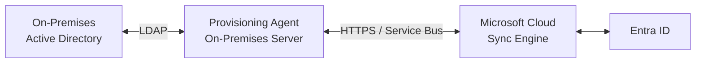
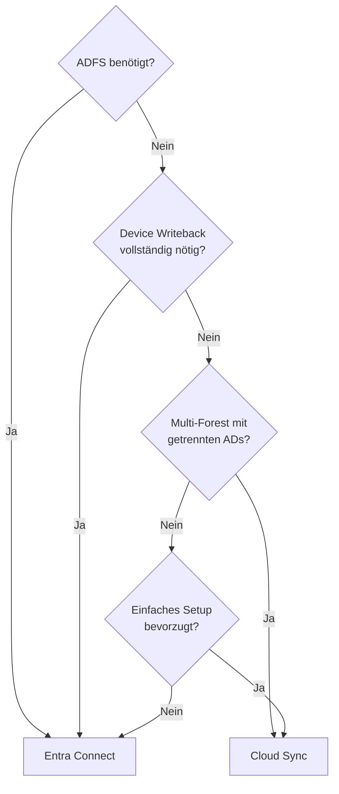
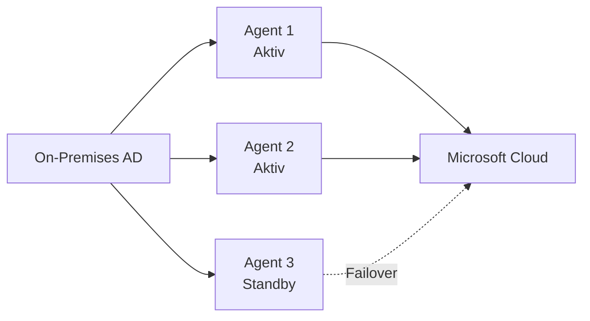
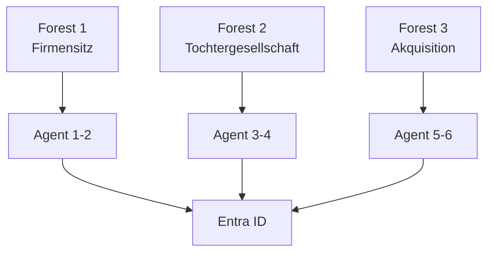

---
tags:
  - entra-id
  - cloud-sync
  - hybrid-identity
  - provisioning
  - active-directory
aliases:
  - Cloud Sync
  - Provisioning Agent
  - Lightweight Sync
---

# Entra Connect Cloud Sync

> [!ABSTRACT] TL;DR
> Entra Connect Cloud Sync ist der modernere, leichtgewichtige Nachfolger für Teile von Entra Connect. Ein kleiner Provisioning-Agent ersetzt den schweren On-Premises-Server. Die gesamte Sync-Logik läuft in der Cloud. Ideal für Multi-Forest-Szenarien und einfache Deployments.

---

## Was ist Entra Connect Cloud Sync?

Entra Connect Cloud Sync (vormals Azure AD Connect Cloud Sync) ist ein **cloudnatives Synchronisierungskonzept**, bei dem die Synchronisierungslogik in der Microsoft-Cloud läuft. Ein leichtgewichtiger **Provisioning-Agent** auf einem On-Premises-Server stellt lediglich die Verbindung zum Active Directory her.



---

## Cloud Sync vs. Entra Connect

| Kriterium | Entra Connect | Cloud Sync |
|-----------|--------------|-----------|
| **Infrastruktur** | Dedizierter Server, SQL-DB | Kleiner Agent (kein SQL nötig) |
| **Konfiguration** | Lokal auf Server | Im Entra-ID-Portal (cloud) |
| **Multi-Forest** | Ja (komplex) | Ja (einfach, nativ) |
| **Disconnected Forests** | Möglich, aber aufwendig | Nativ unterstützt |
| **ADFS** | Ja | Nein |
| **Device Writeback** | Ja | Eingeschränkt |
| **Group Writeback** | Ja | Ja (M365-Gruppen zu AD) |
| **Password Hash Sync** | Ja | Ja |
| **Pass-through Auth** | Ja | Nein |
| **HR-Provisioning** | Nein | Ja (Workday, SuccessFactors) |
| **Provisioning on Demand** | Nein | Ja |
| **Hochverfügbarkeit** | Staging-Modus | Mehrere Agents |

### Wann Cloud Sync verwenden?



---

## Systemvoraussetzungen

### Server-Anforderungen für den Provisioning-Agent

- Windows Server 2016, 2019 oder 2022
- .NET Framework 4.7.2 oder höher
- Mindestens 4 GB RAM (8 GB empfohlen)
- **Kein** SQL Server erforderlich
- TLS 1.2 muss aktiviert sein
- Ausgehende HTTPS-Verbindung zu Microsoft-Endpunkten

> [!NOTE] Keine SQL-Datenbank nötig
> Im Gegensatz zu Entra Connect benötigt Cloud Sync keine SQL-Datenbank. Die Konfiguration und der Status werden in der Cloud gespeichert.

---

## Via Microsoft Entra Admin Center (UI)

### Cloud Sync konfigurieren

#### Provisioning-Agent herunterladen

1. Öffne das **Microsoft Entra Admin Center** unter [entra.microsoft.com](https://entra.microsoft.com)
2. Navigiere zu **Identität → Hybrid management → Microsoft Entra Connect → Cloud Sync**
3. Klicke auf den Tab **Agents**
4. Klicke auf **Neuen Agent herunterladen**
5. Führe den heruntergeladenen Installer (`AADConnectProvisioningAgentSetup.exe`) auf dem On-Premises-Server aus
6. Authentifiziere dich während der Installation mit einem **Globalen Administrator**-Konto

#### Cloud Sync konfigurieren (nach Agent-Installation)

1. Navigiere zurück zu **Identität → Hybrid management → Microsoft Entra Connect → Cloud Sync**
2. Klicke auf **+ Neue Konfiguration**
3. Wähle den gewünschten **AD-Forest** aus der Dropdown-Liste
4. Klicke auf **Erstellen**
5. Konfiguriere:
   - **Bereich:** Alle Benutzer oder spezifische OUs/Gruppen
   - **Attribut-Mapping:** Klicke auf **Attributzuordnungen** → Standardzuordnungen anpassen oder ergänzen
6. Klicke auf **Speichern**

#### Attribut-Mapping im Portal anpassen

1. Öffne die Cloud Sync-Konfiguration
2. Klicke auf **Attributzuordnungen**
3. Klicke auf **+ Zuordnung hinzufügen** um neue Mappings zu erstellen
4. Konfiguriere Quell- und Ziel-Attribut sowie den Transformationstyp
5. Klicke auf **Speichern**

#### Provisioning on Demand testen

1. Navigiere zu **Identität → Hybrid management → Microsoft Entra Connect → Cloud Sync**
2. Klicke auf **On-Demand-Bereitstellung**
3. Gib den **Distinguished Name (DN)** eines Testobjekts (Benutzer oder Gruppe) ein
4. Klicke auf **Bereitstellen** und überprüfe das Ergebnis

> [!TIP]
> Alternativ: **Azure Portal → Microsoft Entra ID → Microsoft Entra Connect → Cloud Sync**

---

## Provisioning-Agent installieren

### Schritt 1: Agent herunterladen

```
Entra ID Portal → Hybrid management → Entra Connect → Cloud Sync
→ Agent herunterladen
```

### Schritt 2: Installation

```powershell
# Agent-Installer ausführen (AADConnectProvisioningAgent.Installer.exe)
# Installations-Assistent:
# 1. Lizenzvereinbarung akzeptieren
# 2. Global-Admin-Konto für Entra ID eingeben
# 3. Active Directory verbinden (Enterprise Admin-Konto)
# 4. Agent registrieren
```

### Schritt 3: Mehrere Agents für HA



> [!TIP] Hochverfügbarkeit
> Mindestens **3 Provisioning-Agents** in Produktion installieren. Die Agents sind zustandslos – bei Ausfall eines Agents übernimmt automatisch ein anderer.

---

## Konfiguration im Portal

### Sync-Job erstellen

```
Entra ID Portal → Hybrid Management → Entra Connect → Cloud Sync
→ Neue Konfiguration → AD-Forest auswählen
```

Konfigurierbare Optionen:
- **Forest auswählen**: Welcher AD-Forest synchronisiert wird
- **Agent zuweisen**: Welcher Agent für diesen Forest zuständig ist
- **Scoping Filter**: Welche Objekte synchronisiert werden
- **Attribut-Mapping**: Welche Attribute wie gemappt werden
- **Zufällige Passwort-Generierung**: Für neue Cloud-Benutzer

---

## Scoping Filter

Scoping Filter bestimmen, welche Objekte synchronisiert werden:

### Gruppen-Scoping

```json
{
  "scopingFilters": [
    {
      "targetAttribute": "DN",
      "values": ["OU=Users,DC=firma,DC=local"],
      "operator": "STARTS_WITH"
    }
  ]
}
```

### Attribut-basierter Scoping

```json
{
  "scopingFilters": [
    {
      "targetAttribute": "extensionAttribute1",
      "values": ["CloudSync"],
      "operator": "EQUALS"
    }
  ]
}
```

---

## Attribut-Mapping

Attribute können zwischen AD und Entra ID flexibel gemappt werden:

```
Portal: Cloud Sync → [Konfiguration] → Attribute-Mapping
```

### Standard-Mappings

| AD-Attribut | Entra-Attribut | Transformationstyp |
|-------------|---------------|-------------------|
| `userPrincipalName` | `userPrincipalName` | Direct |
| `displayName` | `displayName` | Direct |
| `mail` | `mail` | Direct |
| `department` | `department` | Direct |
| `objectGUID` | `onPremisesImmutableId` | Expression |

### Custom Expressions

```
# Beispiel: displayName aus Vor- und Nachname zusammensetzen
Append([givenName], " ", [surname])

# Beispiel: E-Mail aus sAMAccountName und Domain
Append([sAMAccountName], "@firma.de")

# Beispiel: Abteilung normalisieren
Switch([department], 
    "IT-Abteilung", "IT",
    "Personal-Abteilung", "HR",
    "Vertrieb", "Sales",
    [department])
```

---

## Provisioning on Demand

Cloud Sync ermöglicht das sofortige Provisionieren einzelner Objekte zum Testen:

```
Portal: Cloud Sync → [Konfiguration] → Bereitstellung auf Anforderung
→ Benutzer oder Gruppe aus AD auswählen
→ Bereitstellen klicken
```

> [!TIP] Testen vor Go-Live
> Nutze Provisioning on Demand, um einzelne Benutzer zu testen, bevor der reguläre Sync-Zyklus läuft. So werden Mapping-Fehler frühzeitig erkannt.

---

## Provisioning Logs

```powershell
# Provisioning-Logs über Graph API
$Logs = Get-MgAuditLogProvisioning -Filter "jobId eq 'sync-job-id'" -Top 50 |
    Select-Object Action, ActivityDateTime, StatusInfo, SourceIdentity, TargetIdentity

# Fehler-Logs filtern
Get-MgAuditLogProvisioning -Filter "statusInfo/status eq 'failure'" -Top 50 |
    Select-Object ActivityDateTime, StatusInfo, SourceIdentity |
    ForEach-Object {
        [PSCustomObject]@{
            Zeitstempel = $_.ActivityDateTime
            Fehler = $_.StatusInfo.AdditionalDetails
            Quelle = $_.SourceIdentity.DisplayName
        }
    }
```

---

## Multi-Forest-Unterstützung

Cloud Sync unterstützt native Multi-Forest-Szenarien:



Jeder Forest erhält einen eigenen Sync-Job, kann aber in denselben Entra-ID-Tenant synchronisieren. Verschiedene Forests können verschiedene Scoping-Filter und Attribut-Mappings haben.

---

## Einschränkungen von Cloud Sync

> [!WARNING] Wichtige Einschränkungen
> Nicht alle Entra-Connect-Features sind in Cloud Sync verfügbar:

| Feature | Verfügbar in Cloud Sync? |
|---------|------------------------|
| Password Hash Sync | ✅ |
| SSPR Password Writeback | ✅ |
| Group Writeback (M365 zu AD) | ✅ |
| Device Writeback | ⚠️ (nur mit Hybrid Join, eingeschränkt) |
| Exchange Hybrid Writeback | ❌ |
| Pass-through Authentication | ❌ |
| ADFS-Verbund | ❌ |
| Seamless SSO | ✅ (via separaten Schritt) |
| Filtering (OU, Attribut, Gruppe) | ✅ |

---

## Troubleshooting

### Agent-Status prüfen

```powershell
# Agent-Dienst-Status auf dem Server
Get-Service -Name "AADConnectProvisioningAgent"
Get-Service -Name "AADConnectProvisioningAgentUpdater"

# Event Log prüfen
Get-EventLog -LogName "Application" -Source "AAD Connect Provisioning Agent" -Newest 20 |
    Where-Object {$_.EntryType -in @("Error", "Warning")} |
    Select-Object TimeGenerated, Message

# Agent-Version anzeigen
(Get-ItemProperty "HKLM:\SOFTWARE\Microsoft\Azure AD Connect Provisioning Agent\").Version
```

### Häufige Probleme

| Problem | Ursache | Lösung |
|---------|---------|--------|
| Agent zeigt "Offline" | Firewall blockiert Verbindung | Ausgehende HTTPS zu `*.msappproxy.net` freigeben |
| Objekte werden nicht synchronisiert | Scoping Filter zu restriktiv | Filter prüfen, Provisioning on Demand testen |
| Attribut fehlt in Entra ID | Attribut nicht im Mapping | Attribut-Mapping im Portal ergänzen |
| Doppelte Objekte | Soft Match fehlgeschlagen | ImmutableId manuell setzen |
| Passwort nicht synchronisiert | SSPR Writeback nicht aktiviert | In Cloud-Sync-Konfiguration aktivieren |

```powershell
# Quarantäne-Status prüfen (wenn Sync pausiert)
# Portal: Cloud Sync → [Konfiguration] → Übersicht → Quarantäne-Details
# Häufige Quarantäne-Gründe: Falsches Admin-Konto, Abgelaufene Zugangsdaten

# Agent-Registrierung erneuern
# Systemsteuerung → Microsoft Azure AD Connect Provisioning Agent → Konfigurieren
# Agent de-registrieren und neu registrieren
```

---

## Verwandte Notizen

- [[Microsoft Entra ID Grundlagen]]
- [[Hybrid Identity Entra Connect]]
- [[Entra ID Join vs Hybrid Join]]
- [[Benutzer und Gruppen]]
