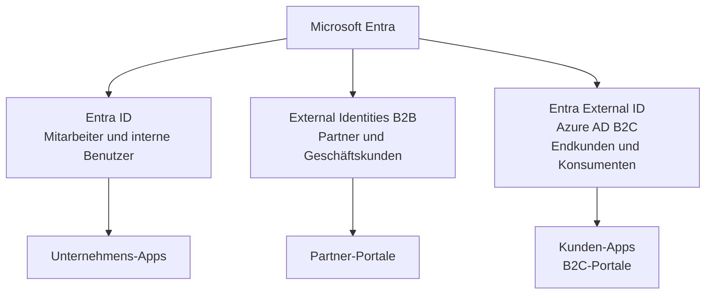

---
tags:
  - entra-id
  - b2c
  - ciam
  - kundenidentitaet
  - external-id
aliases:
  - Azure AD B2C
  - CIAM
  - Customer Identity
  - Entra External ID
---

# Entra ID B2C

> [!ABSTRACT] TL;DR
> Azure Active Directory B2C (heute Teil von Microsoft Entra External ID) ist die CIAM-Plattform (Customer Identity and Access Management) von Microsoft für Kundenidentitäten. Im Gegensatz zu Entra ID (B2E – Mitarbeiter) und B2B (Partner) richtet sich B2C an externe Endkunden mit Social-Logins, Custom User Flows und White-Label-Erlebnis.

---

## Was ist Azure AD B2C / Entra External ID?



### Unterschied B2E, B2B, B2C

| Aspekt | Entra ID (B2E) | B2B | B2C |
|--------|----------------|-----|-----|
| **Zielgruppe** | Eigene Mitarbeiter | Externe Partner | Endkunden, Konsumenten |
| **Identitäten** | Unternehmenskonten | Unternehmenskonten + Social | Social, E-Mail, Phone |
| **Anzahl Benutzer** | Hunderte bis tausende | Wenige bis tausende | Millionen möglich |
| **Tenant** | Unternehmens-Tenant | Unternehmens-Tenant (Gäste) | Eigener B2C-Tenant |
| **Branding** | Microsoft-Look | Teilweise anpassbar | Vollständig anpassbar |
| **Lizenz** | P1/P2 pro Benutzer | P1/P2 pro Benutzer | MAU-basiert |
| **SSPR** | Ja | Eingeschränkt | Ja (Self-Service) |
| **Social Login** | Eingeschränkt | Google, Facebook | Alles konfigurierbar |

---

## Via Microsoft Entra Admin Center (UI)

### Entra ID B2C konfigurieren

#### B2C-Tenant erstellen

1. Öffne das **Azure Portal** unter [portal.azure.com](https://portal.azure.com)
2. Klicke auf **+ Ressource erstellen** und suche nach **Microsoft Entra ID B2C**
3. Klicke auf **Erstellen**
4. Wähle **Neuen Azure AD B2C-Tenant erstellen**
5. Konfiguriere:
   - **Organisationsname:** z. B. `Firma B2C`
   - **Anfänglicher Domainname:** z. B. `firmab2c.onmicrosoft.com`
   - **Land/Region:** Deutschland
   - **Abonnement:** Azure-Subscription für Abrechnung auswählen
   - **Ressourcengruppe:** Vorhandene auswählen oder neue erstellen
6. Klicke auf **Überprüfen + Erstellen** und dann auf **Erstellen**

#### User Flows erstellen

1. Wechsle in den **B2C-Tenant** (Verzeichnis wechseln im Azure Portal)
2. Suche nach **Azure AD B2C** und öffne den Dienst
3. Navigiere zu **Benutzerflows** und klicke auf **+ Neuer Benutzerflow**
4. Wähle den Flow-Typ (z. B. **Registrierung und Anmeldung**)
5. Wähle die Version **Empfohlen**
6. Konfiguriere:
   - **Name:** z. B. `B2C_1_SignUpSignIn`
   - **Identitätsanbieter:** E-Mail-Registrierung aktivieren
   - **Benutzerattribute:** Gewünschte Attribute (Vorname, Nachname etc.) auswählen
7. Klicke auf **Erstellen**

#### Identitätsanbieter konfigurieren

1. Navigiere zu **Identitätsanbieter**
2. Klicke auf den gewünschten Anbieter (z. B. **Google**, **Facebook**)
3. Konfiguriere:
   - **Client-ID:** App-ID vom jeweiligen Anbieter
   - **Geheimnis des Clients:** App-Secret vom jeweiligen Anbieter
4. Klicke auf **Speichern**
5. Füge den Anbieter im gewünschten User Flow unter **Identitätsanbieter** hinzu

#### App-Registrierung im B2C-Tenant

1. Navigiere zu **App-Registrierungen** und klicke auf **+ Neue Registrierung**
2. Konfiguriere:
   - **Name:** Anwendungsname
   - **Unterstützte Kontotypen:** Konten in einem beliebigen Identitätsanbieter
   - **Umleitungs-URI:** z. B. `https://jwt.ms` für Tests
3. Klicke auf **Registrieren**

> [!TIP]
> Alternativ: **Azure Portal → Azure AD B2C** (nach Wechsel in den B2C-Tenant)

---

## B2C-Tenant erstellen

Ein B2C-Tenant ist ein separater Azure-Tenant (nicht der Unternehmens-Tenant):

```
Azure Portal → Ressource erstellen → Azure Active Directory B2C
→ Neuen Azure AD B2C-Tenant erstellen
→ Organisationsname, Domainname (firmaname.onmicrosoft.com)
→ Mit Azure-Subscription verknüpfen (für Abrechnung)
```

> [!IMPORTANT] Separater Tenant
> Der B2C-Tenant ist vollständig vom Unternehmens-Tenant getrennt. Mitarbeiterkonten aus dem Unternehmens-Tenant haben keinen automatischen Zugriff auf den B2C-Tenant.

---

## User Flows (Benutzerflows)

User Flows sind vorkonfigurierte Authentifizierungsabläufe für häufige Szenarien:

### Verfügbare User Flow-Typen

| User Flow | Beschreibung |
|-----------|-------------|
| **Registrieren und Anmelden** | Kombinierter Flow: Neue Benutzer registrieren sich, bestehende melden sich an |
| **Nur Registrierung** | Nur für neue Benutzer |
| **Nur Anmeldung** | Nur für bestehende Benutzer |
| **Kennwortzurücksetzung** | Self-Service-Kennwortreset |
| **Profilbearbeitung** | Benutzer kann eigene Attribute ändern |
| **Ressourcenbesitzer-Kennwort-Anmeldeinformationen** | Für API-Szenarien ohne Browser |

### User Flow erstellen

```
B2C-Portal → Benutzerflows → Neuer Benutzerflow
→ Typ auswählen (Registrieren und Anmelden)
→ Identitätsanbieter auswählen
→ Benutzerattribute konfigurieren (Vorname, Nachname, PLZ...)
→ Anwendungsansprüche konfigurieren (was im Token zurückkommt)
→ Seitenlayout anpassen (HTML, CSS)
```

### User Flow testen

```
B2C-Portal → Benutzerflows → [Flow] → Benutzerflow ausführen
→ Anwendung auswählen (für Token-Empfang)
→ Antwort-URL angeben
→ Ausführen → Browser öffnet Registrierungs-/Anmeldungsseite
```

---

## Identitätsanbieter (Social Logins)

B2C unterstützt eine Vielzahl von Social-Login-Providern:

| Anbieter | Typ |
|----------|-----|
| **Google** | Social |
| **Facebook** | Social |
| **GitHub** | Social |
| **LinkedIn** | Social |
| **Microsoft (MSA)** | Social |
| **Twitter / X** | Social |
| **Amazon** | Social |
| **Apple** | Social |
| **Beliebiger OIDC-IdP** | Federated |
| **Beliebiger SAML-IdP** | Federated |
| **Lokales Konto** | E-Mail + Passwort |
| **Phone Sign-in** | SMS-Code |

### Google als IdP einrichten

```
B2C-Portal → Identitätsanbieter → Google → Hinzufügen
→ Client-ID und Client-Secret aus Google Cloud Console eingeben
→ Zulässige Weiterleitungs-URIs in Google-Konsole eintragen:
  https://firmaname.b2clogin.com/firmaname.onmicrosoft.com/oauth2/authresp
```

---

## Custom Policies (Identity Experience Framework)

Custom Policies ermöglichen vollständig individuelle Authentifizierungsabläufe via XML:

> [!WARNING] Hohe Komplexität
> Custom Policies (IEF) sind sehr mächtig, aber extrem komplex. Für die meisten Anwendungsfälle reichen User Flows. Custom Policies nur verwenden wenn User Flows nicht ausreichen.

### Aufbau einer Custom Policy

```xml
<!-- TrustFrameworkBase.xml - Basiskonfiguration -->
<TrustFrameworkPolicy 
    xmlns:xsi="http://www.w3.org/2001/XMLSchema-instance"
    xmlns:xsd="http://www.w3.org/2001/XMLSchema"
    PolicySchemaVersion="0.3.0.0"
    TenantId="firmaname.onmicrosoft.com"
    PolicyId="B2C_1A_TrustFrameworkBase"
    PublicPolicyUri="http://firmaname.onmicrosoft.com/B2C_1A_TrustFrameworkBase">

  <BuildingBlocks>
    <ClaimsSchema>
      <!-- Ansprüche / Attribute definieren -->
    </ClaimsSchema>
  </BuildingBlocks>

  <ClaimsProviders>
    <!-- Identitätsanbieter konfigurieren -->
  </ClaimsProviders>

  <UserJourneys>
    <!-- Authentifizierungsabläufe definieren -->
  </UserJourneys>
</TrustFrameworkPolicy>
```

### Typische Custom Policy Anwendungsfälle

- **Benutzerdefinierte Attribute** aus externer API validieren
- **REST-API-Calls** während der Anmeldung (Fraud-Prüfung)
- **Komplexe MFA-Abläufe** (z. B. Phone + E-Mail)
- **Account-Linking** (verschiedene Social-Logins mit einem Konto verknüpfen)
- **Migration** von Legacy-Systemen mit Passwort-Validierung via API

---

## App-Registrierung in B2C

```powershell
# Im B2C-Portal: App-Registrierungen → Neue Registrierung
# Für Web-Apps:
# - Redirect URI: https://meine-app.de/auth/callback
# - Impliziter Grant: ID Token (für OIDC)

# Für Native Apps / SPAs:
# - PKCE verwenden (Authorization Code Flow)
# - Redirect URI: https://app.de/callback oder msal://auth

# B2C-spezifische Token-Anfrage
$B2CTokenEndpoint = "https://firmaname.b2clogin.com/firmaname.onmicrosoft.com/B2C_1_SignIn/oauth2/v2.0/token"

# OIDC-Discovery für User Flow
# https://firmaname.b2clogin.com/firmaname.onmicrosoft.com/B2C_1_SignIn/v2.0/.well-known/openid-configuration
```

---

## Custom Domains in B2C

Statt `firmaname.b2clogin.com` eine eigene Domain verwenden:

```
B2C-Portal → Domänen → Benutzerdefinierte Domäne hinzufügen
→ login.meine-firma.de
→ DNS-CNAME: login.meine-firma.de → firmaname.b2clogin.com
→ TLS-Zertifikat konfigurieren (über Azure Front Door)
```

> [!TIP] Custom Domain = besseres Branding
> Eigene Domain (`login.meine-firma.de`) ist professioneller und vermeidet dass Kunden den Microsoft-Login erkennen. Pflicht für Branchen mit Datenschutzsensibilität.

---

## Token-Konfiguration

```json
// Beispiel: ID Token aus B2C User Flow
{
  "iss": "https://firmaname.b2clogin.com/tenant-id/v2.0/",
  "sub": "abc123-user-object-id",
  "aud": "client-app-id",
  "exp": 1234567890,
  "iat": 1234567890,
  "given_name": "Max",
  "family_name": "Mustermann",
  "emails": ["max@gmail.com"],
  "extension_LoyaltyNumber": "LYL-001234",
  "idp": "google.com",
  "tfp": "B2C_1_SignIn"
}
```

Konfigurierbare Ansprüche im User Flow:
- Standard-Attribute: Vorname, Nachname, E-Mail, Land, PLZ
- Benutzerdefinierte Attribute (Extension Attributes): Kundennummer, Mitgliedschaftslevel

---

## Lizenzierung (MAU-basiert)

B2C wird nach **Monthly Active Users (MAU)** abgerechnet:

| Tier | MAU | Kosten |
|------|-----|--------|
| Kostenlos | 0-50.000 MAU | Kostenlos |
| Kostenpflichtig | Ab 50.001 MAU | ~0,00325 € pro MAU |
| Premium P1 (MFA, CA) | Pro MAU | Zusatzkosten |
| Premium P2 (Identity Protection) | Pro MAU | Zusatzkosten |

---

## B2C vs. Entra External ID – Wann was verwenden?

> [!NOTE] Entra External ID ist der Nachfolger
> Microsoft hat **Entra External ID** als den modernen Nachfolger von Azure AD B2C angekündigt. B2C wird weiterhin unterstützt, aber Neuprojekte sollten Entra External ID evaluieren.

| Kriterium | Azure AD B2C | Entra External ID |
|-----------|-------------|------------------|
| **Status** | GA, supported | GA (2024) |
| **Konfiguration** | User Flows + Custom Policies (XML) | User Flows (modern, einfacher) |
| **Portal** | Eigenes B2C-Portal | Integriert in Entra ID |
| **Tenant** | Separater B2C-Tenant | Externer Tenant (oder eigener Tenant) |
| **CIAM** | Vollständig | Vollständig |
| **Custom Policies** | Ja (XML) | Noch in Entwicklung |
| **Empfehlung** | Bestehende B2C-Apps | Neue CIAM-Projekte |

---

## Troubleshooting

### Häufige B2C-Probleme

| Problem | Ursache | Lösung |
|---------|---------|--------|
| Anmeldung schlägt fehl mit AADB2C90077 | Ablaufende Session | Session-Cookie löschen, User Flow neu testen |
| Social Login schlägt fehl | Client-ID/Secret falsch | IdP-Konfiguration prüfen, Redirect URI validieren |
| Benutzerdefiniertes Attribut fehlt im Token | Attribut nicht als Anspruch konfiguriert | User Flow → Anwendungsansprüche → Attribut hinzufügen |
| Custom Policy Fehler | XML-Syntaxfehler | Policy-Validator nutzen, B2C-Fehlerlog prüfen |
| MAU höher als erwartet | Alle API-Calls zählen als MAU | Nur echte Benutzerinteraktionen zählen (Client Credentials nicht) |

```powershell
# B2C-Benutzer per Graph API verwalten
# Hinweis: B2C-Tenant hat eigene Tenant-ID!
Connect-MgGraph -TenantId "b2c-tenant-id"

# Alle B2C-Benutzer (lokale Konten)
Get-MgUser -Filter "identities/any(i:i/issuer eq 'firmaname.onmicrosoft.com')" -All |
    Select-Object DisplayName, Id, CreatedDateTime

# Benutzerdefiniertes Attribut lesen
Get-MgUser -UserId "user-id" -Property "displayName,extension_appid_LoyaltyNumber" |
    Select-Object DisplayName, @{N="Kundennummer";E={$_.AdditionalProperties["extension_appid_LoyaltyNumber"]}}
```

---

## Verwandte Notizen

- [[Microsoft Entra ID Grundlagen]]
- [[External Identities B2B]]
- [[Single Sign-On]]
- [[Multi-Factor Authentication]]
