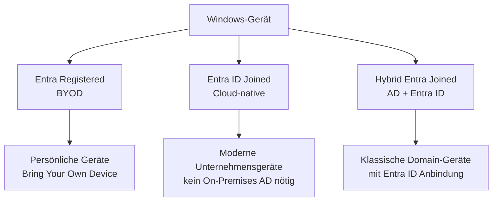
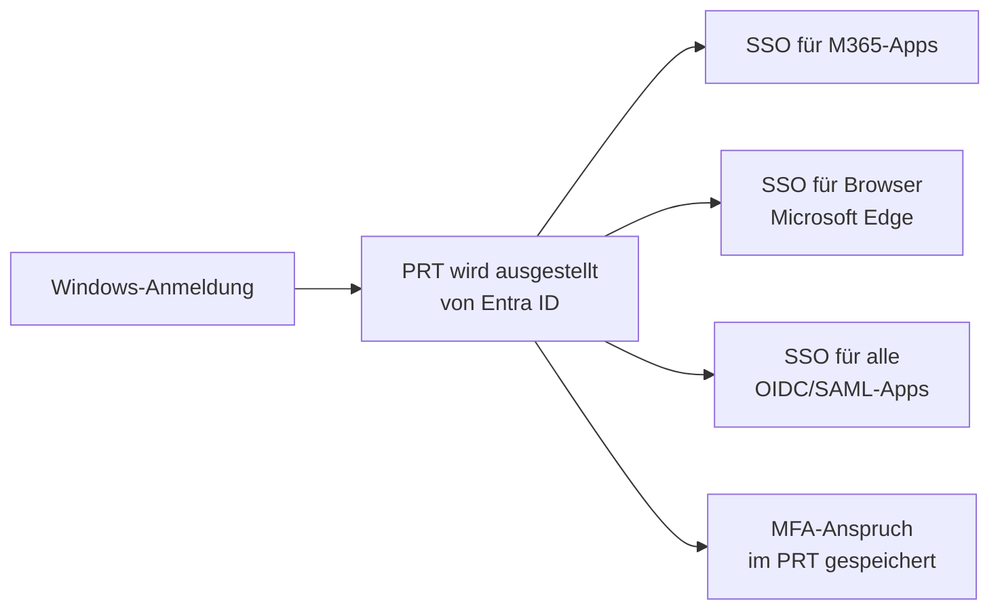
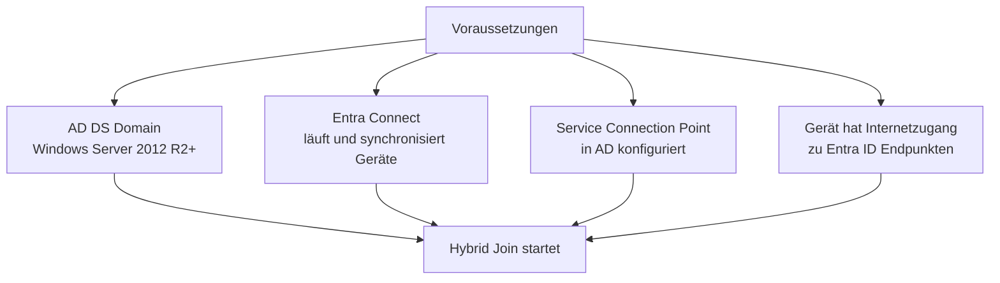
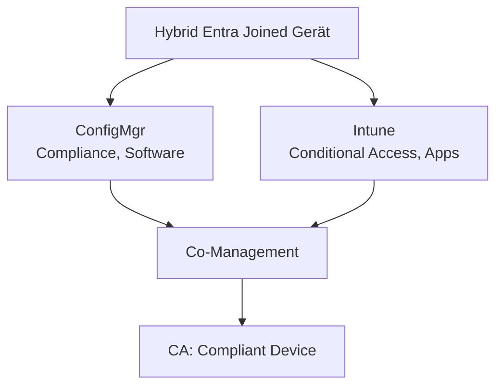

---
tags:
  - entra-id
  - geraete
  - hybrid-join
  - entra-join
  - windows
  - prt
aliases:
  - Device Join
  - Hybrid Entra Join
  - Azure AD Join
  - Geräteregistrierung
---

# Entra ID Join vs Hybrid Join

> [!ABSTRACT] TL;DR
> Geräte können auf drei Arten mit Entra ID verbunden werden: Registered (BYOD), Entra Joined (moderne Cloud-Geräte) oder Hybrid Entra Joined (sowohl AD als auch Entra ID). Der Primary Refresh Token (PRT) ermöglicht SSO auf verbundenen Geräten. `dsregcmd /status` ist das wichtigste Diagnosewerkzeug.

---

## Geräteregistrierungstypen im Überblick



| Aspekt | Entra Registered | Entra ID Joined | Hybrid Entra Joined |
|--------|-----------------|----------------|---------------------|
| **Zielgerät** | BYOD / persönlich | Unternehmensgerät | Domain-joined Unternehmensgerät |
| **Besitz** | Persönlich | Unternehmen | Unternehmen |
| **OS** | Windows, iOS, Android, macOS | Windows 10/11 | Windows 10/11 |
| **On-Premises AD nötig** | Nein | Nein | Ja |
| **Entra Connect nötig** | Nein | Nein | Ja |
| **Lokaler Admin** | Benutzer | Entra Global Admin | Domain Admin |
| **SSO (Cloud)** | Nein (manuell) | Ja (PRT) | Ja (PRT) |
| **SSO (On-Premises)** | Nein | Nein | Ja (Kerberos) |
| **Conditional Access** | Eingeschränkt | Vollständig | Vollständig |
| **Intune-Verwaltung** | Ja (MDM) | Ja | Ja |
| **Autopilot** | Nein | Ja | Nein |

---

## Primary Refresh Token (PRT)

Der PRT ist das zentrale Authentifizierungsartefakt für verbundene Geräte:



**Eigenschaften des PRT:**
- Gültigkeit: 14 Tage (wird bei Nutzung erneuert)
- Enthält: Geräteinformationen, Benutzeridentität, MFA-Anspruch
- Gespeichert im: TPM (bei Entra Joined), LSASS-Cache
- Gerätegebunden: Kann nicht auf anderem Gerät verwendet werden

> [!IMPORTANT] PRT und Conditional Access
> CA-Richtlinien mit "Konformes Gerät" oder "Hybrid Entra Joined" prüfen den PRT. Ohne gültigen PRT werden diese Richtlinien blockiert.

---

## Entra Registered (BYOD)

Für persönliche Geräte – minimale Unternehmenskontrolle:

```powershell
# Entra Registered prüfen
# Windows-Einstellungen → Konten → Auf Geschäfts- oder Schulkonto zugreifen
# → Gerät ist als "Verbunden mit FIRMA-Tenant" registriert (nicht joined)

# Entra Registered via Intune MDM (automatisch bei M365-Anmeldung möglich)
```

**Typische Nutzung:**
- Privatgeräte von Mitarbeitern
- Zugriff auf M365 (Teams, Outlook Web)
- Conditional Access: `Require approved client app` möglich

---

## Entra ID Joined

Vollständig cloud-native Windows-Geräte ohne lokales AD:

### Voraussetzungen

- Windows 10 (1903+) oder Windows 11
- Internet-Verbindung zu Entra ID
- Entra ID P1 (für Autopilot/Intune-Integration)

### Einrichten von Entra ID Join

```powershell
# Methode 1: OOBE (Out-of-Box-Experience)
# Beim ersten Windows-Start:
# "Wie möchtest du diesen PC einrichten?" → Für eine Organisation einrichten
# → Mit Entra ID (Azure AD) anmelden

# Methode 2: In bestehender Windows-Installation
# Einstellungen → Konten → Auf Geschäfts- oder Schulkonto zugreifen
# → Verbinden → Dieses Gerät mit Azure Active Directory verbinden

# Methode 3: Autopilot (empfohlen für Massendeployment)
# Zero-Touch-Deployment über Intune und Windows Autopilot
```

### Lokale Administratoren auf Entra-Joined-Geräten

```powershell
# Standardmäßig sind lokale Admins:
# - Der Benutzer, der das Gerät gejoined hat
# - Alle Entra-ID-Benutzer mit "Global Administrator"-Rolle

# Zusätzliche Admins per Gerätekonfiguration (Intune):
# Entra ID → Geräte → Geräteeinstellungen → Lokale Administrator-Einstellungen
# Oder: Conditional Access + Local Administrator Password Solution (LAPS)
```

---

## Hybrid Entra Joined

Geräte, die sowohl im On-Premises AD als auch in Entra ID registriert sind:

### Voraussetzungen



### Service Connection Point (SCP) konfigurieren

SCP teilt Domain-Geräten mit, zu welchem Entra-ID-Tenant sie joinen sollen:

```powershell
# SCP via Entra Connect konfigurieren (empfohlen)
# Entra Connect → Geräteoption konfigurieren → Hybrid Azure AD Join konfigurieren

# Oder manuell per PowerShell
Import-Module "C:\Program Files\Microsoft Azure Active Directory Connect\AdPrep\AdSyncPrep.psm1"

$Creds = Get-Credential   # Enterprise Admin
$AzureCreds = Get-Credential  # Global Admin

Initialize-ADSyncDomainJoinedComputerSync `
    -AdConnectorAccount "FIRMA\AAD_SyncAccount" `
    -AzureADCredentials $AzureCreds
```

### SCP prüfen

```powershell
# SCP in AD prüfen
$SCP = New-Object System.DirectoryServices.DirectoryEntry
$SCP.Path = "LDAP://CN=62a0ff2e-97b9-4513-943f-0d221bd30080,CN=Device Registration Configuration,CN=Services,CN=Configuration,DC=firma,DC=local"
$SCP.Keywords
# Ausgabe sollte zeigen: azureADName:firma und azureADId:tenant-id
```

---

## dsregcmd – Diagnose-Tool

Das wichtigste Werkzeug zur Diagnose von Gerätezustand und Join-Status:

```powershell
# Vollständiger Status
dsregcmd /status

# Wichtige Felder in der Ausgabe:

# --- Device State ---
# AzureAdJoined : YES   (Entra ID Joined)
# DomainJoined  : YES   (On-Premises AD Joined)
# WorkplaceJoined: NO   (Entra Registered = NO wenn Joined)

# --- Tenant Details ---
# TenantName    : Firma GmbH
# TenantId      : xxxxxxxx-xxxx-xxxx-xxxx-xxxxxxxxxxxx

# --- User State ---
# NgcSet        : YES   (Windows Hello konfiguriert)
# PrtAuthority  : sts.windows.net/tenant-id (PRT vorhanden)

# --- SSO State ---
# AzureAdPrt    : YES   (PRT vorhanden - SSO funktioniert)
# AzureAdPrtAuthority: https://login.microsoftonline.com/tenant-id
```

```powershell
# Häufige dsregcmd-Diagnosen
dsregcmd /status /debug    # Detaillierte Debug-Infos
dsregcmd /join             # Hybrid Join manuell auslösen
dsregcmd /leave            # Gerät aus Entra ID entfernen
```

---

## Wann welcher Join-Typ?

| Szenario | Empfehlung |
|----------|-----------|
| Neues Unternehmen, kein On-Premises AD | **Entra ID Joined** |
| Vorhandenes AD, Modernisierung | **Hybrid Entra Joined** (Übergang) → langfristig Entra Joined |
| Mitarbeiter mit Privatgerät | **Entra Registered** (BYOD) |
| Kiosk-Geräte / Shared Devices | **Entra ID Joined** mit Shared Device Mode |
| Autopilot Deployment | **Entra ID Joined** |
| Klassische Domain-Umgebung mit Gruppenrichtlinien | **Hybrid Entra Joined** |

---

## Co-Management (Intune + ConfigMgr)

Hybrid-Joined-Geräte können sowohl von ConfigMgr als auch Intune verwaltet werden:



---

## Windows Autopilot + Entra ID Join

Für Zero-Touch-Deployment neuer Geräte:

```powershell
# Autopilot-Hash eines Geräts ermitteln
# Auf dem Gerät ausführen (bei OOBE oder in Windows)
Install-Script -Name Get-WindowsAutoPilotInfo
Get-WindowsAutoPilotInfo -OutputFile AutoPilot.csv

# Hash in Intune/Autopilot importieren
# Portal: Intune → Geräte → Registrierung → Windows Autopilot → Geräte
```

---

## Troubleshooting

### Häufige Probleme bei Hybrid Join

| Problem | Ursache | Lösung |
|---------|---------|--------|
| `DomainJoined: YES` aber `AzureAdJoined: NO` | SCP fehlt oder Gerät nicht synchronisiert | SCP prüfen, Entra Connect Gerätesynchronisierung aktivieren |
| Gerät in Entra ID als "Ausstehend" | Gerät noch nicht bei Entra ID registriert | `dsregcmd /join` ausführen, Task Scheduler-Jobs prüfen |
| `PRT: NO` trotz Join | Token-Erneuerung fehlgeschlagen | NTLM/Kerberos-Konnektivität zu `device.login.microsoftonline.com` prüfen |
| Hybridjoin schlägt fehl auf Win7/8 | Veraltetes OS | Auf Windows 10/11 upgraden |
| Gerät nach Domain-Migration weg | Tenant-ID im SCP geändert | `dsregcmd /leave` dann `dsregcmd /join` |

```powershell
# Event Logs für Device Registration
Get-WinEvent -LogName "Microsoft-Windows-User Device Registration/Admin" -MaxEvents 50 |
    Where-Object {$_.Level -le 3} |
    Select-Object TimeCreated, Id, Message |
    Format-List

# PRT erneuern erzwingen
dsregcmd /refreshprt
```

---

## Verwandte Notizen

- [[Microsoft Entra ID Grundlagen]]
- [[Hybrid Identity Entra Connect]]
- [[Entra Connect Cloud Sync]]
- [[Conditional Access]]
- [[Multi-Factor Authentication]]
