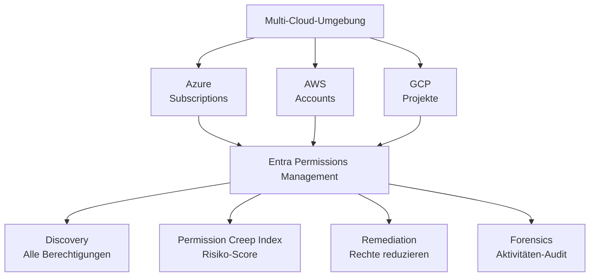
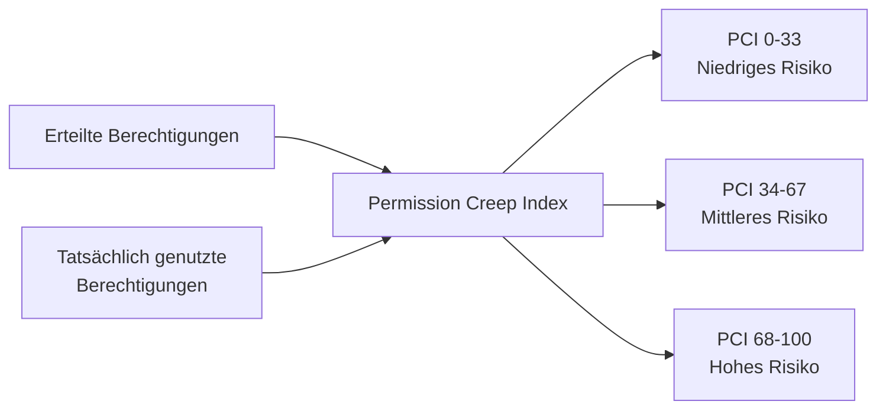
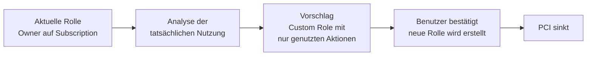

---
tags:
  - entra-id
  - permissions-management
  - ciem
  - cloud-security
  - aws
  - azure
  - gcp
aliases:
  - CIEM
  - Permission Creep
  - Entra Permissions
---

# Entra Permissions Management

> [!ABSTRACT] TL;DR
> Microsoft Entra Permissions Management ist ein CIEM-Tool (Cloud Infrastructure Entitlement Management), das übermäßige Berechtigungen in Azure, AWS und GCP erkennt und bereinigt. Der Permission Creep Index (PCI) misst das Risiko. Entra Permissions Management ergänzt IAM um Multi-Cloud-Sichtbarkeit.

---

## Was ist Entra Permissions Management?

Microsoft Entra Permissions Management (ehemals CloudKnox, 2021 von Microsoft übernommen) löst das Problem des **Permission Creep**: In der Cloud erhalten Identitäten mit der Zeit immer mehr Berechtigungen, nutzen aber nur einen Bruchteil davon. Dieses Übermaß an Rechten vergrößert die Angriffsfläche.



---

## Unterstützte Cloud-Plattformen

| Plattform | Identitätstypen |
|-----------|----------------|
| **Microsoft Azure** | Benutzer, Gruppen, Service Principals, Managed Identities |
| **Amazon Web Services** | IAM-Benutzer, IAM-Rollen, Gruppen |
| **Google Cloud Platform** | Benutzer, Dienstkonten, Gruppen |

---

## Permission Creep Index (PCI)

Der PCI ist der zentrale Risikoindikator in Entra Permissions Management:



**Berechnung (vereinfacht):**
- `PCI = (Erteilte Berechtigungen − Genutzte Berechtigungen) / Erteilte Berechtigungen × 100`
- Hoher PCI = Identität hat viele Rechte, nutzt aber kaum etwas davon

---

## Discovery

Entra Permissions Management entdeckt alle Berechtigungen im Multi-Cloud-Portfolio:

### Was wird entdeckt?

- **Identitäten**: Alle Benutzer, Rollen, Service Principals, Managed Identities
- **Ressourcen**: VMs, Storage, Datenbanken, Netzwerk
- **Berechtigungen**: Wer darf was auf welcher Ressource
- **Aktivitäten**: Was wurde wann tatsächlich genutzt (aus Cloud-Audit-Logs)

### Onboarding Azure

```
Entra Permissions Management Portal → Data Collectors → Azure → Subscription hinzufügen
```

Benötigte Berechtigungen:
- Reader-Rolle auf der zu analysierenden Subscription
- Zugriff auf Activity Logs

### Onboarding AWS

```
Entra Permissions Management Portal → Data Collectors → AWS
→ CloudFormation-Template herunterladen
→ Template in AWS-Account deployen (erstellt IAM-Rolle)
```

### Onboarding GCP

```
Entra Permissions Management Portal → Data Collectors → GCP
→ Terraform-Skript oder manuelle Service-Account-Erstellung
→ Erforderliche IAM-Rollen: Security Reviewer, Logs Viewer
```

---

## Risikoansichten

### Identitäten mit hohem PCI

```
Dashboard → Permissions → Permission Creep Index
→ Filter: PCI > 67 (Hoch)
→ Liste aller Identitäten mit übermäßigen Rechten
```

### Inaktive Identitäten

Identitäten, die sich in den letzten 90 Tagen nicht angemeldet haben:
- Ehemalige Mitarbeiter-Konten
- Service Accounts, die nicht mehr benötigt werden
- Testkonten

### Überprivilegierte Rollen

Identitäten mit gefährlichen Berechtigungen:
- Globale Administratoren / Owner ohne PIM
- Service Principals mit `Contributor` auf gesamter Subscription
- IAM-Rollen mit `AdministratorAccess` in AWS

---

## Remediation (Rechtereduzierung)

### Right-Sizing

Entra Permissions Management schlägt automatisch optimierte Richtlinien vor:



### Just-Enough-Access (JEA)

Für On-Demand-Zugriff:
1. Benutzer fordert Zugriff auf Ressource an
2. Entra Permissions Management erstellt temporäre Rolle
3. Zugriff ist zeitbegrenzt und protokolliert
4. Zugriff endet automatisch nach definierter Zeitspanne

### Berechtigungen direkt entfernen

```
Identität auswählen → Berechtigungen → Überflüssige entfernen
→ Automatisch oder nach Genehmigungsworkflow
```

---

## Forensics und Audit

### Aktivitäten-Timeline

Für jede Identität und Ressource ist eine vollständige Aktivitäts-Timeline verfügbar:
- Welche API-Calls wurden gemacht?
- Wann wurde welche Ressource zugegriffen?
- Von welchem IP und Gerät?

### Anomalie-Erkennung

Entra Permissions Management erkennt ungewöhnliche Aktivitätsmuster:
- Plötzliche Häufung von Ressourcen-Zugriffen
- Zugriff auf ungewöhnliche Ressourcentypen
- Massenhaftes Lesen von Daten (potenzielle Exfiltration)

### Berichte

```
Portal → Reports → Permissions Analytics Report
→ Exportierbar als CSV oder PDF
→ Enthält: PCI-Übersicht, riskante Identitäten, inaktive Konten
```

---

## Integration mit Entra ID

Entra Permissions Management integriert sich mit:

- **Entra ID PIM**: JIT-Anfragen können über PIM genehmigt werden
- **Entra ID Conditional Access**: Hochriskante Identitäten können mit CA-Richtlinien belegt werden
- **Microsoft Sentinel**: Alerts und Forensics können an Sentinel gestreamt werden
- **Microsoft Defender for Cloud**: Integration in Cloud-Security-Posture-Management

---

## Lizenzierung

> [!IMPORTANT] Separate Lizenzierung
> Entra Permissions Management ist **kein Bestandteil** von Entra ID P1/P2 oder Microsoft 365. Es wird separat lizenziert.

| Lizenzmodell | Beschreibung |
|-------------|-------------|
| **Pro Ressource** | Pro Azure-Subscription / AWS-Account / GCP-Projekt |
| **Trial** | 90-Tage-Kostenlose Testversion verfügbar |

```
Portal: entra.microsoft.com → Permissions Management → Kostenlos testen
```

---

## Einschränkungen und Grenzen

> [!NOTE] Bekannte Einschränkungen
> - Nur Azure, AWS und GCP werden unterstützt (kein on-premises)
> - Historische Aktivitätsdaten nur verfügbar, wenn Audit-Logs aktiviert waren
> - Änderungen werden **nicht automatisch** angewendet – immer manuelle Bestätigung oder Workflow nötig

---

## Verwandte Notizen

- [[Microsoft Entra ID Grundlagen]]
- [[Privileged Identity Management]]
- [[Conditional Access]]
- [[Identity Protection]]
