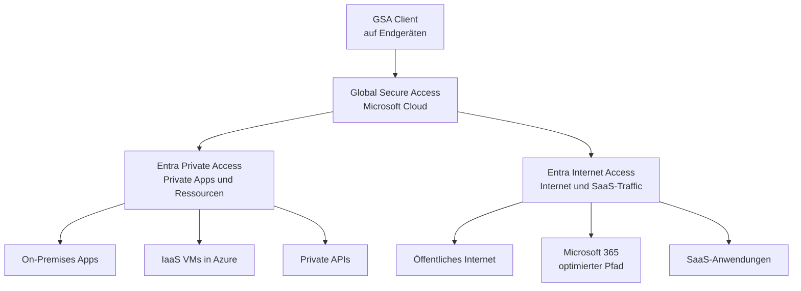
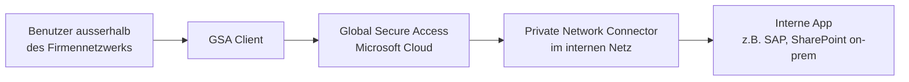
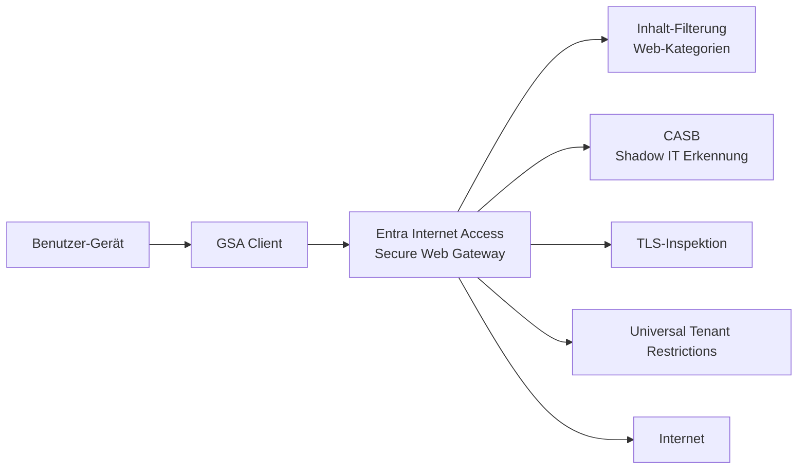
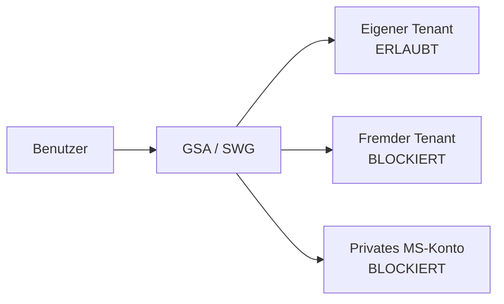
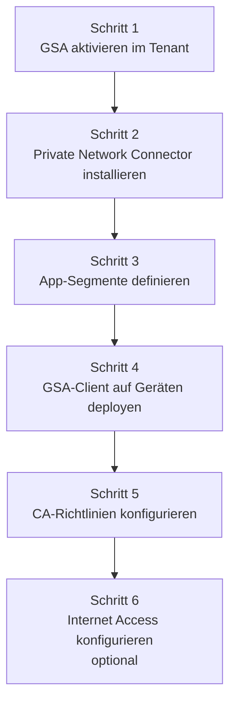

---
tags:
  - entra-id
  - private-access
  - internet-access
  - ztna
  - sase
  - global-secure-access
aliases:
  - GSA
  - Global Secure Access
  - ZTNA
  - Secure Web Gateway
---

# Entra Private Access und Internet Access

> [!ABSTRACT] TL;DR
> Microsoft Entra Private Access (ZTNA) ersetzt klassische VPNs durch Zero-Trust-Netzwerkzugriff auf private Anwendungen. Entra Internet Access (SWG) schützt den Internetdatenverkehr durch einen Secure Web Gateway. Beide sind Teil von Global Secure Access (GSA) und der Microsoft Entra Suite.

---

## Global Secure Access – Überblick

Global Secure Access (GSA) ist Microsofts **Security Service Edge (SSE)**-Lösung:



### Unterschied zu klassischem VPN

| Aspekt | Klassisches VPN | Entra Private Access |
|--------|----------------|---------------------|
| **Zugangsmodel** | Volles Netzwerk-Tunnel | Nur App-spezifischer Zugriff |
| **Vertrauen** | Einmal verbunden = vertraut | Jede Anfrage wird geprüft |
| **MFA/CA** | Nur beim VPN-Connect | Bei jeder App-Anfrage |
| **Lateral Movement** | Möglich | Verhindert (kein Netzwerk-Zugriff) |
| **Client** | VPN-Client | GSA-Client |
| **Gerätekompliance** | Optional | Erzwingbar über CA |
| **Skalierung** | VPN-Server-Kapazität | Microsoft-Cloud (global) |

---

## Via Microsoft Entra Admin Center (UI)

### Global Secure Access konfigurieren

#### Global Secure Access aktivieren

1. Öffne das **Microsoft Entra Admin Center** unter [entra.microsoft.com](https://entra.microsoft.com)
2. Navigiere zu **Global Secure Access → Erste Schritte**
3. Klicke auf **Aktivieren** um Global Secure Access für den Tenant zu aktivieren
4. Bestätige die Aktivierung — dies kann einige Minuten dauern

#### Private Network Connector installieren

1. Navigiere zu **Global Secure Access → Verbinden → Connectors**
2. Klicke auf **Neuen Connector herunterladen**
3. Führe den Installer auf einem Windows Server im internen Netzwerk aus (mindestens Windows Server 2019)
4. Authentifiziere dich während der Installation mit einem Entra ID-Administratorkonto
5. Nach erfolgreicher Installation erscheint der Connector als **Aktiv** in der Connector-Liste
6. Optional: Weise den Connector einer **Connector-Gruppe** zu

#### Quick Access konfigurieren (Private Access)

1. Navigiere zu **Global Secure Access → Anwendungen → Quick Access**
2. Klicke auf **Quick Access konfigurieren**
3. Füge private Ressourcen hinzu:
   - **FQDNs:** z. B. `intranet.firma.local`
   - **IP-Adressen/Bereiche:** z. B. `192.168.10.0/24`
   - **Ports:** z. B. `443`, `3389`
4. Weise eine **Connector-Gruppe** zu
5. Klicke auf **Speichern**

#### Internet Access konfigurieren

1. Navigiere zu **Global Secure Access → Internetdatenverkehrprofile**
2. Klicke auf **Profil erstellen** oder aktiviere das **Standardprofil**
3. Konfiguriere Filterrichtlinien (Web Content Filtering):
   - Navigiere zu **Global Secure Access → Schutz → Webinhaltsfilterung**
   - Erstelle Filterrichtlinien für Kategorien oder spezifische URLs
4. Verknüpfe das Profil mit einer CA-Richtlinie über **Global Secure Access Signale**

#### GSA-Client herunterladen und verteilen

1. Navigiere zu **Global Secure Access → Verbinden → Client-Download**
2. Lade den GSA-Client für die gewünschte Plattform herunter (Windows, macOS, Android, iOS)
3. Verteile den Client über **Intune** oder andere MDM-Lösungen an Endgeräte
4. Nach Installation verbindet sich der Client automatisch mit den konfigurierten Profilen

> [!TIP]
> Alternativ: **Azure Portal → Microsoft Entra ID → Global Secure Access**

---

## Microsoft Entra Private Access (ZTNA)

### Was ist ZTNA?

Zero Trust Network Access (ZTNA) ermöglicht Benutzern sicheren Zugriff auf **private Ressourcen** (On-Premises, Azure, andere Clouds) ohne klassisches VPN:



### Private Network Connector

Der Connector ist ein leichtgewichtiger Agent im internen Netzwerk:
- Kein eingehender Firewall-Port nötig (nur ausgehend HTTPS)
- Kann auf Windows Server oder in Docker laufen
- Hochverfügbarkeit: Mehrere Connectors pro Connector-Gruppe

```powershell
# Connector-Status prüfen
# Portal: Entra ID → Global Secure Access → Connectors

# Connector-Gruppe erstellen und Connector zuweisen
# Portal: GSA → Private Network → Connector Gruppen → Neue Gruppe
```

### Quick Access (Einfacher Einstieg)

Schnelle Konfiguration für den gesamten ZTNA-Zugriff:

```
Portal: Entra ID → Global Secure Access → Private Access → Quick Access
→ Private-Access-App erstellen
→ FQDNs und IP-Ranges hinzufügen
→ Connector-Gruppe zuweisen
→ Zugriffsrichtlinie (CA) konfigurieren
```

### App-spezifischer Zugriff

Granulare Steuerung pro Anwendung:

```json
{
  "appSegments": [
    {
      "destinationHost": "intern-erp.firma.local",
      "protocol": "TCP",
      "ports": ["443", "8080"]
    },
    {
      "destinationHost": "10.0.0.0/24",
      "protocol": "TCP",
      "ports": ["443"]
    }
  ]
}
```

---

## Microsoft Entra Internet Access (SWG)

### Was ist ein Secure Web Gateway?

Entra Internet Access filtert und sichert den **ausgehenden Internetdatenverkehr**:



### Funktionen

| Funktion | Beschreibung |
|----------|-------------|
| **Web-Inhaltsfilterung** | Blockieren nach Kategorien (Malware, Erwachseneninhalt, etc.) |
| **CASB** | Cloud Access Security Broker – Shadow IT erkennen |
| **TLS-Inspektion** | Verschlüsselten Traffic analysieren |
| **Universal Tenant Restrictions** | Nur eigenen Tenant zulassen (kein Daten-Exfiltration via fremde M365-Tenants) |
| **Compliant Network Check** | CA kann prüfen, ob Traffic über GSA läuft |

---

## Global Secure Access Client

### Installation

```powershell
# Windows Client installieren (per Intune oder manuell)
# Download: Entra ID Portal → Global Secure Access → Client herunterladen

# Per Intune deployen (Win32 App)
# Installer: GlobalSecureAccessClient.exe /quiet

# Client-Status prüfen
Get-Service -Name "GlobalSecureAccessTunnelManager"
Get-Service -Name "GlobalSecureAccessPolicyRetrieval"
```

### Unterstützte Plattformen

| Plattform | Status |
|-----------|--------|
| Windows 10/11 (joined) | GA |
| macOS | GA |
| iOS | Vorschau |
| Android | Vorschau |

> [!NOTE] Anforderungen
> Entra ID Join oder Hybrid Entra Joined für Windows. Der GSA-Client authentifiziert sich mit dem PRT des verbundenen Geräts.

---

## Universal Tenant Restrictions

Verhindert, dass Benutzer über ihren Browser auf fremde Microsoft-365-Tenants zugreifen (Datenexfiltration-Schutz):



```
Portal: GSA → Internet Access → Tenant Restrictions
→ Externen Tenants erlauben oder verbieten
→ Kategorie: Alle, Nur Microsoft, Spezifische Tenants
```

---

## Compliant Network Check

Entra Private Access und Internet Access ermöglichen eine neue CA-Bedingung:

```powershell
# CA-Richtlinie: Nur Zugriff wenn über GSA (Compliant Network)
$CAPolicy = @{
    displayName = "CA-Require-Compliant-Network"
    state = "enabled"
    conditions = @{
        users = @{includeUsers = @("All")}
        applications = @{includeApplications = @("All")}
        # Compliant Network = Traffic kommt über GSA
        # networkLocations = @{includeLocations = @("AllTrusted")}
    }
    grantControls = @{
        operator = "OR"
        builtInControls = @("compliantApplication")
    }
}
```

---

## GSA Dashboard

Das Dashboard zeigt:
- Verbundene Benutzer und Geräte
- Traffic-Statistiken (Private Access vs. Internet Access)
- Top Apps (Private Access)
- Blockierte Domains und Kategorien (Internet Access)
- Connector-Gesundheit

```
Portal: Entra ID → Global Secure Access → Dashboard
```

---

## Lizenzierung (Microsoft Entra Suite)

> [!IMPORTANT] Neue Lizenzen ab 2024
> GSA-Features sind in der **Microsoft Entra Suite** enthalten, die ab Juli 2024 verfügbar ist.

| Produkt | Lizenz |
|---------|--------|
| **Entra Private Access** | Microsoft Entra Suite oder Entra Private Access Add-on |
| **Entra Internet Access** | Microsoft Entra Suite oder Entra Internet Access Add-on |
| **Microsoft 365-Optimierung** | Kostenlos in M365-Lizenzen enthalten |

**Microsoft Entra Suite** enthält:
- Entra ID P2
- Entra Private Access
- Entra Internet Access
- Entra ID Governance

---

## Deployment-Reihenfolge



---

## Troubleshooting

### Häufige Probleme

| Problem | Ursache | Lösung |
|---------|---------|--------|
| Client verbindet nicht | GSA-Dienste laufen nicht | `Get-Service GlobalSecureAccess*` prüfen, Dienste neu starten |
| App nicht erreichbar | Connector offline | Connector-Status im Portal prüfen |
| Connector zeigt "Inaktiv" | Ausgehende Verbindung blockiert | Firewall: Port 443 zu `*.msappproxy.net` freigeben |
| Langsame Verbindung | Falscher Connector-Standort | Connector näher am Benutzer/App platzieren |
| CA blockiert trotz GSA | Compliant Network Check nicht konfiguriert | Named Location für GSA-Ausgang konfigurieren |

```powershell
# Lokale GSA-Diagnose auf Windows-Gerät
# Event Log prüfen
Get-WinEvent -LogName "Microsoft-Windows-GlobalSecureAccess/Operational" -MaxEvents 50 |
    Where-Object {$_.Level -le 3} |
    Select-Object TimeCreated, Id, Message

# GSA-Tunnel-Status
Get-NetRoute | Where-Object {$_.InterfaceAlias -like "*GlobalSecureAccess*"}
```

---

## Verwandte Notizen

- [[Microsoft Entra ID Grundlagen]]
- [[Conditional Access]]
- [[Entra ID Join vs Hybrid Join]]
- [[External Identities B2B]]
