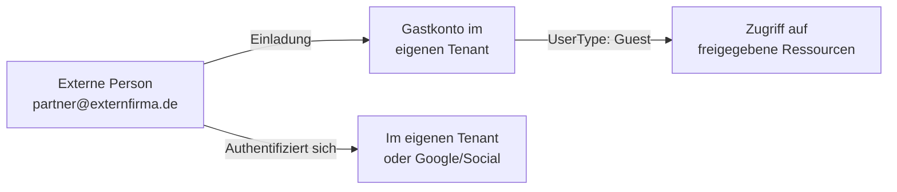
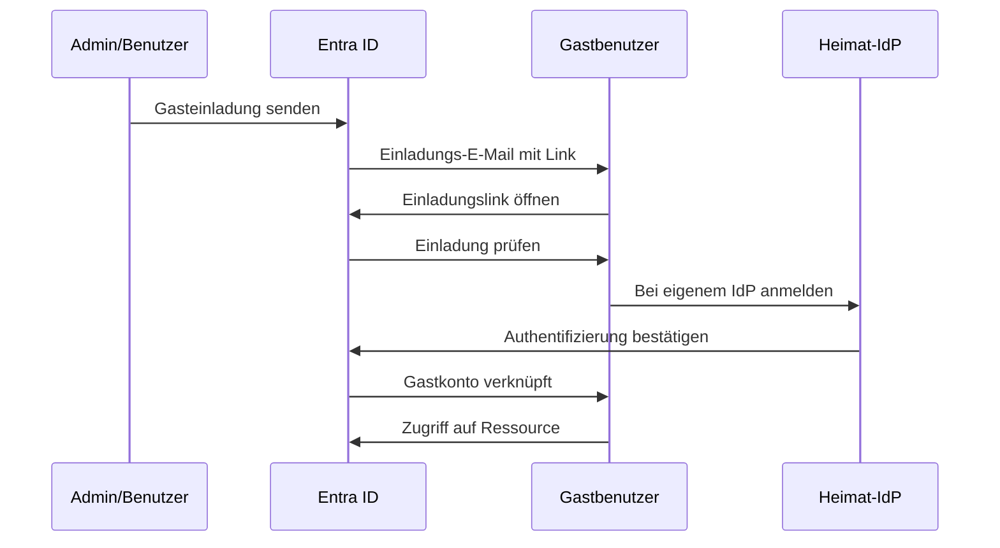
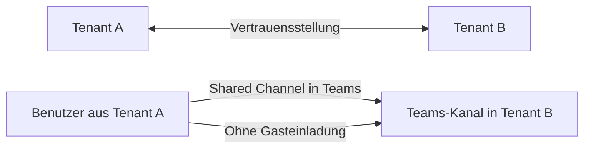
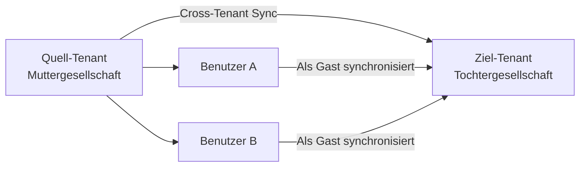
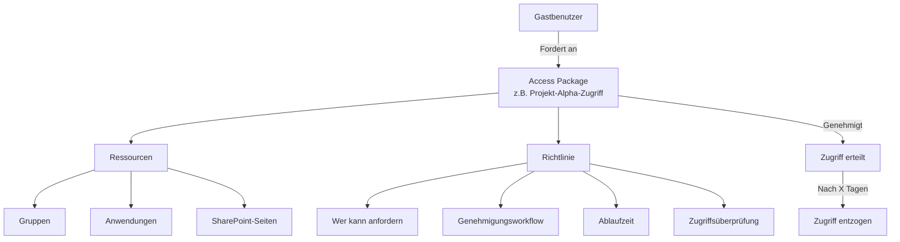
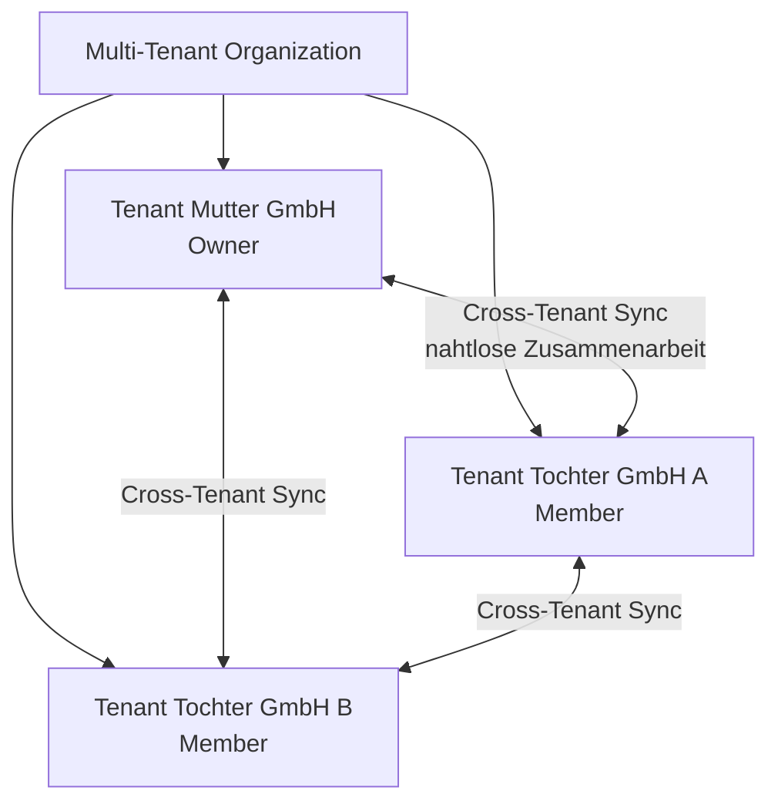

---
tags:
  - entra-id
  - b2b
  - external-identities
  - gastbenutzer
  - zusammenarbeit
aliases:
  - B2B Collaboration
  - Gastbenutzer
  - External Identities
---

# External Identities B2B

> [!ABSTRACT] TL;DR
> Entra External Identities B2B ermöglicht sichere Zusammenarbeit mit externen Partnern. Gastbenutzer können mit ihren eigenen Identitäten (M365, Google, SAML) auf freigegebene Ressourcen zugreifen. Entitlement Management (Access Packages) automatisiert Zugriffsprozesse. Multi-Tenant Organizations ermöglichen nahtlose Zusammenarbeit zwischen Unternehmenstöchtern.

---

## Gastbenutzer-Konzept

In Entra ID können externe Benutzer als **Gastbenutzer (B2B)** eingeladen werden:



**Unterschied Member vs. Guest:**
- `UserType: Member` = eigener Mitarbeiter
- `UserType: Guest` = externer Benutzer (eingeschränkte Standardberechtigungen)

---

## Unterstützte Identitätsprovider für Gäste

| IdP-Typ | Beschreibung |
|---------|-------------|
| **Microsoft Entra ID** | Partner hat eigenen M365-/Entra-ID-Tenant |
| **Microsoft-Konto (MSA)** | Hotmail, Outlook.com, Live.com |
| **Google** | Gmail-Konten |
| **Facebook** | Facebook-Konten |
| **Email OTP** | Einmalcode per E-Mail (kein Account nötig) |
| **SAML/WS-Fed IdP** | Beliebiger SAML 2.0 oder WS-Fed IdP |

> [!NOTE] Email OTP als Fallback
> Wenn keine andere Methode verfügbar ist, sendet Entra ID einen Einmalcode per E-Mail. Dies ermöglicht B2B-Zusammenarbeit mit jedem Benutzer, unabhängig vom IdP.

---

## B2B-Einladungsprozess (Redemption Flow)



### Gastbenutzer einladen

```powershell
# Einzelne Einladung
New-MgInvitation `
    -InvitedUserEmailAddress "partner@externfirma.de" `
    -InviteRedirectUrl "https://myapps.microsoft.com" `
    -InvitedUserDisplayName "Klaus Mustermann (ExternFirma)" `
    -SendInvitationMessage $true `
    -InvitedUserMessageInfo @{
        CustomizedMessageBody = "Hallo Klaus, bitte nehmen Sie unsere Einladung zur Zusammenarbeit an."
        MessageLanguage = "de"
    }

# Massenhaft einladen (CSV-Import)
$Guests = Import-Csv "guests.csv"  # Spalten: Email, DisplayName, Department

foreach ($Guest in $Guests) {
    New-MgInvitation `
        -InvitedUserEmailAddress $Guest.Email `
        -InviteRedirectUrl "https://myapps.microsoft.com" `
        -InvitedUserDisplayName $Guest.DisplayName `
        -SendInvitationMessage $true
    Write-Host "Eingeladen: $($Guest.DisplayName)"
}
```

---

## B2B Direct Connect

B2B Direct Connect ermöglicht tiefere Integration ohne explizite Einladung:



**Hauptanwendungsfall:** Geteilte Kanäle in Microsoft Teams mit externen Organisationen

```
Portal: Entra ID → External Identities → Cross-tenant access settings
→ Inbound settings → B2B direct connect aktivieren
→ Outbound settings → B2B direct connect erlauben
```

---

## Cross-Tenant Synchronization

Für enge Unternehmensverbünde: Automatische Synchronisierung von Benutzern als Gastbenutzer:



```powershell
# Cross-Tenant Sync konfigurieren
# Quell-Tenant: Provisioning-Konfiguration erstellen
# Portal: Entra ID → External Identities → Cross-tenant synchronization
# → Konfiguration → Neuer Synchronisierungs-Job
```

---

## Conditional Access für Gastbenutzer

```powershell
# CA-Richtlinie nur für Gastbenutzer
$GuestCAPolicy = @{
    displayName = "CA-Guests-MFA-Always"
    state = "enabled"
    conditions = @{
        users = @{
            includeGuestsOrExternalUsers = @{
                guestOrExternalUserTypes = "internalGuest,b2bCollaborationGuest,b2bCollaborationMember"
                externalTenants = @{membershipKind = "all"}
            }
        }
        applications = @{includeApplications = @("All")}
    }
    grantControls = @{
        operator = "OR"
        builtInControls = @("mfa")
    }
}
```

> [!TIP] Gäste immer mit MFA
> Für Gastbenutzer sollte MFA immer erzwungen werden, unabhängig vom Standort oder Gerät. Der eigene Tenant hat keine Kontrolle über die Sicherheit des Heimat-Tenants des Gastes.

---

## Entitlement Management (Access Packages)

Entitlement Management automatisiert den Zugriffslebenszyklus für externe (und interne) Benutzer:



### Access Package erstellen

```
Portal: Identity Governance → Entitlement Management → Access Packages
→ Neues Access Package
→ Name, Beschreibung, Katalog
→ Ressourcenrollen hinzufügen (Gruppen, Apps, SharePoint)
→ Richtlinie erstellen:
   - Benutzer die anfordern können: Externe Benutzer
   - Genehmigung: Manager oder Sponsoren
   - Ablauf: Nach X Tagen oder spezifisches Datum
   - Zugriffsüberprüfung: Quartalsweise
```

---

## Multi-Tenant Organizations (MTO)

Für Unternehmensgruppen mit mehreren Tenants (Muttergesellschaft + Tochtergesellschaften):



**MTO-Vorteile:**
- Einheitliches Teams-Erlebnis über Tenants
- Nahtlose Suche nach Benutzern in allen Tenants
- Synchronisierte Präsenz und Kontaktdaten

```
Portal: Entra ID → External Identities → Multi-tenant organization
→ Organisation erstellen
→ Tenants einladen
→ Cross-Tenant Sync konfigurieren
```

---

## External Collaboration Settings

Globale Einstellungen für B2B-Zusammenarbeit:

```
Portal: Entra ID → External Identities → External collaboration settings
```

Konfigurierbare Einstellungen:
- **Gastbenutzer-Zugriffseinschränkungen**: Welche Verzeichnisinformationen Gäste sehen können
- **Einladungseinstellungen**: Wer darf Gäste einladen (Alle, Mitglieder, Admins, Niemand)
- **Einschränkungen für die externe Zusammenarbeit**: Whitelist/Blacklist von Domains
- **Self-Service-Registrierung**: Ob externe Benutzer sich selbst registrieren können

```powershell
# Einladungen nur für bestimmte Domains erlauben
# Portal: External collaboration settings → Zusammenarbeit einschränken
# → Nur für bestimmte Domains erlauben (Whitelist): externfirma.de, partner.com

# Per Graph API
$CollabSettings = @{
    allowInvitesFrom = "adminsAndGuestInviters"
    allowedToSignUpEmailBasedSubscriptions = $true
    guestUserRoleId = "10dae51f-b6af-4016-8d66-8c2a99b929b3"  # Guest User
    collaborationRestrictions = @{
        restrictedToSpecificDomains = $true
        allowedDomains = @("externfirma.de", "partner.com")
    }
}
```

---

## Gastbenutzer verwalten und bereinigen

```powershell
# Alle Gastbenutzer auflisten
Get-MgUser -Filter "userType eq 'Guest'" -All |
    Select-Object DisplayName, Mail, CreatedDateTime, SignInActivity |
    Sort-Object CreatedDateTime

# Inaktive Gastbenutzer finden (keine Anmeldung seit 90 Tagen)
$Cutoff = (Get-Date).AddDays(-90).ToString("yyyy-MM-ddTHH:mm:ssZ")
Get-MgUser -Filter "userType eq 'Guest' and signInActivity/lastSignInDateTime le $Cutoff" -All |
    Select-Object DisplayName, Mail, @{N="LetzteAnmeldung";E={$_.SignInActivity.LastSignInDateTime}}

# Gastbenutzer entfernen
Remove-MgUser -UserId "gast@externfirma.de#EXT#@firma.onmicrosoft.com"
```

---

## Troubleshooting

### Häufige B2B-Probleme

| Problem | Ursache | Lösung |
|---------|---------|--------|
| Gasteinladung wird nicht angenommen | E-Mail im SPAM | SPAM-Filter prüfen, Einladung erneut senden |
| Gast kann sich nicht anmelden | IdP-Vertrauensstellung fehlt | Cross-tenant access settings prüfen |
| Gast sieht keine App | Kein Zugriff zugewiesen | Gruppe oder direkte App-Zuweisung prüfen |
| Gast kann Verzeichnis durchsuchen | Gastbeschränkungen zu locker | External collaboration settings → Gastbenutzer-Zugriff einschränken |
| MFA wird für Gast nicht erzwungen | CA-Richtlinie schließt Gäste nicht ein | CA-Richtlinie für Gastbenutzer prüfen |

```powershell
# Einlösungsstatus einer Einladung prüfen
Get-MgUser -Filter "mail eq 'gast@externfirma.de'" |
    Select-Object DisplayName, ExternalUserState, ExternalUserStateChangeDateTime
# ExternalUserState: PendingAcceptance oder Accepted
```

---

## Verwandte Notizen

- [[Microsoft Entra ID Grundlagen]]
- [[Conditional Access]]
- [[Benutzer und Gruppen]]
- [[Entra ID B2C]]
- [[Single Sign-On]]
