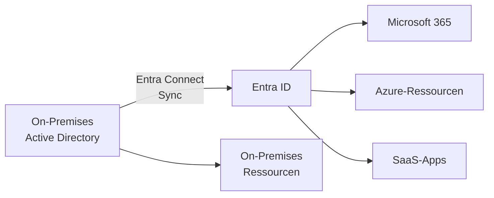
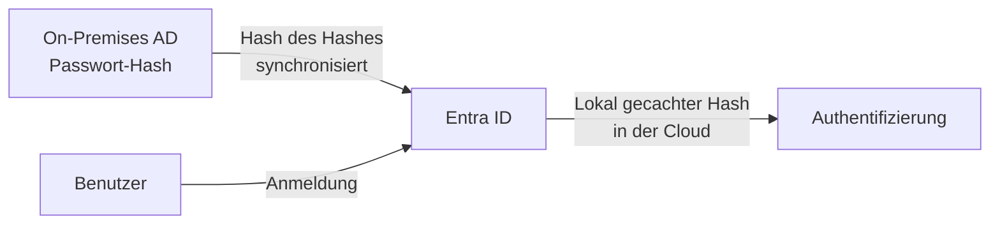
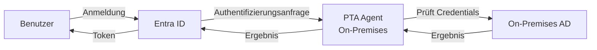
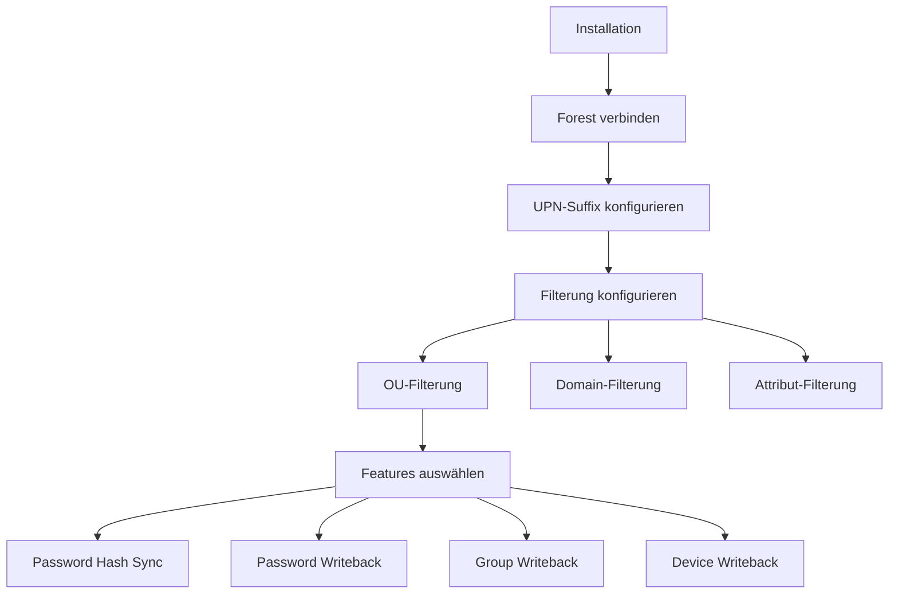

---
tags:
  - entra-id
  - hybrid-identity
  - entra-connect
  - active-directory
  - synchronisation
aliases:
  - Azure AD Connect
  - Entra Connect
  - Hybrid AD
---

# Hybrid Identity Entra Connect

> [!ABSTRACT] TL;DR
> Microsoft Entra Connect synchronisiert On-Premises-Active-Directory-Objekte mit Entra ID und ermöglicht hybride Identitäten. Drei Sync-Methoden stehen zur Wahl: Password Hash Sync (empfohlen), Pass-through Authentication oder ADFS-Verbund. Entra Connect Health überwacht den Synchronisierungsstatus.

---

## Was ist Hybrid Identity?

Hybrid Identity verbindet On-Premises Active Directory (AD DS) mit Entra ID, sodass:
- Benutzer **eine einzige Identität** für on-premises und Cloud-Ressourcen haben
- On-Premises-Passwörter für Cloud-Dienste genutzt werden können (oder synchronisiert werden)
- Geräte sowohl on-premises als auch in der Cloud registriert sind



---

## Entra Connect vs. Entra Connect Cloud Sync

| Aspekt | Entra Connect | Cloud Sync |
|--------|--------------|-----------|
| **Installation** | On-Premises-Server erforderlich | Leichtgewichtiger Agent |
| **Konfiguration** | Lokal auf Server | Im Entra-ID-Portal (Cloud) |
| **Multi-Forest** | Ja (komplexe Konfiguration) | Ja (einfacher) |
| **ADFS-Integration** | Ja | Nein |
| **Device Writeback** | Ja | Eingeschränkt |
| **Group Writeback** | Ja | Ja (v2) |
| **Empfehlung** | Komplexe Umgebungen | Einfache/mittlere Umgebungen |

---

## Sync-Methoden

### 1. Password Hash Sync (PHS) – Empfohlen



**Vorteile:**
- Authentifizierung findet **vollständig in der Cloud** statt
- On-Premises-Ausfall beeinträchtigt Cloud-Anmeldung nicht
- Leaked Credentials Detection (Identity Protection)
- Einfachste Konfiguration

**Wichtig:** Es wird nicht das Passwort, sondern ein **Hash des MD4-Hashes** synchronisiert. Das Originalpasswort verlässt nie das on-premises Netzwerk.

### 2. Pass-through Authentication (PTA)



**Vorteile:**
- Passwörter werden niemals in die Cloud synchronisiert
- Passwortrichtlinien werden von On-Premises AD erzwungen
- Sofortige Konto-Deaktivierung wirkt sich auf Cloud aus

**Nachteile:**
- On-Premises-Ausfall → keine Cloud-Anmeldung
- Mindestens 2-3 PTA-Agents für Hochverfügbarkeit nötig

### 3. Federation mit ADFS


**Vorteile:**
- Vollständige Kontrolle über Authentifizierung
- Smart Card / PKI-Authentifizierung möglich
- Komplexe Claims-Transformationen

**Nachteile:**
- Komplexeste Lösung, höchste Wartungskosten
- ADFS ist ein Single Point of Failure (mindestens 2 Server nötig)
- Microsoft empfiehlt Migration weg von ADFS zu PHS/PTA

---

## Installation von Entra Connect

### Systemvoraussetzungen

- Windows Server 2016 oder neuer (Server Core nicht unterstützt)
- .NET Framework 4.6.2 oder höher
- Mindestens 4 GB RAM, 70 GB freier Speicher
- SQL Server (Express für <100.000 Objekte inkl., sonst Full SQL)
- Netzwerkzugriff zu `*.msappproxy.net`, `*.servicebus.windows.net`, Login-Endpunkten

### Installations-Schritte

```powershell
# 1. Entra Connect Installer herunterladen
# Von: https://www.microsoft.com/en-us/download/details.aspx?id=47594

# 2. Installer als Administrator ausführen
# Setup-Assistent führt durch:
# - Express vs. Customize
# - Sync-Methode wählen (PHS empfohlen)
# - Forest verbinden (Enterprise Admin Credentials)
# - UPN-Suffix konfigurieren
# - OU-Filterung (optional)
# - Feature-Auswahl
```

> [!IMPORTANT] Konto-Anforderungen
> Entra Connect benötigt ein **Domain Admin**-Konto für den AD-Zugriff und ein **Globaler Administrator**-Konto für Entra ID. Es werden automatisch Dienstkonten erstellt (MSOL_xxxxxxxxxx und AAD_xxxxxxxxxx).

### Custom Installation (wichtige Optionen)



---

## UPN-Suffix-Konfiguration

> [!WARNING] UPN vor dem Sync konfigurieren
> Benutzer müssen in AD einen UPN mit einer **verifizierten Domain** in Entra ID haben. `benutzer@firma.local` funktioniert nicht – `.local`-Domains können nicht in Entra ID verifiziert werden.

```powershell
# Alternativen UPN-Suffix in AD hinzufügen
# Auf dem Domain Controller:
$Forest = [System.DirectoryServices.ActiveDirectory.Forest]::GetCurrentForest()
$Forest.RootDomain.DomainModeLevel

# UPN-Suffix hinzufügen (Active Directory Domains and Trusts → Suffixe)
# Oder per PowerShell:
Set-ADForest -UPNSuffixes @{Add="firma.de"}

# Benutzer-UPN aktualisieren
Get-ADUser -Filter * -SearchBase "OU=Users,DC=firma,DC=local" |
    ForEach-Object {
        $NewUPN = $_.SamAccountName + "@firma.de"
        Set-ADUser $_ -UserPrincipalName $NewUPN
    }
```

---

## Attribut-Synchronisation

Standardmäßig synchronisierte Attribute (Auswahl):

| AD-Attribut | Entra-ID-Attribut |
|-------------|-----------------|
| `userPrincipalName` | `userPrincipalName` |
| `displayName` | `displayName` |
| `mail` | `mail` |
| `department` | `department` |
| `telephoneNumber` | `telephonNumber` |
| `sAMAccountName` | `onPremisesSamAccountName` |
| `objectGUID` | `onPremisesImmutableId` |
| `memberOf` | `memberOf` (Gruppen) |

### Attribut-Filterung und Custom Attribute Mapping

```powershell
# Synchronisierungsregeln anzeigen
# Start-Menü: Synchronization Rules Editor

# Synchronisierungsregel mit Entra Connect PowerShell
Import-Module "ADSync"

# Alle Synchronisierungsregeln anzeigen
Get-ADSyncRule | Select-Object Name, Direction, Priority, Connector

# Manuellen Sync ausführen
Start-ADSyncSyncCycle -PolicyType Delta   # Delta-Sync (nur Änderungen)
Start-ADSyncSyncCycle -PolicyType Initial # Full-Sync (alle Objekte)
```

---

## Filtering (Filterung)

### OU-basierte Filterung

Nur bestimmte Organizational Units synchronisieren:

```powershell
# Aktuelle OU-Filter anzeigen
Get-ADSyncConnector | Where-Object {$_.ConnectorTypeName -eq "AD"} |
    Select-Object -ExpandProperty ConnectorPartitions |
    Select-Object Name, Filter

# OU-Filter im Assistenten konfigurieren:
# Entra Connect → Domain/OU-Filterung → Nur ausgewählte Domänen und OUs
```

### Attribut-basierte Filterung

Nur Benutzer synchronisieren, die ein bestimmtes Attribut gesetzt haben:

```powershell
# Beispiel: Nur Benutzer mit extensionAttribute1 = "Sync"
# In Synchronization Rules Editor:
# Eingehende Regel erstellen mit Scoping Filter:
# Attribut: extensionAttribute1
# Operator: EQUAL
# Wert: Sync
```

---

## Soft Match und Hard Match

Entra Connect verbindet bestehende Cloud-Objekte mit AD-Objekten:

| Match-Typ | Mechanismus | Verwendung |
|-----------|------------|-----------|
| **Hard Match** | `sourceAnchor` (ImmutableId = objectGUID) | Neue Synchronisierungen |
| **Soft Match** | UPN oder E-Mail-Adresse | Bestehende Cloud-Objekte übernehmen |

```powershell
# ImmutableId für einen Benutzer setzen (Hard Match erzwingen)
$GUID = (Get-ADUser -Identity "vorname.nachname").ObjectGUID
$ImmutableId = [System.Convert]::ToBase64String($GUID.ToByteArray())

Update-MgUser -UserId "cloud-user@firma.de" -OnPremisesImmutableId $ImmutableId
```

---

## Staging Mode (Stagingmodus)

Ein zweiter Entra Connect-Server im Stagingmodus:
- Läuft aktiv Sync durch, **schreibt aber nichts** nach Entra ID
- Einfaches Failover möglich (Staging → Aktiv umschalten)
- Kann für Testen von Konfigurationsänderungen genutzt werden

```powershell
# Stagingmodus aktivieren/deaktivieren
# Entra Connect → Konfiguration → Stagingmodus

# Aktuellen Status prüfen
(Get-ADSyncScheduler).StagingModeEnabled
```

---

## Entra Connect Health

Entra Connect Health überwacht den Synchronisierungsstatus:

```
Entra ID Portal → Entra Connect Health
→ SYNC: Sync-Fehler, Objekt-Fehler, Latenz
→ ADFS: ADFS-Server-Status
→ AD DS: Domain Controller-Status
```

```powershell
# Health Agent installieren (auf Entra Connect Server)
# Download: https://aka.ms/aadconnecthealthagentdownload
# Installation: MSI-Datei ausführen, mit Global Admin registrieren

# Sync-Fehler anzeigen
Get-MgDirectoryOnPremiseSynchronization
```

---

## Troubleshooting häufige Fehler

### Sync-Fehler diagnostizieren

```powershell
# Sync-Fehler anzeigen
Get-ADSyncCSObject -ConnectorName "firma.de" -DistinguishedName "CN=Max,OU=Users,DC=firma,DC=local" |
    Select-Object -ExpandProperty SyncErrorDetails

# Event Log auf Sync-Server prüfen
Get-EventLog -LogName "Application" -Source "ADSync" -Newest 50 |
    Where-Object {$_.EntryType -eq "Error"} |
    Select-Object TimeGenerated, Message

# Entra Connect Troubleshooter
Start-ADConnectDiagnostics
```

### Häufige Fehler

| Fehler | Ursache | Lösung |
|--------|---------|--------|
| `DUPLICATE_ATTRIBUTE` | Doppelte E-Mail oder UPN in AD | Doppelte Attribute in AD bereinigen |
| `OBJECT_FROM_DELETED_OBJECTS_CONTAINER` | Objekt im AD Papierkorb | Objekt wiederherstellen oder Papierkorb leeren |
| `LARGE_OBJECT` | Attribut überschreitet 150 KB (z. B. Fotos) | Attributgröße reduzieren oder Filterung |
| `FEDERATED_DOMAIN_CHANGE` | UPN-Domain nicht in Entra ID verifiziert | Domain in Entra ID verifizieren |
| `INVALID_SOFT_MATCH` | Soft Match auf mehrere Objekte | ImmutableId manuell setzen (Hard Match) |

---

## Upgrades

> [!WARNING] Upgrade-Pfad beachten
> Immer auf die **aktuelle Version** upgraden. Entra Connect hat ein 12-Monats-Supportfenster. Veraltete Versionen werden nicht mehr unterstützt und können Sicherheitslücken haben.

```powershell
# Aktuelle Version prüfen
(Get-Module ADSync).Version

# Neueste Version herunterladen und Installer ausführen
# Upgrade ist in-place möglich (Konfiguration bleibt erhalten)
```

---

## Verwandte Notizen

- [[Microsoft Entra ID Grundlagen]]
- [[Entra Connect Cloud Sync]]
- [[Entra ID Join vs Hybrid Join]]
- [[Single Sign-On]]
