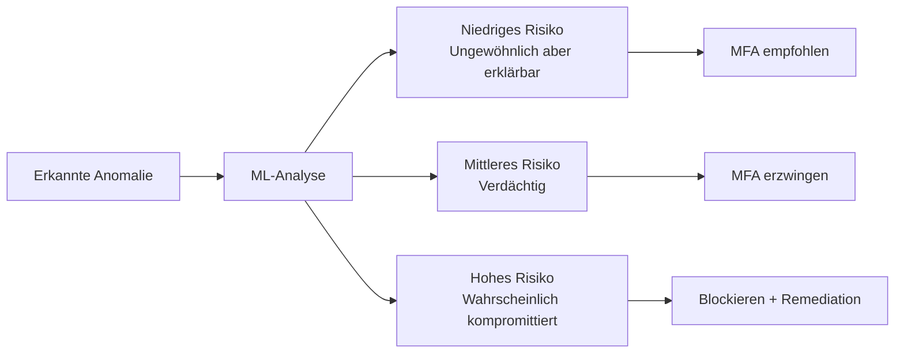
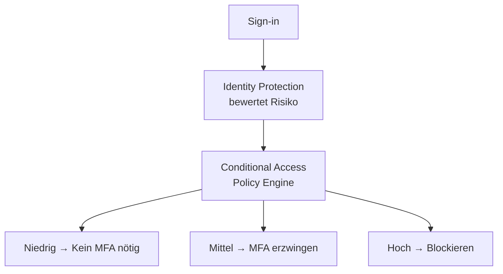
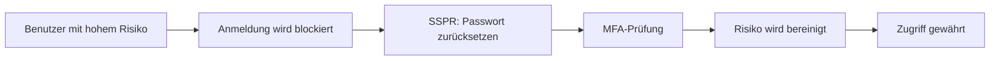

---
tags:
  - entra-id
  - identity-protection
  - risiko
  - sicherheit
  - microsoft-365
aliases:
  - Entra Identity Protection
  - Risikobasierte Authentifizierung
  - Risk-based CA
---

# Identity Protection

> [!ABSTRACT] TL;DR
> Microsoft Entra Identity Protection analysiert Milliarden von Signalen täglich und erkennt riskante Anmeldungen und kompromittierte Konten automatisch. Risikobasierte Conditional-Access-Richtlinien reagieren in Echtzeit: MFA erzwingen bei mittlerem Risiko, Passwort-Reset bei hohem Risiko, blockieren bei kritischen Bedrohungen.

---

## Was ist Identity Protection?

Microsoft Entra Identity Protection nutzt maschinelles Lernen und Microsofts Threat Intelligence, um anomales Anmeldeverhalten zu erkennen. Es schützt vor:

- Gestohlenen Zugangsdaten (Credential Stuffing)
- Brute-Force-Angriffen
- Unmöglichen Reisen (ein Konto meldet sich in 5 Minuten von München und New York an)
- Anonymen Proxy-Anmeldungen
- Token-Diebstahl

> [!IMPORTANT] Lizenzanforderung
> Identity Protection erfordert **Entra ID P2**. Mit P1 sind nur eingeschränkte Berichte verfügbar, keine risikobasierten Richtlinien.

---

## Risikoerkennungen (Risk Detections)

### Sign-in Risk Detections (Anmelde-Risiko)

Bewertung einer einzelnen Anmeldesitzung:

| Erkennung | Beschreibung | Risikolevel |
|-----------|-------------|------------|
| **Anonymous IP Address** | Anmeldung über TOR oder anonymen Proxy | Mittel |
| **Atypical Travel** | Anmeldung von geografisch unmöglichem Ort | Mittel |
| **Impossible Travel** | Zwei Anmeldungen mit zu kurzer Reisezeit | Hoch |
| **Malware-linked IP** | IP mit bekannter Malware-Aktivität | Mittel |
| **Unfamiliar Sign-in Properties** | Neue Geräte-/Browser-/Standortkombo | Niedrig/Mittel |
| **Token Issuer Anomaly** | Verdächtiger Token-Aussteller | Hoch |
| **Suspicious Browser** | Schnelle Sitzungswechsel aus demselben Browser | Mittel |
| **Password Spray** | Viele Benutzer mit wenigen Passwörtern | Hoch |
| **Mass Access to Sensitive Files** | Ungewöhnlicher Dateizugriff in SharePoint | Mittel |
| **Verified Threat Actor IP** | Bekannte Angreifer-IP aus Threat Intelligence | Hoch |

### User Risk Detections (Benutzer-Risiko)

Längerfristige Bewertung des Benutzerkontos:

| Erkennung | Beschreibung | Risikolevel |
|-----------|-------------|------------|
| **Leaked Credentials** | Zugangsdaten in Dark-Web-Leaks gefunden | Hoch |
| **Anomalous User Activity** | Ungewöhnliches Aktivitätsmuster | Mittel/Hoch |
| **Possible Attempt to Access PRT** | Verdächtiger Primary Refresh Token-Zugriff | Hoch |
| **Suspicious API Traffic** | Ungewöhnliche Graph-API-Zugriffe | Mittel |
| **User Reported Suspicious Activity** | Benutzer meldet verdächtigen MFA-Push | Hoch |

---

## Risiko-Level und Bedeutung



| Risikolevel | Bedeutung | Empfohlene Reaktion |
|-------------|-----------|-------------------|
| **Niedrig** | Ungewöhnlich, aber wahrscheinlich legitim | Monitoring, optional MFA |
| **Mittel** | Verdächtig, Handlung empfohlen | MFA erzwingen |
| **Hoch** | Hohes Kompromittierungsrisiko | Blockieren, Passwort-Reset oder Admin-Review |

---

## Via Microsoft Entra Admin Center (UI)

### Identity Protection konfigurieren

#### Identity Protection Dashboard öffnen

1. Öffne das **Microsoft Entra Admin Center** unter [entra.microsoft.com](https://entra.microsoft.com)
2. Navigiere zu **Schutz → Identity Protection**
3. Das Dashboard zeigt:
   - **Neue riskante Benutzer:** Benutzer mit erkannten Risiken
   - **Neue riskante Anmeldungen:** Anmeldungen mit Risikoerkennung
   - **Risikoerkennungen:** Übersicht aller Erkennungstypen

#### Risikobasierte CA-Richtlinie konfigurieren (empfohlen)

1. Navigiere zu **Schutz → Bedingter Zugriff → + Neue Richtlinie**
2. Vergib einen Namen, z. B. `CA – Anmelde-Risiko hoch → MFA`
3. Konfiguriere unter **Zuweisungen → Benutzer:** Alle Benutzer (Break-Glass ausschließen)
4. Konfiguriere unter **Zielressourcen:** Alle Cloud-Apps
5. Konfiguriere unter **Bedingungen → Anmelde-Risiko:**
   - Aktiviere **Konfigurieren**
   - Wähle **Hoch** und **Mittel**
6. Konfiguriere unter **Zugriffssteuerungen → Gewähren:**
   - **Zugriff gewähren** → **Multi-Faktor-Authentifizierung erforderlich**
7. Setze den Status auf **Aktiviert** und klicke auf **Erstellen**

#### Riskante Benutzer anzeigen und verwalten

1. Navigiere zu **Schutz → Identity Protection → Riskante Benutzer**
2. Filtere nach **Risikostufe:** Hoch / Mittel / Niedrig
3. Klicke auf einen Benutzer für Details:
   - **Erkannte Risiken:** Welche Anomalien wurden erkannt
   - **Anmeldeverlauf:** Verdächtige Anmeldungen
4. Ergreife Maßnahmen:
   - **Benutzer sperren:** Klicke auf **Benutzer sperren**
   - **Kennwortreset erzwingen:** Klicke auf **Benutzerkennwort zurücksetzen**

#### Risiko als False Positive markieren

1. Navigiere zu **Schutz → Identity Protection → Riskante Benutzer**
2. Wähle den betreffenden Benutzer aus (Checkbox aktivieren)
3. Klicke in der oberen Leiste auf **Risiko verwerfen**
4. Bestätige die Aktion — das Benutzerrisiko wird auf **Keine** zurückgesetzt

#### Benutzerrisikorichtlinie direkt konfigurieren (Legacy)

1. Navigiere zu **Schutz → Identity Protection → Benutzerrisikorichtlinie**
2. Konfiguriere:
   - **Zuweisungen:** Alle Benutzer oder spezifische Gruppen
   - **Benutzerrisiko:** Schwellenwert (Hoch / Mittel und Hoch)
   - **Steuerelemente:** Zugriff blockieren oder Kennwortänderung erzwingen
3. Setze **Richtlinie erzwingen** auf **Ein** und klicke auf **Speichern**

> [!TIP]
> Alternativ: **Azure Portal → Microsoft Entra ID → Sicherheit → Identity Protection**

---

## Risikobasierte Richtlinien

### Konfiguration über Conditional Access (Empfohlen)

Die moderne Methode: Risikobasierte CA-Richtlinien konfigurieren:



```powershell
# CA-Richtlinie: MFA bei Sign-in Risiko Mittel/Hoch
$SignInRiskPolicy = @{
    displayName = "CA-SignIn-Risk-MFA"
    state = "enabled"
    conditions = @{
        users = @{
            includeUsers = @("All")
            excludeUsers = @("breakglass-id")
        }
        applications = @{includeApplications = @("All")}
        signInRiskLevels = @("medium", "high")
    }
    grantControls = @{
        operator = "OR"
        builtInControls = @("mfa")
    }
}

New-MgIdentityConditionalAccessPolicy -BodyParameter ($SignInRiskPolicy | ConvertTo-Json -Depth 10)

# CA-Richtlinie: Passwort-Reset bei User Risiko Hoch
$UserRiskPolicy = @{
    displayName = "CA-User-Risk-Password-Change"
    state = "enabled"
    conditions = @{
        users = @{
            includeUsers = @("All")
            excludeUsers = @("breakglass-id")
        }
        applications = @{includeApplications = @("All")}
        userRiskLevels = @("high")
    }
    grantControls = @{
        operator = "AND"
        builtInControls = @("mfa", "passwordChange")
    }
}

New-MgIdentityConditionalAccessPolicy -BodyParameter ($UserRiskPolicy | ConvertTo-Json -Depth 10)
```

### Legacy: Direkte Identity Protection Policies

> [!NOTE] Veralteter Ansatz
> Die direkt in Identity Protection konfigurierbaren Richtlinien (Sign-in Risk Policy, User Risk Policy) werden weiterhin unterstützt, aber Microsoft empfiehlt die Migration zu Conditional Access für mehr Flexibilität.

---

## Risky Users Dashboard

```
Entra ID Portal → Sicherheit → Identity Protection → Riskante Benutzer
```

Das Dashboard zeigt:
- **Risiko-Level** (Niedrig/Mittel/Hoch)
- **Letzte Risikoerkennung** und Typ
- **Zeitstempel** der Erkennung
- **Status** (At Risk, Remediated, Dismissed)

```powershell
# Riskante Benutzer per PowerShell auflisten
Get-MgRiskyUser -Filter "riskLevel eq 'high'" |
    Select-Object UserDisplayName, UserPrincipalName, RiskLevel, RiskState, RiskLastUpdatedDateTime |
    Sort-Object RiskLastUpdatedDateTime -Descending

# Riskante Benutzer nach Typ der Erkennung
Get-MgRiskyUserHistory -RiskyUserId "user-id" |
    Select-Object Activity, InitiatedBy, RiskDetail, RiskEventTypes
```

---

## Risky Sign-ins Dashboard

```powershell
# Riskante Anmeldungen der letzten 7 Tage
$Cutoff = (Get-Date).AddDays(-7).ToString("yyyy-MM-ddTHH:mm:ssZ")

Get-MgAuditLogSignIn -Filter "riskLevelDuringSignIn ne 'none' and createdDateTime ge $Cutoff" |
    Select-Object UserDisplayName, AppDisplayName, CreatedDateTime,
        RiskLevelDuringSignIn, RiskLevelAggregated, RiskState,
        @{N="RiskEvents";E={$_.RiskEventTypesV2 -join ", "}} |
    Sort-Object CreatedDateTime -Descending |
    Export-Csv "RiskySignIns.csv" -NoTypeInformation
```

---

## Remediation (Behebung von Risiken)

### Selbst-Remediation durch Benutzer

Wenn SSPR und MFA konfiguriert sind, können Benutzer ihr Risiko **selbst beheben**:



### Admin-Remediation

```powershell
# Benutzer-Risiko als sicher bestätigen (False Positive)
Invoke-MgDismissRiskyUser -RiskyUserIds @("user-id-1", "user-id-2")

# Benutzer als kompromittiert bestätigen
Invoke-MgConfirmRiskyUser -RiskyUserIds @("user-id-1")

# Riskante Anmeldung als sicher bestätigen
# Portal: Riskante Anmeldungen → [Anmeldung] → Als sicher bestätigen
```

---

## Integration mit Microsoft Sentinel

Identity Protection-Ereignisse können an Microsoft Sentinel gestreamt werden:

```bash
# Diagnoseeinstellungen konfigurieren (Azure CLI)
az monitor diagnostic-settings create \
  --resource "/tenants/{tenant-id}/providers/microsoft.aadiam" \
  --name "IPtoSentinel" \
  --workspace "/subscriptions/{sub-id}/resourceGroups/{rg}/providers/Microsoft.OperationalInsights/workspaces/{workspace}" \
  --logs '[{"category": "RiskyUsers", "enabled": true}, {"category": "UserRiskEvents", "enabled": true}]'
```

---

## Werkzeuge und Diagnose

### Identity Protection Workbook

Im Azure-Portal verfügbar unter: Entra ID → Sicherheit → Identity Protection → Workbook

Zeigt:
- Risikotrends über Zeit
- Häufigste Erkennungstypen
- Betroffene Benutzer
- Remediation-Erfolgsrate

### Eigene Risiko-Simulation testen

```powershell
# Tor-Browser-Anmeldung simulieren (Anonymous IP)
# Für Tests: TOR-Browser herunterladen und sich mit einem Test-Konto anmelden
# Identity Protection erkennt TOR-Exit-Nodes als Anonymous IP

# Leaked Credentials testen: Passwort eines Test-Kontos absichtlich in
# bekannten Passwort-Dumps platzieren (nur für kontrollierte Test-Umgebungen)
```

---

## Troubleshooting

### Häufige Probleme

| Problem | Ursache | Lösung |
|---------|---------|--------|
| Benutzer fälschlich als riskant markiert (VPN) | VPN-Exit-Node als Anonymous IP erkannt | Named Location für VPN als Trusted markieren |
| Risiko wird nicht bereinigt | SSPR nicht konfiguriert oder kein MFA | SSPR und MFA einrichten, Passwort-Writeback prüfen |
| Keine Risikoerkennung obwohl verdächtig | P2-Lizenz fehlt oder Richtlinie deaktiviert | Lizenz und Richtlinienstatus prüfen |
| Viele False Positives bei Reisenden | Mitarbeiter reisen viel | Named Locations für häufige Standorte, Ausnahmegruppe erstellen |

```powershell
# Risikoerkennungen für einen Benutzer detailliert analysieren
$UserId = (Get-MgUser -Filter "userPrincipalName eq 'user@firma.de'").Id

Get-MgRiskyUserHistory -RiskyUserId $UserId |
    Select-Object @{N="Datum";E={$_.Activity.EventTypes}},
                  RiskLevel, RiskDetail, RiskState |
    Format-Table -AutoSize
```

---

## Verwandte Notizen

- [[Microsoft Entra ID Grundlagen]]
- [[Conditional Access]]
- [[Multi-Factor Authentication]]
- [[Privileged Identity Management]]
