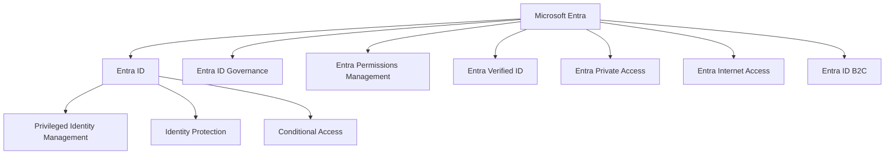
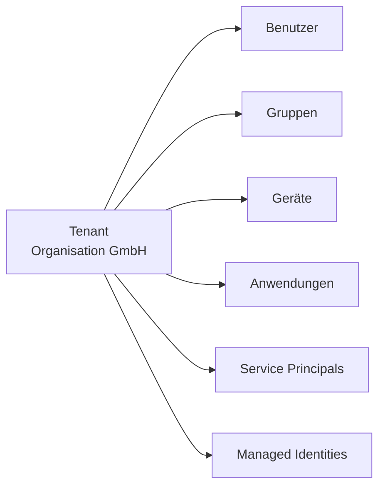
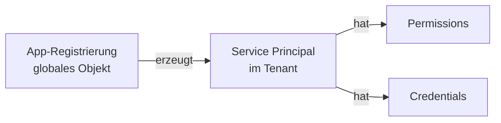
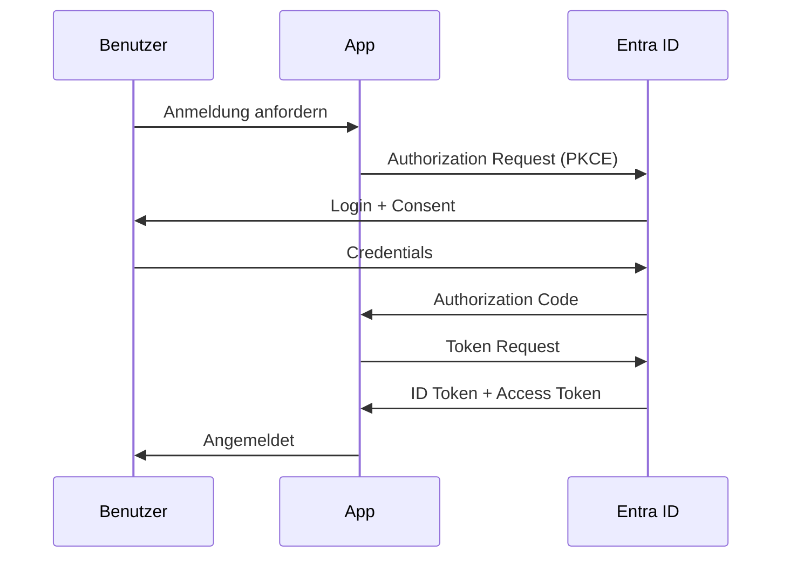
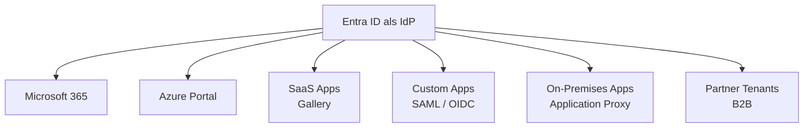

---
tags:
  - microsoft-365
  - entra-id
  - azure-ad
  - identity
  - grundlagen
aliases:
  - Azure Active Directory
  - Azure AD
  - Entra ID Basics
---

# Microsoft Entra ID Grundlagen

> [!ABSTRACT] TL;DR
> Microsoft Entra ID (bis 2023 Azure Active Directory) ist der cloudbasierte Identity Provider von Microsoft. Er verwaltet Identitäten, steuert Zugriffsberechtigungen und ermöglicht Single Sign-On für Millionen von Anwendungen – die Basis jeder modernen Microsoft-365-Umgebung.

---

## Was ist Microsoft Entra ID?

Microsoft Entra ID ist der cloudbasierte **Identity and Access Management (IAM)**-Dienst von Microsoft. Er wurde im Juli 2023 von **Azure Active Directory (Azure AD)** in **Microsoft Entra ID** umbenannt – als Teil der übergreifenden Produktfamilie **Microsoft Entra**, die alle Identity- und Network-Access-Produkte von Microsoft bündelt.

Entra ID ist kein einfaches Upgrade des klassischen Windows Server Active Directory. Es handelt sich um einen eigenständigen Cloud-Dienst, der auf REST-APIs, modernen Protokollen (OAuth 2.0, OIDC, SAML) und globaler Microsoft-Infrastruktur aufbaut.

> [!NOTE] Umbenennung 2023
> Die Umbenennung von Azure AD zu Microsoft Entra ID erfolgte am 1. Juli 2023. Technische Endpunkte (z. B. `login.microsoftonline.com`) und PowerShell-Module blieben zunächst unverändert – die Umbenennung war primär ein Branding-Wechsel. Microsoft empfiehlt jedoch schrittweise die Migration auf das **Microsoft Graph**-API und die neuen **Entra**-PowerShell-Module.

---

## Die Microsoft Entra Produktfamilie



---

## Verzeichnisstruktur: Tenant und Directory

### Tenant

Ein **Tenant** ist eine dedizierte Instanz von Entra ID, die einer Organisation gehört. Jeder Tenant hat:
- Eine eindeutige **Tenant-ID** (GUID)
- Einen primären **Domainnamen** (`organisation.onmicrosoft.com`)
- Optionale eigene **Custom Domains** (z. B. `firma.de`)



> [!IMPORTANT] Tenant-Isolation
> Jeder Tenant ist vollständig von anderen isoliert. Gastbenutzer aus fremden Tenants haben nur explizit erteilten Zugriff. Daten eines Tenants verlassen nie die Grenze des jeweiligen Tenants (außer explizit konfiguriert).

### Directory vs. Tenant

Die Begriffe werden oft synonym verwendet. Technisch korrekt:
- **Directory** = das Entra-ID-Verzeichnis mit seinen Objekten
- **Tenant** = die Organisationseinheit, der das Directory gehört
- Jeder Tenant hat genau ein Directory

---

## Objekte in Entra ID

### Benutzer (Users)

Benutzerkonten repräsentieren Personen oder Dienste. Es gibt drei Typen:

| Typ | Beschreibung |
|-----|-------------|
| **Cloud-only** | Direkt in Entra ID erstellt, kein On-Premises-Pendant |
| **Synchronized** | Aus dem lokalen Active Directory synchronisiert (via Entra Connect) |
| **Guest (B2B)** | Externe Benutzer aus anderen Tenants oder mit Social-Login |

### Gruppen

| Gruppentyp | Verwendung |
|-----------|-----------|
| **Security Group** | Zugriffssteuerung auf Ressourcen |
| **Microsoft 365 Group** | Zusammenarbeit (Teams, SharePoint, Outlook) |
| **Distribution Group** | Nur E-Mail-Verteilung (keine Zugriffskontrolle) |
| **Mail-enabled Security** | E-Mail + Zugriffssteuerung |

### Geräte (Devices)

Geräte können auf drei Arten registriert werden:
- **Entra Registered** – BYOD, ohne vollständige Verwaltung
- **Entra Joined** – Cloud-native Windows-Geräte
- **Hybrid Entra Joined** – sowohl On-Premises AD als auch Entra ID

### Anwendungen und Service Principals



- **App-Registrierung**: Globale Definition einer Anwendung (einmal pro App)
- **Service Principal**: Lokale Instanz im Tenant (Zustimmung durch Admin/User)
- **Enterprise Application**: Service Principal mit UI-Verwaltung

### Managed Identities

Verwaltete Identitäten für Azure-Ressourcen – kein manuelles Credential-Management:

| Typ | Beschreibung |
|-----|-------------|
| **System-assigned** | 1:1 an eine Azure-Ressource gebunden, wird mit der Ressource gelöscht |
| **User-assigned** | Eigenständiges Objekt, kann mehreren Ressourcen zugewiesen werden |

---

## Lizenzierung

### Lizenzstufen

| Stufe | Enthält | Kosten (ca.) |
|-------|---------|-------------|
| **Entra ID Free** | Basis-IAM, SSO für Gallery-Apps, MFA via Authenticator | Kostenlos (inkl. M365) |
| **Entra ID P1** | Conditional Access, Hybrid Identity, Self-Service Password Reset, Dynamic Groups | ~6 €/User/Monat |
| **Entra ID P2** | Identity Protection, Privileged Identity Management (PIM), Access Reviews | ~9 €/User/Monat |
| **Entra ID Governance** | Erweiterte Lifecycle-Workflows, Entitlement Management, Privileged Access | Add-on zu P2 |

> [!TIP] Lizenz-Bundles
> Microsoft 365 Business Premium enthält Entra ID P1. Microsoft 365 E3 enthält P1, Microsoft 365 E5 enthält P2. Enterprise Mobility + Security (EMS) E3/E5 enthält P1/P2 plus Intune.

### Feature-Matrix

| Feature | Free | P1 | P2 |
|---------|------|----|----|
| Basis-SSO | ✅ | ✅ | ✅ |
| MFA | ✅ | ✅ | ✅ |
| Conditional Access | ❌ | ✅ | ✅ |
| Dynamic Groups | ❌ | ✅ | ✅ |
| Self-Service Password Reset | ❌ | ✅ | ✅ |
| Identity Protection | ❌ | ❌ | ✅ |
| PIM | ❌ | ❌ | ✅ |
| Access Reviews | ❌ | ❌ | ✅ |

---

## Unterstützte Protokolle

### OAuth 2.0 und OpenID Connect (OIDC)

Moderne Standardprotokolle für API-Autorisierung und Authentifizierung:



### SAML 2.0

XML-basiertes Protokoll, weit verbreitet in Enterprise-Applikationen:
- **IdP-initiiert**: Benutzer startet bei Entra ID, wird zur App weitergeleitet
- **SP-initiiert**: Benutzer startet bei der App, wird zu Entra ID umgeleitet

### WS-Federation

Älteres Microsoft-Protokoll, genutzt für:
- SharePoint On-Premises
- Active Directory Federation Services (ADFS)
- Legacy-Office-Anwendungen

### Kerberos (Hybrid)

Entra ID kann Kerberos-Tickets über **Entra Kerberos** ausstellen für:
- Hybrid-Umgebungen mit On-Premises-Ressourcen
- Azure Files mit Kerberos-Authentifizierung
- FSLogix-Profile in Azure Virtual Desktop

---

## Entra ID vs. On-Premises Active Directory

| Aspekt | On-Premises AD DS | Microsoft Entra ID |
|--------|-------------------|-------------------|
| **Protokoll** | Kerberos, NTLM, LDAP | OAuth 2.0, OIDC, SAML |
| **Struktur** | Domänen, OUs, Forests | Tenant (flach) |
| **Vertrauensstellung** | Forest Trust, Domain Trust | B2B Collaboration |
| **Gruppenrichtlinien** | GPO | Intune/MDM-Richtlinien |
| **Geräteverwaltung** | Domain Join | Entra Join / Intune |
| **Betrieb** | On-Premises-Server | Vollständig von Microsoft betrieben |
| **Skalierung** | Manuell | Automatisch (globale Infrastruktur) |
| **HA/DR** | Selbst verantwortet | Microsoft SLA (99,99 %) |

> [!NOTE] Kein LDAP in der Cloud
> Entra ID unterstützt kein LDAP und kein NTLM. Anwendungen, die LDAP benötigen, müssen **Microsoft Entra Domain Services** (verwaltetes AD DS in Azure) oder eine klassische AD-DS-VM nutzen.

---

## Entra ID als Identity Provider (IdP)

Entra ID fungiert als zentraler IdP für:

1. **Microsoft-Dienste**: Microsoft 365, Azure-Portal, Teams, SharePoint
2. **Gallery-Anwendungen**: Tausende vorkonfigurierte SaaS-Apps (Salesforce, ServiceNow, Workday, etc.)
3. **Custom Applications**: Eigene Apps über App-Registrierung
4. **On-Premises-Anwendungen**: Via Application Proxy oder ADFS-Verbund



---

## Wichtige Entra-ID-Endpunkte

```bash
# OpenID Connect Discovery-Dokument
https://login.microsoftonline.com/{tenant-id}/.well-known/openid-configuration

# Authorization Endpoint
https://login.microsoftonline.com/{tenant-id}/oauth2/v2.0/authorize

# Token Endpoint
https://login.microsoftonline.com/{tenant-id}/oauth2/v2.0/token

# Microsoft Graph API
https://graph.microsoft.com/v1.0/
```

---

## Via Microsoft Entra Admin Center (UI)

### Entra ID über das Admin Center verwalten

#### Entra Admin Center öffnen und Überblick erhalten

1. Öffne das **Microsoft Entra Admin Center** unter [entra.microsoft.com](https://entra.microsoft.com)
2. Die Startseite zeigt einen **Tenant-Überblick** mit:
   - Aktive Benutzer, Gruppen, Anwendungen
   - Sicherheitswarnungen und Empfehlungen
   - Lizenzstatus
3. Navigiere zu **Verwaltung → Übersicht** für detaillierte Tenant-Informationen:
   - **Tenant-ID**, primäre Domain, Verzeichnis-Typ
   - Abonnement- und Lizenzübersicht

#### Benutzer verwalten

1. Navigiere zu **Identität → Benutzer → Alle Benutzer**
2. Nutze **Filter** und **Suche** um gezielt Benutzer zu finden
3. Klicke auf einen Benutzer für die Detailansicht:
   - **Eigenschaften:** UPN, Anzeigename, Abteilung, Titel
   - **Zugewiesene Rollen:** Administrative Rollen
   - **Gruppen:** Gruppenmitgliedschaften
   - **Lizenzen:** Zugewiesene Lizenzen
   - **Anmeldungen:** Anmeldeaktivität
4. Klicke auf **Bearbeiten** um Eigenschaften zu ändern

#### Gruppen verwalten

1. Navigiere zu **Identität → Gruppen → Alle Gruppen**
2. Nutze **+ Neue Gruppe** um Gruppen anzulegen
3. Klicke auf eine Gruppe für die Detailansicht:
   - **Mitglieder:** Mitglieder hinzufügen/entfernen
   - **Besitzer:** Gruppenbesitzer festlegen
   - **Dynamische Abfrageregel:** Für dynamische Gruppen anpassen

#### Anwendungen verwalten

1. Navigiere zu **Anwendungen → Unternehmensanwendungen** für zugewiesene/Gallery-Apps:
   - Benutzer und Gruppen zuweisen
   - SSO konfigurieren (SAML/OIDC)
   - Provisioning konfigurieren
2. Navigiere zu **Anwendungen → App-Registrierungen** für eigene Anwendungen:
   - Neue App registrieren
   - Zertifikate und Geheimnisse verwalten
   - API-Berechtigungen konfigurieren

#### Audit-Logs und Sign-in-Logs ansehen

1. Navigiere zu **Identität → Überwachung und Integrität → Überwachungsprotokolle**
2. Filtere nach:
   - **Datum/Uhrzeit:** Zeitraum einschränken
   - **Dienst:** z. B. Benutzeradministration, Anwendungsverwaltung
   - **Aktivität:** z. B. „Benutzer hinzufügen", „Richtlinie aktualisieren"
   - **Initiiert von:** Wer hat die Aktion ausgeführt
3. Navigiere zu **Identität → Überwachung und Integrität → Anmeldeprotokolle** für Anmeldeaktivitäten:
   - Filtere nach Benutzer, Anwendung, Status (Erfolg/Fehler)
   - Klicke auf eine Anmeldung für Details (CA-Richtlinien, MFA-Methode, IP-Adresse)

> [!TIP]
> Alternativ: **Azure Portal → Microsoft Entra ID** — alle Funktionen sind auch dort verfügbar, jedoch ist das Entra Admin Center die empfohlene und modernere Oberfläche

---

## Verwaltung über PowerShell und CLI

```powershell
# Entra ID PowerShell-Modul (empfohlen)
Install-Module Microsoft.Graph -Scope CurrentUser

# Verbindung herstellen
Connect-MgGraph -Scopes "User.Read.All","Group.Read.All"

# Alle Benutzer auflisten
Get-MgUser -All | Select-Object DisplayName, UserPrincipalName, AccountEnabled

# Tenant-Informationen
Get-MgOrganization | Select-Object DisplayName, Id, VerifiedDomains
```

```bash
# Azure CLI
az login
az ad user list --query "[].{Name:displayName, UPN:userPrincipalName}" -o table
az ad group list --query "[].displayName" -o tsv
```

> [!WARNING] Veraltete Module
> Das ältere `AzureAD`-PowerShell-Modul sowie `MSOnline` sind **deprecated** und werden eingestellt. Neuentwicklungen sollten ausschließlich das **Microsoft.Graph**-Modul verwenden.

---

## Troubleshooting

### Häufige Probleme beim Einstieg

| Problem | Ursache | Lösung |
|---------|---------|--------|
| Benutzer kann sich nicht anmelden | Konto deaktiviert oder gesperrt | Konto im Entra-Portal prüfen |
| Anwendung erscheint nicht im App-Launcher | Enterprise App nicht für Benutzer zugewiesen | App-Zuweisung in Enterprise Applications |
| MFA-Registrierung fehlgeschlagen | Combined Registration deaktiviert | Security Registration Policy prüfen |
| Token-Fehler in API-Call | Falscher Scope oder fehlende Admin Consent | App-Berechtigungen und Admin Consent prüfen |

### Diagnose-Tools

```powershell
# Sign-in-Logs auslesen (letzte 10 Fehler)
Get-MgAuditLogSignIn -Filter "status/errorCode ne 0" -Top 10 |
    Select-Object UserDisplayName, AppDisplayName, @{N="Error";E={$_.Status.FailureReason}}

# Benutzer-Authentifizierungsmethoden prüfen
Get-MgUserAuthenticationMethod -UserId "user@firma.de"
```

---

## Verwandte Notizen

- [[Benutzer und Gruppen]]
- [[Multi-Factor Authentication]]
- [[Conditional Access]]
- [[Privileged Identity Management]]
- [[Identity Protection]]
- [[Single Sign-On]]
- [[Hybrid Identity Entra Connect]]
- [[External Identities B2B]]
- [[Entra ID B2C]]
