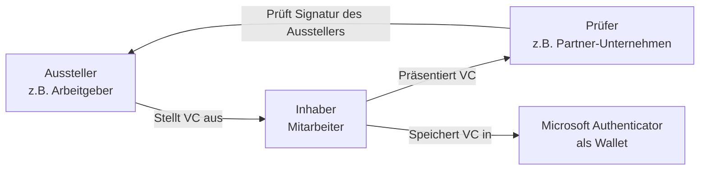
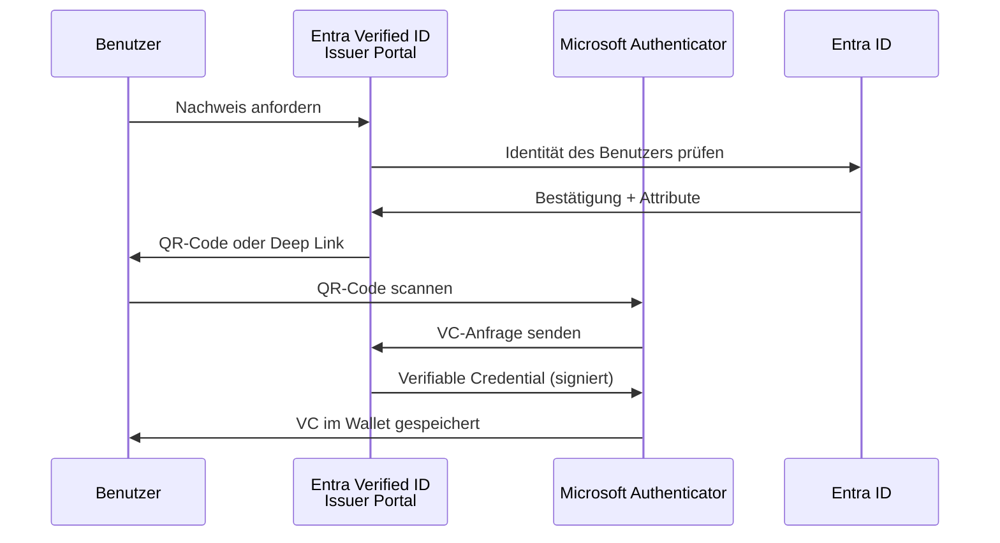
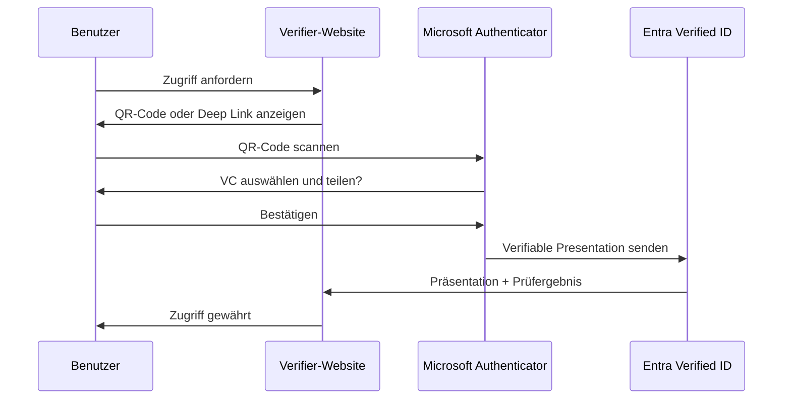
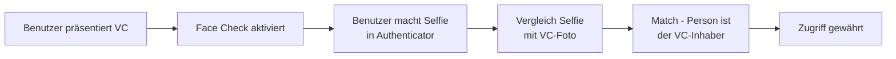

---
tags:
  - entra-id
  - verified-id
  - verifiable-credentials
  - dezentrale-identitaet
  - w3c
aliases:
  - Verifiable Credentials
  - VC
  - Dezentrale Identität
  - DID
---

# Microsoft Entra Verified ID

> [!ABSTRACT] TL;DR
> Microsoft Entra Verified ID implementiert den W3C-Standard für Verifiable Credentials (VC) und dezentrale Identitäten (DID). Organisationen können verifizierte digitale Nachweise ausstellen (Arbeitgebernachweise, Bildungsabschlüsse), die Benutzer in der Microsoft Authenticator App als digitale Brieftasche tragen und bei Bedarf vorzeigen.

---

## Was sind Verifiable Credentials?

Verifiable Credentials (VC) sind digitale Nachweise, die:
- **Kryptografisch überprüfbar** sind (Signatur des Ausstellers)
- **Selektiv preisgebbar** sind (nur nötige Attribute teilen)
- **Dezentral** sind (kein zentraler Verzeichnisdienst nötig)
- Dem **W3C-Standard** entsprechen



---

## Dezentrale Identitäten (DIDs)

**Decentralized Identifiers (DIDs)** sind eine globale Kennung, die:
- Niemandem "gehört" (dezentral, kein zentrales Register)
- Mit einem öffentlichen Schlüssel (DID Document) verbunden ist
- Auf verschiedenen "DID Methods" basieren kann

Microsoft verwendet die **did:web**-Methode:

```json
{
  "@context": "https://www.w3.org/ns/did/v1",
  "id": "did:web:firma.de",
  "verificationMethod": [
    {
      "id": "did:web:firma.de#key-1",
      "type": "JsonWebKey2020",
      "controller": "did:web:firma.de",
      "publicKeyJwk": {
        "kty": "EC",
        "crv": "P-384",
        "x": "...",
        "y": "..."
      }
    }
  ],
  "authentication": ["did:web:firma.de#key-1"]
}
```

Das DID-Dokument wird unter `https://firma.de/.well-known/did.json` gehostet.

---

## Rollen: Issuer, Holder, Verifier

### Issuer (Aussteller)

Eine Organisation, die verifizierte Nachweise ausstellt:
- Unternehmen (Beschäftigungsnachweis)
- Universität (Abschlusszeugnis)
- Behörde (Personalausweis-Äquivalent)
- Zertifizierungsstelle (Berufsqualifikation)

### Holder (Inhaber)

Der Benutzer, der den Nachweis besitzt:
- Speichert VCs in der **Microsoft Authenticator App**
- Entscheidet selbst, wem er den Nachweis zeigt
- Kann Nachweise aus dem Wallet löschen

### Verifier (Prüfer)

Eine Organisation, die Nachweise überprüft:
- Bittet Benutzer, einen bestimmten VC vorzulegen
- Prüft kryptografische Signatur des Ausstellers
- Erhält nur die angeforderten Attribute

---

## Ausstellungsprozess



---

## Präsentationsprozess



---

## Anwendungsfälle

| Anwendungsfall | Aussteller | Prüfer |
|---------------|-----------|-------|
| **Mitarbeiterausweis** | Arbeitgeber | Partner, Hotels, Zutrittssysteme |
| **Bildungsabschluss** | Universität/Schule | Arbeitgeber, Behörden |
| **Berufsqualifikation** | Kammer/Verband | Auftraggeber |
| **Altersverifikation** | Behörde / Entra Verified ID | Online-Shops, Plattformen |
| **Mitgliedschaft** | Verein/Verband | Mitglieder-Events, Rabattsysteme |
| **Gesundheitsdaten** | Krankenhaus/Arzt | Krankenversicherung, Apotheke |

---

## Via Microsoft Entra Admin Center (UI)

### Entra Verified ID einrichten (UI)

#### Verified ID öffnen

1. Öffne das **Microsoft Entra Admin Center** unter [entra.microsoft.com](https://entra.microsoft.com)
2. Navigiere zu **Überprüfung → Übersicht** (Verified ID)
3. Das Dashboard zeigt den Einrichtungsstatus und ausgestellte Anmeldeinformationstypen

#### Organisation einrichten

1. Navigiere zu **Überprüfung → Erste Schritte**
2. Klicke auf **Organisation einrichten**
3. Schritt 1 – **Azure Key Vault verknüpfen:**
   - Wähle das Azure-Abonnement und den vorhandenen Key Vault aus
   - Falls kein Key Vault vorhanden: Klicke auf **Neu erstellen**
   - Klicke auf **Weiter**
4. Schritt 2 – **Organisation registrieren:**
   - Gib den **Organisationsnamen** ein
   - Gib die **vertrauenswürdige Domain** ein (z. B. `firma.de`)
   - Lade die **did-configuration.json** herunter und hoste sie unter `https://firma.de/.well-known/did-configuration.json`
   - Klicke auf **Domäne bestätigen**
5. Klicke auf **Speichern**

#### Anmeldeinformationstyp erstellen

1. Navigiere zu **Überprüfung → Anmeldeinformationstypen**
2. Klicke auf **+ Anmeldeinformationstyp hinzufügen**
3. Konfiguriere:
   - **Name:** z. B. `MitarbeiterAusweis`
   - **Anzeigename:** Für Benutzer sichtbarer Name
   - **Beschreibung:** Zweck des Anmeldeinformationstyps
4. Füge das **JSON-Schema** für die Ansprüche (Claims) ein:
   - Definiere Attribute wie `vorname`, `nachname`, `abteilung`, `gültigBis`
5. Klicke auf **Erstellen**

#### Ausstellung konfigurieren

1. Navigiere zu **Überprüfung → Anmeldeinformationstypen → [Typ auswählen]**
2. Klicke auf **Ausstellen konfigurieren**
3. Konfiguriere:
   - **Ausstellungs-URL:** Endpunkt der eigenen Ausstellungs-App
   - **Pin erforderlich:** Optional für erhöhte Sicherheit
   - **Authentifizierung:** ID Token Hint oder Self-Attested
4. Klicke auf **Speichern**
5. Teste die Ausstellung mit der **Microsoft Authenticator**-App und dem angezeigten QR-Code

> [!TIP]
> Alternativ: **Azure Portal → Microsoft Entra ID → Verified ID** — der Einrichtungsprozess ist identisch, jedoch ist das Entra Admin Center unter **Überprüfung** die primäre Anlaufstelle

---

## Entra Verified ID einrichten

### Voraussetzungen

- Entra ID-Tenant (P2 für erweiterte Features)
- Azure Key Vault (für Signing Keys)
- Verifizierte Domain
- Microsoft Authenticator App (für Benutzer)

### Einrichtung im Portal

```
Entra ID Portal → Verified ID → Erste Schritte
→ Organisation einrichten
→ Azure Key Vault konfigurieren
→ Domain-Eigentümerschaft bestätigen (did.json hochladen)
→ Anmeldeinformationstyp erstellen
```

### Anmeldeinformationstyp erstellen (JSON)

```json
{
  "credentialSubject": {
    "type": ["EmployeeCredential"],
    "employeeId": {
      "type": "string",
      "title": "Mitarbeiter-ID"
    },
    "displayName": {
      "type": "string",
      "title": "Name"
    },
    "department": {
      "type": "string",
      "title": "Abteilung"
    },
    "jobTitle": {
      "type": "string",
      "title": "Berufsbezeichnung"
    }
  }
}
```

---

## Ausstellung per API (Issuer)

```python
import requests
import msal

# Zugriffstoken holen
app = msal.ConfidentialClientApplication(
    client_id="app-id",
    client_credential="client-secret",
    authority="https://login.microsoftonline.com/tenant-id"
)
token = app.acquire_token_for_client(
    scopes=["3db474b9-6a0c-4840-96ac-1fceb342124f/.default"]
)

# Ausstellungsanfrage senden
headers = {
    "Authorization": f"Bearer {token['access_token']}",
    "Content-Type": "application/json"
}

issuance_request = {
    "includeQRCode": True,
    "callback": {
        "url": "https://meine-app.firma.de/api/vc-callback",
        "state": "session-id-123",
        "headers": {"api-key": "mein-secret"}
    },
    "authority": "did:web:firma.de",
    "registration": {
        "clientName": "Firma GmbH HR-Portal"
    },
    "type": "EmployeeCredential",
    "manifest": "https://verifiedid.did.msidentity.com/v1.0/tenants/tenant-id/verifiableCredentials/contracts/EmployeeCredential/manifest",
    "claims": {
        "given_name": "Max",
        "family_name": "Mustermann",
        "employeeId": "EMP-001",
        "department": "IT"
    }
}

response = requests.post(
    "https://verifiedid.did.msidentity.com/v1.0/verifiableCredentials/createIssuanceRequest",
    headers=headers,
    json=issuance_request
)
```

---

## Face Check (Biometrische Prüfung)

Face Check ist eine optionale Funktion bei der Präsentation:



> [!IMPORTANT] Datenschutz bei Face Check
> Das Selfie wird nur für den Vergleich verwendet und **nicht gespeichert**. Der Verifier erhält nur das Ergebnis (Übereinstimmung ja/nein), nicht das Bild selbst.

---

## Lizenzierung

| Feature | Kosten |
|---------|--------|
| **Ausstellung und Präsentation** | Kostenlos (bis zu einem gewissen Kontingent) |
| **Face Check** | Kostenpflichtig (pro Verifikation) |
| **High Volume** | Lizenzgebühren für Enterprise |

---

## Troubleshooting

### Häufige Probleme

| Problem | Ursache | Lösung |
|---------|---------|--------|
| QR-Code wird in Authenticator nicht erkannt | Ältere App-Version | Authenticator auf neueste Version updaten |
| Ausstellung schlägt fehl | Key Vault nicht erreichbar | Azure Key Vault Firewall/RBAC prüfen |
| did.json nicht erreichbar | Webserver-Konfiguration | `https://firma.de/.well-known/did.json` manuell aufrufen |
| Präsentation schlägt fehl | Falscher Credential-Typ angefordert | Manifest-URL und Typ in Verifier-Konfiguration prüfen |

---

## Verwandte Notizen

- [[Microsoft Entra ID Grundlagen]]
- [[Single Sign-On]]
- [[External Identities B2B]]
- [[Entra ID B2C]]
