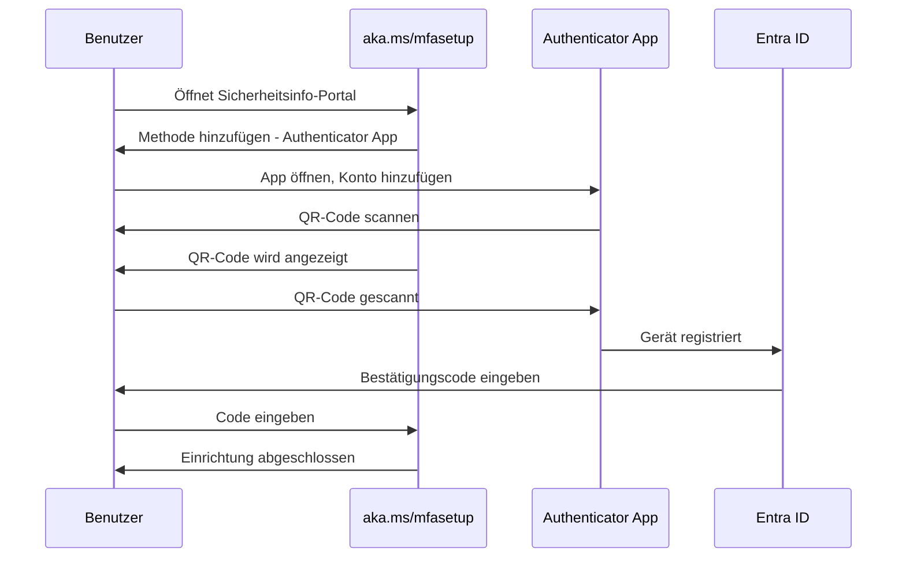
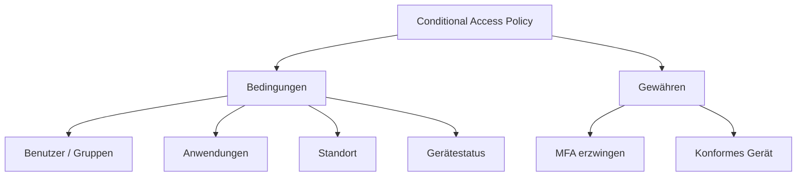

---
tags:
  - entra-id
  - mfa
  - multi-factor-authentication
  - sicherheit
  - microsoft-365
aliases:
  - MFA
  - Zwei-Faktor-Authentifizierung
  - 2FA Entra
---

# Multi-Factor Authentication

> [!ABSTRACT] TL;DR
> Multi-Factor Authentication (MFA) in Entra ID schützt Identitäten durch einen zweiten Verifizierungsschritt. Moderne Deployments setzen auf Conditional Access für granulare MFA-Steuerung, Number Matching gegen MFA-Fatigue-Angriffe und FIDO2-Keys als phishing-resistente Alternative.

---

## Was ist MFA in Entra ID?

Multi-Factor Authentication erzwingt neben dem Passwort mindestens einen weiteren Authentifizierungsfaktor:

- **Etwas, das du weißt**: Passwort, PIN
- **Etwas, das du hast**: Authenticator-App, Hardware-Token, SMS
- **Etwas, das du bist**: Biometrie (Windows Hello, Face Check)

> [!IMPORTANT] MFA ist keine Option mehr
> Laut Microsoft-Statistiken werden über 99,9 % aller kompromittierten Konten **ohne MFA** angegriffen. MFA blockiert fast alle automatisierten Angriffe. Seit Oktober 2024 erzwingt Microsoft MFA für alle Azure-Portal-Anmeldungen.

---

## MFA-Methoden im Vergleich

| Methode | Sicherheitsniveau | Phishing-Resistent | Benutzerfreundlichkeit | Lizenz |
|---------|------------------|-------------------|----------------------|--------|
| **FIDO2-Sicherheitsschlüssel** | Sehr hoch | ✅ | Hoch | Free |
| **Windows Hello for Business** | Sehr hoch | ✅ | Sehr hoch | Free |
| **Microsoft Authenticator (Numbermatching)** | Hoch | Teilweise | Hoch | Free |
| **Software OATH-Token** | Mittel | ❌ | Mittel | Free |
| **Hardware OATH-Token (TOTP)** | Mittel | ❌ | Mittel | Free |
| **SMS-Einmalcode** | Niedrig | ❌ | Mittel | Free |
| **Sprachanruf** | Niedrig | ❌ | Niedrig | Free |

> [!WARNING] SMS und Anruf sind schwach
> SMS-Codes können durch SIM-Swapping-Angriffe oder SS7-Schwachstellen kompromittiert werden. Microsoft empfiehlt, SMS/Anruf nur als letzten Ausweg zu verwenden und auf Authenticator App oder FIDO2 zu migrieren.

---

## Microsoft Authenticator App

Die Microsoft Authenticator App ist die empfohlene MFA-Methode. Sie bietet:

- **Push-Benachrichtigungen** mit Number Matching
- **Passwortloser Anmeldemodus** (Passwordless)
- **TOTP-Codes** (Time-based One-Time Password) als Fallback
- **Biometrische Sperre** der App

### Authenticator App einrichten (Benutzer-Sicht)



### Number Matching (Phishing-Schutz)

Number Matching verhindert **MFA-Fatigue-Angriffe** (Angreifer sendet massenhaft Push-Benachrichtigungen, bis Benutzer aus Versehen bestätigt):


> [!IMPORTANT] Number Matching ist Standard
> Seit Mai 2023 ist Number Matching für alle Microsoft Authenticator-Benachrichtigungen **standardmäßig aktiviert** und kann nicht mehr deaktiviert werden.

---

## FIDO2-Sicherheitsschlüssel

FIDO2-Keys (z. B. YubiKey, Feitian) sind die sicherste MFA-Methode:
- **Phishing-resistent**: Schlüssel ist an die Domain gebunden
- **Kein Shared Secret**: Asymmetrische Kryptografie
- **Passwortlos**: Kann Passwort vollständig ersetzen

```powershell
# FIDO2-Methode für Tenant aktivieren
# Portal: Entra ID → Sicherheit → Authentifizierungsmethoden → FIDO2-Sicherheitsschlüssel

# Per Graph API aktivieren
$MethodConfig = @{
    "@odata.type" = "#microsoft.graph.fido2AuthenticationMethodConfiguration"
    state = "enabled"
    isAttestationEnforced = $false
    keyRestrictions = @{
        isEnforced = $false
        enforcementType = "allow"
        aaGuids = @()
    }
}
```

---

## Windows Hello for Business

Windows Hello for Business nutzt TPM-basierte Schlüsselpaare für passwortlose Anmeldung:
- Biometrisch (Gesicht, Fingerabdruck) oder PIN als Faktor
- Private Key verlässt niemals das Gerät
- Funktioniert mit Entra Joined und Hybrid Entra Joined Geräten

---

## MFA-Konfiguration: Conditional Access vs. Legacy MFA

### Empfohlen: Conditional Access



Conditional Access MFA bietet:
- Granulare Steuerung (nur für bestimmte Apps, Standorte, Risikoniveaus)
- Report-Only-Modus zum Testen
- Integration mit Risikobasierter Authentifizierung

> [!WARNING] Legacy Per-User MFA
> Die ältere "Per-User MFA"-Einstellung (über das Legacy-MFA-Portal unter `account.activedirectory.windowsazure.com/usermanagement/mfasettings.aspx`) ist **deprecated**. Microsoft empfiehlt die Migration zu Conditional Access oder Security Defaults.

### Security Defaults (für kleine Organisationen)

Security Defaults aktivieren MFA automatisch für alle Benutzer – ohne Conditional-Access-Konfiguration:
- Kostenlos, kein P1 erforderlich
- Kein Granularbetrieb möglich
- Empfohlen für Tenants ohne Entra ID P1

```powershell
# Security Defaults aktivieren/deaktivieren
$SecurityDefaults = Get-MgPolicyIdentitySecurityDefaultEnforcementPolicy
Update-MgPolicyIdentitySecurityDefaultEnforcementPolicy -IsEnabled $true
```

---

## Self-Service Password Reset (SSPR)

SSPR ermöglicht Benutzern, ihr Passwort selbst zurückzusetzen – ohne Helpdesk:


### SSPR konfigurieren

```powershell
# SSPR-Status prüfen
Get-MgPolicySelfServiceSignUpEnabledByDefault

# Per Portal: Entra ID → Passwort zurücksetzen → Eigenschaften
# - Aktiviert für: Keine / Ausgewählt / Alle
# - Methoden: Anzahl der erforderlichen Methoden (1 oder 2)
# - Authentifizierungsmethoden: E-Mail, Mobil, Büro-Telefon, Sicherheitsfragen
```

> [!IMPORTANT] Passwort-Rückschreiben
> Für hybride Umgebungen muss **Password Writeback** in Entra Connect aktiviert sein, damit SSPR-Passwortänderungen ins On-Premises AD zurückgeschrieben werden. Sonst haben Benutzer zwei verschiedene Passwörter.

---

## Combined Registration (Kombinierte Registrierung)

Die kombinierte Registrierung ermöglicht es Benutzern, MFA und SSPR in einem einzigen Workflow einzurichten:

- URL: `https://aka.ms/mfasetup` oder `https://mysignins.microsoft.com/security-info`
- Benutzer registrieren alle Methoden auf einmal
- Admins können Registrierungskampagnen starten

```powershell
# Registration Campaign konfigurieren
# Portal: Entra ID → Sicherheit → Authentifizierungsmethoden → Registrierungskampagnen
# - Aktiviert: Ja
# - Erzwingen nach: 3, 7, 14 oder 30 Tage nach Snooze
# - Ausgeschlossene Benutzer/Gruppen konfigurieren
```

---

## MFA-Ausnahmen und Named Locations

### Vertrauenswürdige IPs / Named Locations

MFA kann für bestimmte IP-Adressen oder Standorte übersprungen werden:

```powershell
# Named Location erstellen (vertrauenswürdige IP-Ranges)
$IPRanges = @(
    @{"@odata.type" = "#microsoft.graph.iPv4CidrRange"; cidrAddress = "192.168.1.0/24"},
    @{"@odata.type" = "#microsoft.graph.iPv4CidrRange"; cidrAddress = "10.0.0.0/8"}
)

New-MgIdentityConditionalAccessNamedLocation -DisplayName "Firmennetz-Muenchen" `
    -BodyParameter @{
        "@odata.type" = "#microsoft.graph.ipNamedLocation"
        displayName = "Firmennetz-Muenchen"
        isTrusted = $true
        ipRanges = $IPRanges
    }
```

---

## MFA-Berichte

```powershell
# MFA-Registrierungsstatus aller Benutzer
Get-MgReportAuthenticationMethodUserRegistrationDetail -All |
    Select-Object UserDisplayName, IsMfaRegistered, IsMfaCapable, IsPasswordlessCapable |
    Export-Csv "MFA-Report.csv" -NoTypeInformation

# Sign-in-Logs mit MFA-Details
Get-MgAuditLogSignIn -Filter "authenticationRequirement eq 'multiFactorAuthentication'" -Top 100 |
    Select-Object UserDisplayName, AppDisplayName, CreatedDateTime,
        @{N="MFAResult";E={$_.MfaDetail.AuthMethod}}
```

---

## Hardware OATH-Token (TOTP)

Hardware-Token (RFC 6238 TOTP-kompatibel) können in Entra ID importiert werden:

```powershell
# TOTP-Token via CSV importieren
# CSV-Format: upn,serial number,secret key,time interval,manufacturer,model
# Beispiel: user@firma.de,123456789,BASE32SECRET,30,Vendor,Model100

# Import über Graph API
$TokenData = @{
    value = @(
        @{
            upn = "user@firma.de"
            serialNumber = "123456789"
            secretKey = "BASE32ENCODEDSECRETKEY"
            timeIntervalInSeconds = 30
            manufacturer = "Vendor"
            model = "Model100"
        }
    )
}
# POST https://graph.microsoft.com/v1.0/directory/authenticationMethodConfigurations/softwareOath/usageTarget
```

---

## Troubleshooting

### Häufige MFA-Probleme

| Problem | Ursache | Lösung |
|---------|---------|--------|
| Benutzer erhält keine Push-Benachrichtigung | App-Benachrichtigungen blockiert oder schlechte Verbindung | Push-Benachrichtigungen prüfen, Fallback auf Code aktivieren |
| MFA-Code wird nicht akzeptiert | Zeit-Desynchronisation auf Gerät | Uhrzeit auf Smartphone synchronisieren, App neu starten |
| Benutzer ist aus Konto ausgesperrt | Zu viele fehlgeschlagene MFA-Versuche | Admin setzt MFA zurück oder entsperrt: `Reset MFA` im Portal |
| MFA-Aufforderung erscheint nicht | Trusted IP oder persistentes MFA-Cookie | CA-Richtlinie prüfen, MFA-Cookie-Lebensdauer prüfen |
| SSPR funktioniert nicht | Keine Methode registriert oder Writeback deaktiviert | Registrierungsstatus prüfen, Password Writeback prüfen |

### MFA für Benutzer zurücksetzen

```powershell
# MFA-Registrierung eines Benutzers zurücksetzen
# Alle starken Authentifizierungsmethoden entfernen
$UserId = (Get-MgUser -Filter "userPrincipalName eq 'user@firma.de'").Id

# Alle registrierten Methoden auflisten
Get-MgUserAuthenticationMethod -UserId $UserId

# Spezifische Methode entfernen (Authenticator)
$MethodId = "method-id-here"
Remove-MgUserAuthenticationMicrosoftAuthenticatorMethod -UserId $UserId `
    -MicrosoftAuthenticatorAuthenticationMethodId $MethodId
```

> [!DANGER] MFA-Reset-Vorsicht
> Das Zurücksetzen der MFA-Methoden eines Benutzers ohne vorherige Identitätsprüfung ist ein Social-Engineering-Angriffsvektor. Definiere einen klaren Prozess für MFA-Resets (z. B. Vorgesetzte müssen anfragen, Manager-Bestätigung erforderlich).

---

## Verwandte Notizen

- [[Microsoft Entra ID Grundlagen]]
- [[Conditional Access]]
- [[Identity Protection]]
- [[Entra ID Join vs Hybrid Join]]
