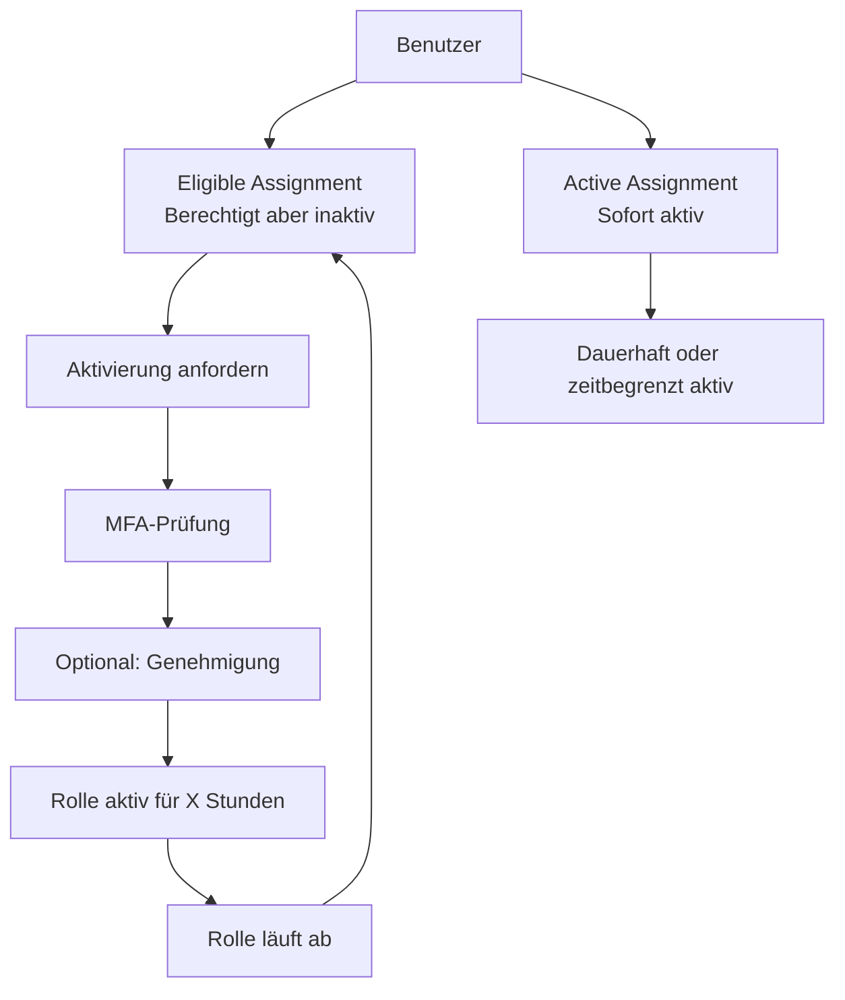
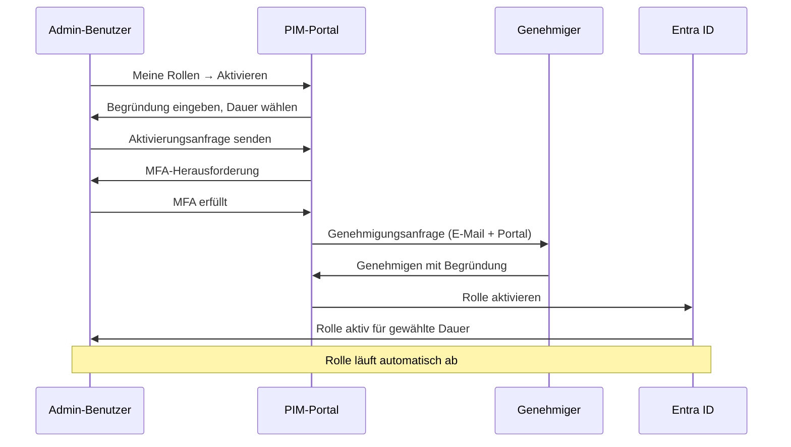
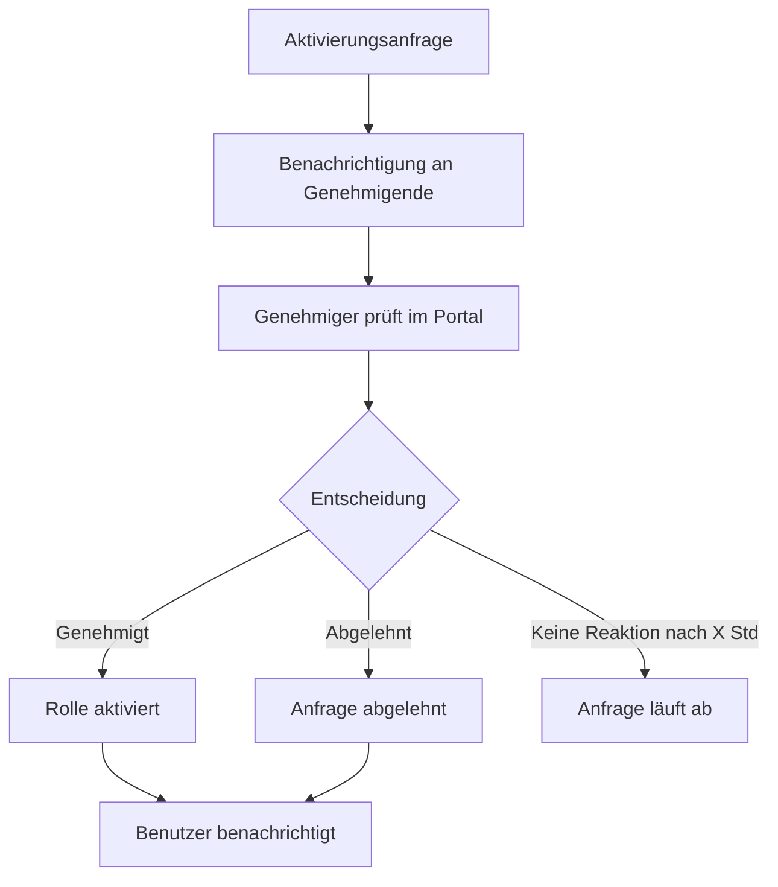
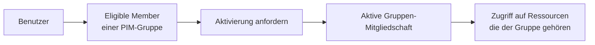

---
tags:
  - entra-id
  - pim
  - privileged-identity-management
  - just-in-time
  - sicherheit
aliases:
  - PIM
  - Just-in-Time Access
  - Privilegierte Rollen
---

# Privileged Identity Management

> [!ABSTRACT] TL;DR
> Privileged Identity Management (PIM) eliminiert dauerhafte Admin-Rechte durch Just-in-Time (JIT)-Aktivierung. Berechtigte Rollen müssen aktiv angefordert werden, gelten nur begrenzte Zeit und können Genehmigungen, MFA und Begründungen erfordern. PIM erfordert Entra ID P2.

---

## Was ist Privileged Identity Management?

Traditionell werden Administrator-Rollen **dauerhaft** zugewiesen. Das bedeutet: Ein kompromittiertes Admin-Konto hat jederzeit vollen Zugriff. PIM löst dieses Problem durch:

- **Just-in-Time (JIT)**: Rollen nur aktivieren wenn nötig
- **Just-Enough-Access**: Minimale Rechte für die Aufgabe
- **Zeitgebundene Berechtigungen**: Rollen laufen automatisch ab
- **Begründungspflicht**: Warum wird die Rolle benötigt?
- **Genehmigungsworkflow**: Optionale Genehmigung durch Manager
- **Audit-Trail**: Vollständige Protokollierung aller Aktivierungen

> [!IMPORTANT] Lizenzanforderung
> PIM erfordert **Entra ID P2** oder **Microsoft Entra ID Governance** für jeden Benutzer, der privilegierten Zugriff hat oder Zugriff genehmigt.

---

## Eligible vs. Active Assignment



| Assignment-Typ | Beschreibung | Empfehlung |
|---------------|-------------|-----------|
| **Eligible** | Benutzer kann Rolle bei Bedarf aktivieren | Standard für alle Admins |
| **Active (zeitbegrenzt)** | Rolle ist für definierten Zeitraum aktiv | Für Projekte, Urlaubsvertretungen |
| **Active (permanent)** | Rolle ist immer aktiv – kein Ablauf | Nur für Break-Glass-Konten |

> [!TIP] Nie permanent aktiv ohne Grund
> Selbst der Global Administrator sollte nur als **Eligible** zugewiesen sein. Permanente Active Assignments nur für Break-Glass-Konten vergeben.

---

## Via Microsoft Entra Admin Center (UI)

### Privileged Identity Management konfigurieren

#### PIM öffnen

1. Öffne das **Microsoft Entra Admin Center** unter [entra.microsoft.com](https://entra.microsoft.com)
2. Navigiere zu **Identitätsverwaltung → Privileged Identity Management**
3. Das PIM-Dashboard zeigt:
   - **Meine Rollen:** Eigene berechtigte und aktive Zuweisungen
   - **Aufgaben:** Ausstehende Genehmigungsanfragen
   - **Entra ID-Rollen / Azure-Ressourcen-Rollen:** Verwaltungsbereich

#### Rolle als Eligible zuweisen

1. Navigiere zu **Identitätsverwaltung → Privileged Identity Management → Entra ID-Rollen → Zuweisungen**
2. Klicke auf **+ Zuweisungen hinzufügen**
3. Konfiguriere:
   - **Rolle auswählen:** z. B. `Globaler Administrator`, `User Administrator`
   - **Bereich:** Verzeichnis
4. Klicke auf **Weiter**
5. Wähle unter **Mitglieder** den Benutzer oder die Gruppe aus
6. Wähle **Berechtigt** (Eligible) als Zuweisungstyp
7. Setze optional eine **Ablaufzeit** für die Zuweisung
8. Klicke auf **Zuweisen**

#### Rolleneinstellungen konfigurieren

1. Navigiere zu **Identitätsverwaltung → PIM → Entra ID-Rollen → Einstellungen**
2. Wähle die zu konfigurierende Rolle (z. B. `Globaler Administrator`)
3. Klicke auf **Bearbeiten**
4. Konfiguriere unter **Aktivierung:**
   - **Maximale Aktivierungsdauer:** z. B. 4 Stunden
   - **Aktivierungsgrund erforderlich:** Ja/Nein
   - **Aktivierungsticket erforderlich:** Ja/Nein
   - **MFA bei Aktivierung erforderlich:** Ja (empfohlen)
   - **Genehmigung erforderlich:** Ja → Genehmiger auswählen
5. Konfiguriere unter **Zuweisung:**
   - **Permanente berechtigte Zuweisung erlauben:** Ja/Nein
   - **Ablauf nach:** z. B. 365 Tagen
6. Klicke auf **Aktualisieren**

#### Rolle aktivieren (Benutzer-Sicht)

1. Navigiere zu **Identitätsverwaltung → Privileged Identity Management → Meine Rollen**
2. Klicke auf den Tab **Berechtigte Zuweisungen**
3. Klicke bei der gewünschten Rolle auf **Aktivieren**
4. Konfiguriere:
   - **Dauer:** Aktivierungszeitraum (max. konfiguriertes Maximum)
   - **Grund:** Geschäftlicher Grund für die Aktivierung
5. Schließe ggf. die **MFA-Abfrage** ab
6. Klicke auf **Aktivieren** — die Rolle ist nach kurzer Zeit aktiv

#### Access Review erstellen

1. Navigiere zu **Identitätsverwaltung → Access Reviews → + Neue Zugriffsüberprüfung**
2. Konfiguriere:
   - **Name:** z. B. `Vierteljährliche PIM-Rollenüberprüfung`
   - **Überprüfungstyp:** Teams + Gruppen / Anwendungen / Azure AD-Rollen
   - **Bereich:** Privilegierte Rollen auswählen
   - **Prüfer:** Vorgesetzte / Ausgewählte Prüfer / Mitglieder selbst
   - **Dauer:** z. B. 14 Tage
   - **Wiederholung:** Vierteljährlich
3. Konfiguriere unter **Einstellungen:**
   - **Wenn Prüfer nicht reagieren:** Zugriff entfernen (empfohlen)
   - **Ergebnisse automatisch anwenden:** Aktivieren
4. Klicke auf **Erstellen**

> [!TIP]
> Alternativ: **Azure Portal → Microsoft Entra ID → Identity Governance → Privileged Identity Management**

---

## PIM einrichten

### Schritt 1: PIM-Berechtigungen konfigurieren

```
Entra ID Portal → Identity Governance → Privileged Identity Management
→ Entra ID-Rollen → Einstellungen → [Rolle auswählen]
```

Konfigurierbare Einstellungen pro Rolle:
- **Maximale Aktivierungsdauer** (z. B. 8 Stunden)
- **Begründung bei Aktivierung** (Ja/Nein)
- **Benachrichtigungen** (wer wird informiert)
- **Genehmigung erforderlich** (Ja/Nein)
- **Genehmigende** (Benutzer oder Gruppe)
- **MFA bei Aktivierung** (Ja/Nein)

### Schritt 2: Berechtigung zuweisen

```powershell
# Benutzer als "Eligible" für Global Administrator zuweisen
# Über Portal: PIM → Entra ID Rollen → Zuweisungen → Zuweisungen hinzufügen

# Per Graph API (Microsoft.Graph.Identity.Governance)
$Assignment = @{
    action = "AdminAssign"
    justification = "IT-Admin benötigt Global Admin Berechtigung"
    roleDefinitionId = "62e90394-69f5-4237-9190-012177145e10"  # Global Administrator
    directoryScopeId = "/"
    principalId = "benutzer-object-id"
    scheduleInfo = @{
        startDateTime = (Get-Date).ToUniversalTime().ToString("o")
        expiration = @{
            type = "NoExpiration"
            # Oder: type = "AfterDateTime"; endDateTime = "2025-12-31T00:00:00Z"
        }
    }
}

New-MgRoleManagementDirectoryRoleEligibilityScheduleRequest -BodyParameter ($Assignment | ConvertTo-Json -Depth 10)
```

---

## Rolle aktivieren (Benutzer-Sicht)



### Aktivierung per PowerShell

```powershell
# Eigene berechtigte Rollen anzeigen
Get-MgRoleManagementDirectoryRoleEligibilitySchedule -Filter "principalId eq 'meine-user-id'" |
    Select-Object @{N="Rolle";E={(Get-MgDirectoryRoleDefinition -UnifiedRoleDefinitionId $_.RoleDefinitionId).DisplayName}},
                  @{N="Scope";E={$_.DirectoryScopeId}}

# Rolle aktivieren (Self-Activation)
$Activation = @{
    action = "SelfActivate"
    justification = "Notfall-Wartung am Exchange-Server benötigt"
    roleDefinitionId = "62e90394-69f5-4237-9190-012177145e10"
    directoryScopeId = "/"
    principalId = "meine-user-id"
    scheduleInfo = @{
        startDateTime = (Get-Date).ToUniversalTime().ToString("o")
        expiration = @{
            type = "AfterDuration"
            duration = "PT4H"  # 4 Stunden
        }
    }
}

New-MgRoleManagementDirectoryRoleAssignmentScheduleRequest -BodyParameter ($Activation | ConvertTo-Json -Depth 10)
```

---

## Aktivierungsdauer und Richtlinien

### Empfohlene Aktivierungsdauern

| Rolle | Empfohlene Max-Dauer | Genehmigung |
|-------|---------------------|------------|
| Global Administrator | 1-4 Stunden | Ja (mindestens 2 Genehmigende) |
| User Administrator | 4-8 Stunden | Optional |
| Exchange Administrator | 4-8 Stunden | Optional |
| Security Administrator | 4-8 Stunden | Optional |
| Privileged Role Administrator | 1-4 Stunden | Ja |
| Billing Administrator | 4-8 Stunden | Optional |

---

## Genehmigungsworkflow



> [!NOTE] Genehmigungsfenster
> Standardmäßig haben Genehmigende **24 Stunden** Zeit. Nach Ablauf wird die Anfrage automatisch abgelehnt. Die Zeitspanne ist konfigurierbar.

---

## PIM für Azure-Ressourcen

PIM gilt nicht nur für Entra-ID-Rollen, sondern auch für Azure-RBAC:

```powershell
# Azure-Ressourcen-Scope onboarden
# Portal: PIM → Azure-Ressourcen → Ressourcen ermitteln

# Subscription als Eligible zuweisen
$AzureAssignment = @{
    action = "AdminAssign"
    justification = "DevOps-Admin benötigt Contributor-Rechte auf Subscription"
    roleDefinitionId = "b24988ac-6180-42a0-ab88-20f7382dd24c"  # Contributor
    directoryScopeId = "/subscriptions/abo-id"
    principalId = "benutzer-id"
    scheduleInfo = @{
        startDateTime = (Get-Date).ToUniversalTime().ToString("o")
        expiration = @{type = "NoExpiration"}
    }
}

New-MgRoleManagementDirectoryRoleEligibilityScheduleRequest -BodyParameter ($AzureAssignment | ConvertTo-Json -Depth 10)
```

---

## PIM für Gruppen

PIM kann auch für Gruppen-Mitgliedschaft verwendet werden:



Anwendungsfälle:
- Just-in-Time-Mitgliedschaft in privilegierten Security-Gruppen
- Temporärer Zugriff auf geteilte Postfächer (Exchange)
- Zeitbegrenzter Zugriff auf SharePoint-Seiten

---

## Access Reviews

Access Reviews prüfen regelmäßig, ob Rollenzuweisungen noch berechtigt sind:

```
Portal: Identity Governance → Access Reviews → Überprüfungen erstellen
```

Konfiguration:
- **Ressource**: PIM-Rollenzuweisungen, Gruppen, Anwendungen
- **Überprüfungsbereich**: Benutzer mit permanenter oder berechtigter Rolle
- **Prüfer**: Manager, Mitglieder selbst, bestimmte Benutzer
- **Häufigkeit**: Einmal, Wöchentlich, Monatlich, Quartalsweise, Halbjährlich, Jährlich
- **Automatische Anwendung**: Entfernung bei fehlender Antwort

> [!TIP] Quartalsweise Reviews
> Best Practice: Privilegierte Rollen **quartalsweise** reviewen. Reviewer sollten aktiv bestätigen müssen (kein "Auto-Approve bei Nicht-Antwort"), aber eine automatische Bereinigung bei Inaktivität ist sinnvoll.

---

## PIM-Alerts

PIM generiert automatisch Sicherheitswarnungen:

| Alert | Bedeutung | Empfohlene Aktion |
|-------|-----------|------------------|
| Zu viele globale Administratoren | Mehr als 5 Global Admins | Rollen reduzieren |
| Permanente Rollen-Zuweisung | Rollen ohne Ablaufzeit | Auf Eligible umstellen |
| Rollen ohne MFA | Admin ohne MFA-Registrierung | MFA erzwingen |
| Duplizierte Rollenzuweisungen | Selbe Rolle direkt + über Gruppe | Bereinigen |
| Potenzielle veraltete Admins | Keine Aktivierung in 30+ Tagen | Zuweisung prüfen/entfernen |

---

## Audit-Protokoll

```powershell
# PIM-Aktivierungshistorie der letzten 30 Tage
Get-MgAuditLogDirectoryAudit -Filter "loggedByService eq 'PIM'" -Top 100 |
    Where-Object {$_.ActivityDateTime -gt (Get-Date).AddDays(-30)} |
    Select-Object ActivityDateTime, InitiatedByUser, ActivityDisplayName,
        @{N="Ziel";E={$_.TargetResources[0].DisplayName}} |
    Sort-Object ActivityDateTime -Descending |
    Export-Csv "PIM-Audit.csv" -NoTypeInformation

# Aktive Rollenzuweisungen anzeigen
Get-MgRoleManagementDirectoryRoleAssignmentScheduleInstance |
    Select-Object PrincipalId, RoleDefinitionId, StartDateTime, EndDateTime |
    ForEach-Object {
        $RoleName = (Get-MgDirectoryRoleDefinition -UnifiedRoleDefinitionId $_.RoleDefinitionId).DisplayName
        $UserName = (Get-MgUser -UserId $_.PrincipalId -ErrorAction SilentlyContinue).DisplayName
        [PSCustomObject]@{
            Benutzer = $UserName
            Rolle = $RoleName
            Start = $_.StartDateTime
            Ende = $_.EndDateTime
        }
    }
```

---

## Troubleshooting

### Häufige PIM-Probleme

| Problem | Ursache | Lösung |
|---------|---------|--------|
| Aktivierung schlägt fehl | MFA nicht erfüllt | MFA in Authenticator App abschließen |
| Genehmigungsanfrage nicht erhalten | Falsche Genehmigende konfiguriert oder SPAM | Genehmigende-Konfiguration prüfen, SPAM-Filter checken |
| Rolle erscheint nicht nach Aktivierung | Propagierungsverzögerung | Bis zu 5 Minuten warten, Seite neu laden |
| Nicht berechtigt für Aktivierung | Kein Eligible Assignment | Admin muss Eligible Assignment erstellen |
| Access Review nicht abgeschlossen | Reviewer ignoriert E-Mail | Erinnerung senden, Auto-Remediation konfigurieren |

```powershell
# Aktuelle berechtigte Rollenzuweisungen für einen Benutzer
$UserId = (Get-MgUser -Filter "userPrincipalName eq 'admin@firma.de'").Id

Get-MgRoleManagementDirectoryRoleEligibilitySchedule `
    -Filter "principalId eq '$UserId'" |
    ForEach-Object {
        $Role = Get-MgDirectoryRoleDefinition -UnifiedRoleDefinitionId $_.RoleDefinitionId
        [PSCustomObject]@{
            Rolle = $Role.DisplayName
            Status = $_.Status
            Start = $_.StartDateTime
            Ende = $_.EndDateTime ?? "Kein Ablauf"
        }
    }
```

---

## Verwandte Notizen

- [[Microsoft Entra ID Grundlagen]]
- [[Conditional Access]]
- [[Identity Protection]]
- [[Benutzer und Gruppen]]
