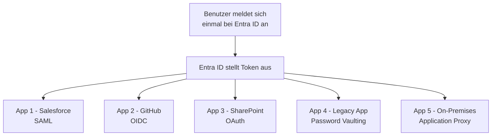
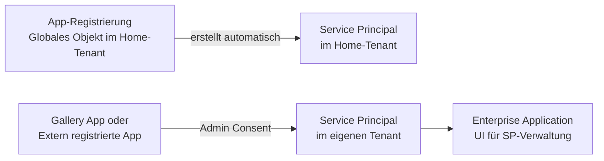
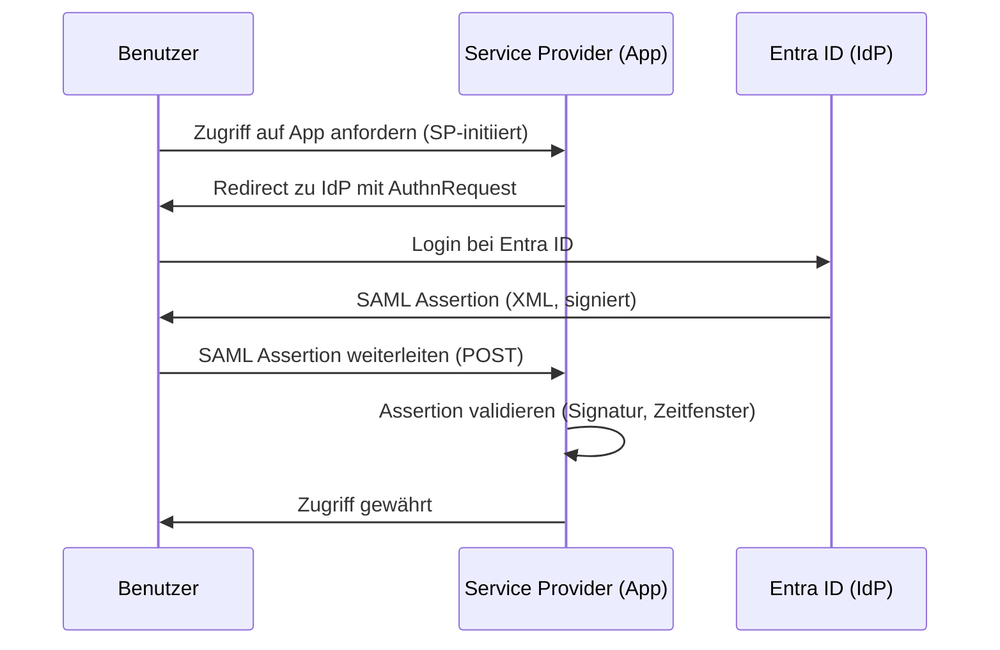
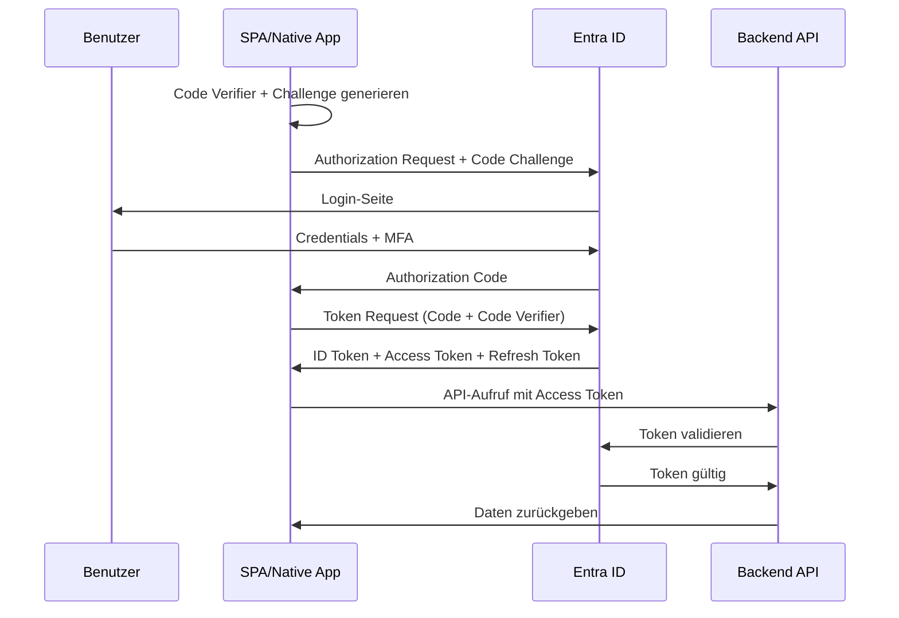
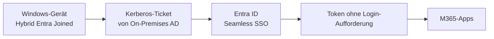

---
tags:
  - entra-id
  - sso
  - single-sign-on
  - oauth
  - saml
  - openid-connect
aliases:
  - SSO
  - Single Sign-On
  - OAuth 2.0
  - OIDC
---

# Single Sign-On

> [!ABSTRACT] TL;DR
> Single Sign-On (SSO) mit Entra ID ermöglicht einmalige Anmeldung für tausende Anwendungen. SAML 2.0 für klassische Enterprise-Apps, OpenID Connect/OAuth 2.0 für moderne Apps. App-Registrierungen definieren die Anwendung global, Service Principals instanziieren sie im Tenant.

---

## SSO-Konzept und Vorteile



**Vorteile von SSO:**
- Benutzer müssen sich nur einmal anmelden
- Weniger Passwörter = weniger Sicherheitsrisiken
- Zentralisierte Zugriffskontrolle und Audit
- Sofortige Deaktivierung bei Kontoauflösung
- Bessere Benutzererfahrung

---

## App-Registrierung vs. Enterprise Application



| Aspekt | App-Registrierung | Enterprise Application |
|--------|------------------|----------------------|
| **Was es ist** | Definition der App (Client-ID, Secrets, Permissions) | Service Principal im Tenant (lokale Instanz) |
| **Wo erstellen** | Eigene Apps, die Entra ID nutzen | Zugewiesene/Gallery-Apps, externe Apps |
| **Credentials** | Client Secrets, Zertifikate | Keine eigenen Credentials |
| **Berechtigungen** | API Permissions definieren | Admin Consent erteilen |
| **SSO** | Konfigurierbar | SAML, OIDC, Password konfigurieren |

---

## SAML 2.0

SAML (Security Assertion Markup Language) ist das am weitesten verbreitete Enterprise-SSO-Protokoll.

### SAML-Ablauf



### SAML in Entra ID konfigurieren

```
Entra ID Portal → Enterprise Applications → [App] → Single sign-on → SAML
```

Pflichtfelder:
- **Entity ID (Identifier)**: Eindeutige Kennung der App (z. B. `urn:app:firma`)
- **Reply URL (Assertion Consumer Service)**: Wo Entra ID die SAML-Assertion hinsendet
- **Sign on URL**: Wo Benutzer zur App weitergeleitet werden (SP-initiiert)

```powershell
# SAML-App konfigurieren per Graph API
$SAMLConfig = @{
    web = @{
        redirectUris = @("https://app.firma.de/saml/consume")
    }
    identifierUris = @("urn:firma:app:prod")
}

# In Enterprise App: SAML-Zertifikat herunterladen für App-Konfiguration
# Portal: Enterprise Apps → [App] → SSO → SAML-Signaturzertifikat → Herunterladen (Base64)
```

### SAML Assertion Attribute

```xml
<!-- Beispiel SAML Assertion (vereinfacht) -->
<Attribute Name="http://schemas.xmlsoap.org/ws/2005/05/identity/claims/emailaddress">
    <AttributeValue>user@firma.de</AttributeValue>
</Attribute>
<Attribute Name="http://schemas.microsoft.com/identity/claims/displayname">
    <AttributeValue>Max Mustermann</AttributeValue>
</Attribute>
```

---

## OpenID Connect (OIDC) und OAuth 2.0

### Unterschied OAuth vs. OIDC

| Protokoll | Zweck | Token |
|-----------|-------|-------|
| **OAuth 2.0** | Autorisierung (Zugriff auf APIs) | Access Token |
| **OpenID Connect** | Authentifizierung (Wer ist der Benutzer?) | ID Token + Access Token |

### Authorization Code Flow mit PKCE (empfohlen)



```python
# MSAL Python - Authorization Code Flow
import msal

app = msal.PublicClientApplication(
    client_id="app-client-id",
    authority="https://login.microsoftonline.com/tenant-id"
)

# Anmelde-URL generieren
flow = app.initiate_auth_code_flow(
    scopes=["User.Read", "Mail.Read"],
    redirect_uri="http://localhost:8000/callback"
)

# Nach Redirect: Token einlösen
result = app.acquire_token_by_auth_code_flow(
    auth_code_flow=flow,
    auth_response={"code": "authorization_code_here"}
)

access_token = result["access_token"]
```

### Client Credentials Flow (Service-zu-Service)

Für Daemon-Apps oder Backend-Services ohne Benutzerinteraktion:

```python
import msal

app = msal.ConfidentialClientApplication(
    client_id="app-client-id",
    client_credential="client-secret",
    authority="https://login.microsoftonline.com/tenant-id"
)

result = app.acquire_token_for_client(
    scopes=["https://graph.microsoft.com/.default"]
)

access_token = result["access_token"]
```

```powershell
# Client Credentials mit Zertifikat (sicherer als Secret)
$Certificate = Get-Item "Cert:\CurrentUser\My\THUMBPRINT"

$App = [Microsoft.Identity.Client.ConfidentialClientApplicationBuilder]::Create("client-id") `
    .WithCertificate($Certificate) `
    .WithAuthority("https://login.microsoftonline.com/tenant-id") `
    .Build()

$Token = $App.AcquireTokenForClient(@("https://graph.microsoft.com/.default")).ExecuteAsync().Result
```

---

## App-Registrierung einrichten

```powershell
# Neue App-Registrierung erstellen
$NewApp = New-MgApplication `
    -DisplayName "Meine Web-Anwendung" `
    -SignInAudience "AzureADMyOrg" `
    -Web @{
        RedirectUris = @("https://app.firma.de/auth/callback")
        ImplicitGrantSettings = @{
            EnableIdTokenIssuance = $false
            EnableAccessTokenIssuance = $false
        }
    }

Write-Host "App ID (Client ID): $($NewApp.AppId)"
Write-Host "Object ID: $($NewApp.Id)"

# Client Secret hinzufügen
$Secret = Add-MgApplicationPassword `
    -ApplicationId $NewApp.Id `
    -PasswordCredential @{
        DisplayName = "Prod-Secret"
        EndDateTime = (Get-Date).AddYears(1)
    }

Write-Host "Client Secret (nur jetzt sichtbar!): $($Secret.SecretText)"
```

> [!DANGER] Secrets sicher speichern
> Client Secrets werden **nur einmal** bei der Erstellung angezeigt. Sofort in Azure Key Vault oder einem Passwort-Manager speichern. Ablaufende Secrets rechtzeitig rotieren!

### Zertifikat statt Secret (Best Practice)

```powershell
# Selbst-signiertes Zertifikat erstellen
$Cert = New-SelfSignedCertificate `
    -Subject "CN=MeineApp" `
    -CertStoreLocation "Cert:\CurrentUser\My" `
    -NotAfter (Get-Date).AddYears(2) `
    -KeyUsage DigitalSignature

# Öffentlichen Schlüssel exportieren
$CertBase64 = [System.Convert]::ToBase64String($Cert.GetRawCertData())

# Zertifikat zur App-Registrierung hinzufügen
Add-MgApplicationKey `
    -ApplicationId $NewApp.Id `
    -KeyCredential @{
        Type = "AsymmetricX509Cert"
        Usage = "Verify"
        Key = [System.Convert]::FromBase64String($CertBase64)
    } `
    -PasswordCredential @{} `
    -Proof "jwt-proof-token"
```

---

## API-Berechtigungen

```powershell
# Delegierte Berechtigung hinzufügen (User.Read)
$GraphServicePrincipal = Get-MgServicePrincipal -Filter "AppId eq '00000003-0000-0000-c000-000000000000'"
$UserReadPermission = $GraphServicePrincipal.Oauth2PermissionScopes |
    Where-Object {$_.Value -eq "User.Read"}

Update-MgApplication -ApplicationId $NewApp.Id -RequiredResourceAccess @(
    @{
        ResourceAppId = "00000003-0000-0000-c000-000000000000"  # Microsoft Graph
        ResourceAccess = @(
            @{Id = $UserReadPermission.Id; Type = "Scope"}  # Delegiert
        )
    }
)

# Admin Consent für Application Permission erteilen
$SP = Get-MgServicePrincipal -Filter "AppId eq '$($NewApp.AppId)'"
New-MgServicePrincipalAppRoleAssignment `
    -ServicePrincipalId $SP.Id `
    -PrincipalId $SP.Id `
    -ResourceId $GraphServicePrincipal.Id `
    -AppRoleId "app-role-id"
```

---

## WS-Federation

WS-Federation wird für ältere Microsoft-Dienste verwendet:
- SharePoint on-premises mit ADFS
- Ältere Office-Integrationen
- Legacy-Enterprise-Anwendungen

Entra ID unterstützt WS-Federation als IdP für kompatible Apps. Konfiguration ähnlich wie SAML in Enterprise Applications.

---

## SSO mit Password Vaulting (Legacy Apps)

Für Anwendungen ohne moderne Auth-Unterstützung:

```
Enterprise Applications → [App] → Single sign-on → Passwortbasiert
```

- Entra ID speichert Benutzername/Passwort verschlüsselt
- Die **My Apps-Browsererweiterung** füllt die Anmeldefelder automatisch aus
- Nur für Apps ohne SAML/OIDC-Support empfohlen

---

## Microsoft Entra Seamless SSO (Hybrid)

Für hybride Umgebungen: Transparentes SSO für Domain-joined Windows-Geräte:



```powershell
# Seamless SSO aktivieren (in Entra Connect)
# Entra Connect Assistent → Features ändern → Einmaliges Anmelden aktivieren

# Oder per PowerShell im Entra Connect-Server
Import-Module "C:\Program Files\Microsoft Azure Active Directory Connect\AzureADSSO.psd1"
New-AzureADSSOAuthenticationContext
Enable-AzureADSSO -Enable $true
```

---

## Kerberos-basiertes SSO (Application Proxy)

Für On-Premises-Apps, die Kerberos nutzen:

```
Enterprise Applications → Neue App → On-Premises-Anwendung
→ Interne URL, Externe URL
→ Vorauthentifizierung: Azure Active Directory
→ Delegierungsidentität: User Principal Name
```

Der Application Proxy Connector führt **Kerberos Constrained Delegation (KCD)** im Namen des Benutzers durch.

---

## Token-Konfiguration

```powershell
# Claims in Token anpassen (für SAML oder OIDC)
# Portal: Enterprise Apps → [App] → SSO → Attribute und Ansprüche

# Optionale Claims per Manifest hinzufügen
$Manifest = @{
    optionalClaims = @{
        idToken = @(
            @{name = "email"; essential = $true},
            @{name = "family_name"; essential = $false},
            @{name = "given_name"; essential = $false}
        )
        accessToken = @(
            @{name = "groups"; essential = $false}
        )
    }
}

Update-MgApplication -ApplicationId $NewApp.Id `
    -OptionalClaims $Manifest.optionalClaims
```

---

## Troubleshooting

### Häufige SSO-Probleme

| Problem | Ursache | Lösung |
|---------|---------|--------|
| SAML-Fehler: Signature validation failed | Falsches Zertifikat in App konfiguriert | SAML-Zertifikat aus Entra ID herunterladen und in App importieren |
| OIDC: invalid_client | Falsches Client Secret oder abgelaufen | Neues Secret generieren |
| OAuth: AADSTS50011 - Reply URL mismatch | Redirect URI stimmt nicht überein | Redirect URI in App-Registrierung prüfen |
| AADSTS65001 - No consent | Admin Consent nicht erteilt | Admin Consent im Portal erteilen |
| Endloser Login-Loop | Reply URL falsch konfiguriert | ACS-URL in SAML-Konfiguration prüfen |

```powershell
# App-Registrierung debuggen
Get-MgApplication -ApplicationId "app-id" |
    Select-Object DisplayName, AppId, SignInAudience,
        @{N="RedirectUris";E={$_.Web.RedirectUris}},
        @{N="RequiredPermissions";E={$_.RequiredResourceAccess | ConvertTo-Json -Depth 5}}
```

---

## Verwandte Notizen

- [[Microsoft Entra ID Grundlagen]]
- [[Conditional Access]]
- [[Entra ID B2C]]
- [[External Identities B2B]]
- [[Hybrid Identity Entra Connect]]
