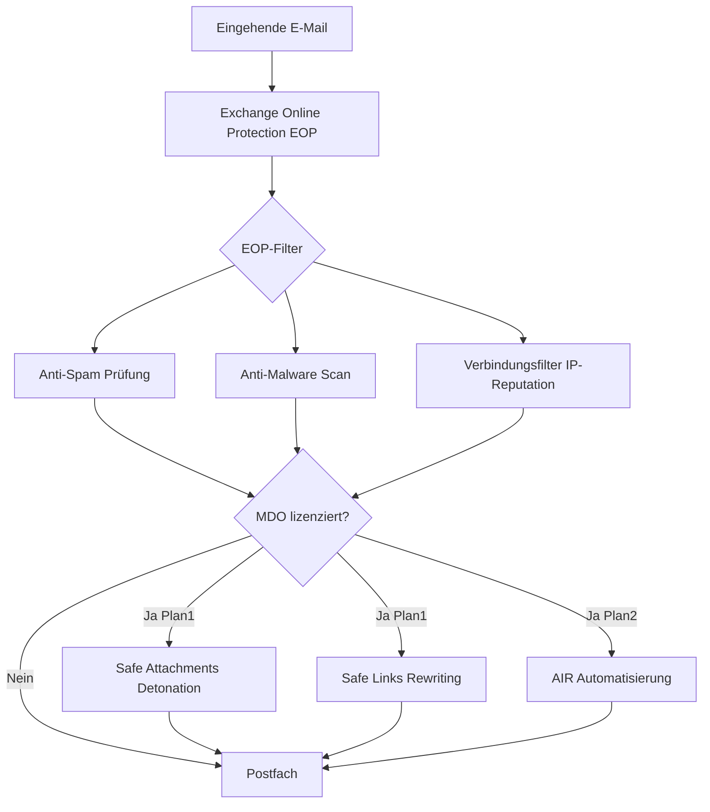
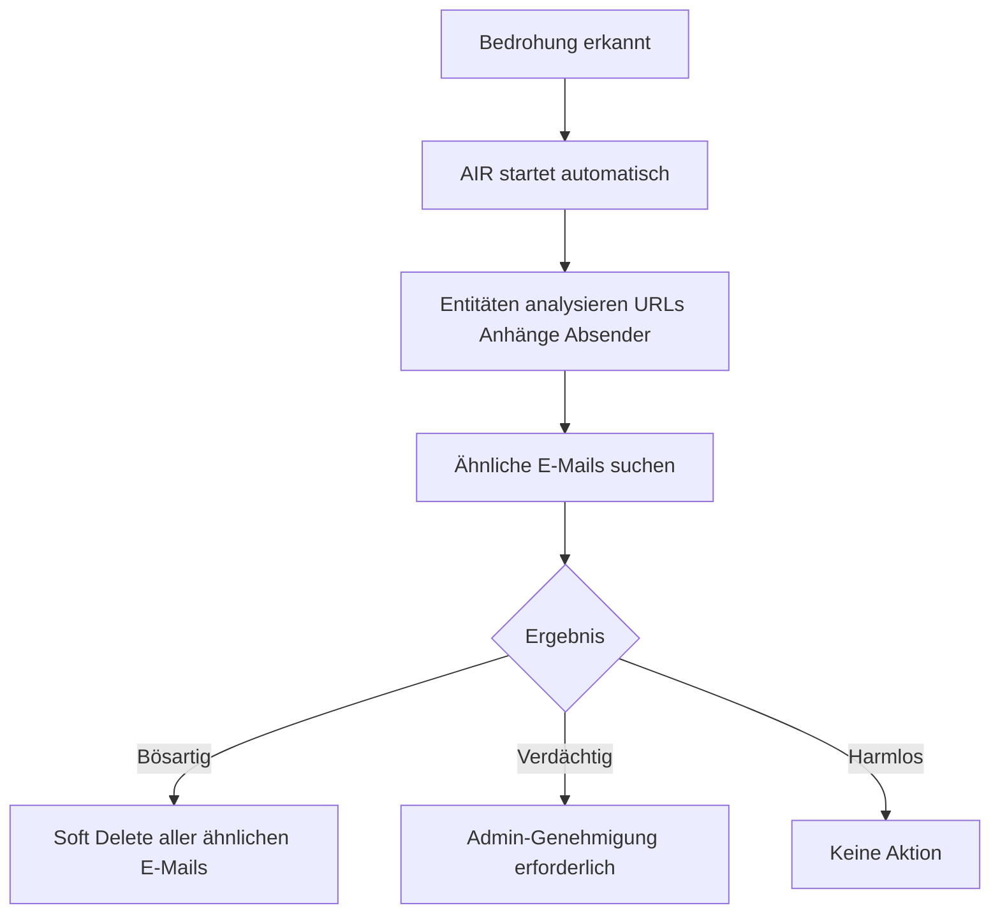

---
tags:
  - exchange-online
  - anti-spam
  - anti-phishing
  - eop
  - defender-office365
  - sicherheit
aliases:
  - EOP
  - Defender for Office 365
  - Anti-Spam
  - Anti-Phishing
---

# Anti-Spam und Anti-Phishing

> [!ABSTRACT] TL;DR
> Exchange Online Protection (EOP) ist der in Exchange Online integrierte Basis-Schutz gegen Spam, Malware und Phishing. Microsoft Defender for Office 365 (MDO) ergänzt EOP um erweiterte Schutzmechanismen wie Safe Links, Safe Attachments, Anti-Phishing mit Impersonation-Schutz und automatisierte Incident-Reaktion (AIR).

---

## Schutzebenen-Architektur



---

## Exchange Online Protection (EOP)

EOP ist in **allen** Microsoft 365-Plänen enthalten und bietet:

| Feature | Beschreibung |
|---------|-------------|
| Anti-Spam (Inbound) | Spam-Erkennung, SCL-Bewertung |
| Anti-Spam (Outbound) | Massenversand-Limits, Kompromittierungs-Erkennung |
| Anti-Malware | Virenscan aller Anhänge |
| Verbindungsfilter | IP-Reputation, Blocklisten |
| Spoofing-Schutz | DMARC-Enforcement, Anti-Spoofing |
| Quarantäne | Verwaltung gefährlicher E-Mails |
| Nachrichten-Reporting | Spam-Berichte, Benutzer-Feedback |

---

## Spam Confidence Level (SCL)

Der SCL (Spam Confidence Level) ist ein Wert von -1 bis 9, der die Spam-Wahrscheinlichkeit einer E-Mail angibt.

| SCL | Bedeutung | Standard-Aktion |
|-----|-----------|----------------|
| -1 | Safe Listed (Whitelist) | Direkt zustellen |
| 0–1 | Kein Spam | Posteingang |
| 2–4 | Möglicherweise Spam | Posteingang |
| 5–6 | Spam | Junk-Ordner |
| 7–9 | Sehr wahrscheinlich Spam | Junk-Ordner |
| (Sonderfall) | Malware/Phishing | Quarantäne |

```powershell
# Anti-Spam-Richtlinien anzeigen
Get-HostedContentFilterPolicy | Select-Object Name, SpamAction, HighConfidenceSpamAction, BulkThreshold

# Standard-Richtlinie bearbeiten
Set-HostedContentFilterPolicy -Identity "Default" `
    -SpamAction MoveToJmf `
    -HighConfidenceSpamAction Quarantine `
    -BulkThreshold 6 `
    -BulkSpamAction MoveToJmf

# Neue benutzerdefinierte Anti-Spam-Richtlinie erstellen
New-HostedContentFilterPolicy -Name "Strenge Spam-Richtlinie" `
    -SpamAction Quarantine `
    -HighConfidenceSpamAction Quarantine `
    -PhishSpamAction Quarantine `
    -BulkThreshold 4

# Richtlinie einer Gruppe zuweisen
New-HostedContentFilterRule -Name "Strenge Spam Regel" `
    -HostedContentFilterPolicy "Strenge Spam-Richtlinie" `
    -SentToMemberOf "Führungskräfte@contoso.com"
```

---

## Microsoft Defender for Office 365

### Plan-Vergleich

| Feature | EOP | MDO Plan 1 | MDO Plan 2 |
|---------|-----|-----------|-----------|
| Anti-Spam | ✅ | ✅ | ✅ |
| Anti-Malware | ✅ | ✅ | ✅ |
| Anti-Phishing (Basis) | ✅ | ✅ | ✅ |
| Safe Links | ❌ | ✅ | ✅ |
| Safe Attachments | ❌ | ✅ | ✅ |
| Impersonation-Schutz | ❌ | ✅ | ✅ |
| AIR (Automatisierung) | ❌ | ❌ | ✅ |
| Attack Simulator | ❌ | ❌ | ✅ |
| Threat Analytics | ❌ | ❌ | ✅ |
| Threat Explorer | ❌ | ❌ | ✅ |

> [!NOTE] Enthaltene Pläne
> MDO Plan 1 ist in **Microsoft 365 Business Premium** und **Office 365 E1/E3** enthalten. MDO Plan 2 ist in **Microsoft 365 E5** und **Microsoft 365 Defender** enthalten oder als Add-on erhältlich.

---

## Safe Links

Safe Links schützt vor bösartigen URLs in E-Mails und Office-Dokumenten durch **URL-Rewriting** und **Echtzeit-Detonation**.

### Funktionsweise

1. Eingehende URL wird in eine Microsoft-URL umgeschrieben: `https://nam12.safelinks.protection.outlook.com/?url=...`
2. Beim Klick wird die URL in Echtzeit geprüft
3. Bekannte bösartige URLs → Warnseite
4. Unbekannte URLs → Detonation in Sandbox → dann Ergebnis

### Konfiguration

```powershell
# Safe Links Richtlinie anzeigen
Get-SafeLinksPolicy | Select-Object Name, IsEnabled, EnableSafeLinksForEmail, TrackClicks

# Neue Safe Links Richtlinie erstellen
New-SafeLinksPolicy -Name "Standard Safe Links" `
    -EnableSafeLinksForEmail $true `
    -EnableSafeLinksForTeams $true `
    -EnableSafeLinksForOffice $true `
    -TrackClicks $true `
    -AllowClickThrough $false `
    -ScanUrls $true `
    -EnableForInternalSenders $true

# Richtlinie zuweisen
New-SafeLinksRule -Name "Standard Safe Links Regel" `
    -SafeLinksPolicy "Standard Safe Links" `
    -RecipientDomainIs "contoso.com"

# URL aus Safe Links ausschließen (Whitelist)
Set-SafeLinksPolicy -Identity "Standard Safe Links" `
    -DoNotRewriteUrls "https://vertrauenswuerdige-seite.de"
```

> [!WARNING] AllowClickThrough
> `AllowClickThrough $false` verhindert, dass Benutzer Warnseiten umgehen können. Für sicherheitssensible Umgebungen empfohlen, kann aber zu Support-Anfragen führen.

---

## Safe Attachments

Safe Attachments öffnet Anhänge in einer virtuellen Sandbox und analysiert ihr Verhalten, bevor sie dem Benutzer zugestellt werden.

### Dynamic Delivery

Mit **Dynamic Delivery** erhält der Benutzer die E-Mail sofort, aber der Anhang wird durch einen Platzhalter ersetzt bis die Analyse abgeschlossen ist. Dies reduziert die Verzögerung auf typisch 1–3 Minuten.

```powershell
# Safe Attachments Richtlinie erstellen
New-SafeAttachmentPolicy -Name "Standard Safe Attachments" `
    -Enable $true `
    -Action DynamicDelivery `
    -Redirect $false

# Alternativ: Blockieren bei Erkennung (keine Zustellung)
New-SafeAttachmentPolicy -Name "Strenge Safe Attachments" `
    -Enable $true `
    -Action Block

# Richtlinie zuweisen
New-SafeAttachmentRule -Name "Safe Attachments Regel" `
    -SafeAttachmentPolicy "Standard Safe Attachments" `
    -RecipientDomainIs "contoso.com"

# Status prüfen
Get-SafeAttachmentPolicy | Select-Object Name, Enable, Action
```

---

## Anti-Phishing-Richtlinien

Anti-Phishing-Richtlinien schützen vor mehreren Angriffstypen:

### Schutztypen

| Schutz | Beschreibung |
|--------|-------------|
| **Impersonation (User)** | Schutz vor Nachahmung bestimmter Benutzer (z. B. CEO) |
| **Impersonation (Domain)** | Schutz vor ähnlichen Domänen (contöso.com, c0ntoso.com) |
| **Mailbox Intelligence** | KI-Analyse des normalen Kommunikationsverhaltens |
| **Spoofing-Schutz** | Schutz vor gefälschten Absenderadressen |
| **Safety Tips** | Hinweise in Outlook bei verdächtigen E-Mails |

```powershell
# Anti-Phishing Richtlinie erstellen (MDO erforderlich)
New-AntiPhishPolicy -Name "CEO-Schutz" `
    -EnableOrganizationDomainsProtection $true `
    -EnableTargetedUserProtection $true `
    -TargetedUsersToProtect @("ceo@contoso.com","cfo@contoso.com","cto@contoso.com") `
    -TargetedUserProtectionAction Quarantine `
    -EnableMailboxIntelligence $true `
    -EnableMailboxIntelligenceProtection $true `
    -MailboxIntelligenceProtectionAction MoveToJmf `
    -EnableSpoofIntelligence $true `
    -AuthenticationFailAction MoveToJmf `
    -EnableFirstContactSafetyTips $true

# Richtlinie zuweisen
New-AntiPhishRule -Name "CEO-Schutz Regel" `
    -AntiPhishPolicy "CEO-Schutz" `
    -RecipientDomainIs "contoso.com" `
    -Priority 0

# Spoof Intelligence Insights anzeigen
Get-SpoofIntelligenceInsight | Select-Object SpoofedUser, AllowedToSpoof, SpoofType
```

---

## Quarantäne-Verwaltung

### Admin-Zugriff auf Quarantäne

```powershell
# Quarantäne-Nachrichten anzeigen
Get-QuarantineMessage -ResultSize Unlimited | 
    Select-Object Subject, SenderAddress, RecipientAddress, QuarantineTypes, Received

# Gefiltert nach Typ
Get-QuarantineMessage -QuarantineTypes Phish | 
    Select-Object Subject, SenderAddress, Received

# Nachricht freigeben
Release-QuarantineMessage -Identity "<Message-ID>" -ReleaseToAll

# Nachricht löschen
Delete-QuarantineMessage -Identity "<Message-ID>"

# Nachrichten in Masse freigeben (alle falsch positiven Spam-Meldungen)
Get-QuarantineMessage -QuarantineTypes Spam -StartReceivedDate (Get-Date).AddDays(-1) |
    Release-QuarantineMessage -ReleaseToAll
```

### Endbenutzer-Quarantäne-Zugriff

```powershell
# Endbenutzer-Spam-Benachrichtigungen aktivieren
Set-HostedContentFilterPolicy -Identity "Default" `
    -EnableEndUserSpamNotifications $true `
    -EndUserSpamNotificationFrequency 3  # alle 3 Tage

# Quarantäne-Richtlinie konfigurieren (erlaubt Benutzern eigene Freigabe)
New-QuarantinePolicy -Name "Benutzer-Freigabe Spam" `
    -EndUserQuarantinePermissionsValue 23  # Bitmask für erlaubte Aktionen
```

---

## Attack Simulator (MDO Plan 2)

Attack Simulator ermöglicht realistische Phishing-Simulations-Kampagnen zur Sicherheitssensibilisierung.

```powershell
# Über Security Center: security.microsoft.com
# Attack Simulation Training → Simulationen
# Typen:
# - Credential Harvest (gefälschte Login-Seite)
# - Malware Attachment (harmloser Anhang)
# - Link in Attachment
# - Drive-by URL
# - OAuth Consent Grant

# Simulation starten (über das Portal, nicht PowerShell)
# Berichte über: security.microsoft.com → Attack simulation training → Reports
```

---

## AIR — Automated Investigation and Response (MDO Plan 2)

AIR automatisiert die Untersuchung und Reaktion auf E-Mail-Bedrohungen.



---

## Troubleshooting

> [!WARNING] Häufige Probleme

**Legitime E-Mails landen im Junk**
```powershell
# Absender zur Safe Sender List hinzufügen (org-weit)
Set-HostedContentFilterPolicy -Identity "Default" `
    -AllowedSenderDomains @{Add="vertrauenswuerdig.de"}

# Bestimmten Absender whitelisten
Set-HostedContentFilterPolicy -Identity "Default" `
    -AllowedSenders @{Add="kontakt@partner.de"}
```

**Spam kommt trotz Filter durch**
```powershell
# Message Trace für verdächtige E-Mail
Get-MessageTrace -SenderAddress "spammer@extern.com" -StartDate (Get-Date).AddDays(-1) |
    Select-Object Subject, Status, ToIP

# Detaillierte Analyse
Get-MessageTraceDetail -MessageTraceId "<ID>" | Select-Object Event, Action, Detail
```

---

## Verwandte Notizen

- [[Exchange Online Grundlagen]]
- [[E-Mail-Authentifizierung SPF DKIM DMARC]]
- [[Mail Flow und Transport Rules]]
- [[Exchange Online PowerShell]]
