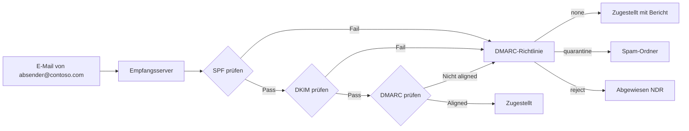
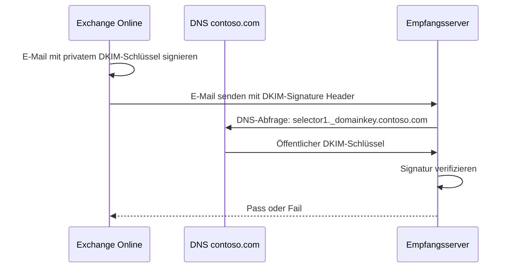
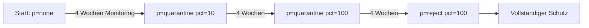

---
tags:
  - exchange-online
  - spf
  - dkim
  - dmarc
  - e-mail-authentifizierung
  - dns
aliases:
  - SPF DKIM DMARC
  - E-Mail Authentifizierung
  - Email Authentication
---

# E-Mail-Authentifizierung SPF DKIM DMARC

> [!ABSTRACT] TL;DR
> SPF, DKIM und DMARC sind drei DNS-basierte Mechanismen zur E-Mail-Authentifizierung. SPF definiert erlaubte Versandserver, DKIM signiert Nachrichten kryptographisch, und DMARC legt fest, was bei Fehlern passieren soll. Zusammen bilden sie den Schutz gegen E-Mail-Spoofing und Phishing.

---

## Warum E-Mail-Authentifizierung?

Das SMTP-Protokoll wurde ohne Authentifizierung konzipiert — jeder Server kann behaupten, E-Mails von beliebigen Domänen zu senden. SPF, DKIM und DMARC lösen dieses Problem nachträglich über DNS.



---

## SPF — Sender Policy Framework

### Was ist SPF?

SPF (RFC 7208) erlaubt dem Domänenbesitzer festzulegen, welche IP-Adressen und Server E-Mails **im Namen seiner Domäne** versenden dürfen. Der Empfangsserver prüft den SPF-Record der Absenderdomäne gegen die IP des versendenden Servers.

### SPF DNS-Record Syntax

```
v=spf1 [Mechanismen] [Qualifizierer]
```

| Qualifizierer | Bedeutung |
|--------------|-----------|
| `+` (Standard) | Pass — erlaubt |
| `-` | Fail — verboten |
| `~` | SoftFail — wahrscheinlich verboten |
| `?` | Neutral — keine Aussage |

| Mechanismus | Beschreibung |
|-------------|-------------|
| `include:domain.com` | Schließt SPF-Record einer anderen Domäne ein |
| `ip4:1.2.3.4` | Erlaubt IPv4-Adresse/Bereich |
| `ip6:2001:db8::/32` | Erlaubt IPv6-Adresse/Bereich |
| `mx` | Erlaubt alle MX-Server der Domäne |
| `a` | Erlaubt A-Record der Domäne |
| `all` | Catch-all (immer am Ende) |

### SPF-Record für Exchange Online

```dns
v=spf1 include:spf.protection.outlook.com -all
```

Für Hybrid (On-Premises + Exchange Online):
```dns
v=spf1 ip4:203.0.113.10 include:spf.protection.outlook.com -all
```

Mit weiteren Diensten (z. B. SendGrid, Mailchimp):
```dns
v=spf1 include:spf.protection.outlook.com include:sendgrid.net include:servers.mcsv.net -all
```

> [!DANGER] SPF PermError — Zu viele DNS-Lookups
> SPF erlaubt maximal **10 DNS-Lookups** pro Prüfung. Jedes `include:`, `mx`, `a` oder `ptr` zählt als Lookup. Werden mehr als 10 verwendet, schlägt SPF mit **PermError** fehl — was wie ein hartes Fail behandelt werden kann.
>
> **Lösung:** Einen SPF-Flattening-Dienst (z. B. dmarcian, AutoSPF) nutzen, der `include:`-Einträge durch IP-Adressen ersetzt.

### SPF prüfen

```powershell
# SPF-Record abfragen
Resolve-DnsName -Name contoso.com -Type TXT | Where-Object {$_.Strings -like "*spf*"}

# Alternativ via nslookup
nslookup -type=TXT contoso.com
```

---

## DKIM — DomainKeys Identified Mail

### Was ist DKIM?

DKIM (RFC 6376) signiert ausgehende E-Mails kryptographisch mit einem privaten Schlüssel. Der Empfangsserver prüft die Signatur anhand des öffentlichen Schlüssels im DNS. DKIM beweist, dass der Nachrichteninhalt nicht verändert wurde und tatsächlich vom autorisierten Server stammt.

### DKIM-Mechanismus



### DKIM in Exchange Online aktivieren

#### Über das Exchange Admin Center

1. EAC → **E-Mail-Schutz → DKIM**
2. Domäne auswählen
3. **DKIM-Signaturen aktivieren** → Zwei CNAME-Einträge werden angezeigt

#### DNS-Einträge erstellen

Exchange Online benötigt **zwei CNAME-Einträge** pro Domäne:

```dns
selector1._domainkey.contoso.com → selector1-contoso-com._domainkey.contoso.onmicrosoft.com
selector2._domainkey.contoso.com → selector2-contoso-com._domainkey.contoso.onmicrosoft.com
```

> [!NOTE] Selector-Rotation
> Exchange Online nutzt zwei Selektoren (selector1, selector2) und rotiert automatisch zwischen ihnen, um den privaten Schlüssel regelmäßig zu erneuern, ohne Downtime.

#### DKIM über PowerShell aktivieren

```powershell
# DKIM-Status für alle Domänen anzeigen
Get-DkimSigningConfig | Select-Object Domain, Enabled, Status, Selector1CNAME, Selector2CNAME

# DKIM für eine Domäne aktivieren
Set-DkimSigningConfig -Identity contoso.com -Enabled $true

# Falls noch nicht vorhanden: DKIM-Konfiguration erstellen
New-DkimSigningConfig -DomainName contoso.com -Enabled $false
# → Dann CNAME-Einträge im DNS erstellen
# → Anschließend aktivieren:
Set-DkimSigningConfig -Identity contoso.com -Enabled $true

# DKIM-Signatur testen
Test-DkimSigningConfig -Domain contoso.com
```

> [!WARNING] DNS-Propagation
> Nach dem Erstellen der CNAME-Einträge kann die DNS-Propagation bis zu **72 Stunden** dauern. Exchange Online überprüft automatisch, ob die Einträge vorhanden sind, bevor DKIM aktiviert wird.

---

## DMARC — Domain-based Message Authentication

### Was ist DMARC?

DMARC (RFC 7489) baut auf SPF und DKIM auf und definiert:
1. Was mit E-Mails passieren soll, die SPF/DKIM nicht bestehen (**Policy**)
2. Wohin Berichte über Fehler gesendet werden sollen (**Reports**)
3. Wie viel Prozent der E-Mails der Richtlinie unterliegen sollen (**Percentage**)

### DMARC Alignment

DMARC prüft, ob die Absenderdomäne (`From:`-Header) **aligned** mit SPF oder DKIM ist:

| Alignment-Typ | SPF | DKIM |
|--------------|-----|------|
| **Relaxed** (Standard) | Subdomain der `From:`-Domäne erlaubt | Subdomain erlaubt |
| **Strict** | Exakte Übereinstimmung | Exakte Übereinstimmung |

### DMARC DNS-Record Syntax

```
_dmarc.contoso.com TXT "v=DMARC1; p=reject; rua=mailto:dmarc@contoso.com; ruf=mailto:dmarc-forensic@contoso.com; adkim=r; aspf=r; pct=100"
```

| Parameter | Werte | Beschreibung |
|-----------|-------|-------------|
| `p` | `none`, `quarantine`, `reject` | Richtlinie bei Fehler |
| `rua` | `mailto:` | Aggregat-Berichte (täglich) |
| `ruf` | `mailto:` | Forensische Berichte (sofort) |
| `adkim` | `r` (relaxed), `s` (strict) | DKIM-Alignment |
| `aspf` | `r` (relaxed), `s` (strict) | SPF-Alignment |
| `pct` | 0–100 | Prozentualer Anteil der Prüfung |
| `sp` | `none`, `quarantine`, `reject` | Richtlinie für Subdomänen |

### DMARC-Rollout-Strategie



**Phase 1 — Monitoring** (keine E-Mails blockiert):
```dns
_dmarc.contoso.com TXT "v=DMARC1; p=none; rua=mailto:dmarc-reports@contoso.com"
```

**Phase 2 — Quarantäne** (fehlende E-Mails in Spam):
```dns
_dmarc.contoso.com TXT "v=DMARC1; p=quarantine; pct=25; rua=mailto:dmarc-reports@contoso.com"
```

**Phase 3 — Reject** (fehlende E-Mails abgewiesen):
```dns
_dmarc.contoso.com TXT "v=DMARC1; p=reject; pct=100; rua=mailto:dmarc-reports@contoso.com; ruf=mailto:dmarc-forensic@contoso.com"
```

> [!IMPORTANT] Vor p=reject prüfen
> Vor dem Wechsel auf `p=reject` sicherstellen, dass **alle legitimen Versanddienste** (CRM, Newsletter, Ticketsysteme, Scanner) korrekte SPF/DKIM-Einstellungen haben. DMARC-Berichte (RUA) analysieren, um blinde Flecken zu finden.

### DMARC-Berichte auswerten

```powershell
# DMARC-Record prüfen
Resolve-DnsName -Name _dmarc.contoso.com -Type TXT

# Externe Tools für DMARC-Berichte:
# - dmarcian.com
# - dmarc.postmarkapp.com
# - Valimail Monitor
# - Google Postmaster Tools (für Gmail-Zustellung)
```

---

## Zusammenspiel SPF, DKIM, DMARC

| Szenario | SPF | DKIM | DMARC |
|---------|-----|------|-------|
| Legitime E-Mail | ✅ Pass | ✅ Pass | ✅ Pass |
| SPF-Fail, DKIM-Pass | ❌ Fail | ✅ Pass | ✅ Pass (DKIM aligned) |
| SPF-Pass, DKIM-Fail | ✅ Pass | ❌ Fail | ✅ Pass (SPF aligned) |
| Beide Fail | ❌ Fail | ❌ Fail | ❌ Fail → Richtlinie |
| Forwarding (Relay) | ❌ Fail | ✅ Pass | ✅ Pass (DKIM) |

> [!TIP] E-Mail-Weiterleitung
> Bei E-Mail-Weiterleitungen (z. B. über einen Relay-Server) schlägt SPF häufig fehl, weil der ursprüngliche Absender-IP nicht mehr übereinstimmt. DKIM bleibt aber erhalten. Deshalb ist **DKIM wichtiger als SPF** für DMARC-Alignment bei Weiterleitungen.

---

## Troubleshooting

### Tools

| Tool | URL | Verwendung |
|------|-----|-----------|
| MXToolbox SuperTool | `mxtoolbox.com/SuperTool` | SPF, DKIM, DMARC, MX prüfen |
| DMARC Analyzer | `dmarcanalyzer.com` | Berichte auswerten |
| Mail-Tester | `mail-tester.com` | Gesamtbewertung einer E-Mail |
| Google MX Toolbox | `toolbox.googleapps.com` | DNS-Checks |
| Microsoft Remote Connectivity Analyzer | `testconnectivity.microsoft.com` | Exchange-spezifische Tests |

### Häufige Fehler

```powershell
# SPF PermError (zu viele Lookups) diagnostizieren
# SPF-Record auflösen und Lookups zählen
Resolve-DnsName -Name contoso.com -Type TXT

# DKIM-Schlüssel prüfen
Resolve-DnsName -Name "selector1._domainkey.contoso.com" -Type CNAME
Resolve-DnsName -Name "selector1-contoso-com._domainkey.contoso.onmicrosoft.com" -Type TXT
```

> [!BUG] DKIM Status "Fehler" im EAC
> Wenn DKIM im EAC als Fehler angezeigt wird: CNAME-Einträge im DNS prüfen. Häufig fehlt der Punkt am Ende des CNAME-Ziels oder der Eintrag ist noch nicht propagiert.

---

## Verwandte Notizen

- [[Exchange Online Grundlagen]]
- [[Mail Flow und Transport Rules]]
- [[Anti-Spam und Anti-Phishing]]
- [[Exchange Online PowerShell]]
