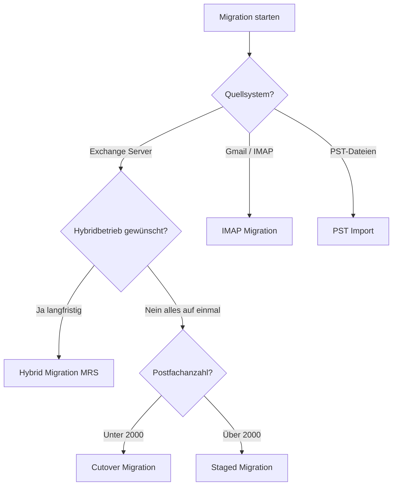
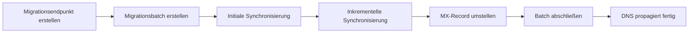

---
tags:
  - exchange-online
  - migration
  - hybrid
  - imap
  - pst
aliases:
  - E-Mail Migration
  - Mailbox Migration
  - Exchange Migration
---

# E-Mail-Migration

> [!ABSTRACT] TL;DR
> Exchange Online bietet fünf Migrationsszenarien: Cutover (alles auf einmal, <2.000 Postfächer), Staged (batchweise, >2.000), Hybrid (MRS Proxy, empfohlen für Exchange-Umgebungen), IMAP (Non-Exchange-Quellen wie Gmail) und PST-Import (Archivdaten). Die Wahl hängt von Quellsystem, Postfachanzahl und Downtime-Toleranz ab.

---

## Migrationsszenarien im Überblick



| Typ | Quelle | Postfächer | Koexistenz | Empfehlung |
|-----|--------|-----------|-----------|------------|
| **Cutover** | Exchange 2010+ | < 2.000 | Nein | Klein, schnell |
| **Staged** | Exchange 2003/2007 | > 2.000 | Begrenzt | Groß, alt |
| **Hybrid (MRS)** | Exchange 2010+ | Beliebig | Ja | Beste Option |
| **IMAP** | Beliebig (IMAP) | Beliebig | Nein | Non-Exchange |
| **PST-Import** | PST-Dateien | Beliebig | Nein | Archivdaten |

---

## Cutover Migration

Bei der Cutover-Migration werden **alle Postfächer auf einmal** in einem Batch migriert. Benutzer sind während der Migration nicht in Exchange Online, bis der Batch abgeschlossen ist.

### Voraussetzungen

- Exchange Server 2010 oder neuer
- Weniger als 2.000 Postfächer (empfohlen: < 150)
- Outlook Anywhere (RPC over HTTP) aktiviert
- Admin-Credentials mit Impersonation-Rechten

### Ablauf



### PowerShell-Befehle

```powershell
# Migrationsendpunkt für On-Premises Exchange erstellen
New-MigrationEndpoint -Name "OnPremExchange" `
    -ExchangeOutlookAnywhere `
    -Autodiscover `
    -EmailAddress "admin@contoso-onprem.com" `
    -Credentials (Get-Credential)

# Cutover-Migrationsbatch erstellen
New-MigrationBatch -Name "Cutover-Migration-01" `
    -SourceEndpoint "OnPremExchange" `
    -TargetDeliveryDomain "contoso.mail.onmicrosoft.com" `
    -AutoStart `
    -AutoComplete

# Status überwachen
Get-MigrationBatch | Select-Object Identity, Status, TotalCount, SyncedCount, FailedCount

# Detaillierte Benutzerstatus
Get-MigrationUser -BatchId "Cutover-Migration-01" | 
    Select-Object EmailAddress, Status, PercentageComplete, DataTransferredInGB
```

---

## Staged Migration

Staged Migration migriert Postfächer in **Batches über mehrere Wochen**. Geeignet für ältere Exchange-Versionen (2003/2007) oder sehr große Organisationen.

> [!WARNING] Staged Migration Einschränkungen
> Staged Migration synchronisiert nur E-Mails, nicht Kalender oder Kontakte vollständig. Die Koexistenz ist eingeschränkt — Free/Busy ist nicht verfügbar. Für moderne Szenarien ist **Hybrid Migration** vorzuziehen.

```powershell
# CSV-Datei für Batch erstellen (EmailAddress-Spalte erforderlich)
# Dateiinhalt: EmailAddress
# user1@contoso-onprem.com
# user2@contoso-onprem.com

# Staged-Batch mit CSV erstellen
New-MigrationBatch -Name "Staged-Batch-01" `
    -SourceEndpoint "OnPremExchange" `
    -CSVData ([System.IO.File]::ReadAllBytes("C:\migration\batch01.csv")) `
    -TargetDeliveryDomain "contoso.mail.onmicrosoft.com" `
    -AutoStart

# Batch abschließen (nach Benutzerbestätigung)
Complete-MigrationBatch -Identity "Staged-Batch-01"
```

---

## Hybrid Migration (MRS Proxy)

Die Hybrid Migration ist die **empfohlene Methode** für Exchange-Organisationen. Sie nutzt den Mailbox Replication Service (MRS) und erfordert eine Hybrid-Konfiguration.

### Voraussetzungen

- Exchange 2010 SP3 RU8 oder neuer (besser: 2016/2019)
- Exchange Hybrid mit HCW konfiguriert (siehe [[Exchange Hybrid]])
- MRS Proxy auf Mailbox-Servern aktiviert
- Outlook Anywhere konfiguriert

```powershell
# MRS Proxy auf On-Premises aktivieren (auf Exchange Server ausführen)
Set-WebServicesVirtualDirectory -Identity "EWS (Default Web Site)" -MRSProxyEnabled $true

# Migrationsendpunkt für Hybrid erstellen
New-MigrationEndpoint -Name "HybridEndpoint" `
    -ExchangeRemoteMove `
    -Autodiscover `
    -EmailAddress "admin@contoso-onprem.com" `
    -Credentials (Get-Credential)

# Hybrid-Migrationsbatch erstellen
New-MigrationBatch -Name "Hybrid-Batch-Q1" `
    -SourceEndpoint "HybridEndpoint" `
    -TargetDeliveryDomain "contoso.mail.onmicrosoft.com" `
    -CSVData ([System.IO.File]::ReadAllBytes("C:\migration\wave1.csv")) `
    -BadItemLimit 50 `
    -LargeItemLimit 25 `
    -AutoStart

# Batch abschließen und MX umstellen
# Erst nach MX-Umstellung abschließen!
Complete-MigrationBatch -Identity "Hybrid-Batch-Q1"

# Migration eines einzelnen Postfachs (Onboarding)
New-MoveRequest -Identity "user@contoso-onprem.com" `
    -Remote `
    -RemoteHostName "mail.contoso-onprem.com" `
    -TargetDeliveryDomain "contoso.mail.onmicrosoft.com" `
    -Credentials (Get-Credential) `
    -BadItemLimit 50

# Move Request Status prüfen
Get-MoveRequest | Get-MoveRequestStatistics | 
    Select-Object DisplayName, Status, PercentComplete, BytesTransferred
```

---

## IMAP Migration

IMAP Migration migriert E-Mails aus beliebigen IMAP-Quellen (Gmail, Zimbra, Lotus Notes etc.).

> [!NOTE] IMAP Einschränkungen
> IMAP migriert nur **E-Mails**, keine Kalender, Kontakte, Aufgaben oder Regeln. Ordnerstruktur wird übernommen, aber Flags wie Gelesen/Ungelesen werden nur teilweise migriert.

### Gmail → Exchange Online

```powershell
# IMAP-Endpunkt für Gmail erstellen
New-MigrationEndpoint -Name "Gmail-IMAP" `
    -IMAP `
    -RemoteServer "imap.gmail.com" `
    -Port 993 `
    -Security Ssl

# CSV-Datei Format für IMAP:
# EmailAddress,UserName,Password
# user@gmail.com,user@gmail.com,App-Passwort-hier

# IMAP-Migrationsbatch erstellen
New-MigrationBatch -Name "Gmail-Migration" `
    -SourceEndpoint "Gmail-IMAP" `
    -CSVData ([System.IO.File]::ReadAllBytes("C:\migration\gmail-users.csv")) `
    -TargetDeliveryDomain "contoso.mail.onmicrosoft.com" `
    -AutoStart

# Batch abschließen
Complete-MigrationBatch -Identity "Gmail-Migration"
```

> [!IMPORTANT] Gmail App-Passwörter
> Für Gmail mit 2-Faktor-Authentifizierung müssen **App-Passwörter** in Google generiert werden. Normale Passwörter funktionieren nicht. Alternativ: Google Workspace mit OAuth-Migration.

---

## PST-Import

### Option 1: Network Upload (Azure Upload)

```powershell
# 1. SAS-URL für Azure Blob Storage generieren (im Compliance Center)
# security.microsoft.com → Information Governance → Import → PST-Dateien importieren

# 2. AzCopy zum Hochladen verwenden
AzCopy.exe copy "C:\PST-Dateien\*" "https://[storageaccount].blob.core.windows.net/ingestiondata/[SAS-Token]" --recursive

# 3. Mapping-CSV erstellen:
# Workload,FilePath,Name,Mailbox,IsArchive,TargetRootFolder,ContentCodePage,SPFileContainer,SPManifestContainer,SPSiteUrl
# Exchange,,user-archiv.pst,user@contoso.com,FALSE,/,,,

# 4. Import-Auftrag im Compliance Center starten
# 5. Status überwachen
```

### Option 2: Drive Shipping (physische Festplatte)

Für sehr große Datenmengen (>10 TB):

1. **Azure Import/Export-Auftrag** im Azure Portal erstellen
2. PST-Dateien mit **WAImportExport.exe** auf Festplatte kopieren (BitLocker-verschlüsselt)
3. Festplatte an **Microsoft Datacenter** senden
4. Nach Upload: Import-Mapping im Compliance Center konfigurieren

---

## Migrationsbatch überwachen und verwalten

```powershell
# Alle Batches anzeigen
Get-MigrationBatch | Select-Object Identity, Status, TotalCount, SyncedCount, FailedCount, CompletedCount

# Fehlerhafte Benutzer anzeigen
Get-MigrationUser -Status Failed | Select-Object EmailAddress, Error

# Fehlermeldungen eines Benutzers
Get-MigrationUserStatistics -Identity "user@contoso.com" -IncludeReport | 
    Select-Object -ExpandProperty Report | Select-Object -ExpandProperty Failures

# Batch anhalten
Suspend-MigrationBatch -Identity "Hybrid-Batch-Q1"

# Batch fortsetzen
Start-MigrationBatch -Identity "Hybrid-Batch-Q1"

# Batch löschen (abbrechen)
Remove-MigrationBatch -Identity "Hybrid-Batch-Q1" -Confirm:$false
```

---

## Migration Assessment (Vorbereitung)

Vor einer Migration sollten folgende Punkte geprüft werden:

```powershell
# Postfachgrößen ermitteln
Get-MailboxStatistics -ResultSize Unlimited | 
    Select-Object DisplayName, TotalItemSize, ItemCount | 
    Sort-Object TotalItemSize -Descending | 
    Export-Csv "C:\migration\postfachgroessen.csv" -Encoding UTF8

# Postfächer über 50 GB identifizieren (benötigen Plan 2)
Get-MailboxStatistics -ResultSize Unlimited | 
    Where-Object {$_.TotalItemSize -gt "50 GB"} | 
    Select-Object DisplayName, TotalItemSize

# Public Folder Größe prüfen
Get-PublicFolderStatistics -ResultSize Unlimited | 
    Select-Object Name, TotalItemSize | 
    Sort-Object TotalItemSize -Descending

# Lizenzanforderungen schätzen
$mailboxes = Get-Mailbox -ResultSize Unlimited -RecipientTypeDetails UserMailbox
Write-Output "Gesamte Postfächer: $($mailboxes.Count)"
```

---

## Troubleshooting

> [!WARNING] Häufige Migrationsfehler

**BadItemLimit überschritten**
```powershell
# BadItemLimit erhöhen (Vorsicht: beschädigte Items werden übersprungen)
Set-MigrationBatch -Identity "Batch-Name" -BadItemLimit 100 -LargeItemLimit 50
```

**MRS Proxy nicht erreichbar**
```powershell
# MRS Proxy testen
Test-MigrationServerAvailability -ExchangeRemoteMove `
    -Autodiscover `
    -EmailAddress "testuser@contoso-onprem.com" `
    -Credentials (Get-Credential)
```

**Migrationsendpunkt-Fehler**
```powershell
# Endpunkt testen
Test-MigrationServerAvailability -Endpoint "HybridEndpoint"

# Endpunkt neu erstellen falls nötig
Remove-MigrationEndpoint -Identity "HybridEndpoint" -Confirm:$false
```

---

## Verwandte Notizen

- [[Exchange Online Grundlagen]]
- [[Exchange Hybrid]]
- [[Postfächer verwalten]]
- [[Öffentliche Ordner]]
- [[Exchange Online PowerShell]]
