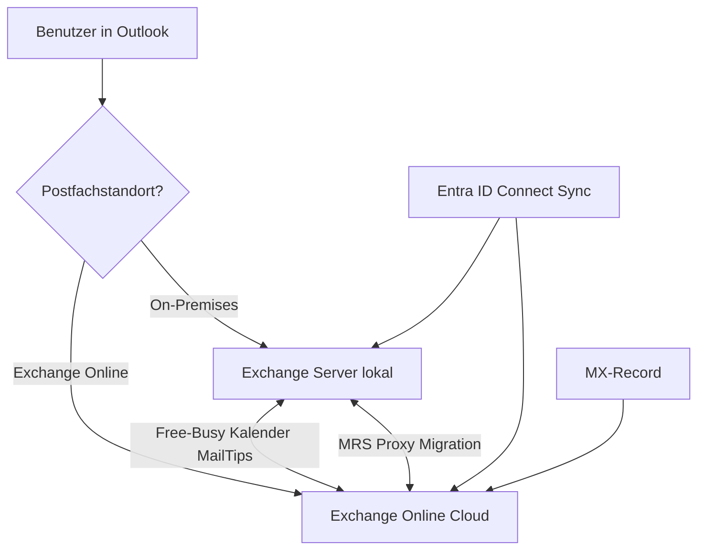

---
tags:
  - exchange-online
  - hybrid
  - on-premises
  - hcw
  - migration
aliases:
  - Exchange Hybrid
  - Hybrid Configuration
  - Hybridkonfiguration
---

# Exchange Hybrid

> [!ABSTRACT] TL;DR
> Exchange Hybrid ermöglicht die gleichzeitige Nutzung von Exchange On-Premises und Exchange Online mit nahtloser Koexistenz. Der Hybrid Configuration Wizard (HCW) automatisiert die Einrichtung. Benutzer können sich unabhängig von ihrem Postfachstandort transparent mit Outlook verbinden, und Features wie Free/Busy, MailTips und Cross-Premises-Kalender funktionieren übergreifend.

---

## Was ist Exchange Hybrid?

Exchange Hybrid ist ein Betriebsmodell, bei dem Exchange On-Premises und Exchange Online **gleichzeitig und koexistierend** betrieben werden. Es ist keine Übergangslösung, sondern kann dauerhaft genutzt werden.

### Einsatzszenarien

- **Schrittweise Migration**: Postfächer werden in Batches nach Exchange Online verschoben
- **Dauerhafter Mischbetrieb**: Bestimmte Benutzer bleiben On-Premises (z. B. aus Compliance-Gründen)
- **Archivierung in der Cloud**: On-Premises-Postfächer mit Cloud-Archiv
- **Koexistenz während Akquisitionen**: Verschiedene Exchange-Umgebungen zusammenführen



---

## Hybridtypen

### Classic Hybrid

Der Standard-Hybridmodus mit vollem Funktionsumfang.

| Merkmal | Classic Hybrid |
|---------|---------------|
| Einrichtung | Hybrid Configuration Wizard |
| Exchange-Server erforderlich | Ja (mind. 1 Edge/Mailbox) |
| Konnektoren | Ja (Inbound + Outbound) |
| Free/Busy | Ja |
| MailTips | Ja |
| OAB | Ja |
| MRS Proxy | Ja |
| OAuth | Optional |

### Modern Hybrid (Hybrid Agent)

Minimaler Hybrid ohne Exchange-Edge-Server im DMZ. Nutzt den **Microsoft Hybrid Agent** (ähnlich wie Azure AD Application Proxy).

| Merkmal | Modern Hybrid |
|---------|--------------|
| Einrichtung | Hybrid Agent + HCW |
| DMZ-Server erforderlich | Nein |
| Konnektoren | Nein (für Free/Busy) |
| Firewall-Öffnungen | Nur outbound (443) |
| Einschränkungen | Kein zentrales Mailrouting |

> [!TIP] Modern Hybrid empfohlen
> Für neue Deployments ist **Modern Hybrid** mit Hybrid Agent vorzuziehen, da keine eingehenden Firewall-Öffnungen benötigt werden und die Konfiguration deutlich einfacher ist.

---

## Via Exchange Admin Center (UI)

### Hybrid Configuration Wizard (HCW) starten

Der HCW ist selbst ein grafisches Tool. So wird er gestartet:

1. Öffne das **Exchange Admin Center** unter [admin.exchange.microsoft.com](https://admin.exchange.microsoft.com)
2. Navigiere zu **Hybrideinrichtung**
3. Klicke auf **Konfigurieren** im Classic Hybrid- oder Modern Hybrid-Bereich
4. Der **Hybrid Configuration Wizard** wird heruntergeladen und gestartet
5. Im HCW-Assistenten:
   - Melde dich mit **Microsoft 365 Global Admin**-Konto an
   - Melde dich mit **On-Premises Exchange Admin**-Konto an
   - Wähle **Vollständige Hybridkonfiguration** oder **Minimale Hybridkonfiguration**
   - Für Modern Hybrid: **Hybrid-Agent verwenden** aktivieren
6. Der Assistent konfiguriert automatisch:
   - Inbound- und Outbound-Konnektoren
   - Organisationsbeziehungen
   - OAuth-Authentifizierung
   - TLS-Zertifikate

> [!TIP]
> Den HCW direkt herunterladen unter: [aka.ms/HybridWizard](https://aka.ms/HybridWizard)

### Konnektoren im EAC prüfen

1. EAC → **Nachrichtenfluss → Connectors**
2. Durch den HCW erstellte Konnektoren prüfen:
   - **Inbound von On-Premises:** Typ „Von Ihrer Organisation"
   - **Outbound zu On-Premises:** Typ „An Ihre Organisation"
3. Konnektor auswählen → **Bearbeiten** für Details

### Free/Busy-Organisationsbeziehungen anzeigen

1. EAC → **Organisation → Freigabe**
2. Unter **Organisationsfreigabe** die Beziehung zu Exchange Online / On-Premises prüfen
3. Freigaberichtlinie bearbeiten:
   - **Zugriffsebene:** Nur Frei/Gebucht / Frei/Gebucht + Betreff / Vollständige Details

### Hybrid-Migrationsbatch über EAC verwalten

1. EAC → **Migration → Migrationsbatches**
2. Bestehende Batches für Onboarding (On-Premises → Cloud) oder Offboarding (Cloud → On-Premises) verwalten
3. **+ Batch hinzufügen** → **Migration zu Exchange Online** → **Exchange Remote Move**

> [!NOTE]
> Die meisten Hybrid-Konfigurationen müssen nach wie vor über den **Hybrid Configuration Wizard** (HCW) eingerichtet werden. Das EAC bietet hauptsächlich Monitoring und Nachbearbeitung.

---

## Hybrid Configuration Wizard (HCW)

Der HCW automatisiert die gesamte Hybrid-Einrichtung.

### Voraussetzungen

- Exchange Server 2010 SP3 RU8 oder neuer (empfohlen: 2016/2019)
- Microsoft 365 Tenant mit verifizierten Domänen
- Entra ID Connect (Azure AD Connect) für Verzeichnissynchronisierung
- Global Admin in Microsoft 365
- Exchange Organization Admin On-Premises
- TLS-Zertifikat für Exchange-Domäne (öffentlich vertrauenswürdig)

### Erforderliche Ports (Classic Hybrid)

| Port | Protokoll | Zweck | Richtung |
|------|-----------|-------|---------|
| 443 | HTTPS | Autodiscover, EWS, EAC | Ein- und ausgehend |
| 25 | SMTP | Mailrouting | Ein- und ausgehend |
| 587 | SMTP | Client Submission | Ausgehend |

### HCW-Ablauf

```powershell
# HCW herunterladen und starten
# https://aka.ms/HybridWizard

# HCW führt automatisch aus:
# 1. Hybrid Configuration Object in On-Premises AD erstellen
# 2. Organisationsbeziehungen konfigurieren
# 3. Inbound/Outbound-Konnektoren erstellen
# 4. Autodiscover konfigurieren
# 5. TLS-Zertifikate konfigurieren
# 6. OAuth konfigurieren (Modern Auth)
# 7. Hybrid Agent installieren (bei Modern Hybrid)
```

> [!IMPORTANT] HCW erneut ausführen
> Nach Updates oder Konfigurationsänderungen den HCW erneut ausführen, um die Hybrid-Konfiguration aktuell zu halten. Der HCW ist idempotent und kann beliebig oft ausgeführt werden.

---

## Free/Busy-Freigabe (Organisationsbeziehungen)

Free/Busy ermöglicht es Benutzern in beiden Umgebungen, die Verfügbarkeit von Benutzern der jeweils anderen Umgebung zu sehen.

```powershell
# On-Premises: Organisationsbeziehung zu Exchange Online
Get-OrganizationRelationship | Select-Object Name, DomainNames, FreeBusyAccessEnabled

# Organisationsbeziehung erstellen (falls nicht durch HCW erstellt)
New-OrganizationRelationship -Name "EXO" `
    -DomainNames "contoso.mail.onmicrosoft.com" `
    -FreeBusyAccessEnabled $true `
    -FreeBusyAccessLevel LimitedDetails `
    -TargetAutodiscoverEpr "https://autodiscover-s.outlook.com/autodiscover/autodiscover.svc/WSSecurity"

# In Exchange Online: Organisationsbeziehung zu On-Premises
New-OrganizationRelationship -Name "OnPremises" `
    -DomainNames "contoso-onprem.com" `
    -FreeBusyAccessEnabled $true `
    -FreeBusyAccessLevel LimitedDetails `
    -TargetAutodiscoverEpr "https://mail.contoso-onprem.com/autodiscover/autodiscover.svc/WSSecurity"

# Free/Busy testen
Test-OrganizationRelationship -Identity "EXO" -UserIdentity "user@contoso.com"
```

### Free/Busy-Zugriffsebenen

| Ebene | Sichtbarkeit |
|-------|-------------|
| `None` | Keine Verfügbarkeit sichtbar |
| `AvailabilityOnly` | Nur Frei/Gebucht |
| `LimitedDetails` | Frei/Gebucht + Betreff |
| `WorkingHours` | Arbeitszeiten |

---

## OAuth-Konfiguration (Modern Auth)

OAuth ermöglicht die Authentifizierung zwischen Exchange On-Premises und Exchange Online ohne Zertifikate.

```powershell
# OAuth testen
Test-OAuthConnectivity -Service EWS `
    -TargetUri "https://outlook.office365.com/ews/exchange.asmx" `
    -Mailbox "user@contoso.com" `
    -Verbose

# OAuth-Konfiguration anzeigen
Get-IntraOrganizationConnector | Select-Object Name, TargetAddressDomains, Enabled, DiscoveryEndpoint

# Falls OAuth nicht durch HCW konfiguriert: manuell einrichten
# Schritt 1: On-Premises Autodiscover-URL registrieren
# Schritt 2: In Exchange Online IntraOrg Connector erstellen
# Schritt 3: On-Premises Authorization Server konfigurieren
# Detaillierte Anleitung: docs.microsoft.com/hybrid-modern-auth
```

---

## Hybrid Agent

Der Hybrid Agent ersetzt die klassische eingehende Firewall-Konfiguration.

```powershell
# Hybrid Agent herunterladen
# https://aka.ms/HybridAgent

# Installation (auf Exchange Server oder dediziertem Windows-Server)
.\HybridAgentSetup.exe

# Agent-Status prüfen
Get-HybridApplication | Select-Object DisplayName, ApplicationId, Enabled

# Connector über Hybrid Agent nutzen
# Im HCW "Hybrid Agent verwenden" auswählen
# HCW konfiguriert automatisch die erforderlichen Azure AD Application Proxy-Verbindungen
```

---

## Nachrichten-Routing im Hybrid

### Zentrales Mail-Routing (Centralized Mail Transport)

Alle ausgehenden E-Mails von Exchange Online werden über On-Premises geroutet (z. B. für DLP-Appliances oder Archivierung).

```powershell
# Zentrales Mail-Routing aktivieren
Set-OutboundConnector -Identity "Outbound to On-Premises" `
    -RouteAllMessagesViaOnPremises $true

# Prüfen
Get-OutboundConnector | Select-Object Name, RouteAllMessagesViaOnPremises
```

### Dezentrales Mail-Routing (Standard)

E-Mails gehen direkt vom Postfachstandort ins Internet — keine Umleitung über On-Premises.

---

## Coexistence-Features

| Feature | Voraussetzung |
|---------|--------------|
| **Free/Busy** | Organisationsbeziehung, OAuth |
| **MailTips** | HCW, OAuth |
| **Cross-Premises Delegates** | HCW, OAuth |
| **Unified Global Address List** | Entra ID Connect |
| **OAB (Offline Address Book)** | HCW |
| **Message Tracking** | EAC und beide Systeme |
| **Einheitlicher Posteingang** | Hybrid Migration abgeschlossen |

---

## Exchange Server Versionen und Support

| Version | Hybrid-Support | Extended Support Ende |
|---------|---------------|----------------------|
| Exchange 2013 | Eingeschränkt | April 2023 (EOL) |
| Exchange 2016 | Ja | Oktober 2025 |
| Exchange 2019 | Ja | Oktober 2025 |
| Exchange Server SE | Ja | In Planung |

> [!DANGER] Exchange 2013
> Exchange Server 2013 hat das End-of-Life (EOL) im April 2023 erreicht. Systeme auf dieser Version erhalten keine Sicherheitspatches mehr. Sofortige Migration oder Upgrade dringend empfohlen.

---

## Migration aus Hybrid (Offboarding)

Nach vollständiger Migration aller Postfächer nach Exchange Online sollte die Hybrid-Konfiguration bereinigt werden.

```powershell
# 1. Sicherstellen dass keine Postfächer mehr On-Premises sind
Get-RemoteMailbox -OnPremises -ResultSize Unlimited | Measure-Object

# 2. Hybrid-Konnektoren entfernen (im EAC oder PowerShell)
Remove-InboundConnector -Identity "Inbound from On-Premises" -Confirm:$false
Remove-OutboundConnector -Identity "Outbound to On-Premises" -Confirm:$false

# 3. Organisationsbeziehungen entfernen
Remove-OrganizationRelationship -Identity "OnPremises" -Confirm:$false

# 4. Entra ID Connect deaktivieren (nach Cutover)
# Vorsicht: Dies deaktiviert die Synchronisierung vollständig!
```

---

## Troubleshooting

> [!WARNING] Häufige Hybrid-Probleme

**Free/Busy funktioniert nicht**
```powershell
# OAuth testen
Test-OAuthConnectivity -Service EWS -TargetUri "https://outlook.office365.com/ews/exchange.asmx" -Mailbox "user@contoso.com"

# Autodiscover prüfen
Test-OutlookWebServices -Identity "user@contoso.com"
```

**Hybrid-Konnektoren funktionieren nicht**
```powershell
# Mail Flow testen
Send-MailMessage -To "user@contoso.com" -From "admin@contoso.com" -Subject "Hybrid Test" -SmtpServer "mail.contoso-onprem.com"

# Message Trace in Exchange Online
Get-MessageTrace -SenderAddress "user@contoso-onprem.com" -StartDate (Get-Date).AddHours(-1)
```

---

## Verwandte Notizen

- [[Exchange Online Grundlagen]]
- [[E-Mail-Migration]]
- [[Mail Flow und Transport Rules]]
- [[Exchange Online PowerShell]]
