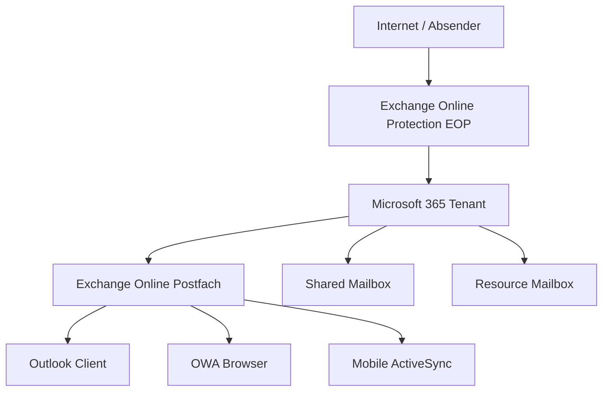

---
tags:
  - exchange-online
  - microsoft-365
  - email
  - grundlagen
aliases:
  - EXO Grundlagen
  - Exchange Online Einführung
---

# Exchange Online Grundlagen

> [!ABSTRACT] TL;DR
> Exchange Online ist der cloud-basierte E-Mail-Dienst von Microsoft innerhalb von Microsoft 365. Er ersetzt den klassischen Exchange Server On-Premises und bietet Multi-Tenant-Architektur, globale Geodistribution, vollständiges Postfachmanagement sowie tiefe Integration mit Teams, SharePoint und Entra ID.

---

## Was ist Exchange Online?

Exchange Online (EXO) ist der E-Mail- und Kalender-Dienst von Microsoft als Teil von Microsoft 365 (früher Office 365). Er basiert auf der bewährten Exchange Server-Technologie, wird aber vollständig von Microsoft in der Azure-Cloud betrieben und gewartet.

Unternehmen erhalten damit:
- **E-Mail-Hosting** ohne eigene Server-Infrastruktur
- **99,9 % SLA** (Service Level Agreement) für Verfügbarkeit
- **Automatische Updates** ohne manuellen Patchaufwand
- **Integration** mit Entra ID (Azure AD), Teams, SharePoint, Intune
- **Compliance-Features** (Retention, eDiscovery, Archivierung)

Exchange Online ist Bestandteil von Microsoft 365 Business Basic, Business Standard, Business Premium sowie Enterprise-Plänen (E1, E3, E5).

---

## Architektur

### Multi-Tenant-Architektur

Exchange Online nutzt eine **Multi-Tenant-Architektur**: Alle Kunden teilen sich dieselbe Infrastruktur, sind jedoch logisch vollständig voneinander getrennt. Jeder Tenant besitzt seinen eigenen Namespace (z. B. `contoso.onmicrosoft.com`) und isolierte Datenpartitionen.

### Geolocation und Datenspeicherung

Microsoft betreibt Exchange Online in mehreren **Geozonen** (Regionen). Für EU-Kunden werden Postfachdaten standardmäßig in europäischen Rechenzentren gespeichert (z. B. Deutschland, Niederlande, Irland). Mit dem **Microsoft 365 Multi-Geo**-Add-on können Unternehmen die Speicherorte einzelner Postfächer steuern.

> [!NOTE] Datensouveränität
> Deutsche Unternehmen mit besonderen Compliance-Anforderungen können das **Microsoft Cloud Deutschland**-Angebot oder die EU Data Boundary-Zusicherungen nutzen.

### Database Availability Group (DAG)

Exchange Online speichert jedes Postfach in einer **Database Availability Group (DAG)** mit mindestens **4 Kopien** über mehrere Rechenzentren hinweg. Bei einem Rechenzentrumsausfall erfolgt ein automatisches Failover ohne Datenverlust.

| Kopie | Typ | Standort |
|-------|-----|----------|
| Primär | Active | Rechenzentrum 1 |
| Kopie 2 | Passive | Rechenzentrum 1 |
| Kopie 3 | Passive | Rechenzentrum 2 |
| Kopie 4 | Passive | Rechenzentrum 3 |

### Mailbox Replication Service (MRS)

Der **Mailbox Replication Service (MRS)** ist für alle Postfachbewegungen zuständig:
- Migration von On-Premises nach Exchange Online
- Verschiebung zwischen Datenbanken (intern)
- PST-Import
- Archivpostfach-Aktivierung

---

## Postfachtypen

| Typ | Beschreibung | Lizenz erforderlich |
|-----|-------------|---------------------|
| **User Mailbox** | Persönliches Postfach für einen Benutzer | Ja (Exchange Plan) |
| **Shared Mailbox** | Gemeinsam genutzt, max. 50 GB ohne Lizenz | Nein (bis 50 GB) |
| **Room Mailbox** | Besprechungsraum, buchbar per Kalender | Nein |
| **Equipment Mailbox** | Ressource (Beamer, Auto), buchbar | Nein |
| **Archive Mailbox** | Erweitertes Archiv, nur in Outlook/OWA | Ja (Exchange Plan 2 oder Add-on) |
| **Inactive Mailbox** | Aufbewahrung nach Benutzerlöschung | Nein (Aufbewahrungsrichtlinie) |

> [!IMPORTANT] Shared Mailbox Limit
> Shared Mailboxes bis 50 GB benötigen keine eigene Exchange-Lizenz. Überschreitet die Größe 50 GB, muss eine Exchange Online Plan 2-Lizenz zugewiesen werden, um automatisches Archivieren zu ermöglichen.

---

## Protokolle

Exchange Online unterstützt zahlreiche Client-Protokolle:

| Protokoll | Einsatz | Moderner Standard |
|-----------|---------|-------------------|
| **MAPI/HTTP** | Outlook-Client (Windows/Mac) | Ja |
| **EWS** (Exchange Web Services) | Ältere Clients, Drittanbieter | Veraltet (abgekündigt 2026) |
| **Microsoft Graph API** | Moderne Apps, Automatisierung | Ja |
| **REST API** | Outlook REST (abgekündigt) | Nein |
| **IMAP4** | Drittanbieter-Clients, Linux-Mail | Eingeschränkt |
| **POP3** | Legacy-Clients | Nicht empfohlen |
| **ActiveSync (EAS)** | Mobile Geräte, ältere Clients | Eingeschränkt |
| **SMTP** | E-Mail-Versand, Relay | Ja (AUTH SMTP) |

> [!WARNING] EWS-Abkündigung
> Microsoft hat angekündigt, Exchange Web Services (EWS) für Exchange Online ab **Oktober 2026** einzuschränken. Anwendungen sollten auf **Microsoft Graph API** migriert werden.

---

## Exchange Admin Center (EAC)

Das **Exchange Admin Center** ist die webbasierte Verwaltungsoberfläche für Exchange Online:

**URL:** `https://admin.exchange.microsoft.com`

### Hauptbereiche im EAC

| Bereich | Funktion |
|---------|----------|
| Empfänger | Postfächer, Gruppen, Kontakte, Ressourcen |
| Mail Flow | Regeln, Konnektoren, Akzeptierte Domänen, Message Trace |
| Migration | Migrationsbatches erstellen und überwachen |
| Berichte | E-Mail-Flow-Berichte, Schutzberichte |
| Öffentliche Ordner | Verwaltung öffentlicher Ordner und Postfächer |
| Einheitliche Messagingdienste | Voicemail (veraltet) |
| Rollen | Adminrollen (RBAC) |
| Connector | Inbound/Outbound-Konnektoren |

> [!TIP] Klassisches EAC
> Das klassische EAC (`https://outlook.office365.com/ecp`) ist noch erreichbar, wird aber sukzessive abgelöst. Das neue EAC bietet moderne Features und bessere Performance.

---

## Limits und Grenzwerte

### Postfachgröße

| Plan | Postfachgröße | Archiv |
|------|--------------|--------|
| Exchange Online Plan 1 | 50 GB | Nicht enthalten |
| Exchange Online Plan 2 | 100 GB | Unbegrenzt (Auto-Expanding) |
| Microsoft 365 Business Basic/Standard | 50 GB | – |
| Microsoft 365 Business Premium | 50 GB | 1,5 TB (Auto-Expanding) |
| Microsoft 365 E3/E5 | 100 GB | Unbegrenzt |

### Nachrichtenlimits

| Parameter | Limit |
|-----------|-------|
| Max. Nachrichtengröße (Senden) | 150 MB |
| Max. Nachrichtengröße (Empfangen) | 150 MB |
| Max. Anhang-Größe | 150 MB |
| Max. Empfänger pro Nachricht | 500 |
| Max. Empfänger pro Tag | 10.000 (für kommerzielle Pläne) |
| Weiterleitungsregeln (SMTP) | 25 externe Domänen |

> [!WARNING] Recipient Rate Limit
> Sendet ein Postfach mehr als 10.000 Nachrichten pro Tag, wird es temporär gesperrt. Bei Massenmailing ist ein dedizierter Versanddienst empfohlen.

---

## Exchange Online vs. Exchange Server On-Premises

| Kriterium | Exchange Online | Exchange On-Premises |
|-----------|----------------|----------------------|
| Infrastruktur | Keine eigene Hardware | Eigene Server erforderlich |
| Updates | Automatisch | Manuell (CU, SU) |
| Kosten | Monatliches Abonnement | Einmalige Lizenz + Hardware + Betrieb |
| Datenkontrolle | Microsoft-Rechenzentrum | Eigenes Rechenzentrum |
| Anpassung | Eingeschränkt | Vollständig anpassbar |
| Hybrid | Möglich (HCW) | Basis |
| Skalierung | Automatisch | Manuell |
| Compliance | Microsoft Compliance Center | Eigenverantwortung |
| AD-Integration | Entra ID (Azure AD) | Active Directory |
| Verfügbarkeit | 99,9 % SLA | Eigenverantwortung |

> [!NOTE] Hybridbetrieb
> Viele Unternehmen betreiben Exchange in einem **Hybridmodell**: On-Premises-Postfächer für bestimmte Abteilungen, Exchange Online für alle anderen. Mehr dazu in [[Exchange Hybrid]].

---

## Via Exchange Admin Center (UI)

Das **Exchange Admin Center (EAC)** ist die zentrale webbasierte Verwaltungsoberfläche für Exchange Online.

### Erster Zugriff auf das EAC

1. Öffne das **Exchange Admin Center** unter [admin.exchange.microsoft.com](https://admin.exchange.microsoft.com)
2. Melde dich mit deinem **Microsoft 365 Administrator-Konto** an
3. Die Hauptnavigation auf der linken Seite bietet Zugriff auf alle Bereiche

### Wichtige Bereiche im EAC (Schnellübersicht)

| Bereich | Navigationspfad | Häufigste Aufgaben |
|---------|----------------|-------------------|
| Postfächer verwalten | **Empfänger → Postfächer** | Erstellen, bearbeiten, löschen |
| Gruppen verwalten | **Empfänger → Gruppen** | Verteilergruppen, M365-Gruppen |
| Transportregeln | **Nachrichtenfluss → Regeln** | Disclaimer, Blockierungen |
| Konnektoren | **Nachrichtenfluss → Connectors** | Hybrid, Smart Host |
| Domänen | **Nachrichtenfluss → Akzeptierte Domänen** | Neue Domäne hinzufügen |
| Nachverfolgung | **Nachrichtenfluss → Nachrichtenablaufverfolgung** | E-Mail-Probleme diagnostizieren |
| Öffentliche Ordner | **Öffentliche Ordner → Öffentliche Ordner** | Ordner, Berechtigungen |
| Migration | **Migration → Migrationsbatches** | Postfächer migrieren |
| DKIM | **E-Mail-Authentifizierung → DKIM** | DKIM aktivieren |

### Weitere Admin-Portale im Überblick

| Portal | URL | Zweck |
|--------|-----|-------|
| Microsoft 365 Admin Center | [admin.microsoft.com](https://admin.microsoft.com) | Benutzer, Lizenzen, Domänen |
| Exchange Admin Center | [admin.exchange.microsoft.com](https://admin.exchange.microsoft.com) | E-Mail-Verwaltung |
| Microsoft Defender-Portal | [security.microsoft.com](https://security.microsoft.com) | Anti-Spam, Anti-Phishing, Safe Links |
| Microsoft Purview | [compliance.microsoft.com](https://compliance.microsoft.com) | Compliance, eDiscovery, Aufbewahrung |
| Entra Admin Center | [entra.microsoft.com](https://entra.microsoft.com) | Identitäten, Gruppen, Conditional Access |

> [!TIP]
> Vom **Microsoft 365 Admin Center** aus das EAC öffnen: **Admin Center → Exchange** (in der linken Navigation unter „Admin Center"). Dies öffnet das EAC im gleichen Browser-Tab.

---

## Verwandte Notizen

- [[Postfächer verwalten]]
- [[Mail Flow und Transport Rules]]
- [[E-Mail-Authentifizierung SPF DKIM DMARC]]
- [[Anti-Spam und Anti-Phishing]]
- [[Exchange Hybrid]]
- [[E-Mail-Migration]]
- [[Exchange Online PowerShell]]
