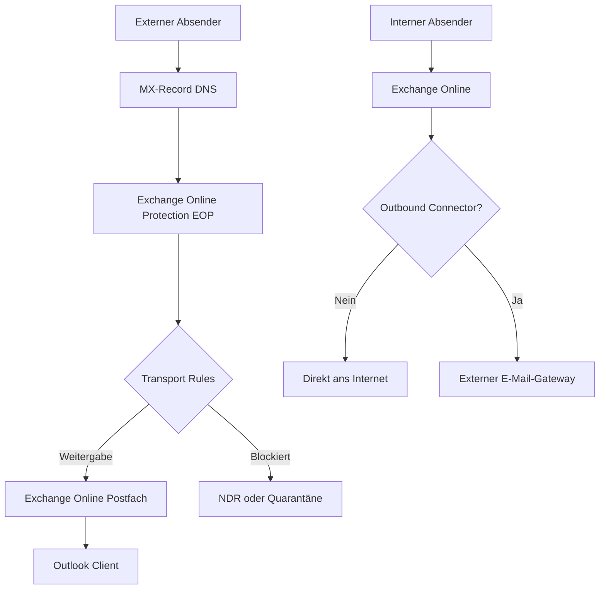
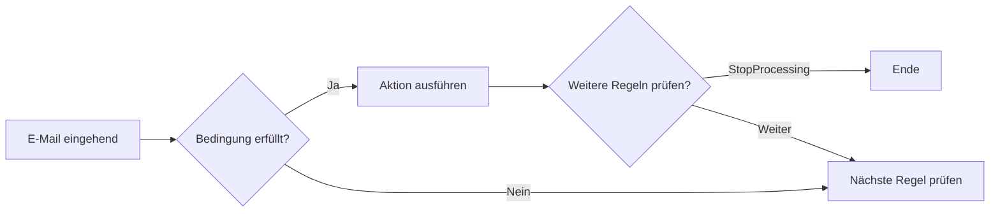

---
tags:
  - exchange-online
  - mail-flow
  - transport-rules
  - smtp
  - konnektoren
aliases:
  - Mail Flow
  - Transport Rules
  - Nachrichtenfluss
---

# Mail Flow und Transport Rules

> [!ABSTRACT] TL;DR
> Mail Flow in Exchange Online beschreibt den Weg einer E-Mail vom Absender bis zum Empfänger. Exchange Online Protection (EOP) filtert eingehende Nachrichten, Konnektoren steuern den Nachrichtenfluss zu/von externen Systemen, und Transport Rules (Nachrichtenflussregeln) ermöglichen regelbasierte Verarbeitung wie Disclaimer, Umleitung und Blockierung.

---

## Mail Flow Architektur



### Eingehende E-Mail (Inbound)

1. **DNS MX-Record** zeigt auf `contoso-com.mail.protection.outlook.com`
2. **Exchange Online Protection (EOP)** prüft: SPF, DKIM, DMARC, Anti-Spam, Anti-Malware
3. **Transport Rules** werden angewendet (in Prioritätsreihenfolge)
4. **Defender for Office 365** (falls lizenziert): Safe Links, Safe Attachments
5. Zustellung ins **Postfach** (Inbox, Junk oder Quarantäne)

### Ausgehende E-Mail (Outbound)

1. Benutzer sendet aus Outlook/OWA
2. **Transport Rules** werden geprüft
3. **Outbound Anti-Spam** prüft auf Massenversand
4. Zustellung über Microsoft-SMTP-Server ans Ziel

---

## Via Exchange Admin Center (UI)

### Akzeptierte Domäne hinzufügen

1. Öffne das **Exchange Admin Center** unter [admin.exchange.microsoft.com](https://admin.exchange.microsoft.com)
2. Navigiere zu **Nachrichtenfluss → Akzeptierte Domänen**
3. Klicke auf **+ Domäne hinzufügen**
4. Konfiguriere die Einstellungen:
   - **Name:** Anzeigename der Domäne
   - **Akzeptierte Domäne:** Vollständiger Domänenname (z.B. `neuedomaene.de`)
   - **Domänentyp:** Autoritativ / Internes Relay / Externes Relay wählen
5. Klicke auf **Speichern**

> [!NOTE]
> Die Domäne muss zuerst im **Microsoft 365 Admin Center → Einstellungen → Domänen** verifiziert werden, bevor sie als akzeptierte Domäne in Exchange Online konfiguriert werden kann.

### Connector erstellen

1. EAC → **Nachrichtenfluss → Connectors → + Connector hinzufügen**
2. Wähle Verbindungsquelle und -ziel:
   - **Office 365 → Partnerorganisation** (für Outbound zu externem System)
   - **Partnerorganisation → Office 365** (für Inbound von externem System)
   - **Office 365 → Ihre Organisation** (für Hybrid Outbound)
   - **Ihre Organisation → Office 365** (für Hybrid Inbound)
3. Vergib einen **Namen** und eine **Beschreibung**
4. Konfiguriere die Routingeinstellungen:
   - **Smart Host:** FQDN oder IP-Adresse des Zielservers
   - **TLS-Einstellungen:** Verschlüsselung auswählen
5. Sicherheitseinstellungen:
   - **Zertifikatname prüfen:** aktivieren (empfohlen)
   - **Absender-IP-Adressen beschränken:** bei Bedarf konfigurieren
6. Verbindung testen mit **Connector validieren**
7. Klicke auf **Speichern**

### Transport Rule (Nachrichtenflussregel) erstellen

1. EAC → **Nachrichtenfluss → Regeln → + Regel hinzufügen**
2. Vergib einen **Regelnamen**
3. Konfiguriere die **Bedingung** (Wenn):
   - Beispiel: **Der Absender befindet sich** → **Innerhalb der Organisation**
   - Mehrere Bedingungen mit **Und/Oder** verknüpfen
4. Wähle die **Aktion** (Dann):
   - Beispiel: **Folgenden Haftungsausschluss anfügen** → HTML-Text eingeben
   - Weitere Aktionen: BCC hinzufügen, Betreff voranstellen, Nachricht ablehnen
5. Optional: **Ausnahmen** (Außer wenn) definieren
6. **Priorität** festlegen (niedrigere Zahl = höhere Priorität)
7. Klicke auf **Speichern** — die Regel ist sofort aktiv

### Nachrichtenablaufverfolgung (Message Trace)

1. EAC → **Nachrichtenfluss → Nachrichtenablaufverfolgung**
2. Suchparameter eingeben:
   - **Absenderadresse:** E-Mail-Adresse des Absenders (optional)
   - **Empfängeradresse:** E-Mail-Adresse des Empfängers (optional)
   - **Zeitraum:** Letzten 48 Stunden (schnell) oder bis zu 90 Tage (erweiterter Trace)
3. Klicke auf **Suche**
4. Nachricht aus der Liste auswählen → **Details anzeigen**
   - Einzelne Ereignisse im Nachrichtenfluss sehen (Empfangen, Gefiltert, Zugestellt etc.)

> [!TIP]
> Alternativ über: **Microsoft 365 Admin Center → Support → Diagnosetool starten** für eine vereinfachte E-Mail-Diagnose bei Zustellproblemen.

---

## Akzeptierte Domänen (Accepted Domains)

Bevor Exchange Online E-Mails für eine Domäne empfangen kann, muss diese als akzeptierte Domäne konfiguriert sein.

| Typ | Beschreibung | Verwendung |
|-----|-------------|-----------|
| **Authoritative** | Exchange Online ist das finale Ziel | Standard für primäre Domänen |
| **Internal Relay** | Weiterleitung an interne Systeme (Hybrid) | Hybrid-Szenarien |
| **External Relay** | Weiterleitung an externe Systeme | Spezialszenarien |

```powershell
# Akzeptierte Domänen anzeigen
Get-AcceptedDomain | Select-Object Name, DomainName, DomainType, Default

# Neue Domäne hinzufügen (muss zuerst im M365 Admin Center verifiziert sein)
New-AcceptedDomain -Name "Neue Domäne" `
    -DomainName "neuedomaene.de" `
    -DomainType Authoritative

# Standard-Domäne setzen
Set-AcceptedDomain -Identity "neuedomaene.de" -MakeDefault $true
```

---

## Konnektoren (Connectors)

Konnektoren steuern den Nachrichtenfluss zwischen Exchange Online und externen Systemen.

### Inbound Connector

Eingehende E-Mails von einem spezifischen Partnersystem oder On-Premises-Server.

```powershell
# Inbound Connector für Hybrid (On-Premises → Exchange Online)
New-InboundConnector -Name "Von On-Premises" `
    -ConnectorType OnPremises `
    -SenderDomains "*" `
    -RequireTls $true `
    -RestrictDomainsToCertificate $true `
    -TlsSenderCertificateName "mail.contoso-onprem.com"

# Inbound Connector von Partner (IP-basiert)
New-InboundConnector -Name "Von SendGrid" `
    -ConnectorType Partner `
    -SenderIPAddresses "167.89.0.0/17","149.72.0.0/15" `
    -RequireTls $true
```

### Outbound Connector

Ausgehende E-Mails über einen spezifischen Smart-Host oder an On-Premises.

```powershell
# Outbound Connector zu On-Premises (Hybrid)
New-OutboundConnector -Name "Zu On-Premises" `
    -ConnectorType OnPremises `
    -RecipientDomains "contoso-onprem.com" `
    -SmartHosts "mail.contoso-onprem.com" `
    -TlsSettings DomainValidation `
    -UseMXRecord $false

# Outbound Connector zu Smart-Host (z.B. Postfix, Barracuda)
New-OutboundConnector -Name "Über SMTP-Gateway" `
    -ConnectorType Partner `
    -RecipientDomains "*" `
    -SmartHosts "smtp-gateway.contoso.com" `
    -TlsSettings EncryptionOnly `
    -UseMXRecord $false
```

> [!IMPORTANT] Konnektoren testen
> Neue Konnektoren immer mit der **Test-Funktion** im EAC oder mit `Validate-OutboundConnector` (PowerShell) testen, bevor sie produktiv geschaltet werden.

---

## SMTP-Relay über Exchange Online

Geräte (Drucker, Scanner, Anwendungen) können E-Mails über Exchange Online versenden.

### Option 1: Direct Send (kein Auth, nur intern)

Gerät sendet direkt an Exchange Online MX-Server. Kein Connector nötig, aber E-Mails erscheinen als extern.

```
SMTP-Server: contoso-com.mail.protection.outlook.com
Port: 25
TLS: Optional
Auth: Keine
Einschränkung: Nur an interne Empfänger
```

### Option 2: SMTP Client Submission (mit Auth)

```
SMTP-Server: smtp.office365.com
Port: 587
TLS: STARTTLS (erforderlich)
Auth: Benutzername/Passwort (Exchange-Postfach)
Einschränkung: Sendet als dieses Postfach
```

> [!WARNING] MFA und SMTP AUTH
> SMTP AUTH funktioniert nicht mit MFA-geschützten Konten, außer es wird ein **App-Passwort** oder ein **Dienstpostfach ohne MFA** (mit Conditional Access-Ausnahme) verwendet. Besser: Exchange Online Connector mit Zertifikat.

### Option 3: Connector mit Anwendung (empfohlen für Apps)

```powershell
# Inbound Connector für Anwendungsserver (IP-basiert)
New-InboundConnector -Name "Anwendungsserver App01" `
    -ConnectorType Partner `
    -SenderIPAddresses "10.0.0.50" `
    -RequireTls $false `
    -SenderDomains "contoso.com"
```

---

## Transport Rules (Nachrichtenflussregeln)

Transport Rules werden auf alle E-Mails angewendet, die durch Exchange Online fließen. Sie bestehen aus **Bedingungen (Conditions)**, **Aktionen (Actions)** und optionalen **Ausnahmen (Exceptions)**.

### Struktur einer Transport Rule



### Häufige Bedingungen

| Bedingung | Beschreibung |
|-----------|-------------|
| `From` | Absender-E-Mail-Adresse |
| `FromMemberOf` | Absender ist Mitglied einer Gruppe |
| `SentTo` | Empfänger-Adresse |
| `SubjectContains` | Betreff enthält Text |
| `AttachmentNameMatchesPatterns` | Anhangname-Muster |
| `HasClassification` | Nachrichtenklassifizierung |
| `RecipientDomainIs` | Empfänger-Domäne |
| `SenderDomainIs` | Absender-Domäne |

### Häufige Aktionen

| Aktion | Beschreibung |
|--------|-------------|
| `AddToRecipients` | BCC hinzufügen |
| `PrependSubject` | Betreff-Präfix hinzufügen |
| `ApplyHtmlDisclaimerText` | HTML-Disclaimer anfügen |
| `RejectMessage` | Nachricht ablehnen (NDR) |
| `DeleteMessage` | Nachricht löschen (kein NDR) |
| `RedirectMessage` | Umleiten an andere Adresse |
| `SetSCL` | Spam Confidence Level setzen |
| `SetAuditSeverity` | Audit-Schweregrad setzen |

### Beispiel 1: Rechtlicher Disclaimer

```powershell
New-TransportRule -Name "Rechtlicher Disclaimer" `
    -FromScope InOrganization `
    -SentToScope NotInOrganization `
    -ApplyHtmlDisclaimerText "<p style='font-size:10px;color:gray'>Diese E-Mail und alle Anhänge sind vertraulich. Wenn Sie nicht der beabsichtigte Empfänger sind, informieren Sie uns bitte.</p>" `
    -ApplyHtmlDisclaimerLocation Append `
    -ApplyHtmlDisclaimerFallbackAction Wrap
```

### Beispiel 2: Nachrichten mit bestimmten Betreff blockieren

```powershell
New-TransportRule -Name "Spam Betreff blockieren" `
    -SubjectContainsWords "Gewinner","Sie haben gewonnen","Lottogewinn" `
    -DeleteMessage $true `
    -Comments "Blockiert bekannte Spam-Betreffs"
```

### Beispiel 3: Externe E-Mails kennzeichnen

```powershell
New-TransportRule -Name "Extern-Kennzeichnung" `
    -FromScope NotInOrganization `
    -PrependSubject "[EXTERN] " `
    -SetAuditSeverity Low
```

### Beispiel 4: BCC-Kopie für Compliance

```powershell
New-TransportRule -Name "Compliance BCC" `
    -FromScope InOrganization `
    -SentToScope NotInOrganization `
    -BlindCopyTo "compliance-archiv@contoso.com"
```

### Regeln verwalten

```powershell
# Alle Regeln anzeigen (nach Priorität)
Get-TransportRule | Sort-Object Priority | Select-Object Priority, Name, State

# Regel deaktivieren/aktivieren
Disable-TransportRule -Identity "Regel Name"
Enable-TransportRule -Identity "Regel Name"

# Priorität ändern
Set-TransportRule -Identity "Regel Name" -Priority 1

# Regel löschen
Remove-TransportRule -Identity "Regel Name" -Confirm:$false
```

---

## Message Trace (Nachverfolgung)

Message Trace ermöglicht die Nachverfolgung einzelner E-Mails durch das Exchange Online-System.

### Über EAC

`EAC → Mail Flow → Nachrichtenablaufverfolgung`

### Über PowerShell

```powershell
# Letzte 48 Stunden (schnell, bis 10 Tage)
Get-MessageTrace -SenderAddress "absender@extern.com" `
    -RecipientAddress "empfaenger@contoso.com" `
    -StartDate (Get-Date).AddDays(-2) `
    -EndDate (Get-Date) | 
    Select-Object Received, SenderAddress, RecipientAddress, Subject, Status, Size

# Detaillierte Ereignisse für eine Nachricht
Get-MessageTraceDetail -MessageTraceId "XXXXXXXX-XXXX-XXXX-XXXX-XXXXXXXXXXXX" `
    -RecipientAddress "empfaenger@contoso.com" | 
    Select-Object Date, Event, Action, Detail

# Erweiterter Trace (über 10 Tage alt, asynchron)
Start-HistoricalSearch -SenderAddress "absender@extern.com" `
    -StartDate "01.01.2024" `
    -EndDate "31.01.2024" `
    -ReportTitle "Januar Nachrichten" `
    -ReportType MessageTrace
```

### Message-Status-Codes

| Status | Bedeutung |
|--------|-----------|
| `Delivered` | Erfolgreich zugestellt |
| `Failed` | Zustellung fehlgeschlagen (NDR) |
| `Quarantined` | In Quarantäne abgelegt |
| `FilteredAsSpam` | Als Spam gefiltert |
| `Pending` | Wartet auf Zustellung |
| `Expanded` | An Gruppe oder DL erweitert |

---

## Troubleshooting Mail Flow

> [!WARNING] Häufige Probleme

**E-Mails kommen nicht an**
```powershell
# MX-Record prüfen (von extern)
Resolve-DnsName -Name contoso.com -Type MX

# Message Trace für Absender
Get-MessageTrace -SenderAddress "extern@beispiel.de" -StartDate (Get-Date).AddHours(-2)
```

**Transport Rule greift nicht**
```powershell
# Alle aktiven Regeln und Prioritäten prüfen
Get-TransportRule | Where-Object {$_.State -eq "Enabled"} | 
    Sort-Object Priority | 
    Select-Object Priority, Name, Conditions, Actions
```

**Connector-Fehler**
```powershell
# Connector-Status prüfen
Get-InboundConnector | Select-Object Name, Enabled, ConnectorType
Get-OutboundConnector | Select-Object Name, Enabled, ConnectorType, SmartHosts
```

---

## Verwandte Notizen

- [[Exchange Online Grundlagen]]
- [[E-Mail-Authentifizierung SPF DKIM DMARC]]
- [[Anti-Spam und Anti-Phishing]]
- [[Exchange Hybrid]]
- [[Exchange Online PowerShell]]
