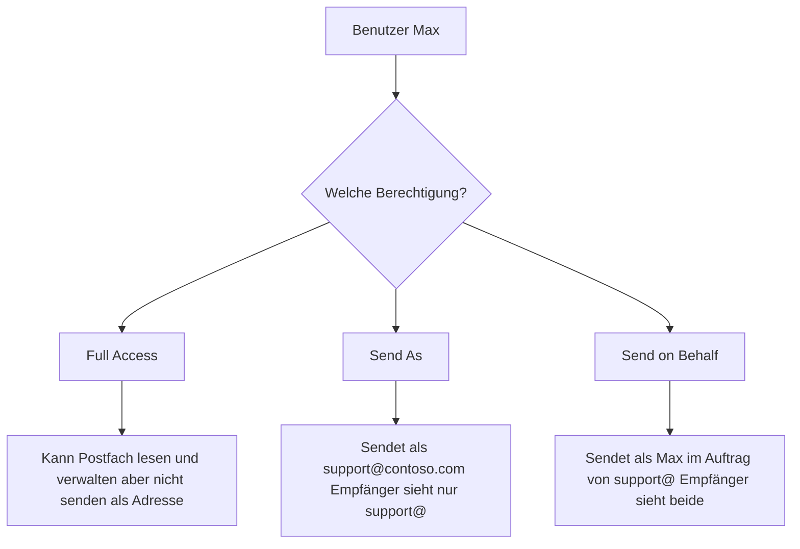

---
tags:
  - exchange-online
  - berechtigungen
  - full-access
  - send-as
  - delegation
aliases:
  - Mailbox Permissions
  - Postfach-Delegation
  - Send As
---

# Postfach-Berechtigungen

> [!ABSTRACT] TL;DR
> Exchange Online bietet drei Hauptberechtigungstypen: Full Access (vollständiger Postfachzugriff), Send As (senden als die Adresse, nicht erkennbar) und Send on Behalf (senden im Auftrag, für Empfänger erkennbar). Automapping fügt freigegebene Postfächer automatisch in Outlook hinzu. Alle Berechtigungen können über EAC oder PowerShell verwaltet werden.

---

## Berechtigungstypen im Überblick



| Berechtigung | Postfach öffnen | Als Adresse senden | Erkennbar für Empfänger |
|-------------|----------------|-------------------|------------------------|
| **Full Access** | ✅ | ❌ | – |
| **Send As** | ❌ | ✅ | Nein |
| **Send on Behalf** | ❌ | ✅ | Ja |
| **Full Access + Send As** | ✅ | ✅ | Nein |

---

## Full Access

Full Access erlaubt einem Benutzer, ein fremdes Postfach vollständig zu öffnen, zu lesen und zu verwalten. Es erlaubt **kein Senden** im Namen der fremden Adresse (ohne zusätzliche Send As-Berechtigung).

### Full Access verwalten

```powershell
# Full Access vergeben
Add-MailboxPermission -Identity "support@contoso.com" `
    -User "max.mustermann@contoso.com" `
    -AccessRights FullAccess `
    -InheritanceType All

# Full Access ohne Automapping (Postfach erscheint nicht automatisch in Outlook)
Add-MailboxPermission -Identity "support@contoso.com" `
    -User "max.mustermann@contoso.com" `
    -AccessRights FullAccess `
    -InheritanceType All `
    -AutoMapping $false

# Full Access entfernen
Remove-MailboxPermission -Identity "support@contoso.com" `
    -User "max.mustermann@contoso.com" `
    -AccessRights FullAccess `
    -Confirm:$false

# Alle Full Access-Berechtigungen eines Postfachs anzeigen
Get-MailboxPermission -Identity "support@contoso.com" | 
    Where-Object {$_.AccessRights -eq "FullAccess" -and $_.IsInherited -eq $false} |
    Select-Object User, AccessRights, Deny

# Alle Postfächer auf die ein Benutzer Full Access hat
Get-MailboxPermission -ResultSize Unlimited | 
    Where-Object {$_.User -like "max.mustermann*" -and $_.AccessRights -eq "FullAccess"} |
    Select-Object Identity, User
```

### Automapping

Automapping fügt Postfächer mit Full Access-Berechtigung automatisch in Outlook hinzu, sobald sich der Benutzer anmeldet.

```powershell
# Automapping prüfen (kein direktes Cmdlet — in Permissions enthalten)
Get-MailboxPermission -Identity "support@contoso.com" | 
    Where-Object {$_.AccessRights -eq "FullAccess"} | 
    Select-Object User, AutoMapping

# Automapping nachträglich deaktivieren: Berechtigung entfernen und neu vergeben
Remove-MailboxPermission -Identity "support@contoso.com" `
    -User "max.mustermann@contoso.com" `
    -AccessRights FullAccess -Confirm:$false

Add-MailboxPermission -Identity "support@contoso.com" `
    -User "max.mustermann@contoso.com" `
    -AccessRights FullAccess `
    -AutoMapping $false
```

> [!TIP] Automapping Empfehlung
> Automapping ist praktisch für einzelne Benutzer mit wenigen Delegation-Postfächern. Bei vielen Postfächern (>10) kann Automapping die Outlook-Startzeit erheblich verlangsamen. In diesem Fall `AutoMapping $false` verwenden.

---

## Send As

Send As erlaubt einem Benutzer, E-Mails so zu senden, als wäre er der Besitzer der Adresse. Der Empfänger sieht nur die delegierte Adresse, nicht den tatsächlichen Absender.

```powershell
# Send As vergeben
Add-RecipientPermission -Identity "support@contoso.com" `
    -Trustee "max.mustermann@contoso.com" `
    -AccessRights SendAs `
    -Confirm:$false

# Send As entfernen
Remove-RecipientPermission -Identity "support@contoso.com" `
    -Trustee "max.mustermann@contoso.com" `
    -AccessRights SendAs `
    -Confirm:$false

# Alle Send As-Berechtigungen eines Postfachs anzeigen
Get-RecipientPermission -Identity "support@contoso.com" | 
    Where-Object {$_.AccessRights -eq "SendAs" -and $_.Trustee -ne "NT AUTHORITY\SELF"} |
    Select-Object Identity, Trustee, AccessRights

# Alle Postfächer auf die ein Benutzer Send As hat
Get-RecipientPermission -Trustee "max.mustermann@contoso.com" | 
    Select-Object Identity, AccessRights
```

> [!NOTE] Send As vs. NT AUTHORITY\SELF
> In der Ausgabe von `Get-RecipientPermission` erscheint immer `NT AUTHORITY\SELF` — das ist der Standardeintrag für den Besitzer des Postfachs selbst. Dieser Eintrag kann ignoriert werden.

---

## Send on Behalf

Send on Behalf erlaubt einem Benutzer, E-Mails im Auftrag einer anderen Adresse zu senden. Empfänger sehen: **„Max Mustermann im Auftrag von Support"**.

```powershell
# Send on Behalf vergeben
Set-Mailbox -Identity "support@contoso.com" `
    -GrantSendOnBehalfTo @{Add="max.mustermann@contoso.com"}

# Mehrere Benutzer gleichzeitig hinzufügen
Set-Mailbox -Identity "support@contoso.com" `
    -GrantSendOnBehalfTo @{Add="user1@contoso.com","user2@contoso.com"}

# Send on Behalf entfernen
Set-Mailbox -Identity "support@contoso.com" `
    -GrantSendOnBehalfTo @{Remove="max.mustermann@contoso.com"}

# Aktuelle Send on Behalf-Einstellungen anzeigen
Get-Mailbox -Identity "support@contoso.com" | 
    Select-Object -ExpandProperty GrantSendOnBehalfTo

# Alle Postfächer mit Send on Behalf-Einstellungen
Get-Mailbox -ResultSize Unlimited | 
    Where-Object {$_.GrantSendOnBehalfTo -ne $null} | 
    Select-Object DisplayName, GrantSendOnBehalfTo
```

---

## Kalender-Delegation

Kalender-Delegation erlaubt das Lesen und Verwalten des Kalenders einer anderen Person.

### Kalenderberechtigungen verwalten

```powershell
# Kalenderberechtigungen anzeigen
Get-MailboxFolderPermission -Identity "chef@contoso.com:\Kalender"

# Kalenderberechtigung vergeben
Add-MailboxFolderPermission -Identity "chef@contoso.com:\Kalender" `
    -User "assistenz@contoso.com" `
    -AccessRights Editor

# Kalenderberechtigung ändern
Set-MailboxFolderPermission -Identity "chef@contoso.com:\Kalender" `
    -User "assistenz@contoso.com" `
    -AccessRights PublishingEditor

# Kalenderberechtigung entfernen
Remove-MailboxFolderPermission -Identity "chef@contoso.com:\Kalender" `
    -User "assistenz@contoso.com" -Confirm:$false
```

### Kalenderberechtigungsrollen

| Rolle | Lesen | Erstellen | Bearbeiten | Löschen |
|-------|-------|-----------|-----------|---------|
| `Owner` | ✅ Alle | ✅ | ✅ Alle | ✅ Alle |
| `PublishingEditor` | ✅ Alle | ✅ | ✅ Alle | ✅ Alle |
| `Editor` | ✅ Alle | ✅ | ✅ Alle | ✅ Alle |
| `PublishingAuthor` | ✅ Alle | ✅ | ✅ Eigene | ✅ Eigene |
| `Author` | ✅ Alle | ✅ | ✅ Eigene | ✅ Eigene |
| `NonEditingAuthor` | ✅ Alle | ✅ | ❌ | ✅ Eigene |
| `Reviewer` | ✅ Alle | ❌ | ❌ | ❌ |
| `LimitedDetails` | Nur Zeit + Betreff | ❌ | ❌ | ❌ |
| `AvailabilityOnly` | Nur Frei/Gebucht | ❌ | ❌ | ❌ |

---

## App-Berechtigungen für Drittanwendungen

Anwendungen können über **OAuth 2.0** mit Microsoft Graph oder EWS auf Postfächer zugreifen.

### Application Permissions vs. Delegated Permissions

| Typ | Beschreibung | MFA-Unterstützung |
|-----|-------------|------------------|
| **Application Permissions** | App agiert eigenständig (kein Benutzerkontext) | Ja |
| **Delegated Permissions** | App agiert im Namen eines Benutzers | Ja |

```powershell
# Anwendungszugriff auf bestimmte Postfächer beschränken (Application Access Policy)
# Verhindert, dass eine App auf ALLE Postfächer zugreift

# App darf nur auf diese Postfach-Gruppe zugreifen
New-ApplicationAccessPolicy -AppId "12345678-1234-1234-1234-123456789012" `
    -PolicyScopeGroupId "app-benutzer-gruppe@contoso.com" `
    -AccessRight RestrictAccess `
    -Description "Beschränkt App auf bestimmte Postfächer"

# Policy testen
Test-ApplicationAccessPolicy -AppId "12345678-1234-1234-1234-123456789012" `
    -Identity "user@contoso.com"

# Alle Application Access Policies anzeigen
Get-ApplicationAccessPolicy | Select-Object AppId, AccessRight, ScopeIdentity
```

---

## Audit-Logging für Postfachzugriff

Mailbox Audit Logging protokolliert Zugriffe auf Postfächer durch Besitzer, Delegates und Admins.

```powershell
# Audit-Logging für ein Postfach prüfen
Get-Mailbox -Identity "user@contoso.com" | 
    Select-Object AuditEnabled, AuditOwner, AuditDelegate, AuditAdmin

# Audit-Logging aktivieren
Set-Mailbox -Identity "user@contoso.com" `
    -AuditEnabled $true `
    -AuditDelegate @("Update","MoveToDeletedItems","SoftDelete","HardDelete","FolderBind","SendAs","SendOnBehalf","Create") `
    -AuditAdmin @("Update","MoveToDeletedItems","SoftDelete","HardDelete","Copy","MessageBind")

# Audit-Log durchsuchen (im Compliance Center)
# security.microsoft.com → Überwachung → Suche

# Über PowerShell
Search-UnifiedAuditLog -StartDate (Get-Date).AddDays(-7) `
    -EndDate (Get-Date) `
    -RecordType ExchangeItem `
    -Operations "MailboxLogin","SendAs","SendOnBehalf" `
    -UserIds "max.mustermann@contoso.com" | 
    Select-Object CreationDate, Operations, UserIds, AuditData
```

> [!IMPORTANT] Standard-Audit-Aktivierung
> Seit 2019 ist Mailbox Audit Logging für alle Exchange Online-Postfächer standardmäßig aktiviert (`DefaultAuditEnabled`). Admins müssen es nicht mehr manuell einschalten.

---

## Massenoperationen

```powershell
# Full Access für alle Mitglieder einer Gruppe vergeben
$group = Get-DistributionGroupMember -Identity "support-team@contoso.com"
foreach ($member in $group) {
    Add-MailboxPermission -Identity "shared-support@contoso.com" `
        -User $member.PrimarySmtpAddress `
        -AccessRights FullAccess `
        -AutoMapping $false
}

# Bericht aller delegierten Berechtigungen erstellen
$report = Get-Mailbox -ResultSize Unlimited | ForEach-Object {
    $mailbox = $_
    Get-MailboxPermission -Identity $mailbox.Identity | 
        Where-Object {$_.AccessRights -eq "FullAccess" -and $_.IsInherited -eq $false -and $_.User -notlike "NT AUTHORITY*"} |
        Select-Object @{N="Postfach";E={$mailbox.DisplayName}}, User, AccessRights
}
$report | Export-Csv "C:\berichte\berechtigungen.csv" -Encoding UTF8
```

---

## Troubleshooting

> [!WARNING] Häufige Berechtigungsprobleme

**Freigegebenes Postfach erscheint nicht in Outlook**
```powershell
# Automapping prüfen (ggf. Berechtigung neu vergeben mit AutoMapping $true)
Get-MailboxPermission -Identity "shared@contoso.com" | 
    Where-Object {$_.User -like "user@*"}
# Outlook-Profil neu erstellen falls nötig
```

**Send As-Fehler: "Sie sind nicht berechtigt, als dieser Benutzer zu senden"**
```powershell
# Send As-Berechtigung prüfen
Get-RecipientPermission -Identity "shared@contoso.com" | 
    Where-Object {$_.Trustee -like "user@*"}
# Berechtigung neu vergeben und 30-60 Min. warten (Replikation)
```

**App-Zugriff auf falsches Postfach**
```powershell
# Application Access Policy prüfen
Get-ApplicationAccessPolicy -AppId "AppId-hier"
Test-ApplicationAccessPolicy -AppId "AppId-hier" -Identity "verbotenes-postfach@contoso.com"
```

---

## Verwandte Notizen

- [[Postfächer verwalten]]
- [[Verteilergruppen und M365-Gruppen]]
- [[Exchange Online PowerShell]]
- [[Exchange Online Grundlagen]]
