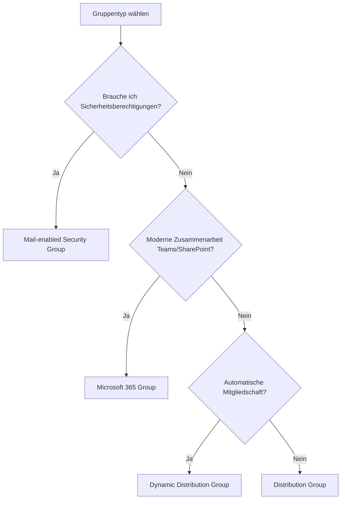

---
tags:
  - exchange-online
  - verteilergruppen
  - m365-gruppen
  - empfänger
aliases:
  - Distribution Groups
  - M365 Groups Exchange
---

# Verteilergruppen und M365-Gruppen

> [!ABSTRACT] TL;DR
> Exchange Online bietet drei Gruppentypen für E-Mail-Verteilung: klassische Verteilergruppen (Distribution Groups), mail-aktivierte Sicherheitsgruppen und Microsoft 365-Gruppen. Dynamische Verteilergruppen befüllen sich automatisch anhand von Attributfiltern. M365-Gruppen sind die moderne Grundlage für Teams, SharePoint und Yammer.

---

## Gruppentypen im Vergleich

| Typ | E-Mail | Sicherheit | Teams/SP | Dynamisch | Empfehlung |
|-----|--------|-----------|----------|-----------|------------|
| Distribution Group | Ja | Nein | Nein | Nein | Klassische Verteilung |
| Mail-enabled Security Group | Ja | Ja | Nein | Nein | Berechtigungen + E-Mail |
| Dynamic Distribution Group | Ja | Nein | Nein | Ja | Auto-Mitgliedschaft |
| Microsoft 365 Group | Ja | Nein | Ja | Optional | Moderne Zusammenarbeit |



---

## Klassische Verteilergruppe (Distribution Group)

Eine Verteilergruppe leitet E-Mails an alle Mitglieder weiter. Sie kann keine Berechtigungen für Ressourcen verwalten.

### Erstellen über EAC

1. EAC → **Empfänger → Gruppen → Gruppe hinzufügen**
2. Typ: **Verteilergruppe**
3. Name, Alias, primäre E-Mail-Adresse eingeben
4. Eigentümer und Mitglieder festlegen
5. Einstellungen (Moderation, Beitrittsbeschränkungen) konfigurieren

### Erstellen über PowerShell

```powershell
# Neue Verteilergruppe erstellen
New-DistributionGroup -Name "Marketing Team" `
    -Alias "marketing" `
    -PrimarySmtpAddress "marketing@contoso.com" `
    -Members "user1@contoso.com","user2@contoso.com" `
    -MemberJoinRestriction Closed `
    -MemberDepartRestriction Closed

# Mitglieder hinzufügen
Add-DistributionGroupMember -Identity "marketing@contoso.com" `
    -Member "neuer.mitarbeiter@contoso.com"

# Mitglieder entfernen
Remove-DistributionGroupMember -Identity "marketing@contoso.com" `
    -Member "alter.mitarbeiter@contoso.com"

# Alle Mitglieder anzeigen
Get-DistributionGroupMember -Identity "marketing@contoso.com" | 
    Select-Object Name, PrimarySmtpAddress

# Gruppe löschen
Remove-DistributionGroup -Identity "marketing@contoso.com" -Confirm:$false
```

### Moderation (Genehmigung)

```powershell
# Moderation aktivieren: alle Nachrichten müssen genehmigt werden
Set-DistributionGroup -Identity "marketing@contoso.com" `
    -ModerationEnabled $true `
    -ModeratedBy "admin@contoso.com" `
    -SendModerationNotifications Always

# Bestimmte Absender von Moderation ausnehmen
Set-DistributionGroup -Identity "marketing@contoso.com" `
    -BypassModerationFromSendersOrMembers "ceo@contoso.com"
```

---

## Mail-enabled Security Group

Kombiniert E-Mail-Verteilung mit Sicherheitsberechtigungen (z. B. für SharePoint, Intune-Richtlinien).

```powershell
# Neue mail-enabled Security Group erstellen
New-DistributionGroup -Name "IT-Abteilung" `
    -Alias "it-abteilung" `
    -PrimarySmtpAddress "it@contoso.com" `
    -Type Security

# Bestehende Sicherheitsgruppe mail-aktivieren
Enable-DistributionGroup -Identity "IT-Security-Group"

# Gruppentyp abfragen
Get-DistributionGroup -Identity "it@contoso.com" | Select-Object GroupType, RecipientTypeDetails
```

> [!NOTE] Entra ID Gruppen
> Mail-enabled Security Groups werden in **Entra ID** (Azure AD) verwaltet. Änderungen in Entra ID synchronisieren sich mit Exchange Online.

---

## Dynamische Verteilergruppe (Dynamic Distribution Group)

DDGs befüllen ihre Mitgliederliste **dynamisch** zur Laufzeit anhand eines LDAP-ähnlichen Filters. Die Mitglieder werden nicht gespeichert, sondern bei jeder E-Mail-Zustellung neu berechnet.

### Erstellen mit vordefinierten Filtern

```powershell
# Alle Benutzer in Deutschland
New-DynamicDistributionGroup -Name "Alle Mitarbeiter Deutschland" `
    -Alias "alle-de" `
    -PrimarySmtpAddress "alle-de@contoso.com" `
    -RecipientFilter {(RecipientTypeDetails -eq 'UserMailbox') -and (CountryOrRegion -eq 'DE')}

# Alle Benutzer einer Abteilung
New-DynamicDistributionGroup -Name "Abteilung Vertrieb" `
    -Alias "vertrieb-ddg" `
    -PrimarySmtpAddress "vertrieb-alle@contoso.com" `
    -RecipientFilter {(RecipientTypeDetails -eq 'UserMailbox') -and (Department -eq 'Vertrieb')}

# Filter anzeigen
Get-DynamicDistributionGroup -Identity "alle-de@contoso.com" | Select-Object RecipientFilter

# Vorschau: Wer würde diese E-Mail erhalten?
$ddg = Get-DynamicDistributionGroup -Identity "alle-de@contoso.com"
Get-Recipient -RecipientPreviewFilter $ddg.RecipientFilter | Select-Object Name, PrimarySmtpAddress
```

### Häufige RecipientFilter-Attribute

| Attribut | Beispielwert |
|----------|-------------|
| `Department` | `'Vertrieb'` |
| `CountryOrRegion` | `'DE'` |
| `Office` | `'Berlin'` |
| `Company` | `'Contoso GmbH'` |
| `Title` | `'Manager'` |
| `CustomAttribute1` | `'VIP'` |

> [!WARNING] DDG-Performance
> Bei sehr großen Tenants (>10.000 Benutzer) kann die Auflösung von DDGs bei E-Mail-Zustellung Zeit beanspruchen. Komplexe Filter sollten getestet werden.

---

## Microsoft 365-Gruppen

M365-Gruppen sind der moderne Gruppentyp für Zusammenarbeit. Sie erstellen automatisch:
- Ein gemeinsames **Postfach** und **Kalender**
- Eine **SharePoint-Website**
- Ein **Teams-Team** (wenn aktiviert)
- Ein **Planner-Board**
- Ein **OneNote-Notizbuch**

### Erstellen über PowerShell

```powershell
# M365-Gruppe erstellen
New-UnifiedGroup -DisplayName "Projekt Phoenix" `
    -Alias "projekt-phoenix" `
    -EmailAddress "phoenix@contoso.com" `
    -AccessType Private `
    -AutoSubscribeNewMembers $true

# Mitglieder hinzufügen
Add-UnifiedGroupLinks -Identity "phoenix@contoso.com" `
    -LinkType Members `
    -Links "user1@contoso.com","user2@contoso.com"

# Eigentümer hinzufügen
Add-UnifiedGroupLinks -Identity "phoenix@contoso.com" `
    -LinkType Owners `
    -Links "teamleiter@contoso.com"

# Gruppe anzeigen
Get-UnifiedGroup -Identity "phoenix@contoso.com" | 
    Format-List DisplayName, PrimarySmtpAddress, AccessType, GroupMemberCount

# Alle M365-Gruppen auflisten
Get-UnifiedGroup -ResultSize Unlimited | 
    Select-Object DisplayName, PrimarySmtpAddress, AccessType, WhenCreated
```

### M365-Gruppen-Typen (Access Type)

| Typ | Beitritt | Inhalte sichtbar |
|-----|---------|-----------------|
| **Public** | Jeder im Tenant | Für alle |
| **Private** | Nur auf Einladung | Nur Mitglieder |

---

## Group Naming Policy

Eine Benennungsrichtlinie erzwingt einheitliche Gruppennamen im Tenant.

```powershell
# Naming Policy anzeigen
Get-OrganizationConfig | Select-Object DistributionGroupNamingPolicy

# Präfix und Suffix definieren (nur über Entra ID / Microsoft 365 Admin Center)
# Beispiel-Richtlinie: "GRP_[GroupName]_[Department]"
# Konfiguration über: https://entra.microsoft.com → Gruppen → Benennungsrichtlinie
```

> [!TIP] Naming Policy Planung
> Empfohlenes Format: `[Abteilung]-[Funktion]-[Standort]`
> Beispiele: `IT-Support-Berlin`, `MKT-Newsletter-DE`, `HR-Onboarding-Global`

---

## Group Expiration Policy

Ablaufrichtlinien löschen inaktive M365-Gruppen automatisch nach einer definierten Zeit.

```powershell
# Ablaufrichtlinie prüfen (über Entra ID)
# Konfiguration: Entra ID → Gruppen → Ablauf
# Lebensdauer: 30/90/180/365 Tage oder benutzerdefiniert
# Benachrichtigung: Eigentümer werden 30, 15, 1 Tag vorher informiert
# Automatische Verlängerung: Wenn Gruppe aktiv genutzt wird

# Ablauf einer bestimmten Gruppe deaktivieren
Set-UnifiedGroup -Identity "kritische-gruppe@contoso.com" -GroupExpiryEnabled $false
```

---

## Troubleshooting

> [!WARNING] Häufige Probleme

**Problem:** Externe Absender können nicht an Verteilergruppe senden
```powershell
# Prüfen ob externe Absender blockiert sind
Get-DistributionGroup -Identity "gruppe@contoso.com" | Select-Object RequireSenderAuthenticationEnabled
# Lösung: Externe Absender erlauben
Set-DistributionGroup -Identity "gruppe@contoso.com" -RequireSenderAuthenticationEnabled $false
```

**Problem:** DDG-Filter liefert keine/falsche Mitglieder
```powershell
# Filter-Vorschau testen
$ddg = Get-DynamicDistributionGroup -Identity "ddg@contoso.com"
$members = Get-Recipient -RecipientPreviewFilter $ddg.RecipientFilter
Write-Output "Anzahl Mitglieder: $($members.Count)"
$members | Select-Object Name, Department, CountryOrRegion
```

**Problem:** M365-Gruppe empfängt keine externen E-Mails
```powershell
# Externe Sender prüfen
Get-UnifiedGroup -Identity "gruppe@contoso.com" | Select-Object RequireSenderAuthenticationEnabled
Set-UnifiedGroup -Identity "gruppe@contoso.com" -RequireSenderAuthenticationEnabled $false
```

---

## Verwandte Notizen

- [[Exchange Online Grundlagen]]
- [[Postfächer verwalten]]
- [[Mail Flow und Transport Rules]]
- [[Postfach-Berechtigungen]]
- [[Exchange Online PowerShell]]
