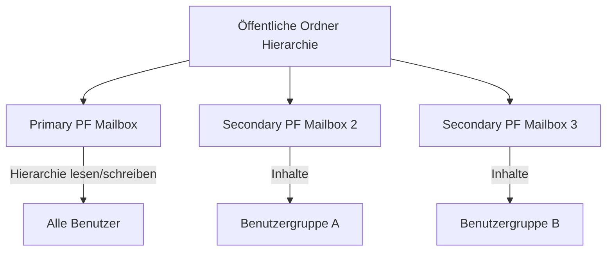

---
tags:
  - exchange-online
  - public-folders
  - öffentliche-ordner
  - sharepoint
aliases:
  - Public Folders
  - Öffentliche Ordner Exchange
---

# Öffentliche Ordner

> [!ABSTRACT] TL;DR
> Öffentliche Ordner (Public Folders) in Exchange Online sind gemeinsam genutzte Ordnerstrukturen für E-Mails, Kalender und Kontakte. Sie sind postfachbasiert und werden in speziellen Public Folder Mailboxes gespeichert. Für neue Projekte sind SharePoint oder Teams in der Regel die modernere Alternative.

---

## Was sind Öffentliche Ordner?

Öffentliche Ordner sind eine traditionsreiche Exchange-Funktion für die gemeinsame Nutzung von E-Mails, Kalendereinträgen und Kontakten innerhalb einer Organisation. In Exchange Online sind sie **postfachbasiert** — alle Daten werden in speziellen Public Folder Mailboxes gespeichert.

### Typische Einsatzszenarien

- **Gemeinsame E-Mail-Ablage**: Abteilungspostfächer für Archivierung
- **Freigegebene Kalender**: Teamkalender ohne Ressourcenpostfach
- **Kontaktverzeichnisse**: Gemeinsame Adressbücher
- **Formulare und Diskussionen**: Strukturierte Informationssammlung
- **Veraltete Anwendungen**: Legacy-Apps die Public Folders voraussetzen

> [!NOTE] Legacy-Feature
> Öffentliche Ordner sind ein Legacy-Feature. Microsoft empfiehlt für neue Deployments **SharePoint** (für Dokumentenablage) oder **Microsoft Teams** (für Teamkommunikation). Bestehende Public Folder-Umgebungen werden aber weiterhin unterstützt.

---

## Architektur in Exchange Online



### Public Folder Mailboxes

| Typ | Beschreibung | Max. Größe |
|-----|-------------|------------|
| **Primary** | Enthält beschreibbare Hierarchie + Inhalte | 100 GB |
| **Secondary** | Enthält schreibgeschützte Hierarchie-Kopie + Inhalte | 100 GB |

- Ein Tenant kann bis zu **1.000 Public Folder Mailboxes** haben
- Gesamtkapazität: bis zu **100 TB** (1.000 × 100 GB)
- Einzelne Public Folders sind auf **25 GB** begrenzt

---

## Via Exchange Admin Center (UI)

### Public Folder Mailbox erstellen

1. Öffne das **Exchange Admin Center** unter [admin.exchange.microsoft.com](https://admin.exchange.microsoft.com)
2. Navigiere zu **Öffentliche Ordner → Postfächer für öffentliche Ordner**
3. Klicke auf **+ Postfach für öffentliche Ordner hinzufügen**
4. Konfiguriere:
   - **Name:** Anzeigename (z.B. „PrimaryPublicFolder")
5. Klicke auf **Speichern**

> [!NOTE]
> Das erste erstellte Postfach wird automatisch als **primäres Postfach** (mit beschreibbarer Hierarchie) festgelegt. Alle weiteren sind sekundäre Postfächer.

### Öffentlichen Ordner erstellen

1. EAC → **Öffentliche Ordner → Öffentliche Ordner**
2. Klicke auf **+ Ordner hinzufügen**
3. Konfiguriere:
   - **Name:** Ordnername (z.B. „Unternehmen")
   - **Übergeordneter Pfad:** Stammverzeichnis `\` oder vorhandenen Ordner wählen
4. Klicke auf **Speichern**
5. Unterordner erstellen: Ordner auswählen → **+ Unterordner hinzufügen**

### Berechtigungen über EAC verwalten

1. EAC → **Öffentliche Ordner → Öffentliche Ordner**
2. Gewünschten Ordner auswählen
3. Im Detailbereich auf **Verwalten** bei **Ordnerberechtigungen** klicken
4. Benutzer hinzufügen:
   - **+ Hinzufügen** → Benutzer suchen und auswählen
   - **Berechtigungsstufe** wählen (Besitzer / Herausgeber / Bearbeiter / Reviewer etc.)
5. Klicke auf **Speichern**

### E-Mail-Aktivierung über EAC

1. EAC → **Öffentliche Ordner → Öffentliche Ordner**
2. Ordner auswählen → **E-Mail-Einstellungen** im Detailbereich
3. **E-Mail-Aktivierung:** aktivieren
4. **E-Mail-Adresse** eingeben (z.B. `vertrieb-eingang@contoso.com`)
5. Option **Externe Absender zulassen:** aktivieren falls benötigt
6. Klicke auf **Speichern**

> [!TIP]
> Alternativ erreichbar über: **Microsoft 365 Admin Center → Admin Center → Exchange → Öffentliche Ordner**

> [!NOTE]
> Die **Migration** von On-Premises-Public-Folders nach Exchange Online kann nicht vollständig über das EAC durchgeführt werden — hierfür sind PowerShell-Skripte von Microsoft erforderlich.

---

## Public Folder Mailboxes erstellen

```powershell
# Erste (primäre) Public Folder Mailbox erstellen
New-Mailbox -PublicFolder -Name "PrimaryPublicFolder"

# Weitere Public Folder Mailboxes erstellen (für mehr Kapazität)
New-Mailbox -PublicFolder -Name "PFMailbox2"
New-Mailbox -PublicFolder -Name "PFMailbox3"

# Alle PF-Mailboxes anzeigen
Get-Mailbox -PublicFolder | Select-Object Name, TotalItemSize, Database

# Statistiken prüfen
Get-MailboxStatistics -PublicFolder | 
    Select-Object DisplayName, TotalItemSize, ItemCount | 
    Sort-Object TotalItemSize -Descending
```

---

## Öffentliche Ordner erstellen und verwalten

### Ordnerstruktur aufbauen

```powershell
# Stammordner erstellen
New-PublicFolder -Name "Unternehmen" -Path "\"

# Unterordner erstellen
New-PublicFolder -Name "Vertrieb" -Path "\Unternehmen"
New-PublicFolder -Name "Marketing" -Path "\Unternehmen"
New-PublicFolder -Name "Projekte" -Path "\Unternehmen\Vertrieb"

# Ordner anzeigen
Get-PublicFolder -Recurse | Select-Object Name, ParentPath, MailEnabled, HasSubFolders

# Ordner in bestimmter Mailbox erstellen
New-PublicFolder -Name "Archiv 2024" -Path "\Unternehmen" -Mailbox "PFMailbox2"

# Ordner verschieben
Move-PublicFolderBranch -Identity "\Unternehmen\AltOrdner" -DestinationPublicFolder "\Archiv"

# Ordner löschen
Remove-PublicFolder -Identity "\Unternehmen\Temp" -Recurse -Confirm:$false
```

### Ordner-Einstellungen

```powershell
# Aufbewahrungseinstellungen setzen
Set-PublicFolder -Identity "\Unternehmen\Vertrieb" `
    -AgeLimit "180.00:00:00" `
    -RetainDeletedItemsFor "30.00:00:00"

# Gelöschte Elemente aufbewahren
Set-PublicFolder -Identity "\Unternehmen" -RetainDeletedItemsFor "14.00:00:00"

# Ordnerkontingent setzen
Set-PublicFolder -Identity "\Unternehmen\Vertrieb" `
    -MaxItemSize 25GB `
    -ProhibitPostQuota 24GB `
    -IssueWarningQuota 22GB
```

---

## Berechtigungen

### Berechtigungsrollen im Überblick

| Rolle | Erstellen | Bearbeiten (eigen) | Bearbeiten (alle) | Löschen | Ordner erstellen |
|-------|-----------|-------------------|------------------|---------|-----------------|
| **Owner** | ✅ | ✅ | ✅ | ✅ | ✅ |
| **PublishingEditor** | ✅ | ✅ | ✅ | ✅ | ✅ |
| **Editor** | ✅ | ✅ | ✅ | ✅ | ❌ |
| **PublishingAuthor** | ✅ | ✅ | ❌ | Nur eigene | ✅ |
| **Author** | ✅ | ✅ | ❌ | Nur eigene | ❌ |
| **NonEditingAuthor** | ✅ | ❌ | ❌ | Nur eigene | ❌ |
| **Reviewer** | ❌ | ❌ | ❌ | ❌ | ❌ |
| **Contributor** | ✅ | ❌ | ❌ | ❌ | ❌ |
| **None** | ❌ | ❌ | ❌ | ❌ | ❌ |

### Berechtigungen verwalten

```powershell
# Aktuelle Berechtigungen anzeigen
Get-PublicFolderClientPermission -Identity "\Unternehmen\Vertrieb" | 
    Select-Object User, AccessRights

# Berechtigung hinzufügen
Add-PublicFolderClientPermission -Identity "\Unternehmen\Vertrieb" `
    -User "max.mustermann@contoso.com" `
    -AccessRights Editor

# Berechtigung ändern
Set-PublicFolderClientPermission -Identity "\Unternehmen\Vertrieb" `
    -User "max.mustermann@contoso.com" `
    -AccessRights Reviewer

# Berechtigung entfernen
Remove-PublicFolderClientPermission -Identity "\Unternehmen\Vertrieb" `
    -User "max.mustermann@contoso.com" -Confirm:$false

# Standard-Berechtigung für alle Benutzer setzen
Set-PublicFolderClientPermission -Identity "\Unternehmen" `
    -User Default `
    -AccessRights Reviewer

# Anonym-Zugriff konfigurieren
Add-PublicFolderClientPermission -Identity "\Unternehmen\Presse" `
    -User Anonymous `
    -AccessRights Reviewer

# Berechtigungen rekursiv für Unterordner setzen
Get-PublicFolder -Identity "\Unternehmen" -Recurse | ForEach-Object {
    Add-PublicFolderClientPermission -Identity $_.Identity `
        -User "neue.mitarbeiterin@contoso.com" `
        -AccessRights Author
}
```

---

## E-Mail-Aktivierung

E-Mail-aktivierte Public Folders können E-Mails empfangen und haben eine eigene E-Mail-Adresse.

```powershell
# Public Folder mail-aktivieren
Enable-MailPublicFolder -Identity "\Unternehmen\Vertrieb\Eingehend"

# E-Mail-Adresse setzen
Set-MailPublicFolder -Identity "\Unternehmen\Vertrieb\Eingehend" `
    -PrimarySmtpAddress "vertrieb-eingang@contoso.com" `
    -EmailAddresses @{Add="vertrieb@contoso.com"}

# Externe Absender erlauben
Set-MailPublicFolder -Identity "\Unternehmen\Vertrieb\Eingehend" `
    -RequireSenderAuthenticationEnabled $false

# Mail-aktivierte Ordner anzeigen
Get-MailPublicFolder | Select-Object Name, PrimarySmtpAddress, Identity

# E-Mail-Aktivierung entfernen
Disable-MailPublicFolder -Identity "\Unternehmen\Vertrieb\Eingehend" -Confirm:$false
```

---

## Öffentliche Ordner in Outlook

Benutzer greifen auf Öffentliche Ordner in Outlook wie folgt zu:

1. **Outlook Desktop**: Ordner → Mehr → Öffentliche Ordner → Alle öffentlichen Ordner
2. **Outlook Web App (OWA)**: Nicht direkt sichtbar (nur über Outlook Desktop oder spezifische Ordner als Favoriten)
3. **Outlook Mobile**: Nicht unterstützt

> [!WARNING] OWA-Einschränkung
> Öffentliche Ordner können in **Outlook Web App (OWA)** nur als Favoriten hinzugefügt werden (mit spezifischer URL), aber nicht über die Standard-Ordnerhierarchie. Für mobilen Zugriff sind Public Folders ungeeignet.

---

## Migration von On-Premises nach Exchange Online

### Voraussetzungen

- Exchange Server 2010 SP3 RU8+ oder 2013/2016/2019
- Exchange Online hat Public Folder-Support aktiviert
- Kein anderer Public Folder-Migration-Batch läuft

### Migrationsablauf

```powershell
# Schritt 1: Statistiken exportieren
Get-PublicFolderStatistics -ResultSize Unlimited | 
    Export-Csv "C:\migration\pf-statistiken.csv" -Encoding UTF8

# Schritt 2: Berechtigungen exportieren
Get-PublicFolder -Recurse -ResultSize Unlimited | 
    ForEach-Object {
        Get-PublicFolderClientPermission -Identity $_.Identity
    } | Export-Csv "C:\migration\pf-berechtigungen.csv" -Encoding UTF8

# Schritt 3: Public Folder Mailboxes in EXO erstellen (s.o.)

# Schritt 4: Migrationsbatch erstellen (Skript von Microsoft)
# https://aka.ms/exopfmigration
.\Create-PublicFolderMigrationRequest.ps1 `
    -FolderMappingCsv "C:\migration\pf-mapping.csv" `
    -BadItemLimit 100

# Schritt 5: Migrationsstatus überwachen
Get-PublicFolderMigrationRequest | Get-PublicFolderMigrationRequestStatistics

# Schritt 6: Finalisieren (Lock und Complete)
Set-OrganizationConfig -PublicFoldersMigrationComplete $true
Complete-MigrationBatch -Identity "PublicFolderMigration"
```

---

## Öffentliche Ordner vs. SharePoint/Teams

| Kriterium | Öffentliche Ordner | SharePoint | Teams-Kanal |
|-----------|-------------------|-----------|-------------|
| E-Mail empfangen | ✅ | Begrenzt | ✅ (Channel-E-Mail) |
| Mobilzugriff | ❌ | ✅ | ✅ |
| Dokumentenverwaltung | Basis | ✅ Vollständig | ✅ |
| Versionierung | ❌ | ✅ | ✅ |
| Moderne Benutzeroberfläche | ❌ | ✅ | ✅ |
| Suche | Eingeschränkt | ✅ | ✅ |
| Externe Freigabe | ❌ | ✅ | ✅ (Gäste) |
| Legacy-Unterstützung | ✅ | ❌ | ❌ |

---

## Troubleshooting

> [!WARNING] Häufige Probleme

**Public Folders erscheinen nicht in Outlook**
```powershell
# Hierarchie-Synchronisierung prüfen
Get-PublicFolderMailboxDiagnostics -Identity "PrimaryPublicFolder" | 
    Select-Object -ExpandProperty SyncInfo
    
# Cache leeren: Outlook → Datei → Kontoeinstellungen → Datendateien → Cache löschen
```

**Berechtigungsfehler beim Zugriff**
```powershell
# Berechtigungen überprüfen
Get-PublicFolderClientPermission -Identity "\Problematischer\Ordner" | 
    Select-Object User, AccessRights

# Default-Berechtigung erhöhen
Set-PublicFolderClientPermission -Identity "\Problematischer\Ordner" `
    -User Default -AccessRights Reviewer
```

**Public Folder Mailbox voll**
```powershell
# Größe prüfen
Get-Mailbox -PublicFolder | Get-MailboxStatistics | 
    Select-Object DisplayName, TotalItemSize

# Neue PF-Mailbox erstellen und Ordner verschieben
New-Mailbox -PublicFolder -Name "PFMailbox-Entlastung"
# Ordner in neue Mailbox verschieben (über Set-PublicFolder -Mailbox)
```

---

## Verwandte Notizen

- [[Exchange Online Grundlagen]]
- [[Postfächer verwalten]]
- [[Postfach-Berechtigungen]]
- [[E-Mail-Migration]]
- [[Exchange Online PowerShell]]
