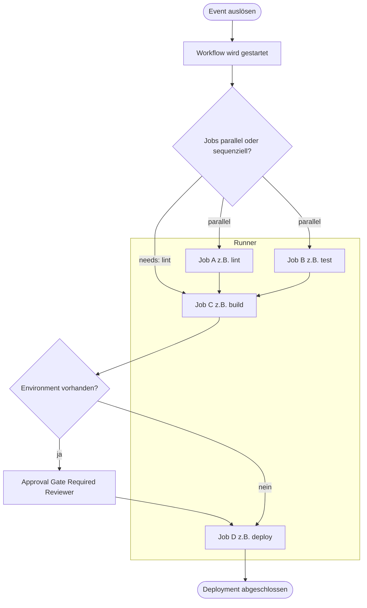

# GitHub Actions

> [!ABSTRACT]
> GitHub Actions ist die integrierte CI/CD- und Automatisierungsplattform von GitHub. Sie ermöglicht event-getriebene Workflows direkt im Repository – von einfachen Build-Pipelines bis hin zu komplexen Deployment-Prozessen mit Environments, Approvals und OIDC-basierter Cloud-Authentifizierung.

---

## Was ist GitHub Actions?

GitHub Actions ist eine vollständig in GitHub integrierte Plattform für Continuous Integration und Continuous Deployment (CI/CD). Workflows werden als YAML-Dateien im Repository versioniert und können durch eine Vielzahl von Events ausgelöst werden.

**Kernkonzepte:**

| Begriff | Beschreibung |
|---|---|
| **Workflow** | YAML-Datei in `.github/workflows/`, definiert den gesamten Ablauf |
| **Event / Trigger** | Auslöser eines Workflows (Push, PR, Schedule, manuell) |
| **Job** | Gruppe von Steps, läuft auf einem Runner |
| **Step** | Einzelne Aufgabe innerhalb eines Jobs (Action oder Shell-Befehl) |
| **Runner** | Virtuelle Maschine oder Container, auf der ein Job ausgeführt wird |
| **Action** | Wiederverwendbare Einheit (aus dem Marketplace oder eigene) |

### Architektur-Übersicht



---

## Workflow-Datei-Struktur

Alle Workflow-Dateien liegen unter `.github/workflows/*.yml` und werden automatisch von GitHub erkannt.

```yaml
name: CI Pipeline

on:
  push:
    branches: [main, develop]
  pull_request:
    branches: [main]

env:
  NODE_VERSION: '20'

jobs:
  build:
    runs-on: ubuntu-latest
    timeout-minutes: 30
    steps:
      - uses: actions/checkout@v4
      - uses: actions/setup-node@v4
        with:
          node-version: ${{ env.NODE_VERSION }}
      - run: npm ci
      - run: npm test
```

### Wichtige YAML-Felder

| Feld | Ebene | Beschreibung |
|---|---|---|
| `name` | Workflow / Job / Step | Anzeigename |
| `on` | Workflow | Trigger-Definition |
| `env` | Workflow / Job / Step | Umgebungsvariablen |
| `jobs.<id>.runs-on` | Job | Runner-Typ |
| `jobs.<id>.needs` | Job | Abhängigkeiten zu anderen Jobs |
| `jobs.<id>.if` | Job | Bedingung für Job-Ausführung |
| `jobs.<id>.environment` | Job | Deployment-Environment |
| `jobs.<id>.strategy` | Job | Matrix-Strategie |
| `steps[].uses` | Step | Action referenzieren |
| `steps[].run` | Step | Shell-Befehl ausführen |
| `steps[].with` | Step | Parameter für eine Action |

---

## Trigger (on)

### Push und Pull Request

```yaml
on:
  push:
    branches:
      - main
      - 'release/**'        # Glob-Pattern
    paths:
      - 'src/**'
      - 'package.json'
    tags:
      - 'v*'

  pull_request:
    branches: [main]
    types: [opened, synchronize, reopened]
    paths-ignore:
      - '**.md'
      - 'docs/**'
```

### Schedule (Cron)

```yaml
on:
  schedule:
    - cron: '0 6 * * 1-5'   # Mo-Fr um 06:00 UTC
    - cron: '0 0 * * 0'     # Jeden Sonntag um Mitternacht
```

> [!NOTE]
> Cron-Zeiten beziehen sich immer auf UTC. Workflows auf dem Default-Branch werden bei Schedule-Triggern ausgeführt.

### Workflow Dispatch (manuell)

```yaml
on:
  workflow_dispatch:
    inputs:
      environment:
        required: true
        type: choice
        options: [dev, staging, production]
      debug:
        type: boolean
        default: false
      version:
        type: string
```

### Weitere wichtige Trigger

| Trigger | Beschreibung |
|---|---|
| `workflow_call` | Workflow als Reusable Workflow aufrufen |
| `repository_dispatch` | Externer HTTP-Trigger via API |
| `release` | Bei GitHub Release Ereignissen |
| `issues` | Bei Issue-Aktionen (opened, closed, etc.) |

---

## Jobs und Steps

### Job-Abhängigkeiten mit needs

```yaml
jobs:
  lint:
    runs-on: ubuntu-latest
    steps:
      - run: npm run lint

  build:
    needs: [lint, test]
    runs-on: ubuntu-latest
    steps:
      - run: npm run build

  deploy:
    needs: build
    if: github.ref == 'refs/heads/main'
    runs-on: ubuntu-latest
    steps:
      - run: ./deploy.sh
```

### if-Conditions

```yaml
steps:
  - if: failure()
    run: ./notify-failure.sh

  - if: github.ref == 'refs/heads/main' && success()
    run: ./deploy.sh

  - if: github.event.pull_request.head.repo.full_name == github.repository
    run: ./integration-test.sh
```

| Funktion | Beschreibung |
|---|---|
| `success()` | Alle vorherigen Steps erfolgreich |
| `failure()` | Mindestens ein vorheriger Step fehlgeschlagen |
| `always()` | Immer ausführen, auch bei Fehler |
| `cancelled()` | Workflow wurde abgebrochen |

---

## Runner-Typen

### GitHub-hosted Runner

| Runner-Label | OS | CPU | RAM | Speicher |
|---|---|---|---|---|
| `ubuntu-latest` | Ubuntu 22.04 | 4 vCPU | 16 GB | 14 GB SSD |
| `ubuntu-22.04` | Ubuntu 22.04 | 4 vCPU | 16 GB | 14 GB SSD |
| `ubuntu-20.04` | Ubuntu 20.04 | 4 vCPU | 16 GB | 14 GB SSD |
| `windows-latest` | Windows Server 2022 | 4 vCPU | 16 GB | 14 GB SSD |
| `macos-latest` | macOS 14 (Sonoma) | 3 CPU (M1) | 7 GB | 14 GB SSD |
| `macos-14` | macOS 14 (M1/ARM) | 3 CPU (M1) | 7 GB | 14 GB SSD |
| `macos-13` | macOS 13 (Intel) | 4 vCPU | 14 GB | 14 GB SSD |

### Self-hosted Runner

```yaml
jobs:
  build:
    runs-on: [self-hosted, linux, x64, gpu]  # Labels kombinieren
```

> [!TIP]
> Self-hosted Runner werden über `Settings → Actions → Runners → New self-hosted runner` registriert. Einrichtung unter Linux: `./config.sh --url https://github.com/ORG/REPO --token TOKEN && sudo ./svc.sh install && sudo ./svc.sh start`

### Larger Runners (GitHub Enterprise / Team)

| Typ | CPU | RAM | Preis/Min |
|---|---|---|---|
| `ubuntu-latest-4-cores` | 4 vCPU | 16 GB | $0.016 |
| `ubuntu-latest-8-cores` | 8 vCPU | 32 GB | $0.032 |
| `ubuntu-latest-16-cores` | 16 vCPU | 64 GB | $0.064 |
| `ubuntu-latest-32-cores` | 32 vCPU | 128 GB | $0.128 |

---

## Actions nutzen

```yaml
steps:
  - uses: actions/checkout@v4
    with:
      fetch-depth: 0

  - uses: actions/setup-node@v4
    with:
      node-version: '20'
      cache: 'npm'

  - uses: docker/build-push-action@v6
    with:
      context: .
      push: true
      tags: ghcr.io/org/image:latest

  - uses: azure/login@v2
    with:
      client-id: ${{ secrets.AZURE_CLIENT_ID }}
      tenant-id: ${{ secrets.AZURE_TENANT_ID }}
      subscription-id: ${{ secrets.AZURE_SUBSCRIPTION_ID }}
```

### Beliebte Marketplace Actions

| Action | Verwendung |
|---|---|
| `actions/checkout@v4` | Repository Code auschecken |
| `actions/setup-node@v4` | Node.js Version konfigurieren |
| `actions/setup-python@v5` | Python Version konfigurieren |
| `actions/setup-java@v4` | Java / JDK konfigurieren |
| `actions/cache@v4` | Dependency Caching |
| `actions/upload-artifact@v4` | Build-Artefakte hochladen |
| `actions/download-artifact@v4` | Artefakte herunterladen |
| `docker/login-action@v3` | Docker Registry Login |
| `docker/build-push-action@v6` | Docker Image bauen und pushen |
| `azure/login@v2` | Azure CLI Login (OIDC-fähig) |
| `aws-actions/configure-aws-credentials@v4` | AWS Credentials konfigurieren |
| `google-github-actions/auth@v2` | GCP Authentifizierung |
| `github/codeql-action/analyze@v3` | CodeQL Sicherheitsanalyse |
| `softprops/action-gh-release@v2` | GitHub Release erstellen |

> [!WARNING]
> Immer eine spezifische Version (`@v4`) oder einen Commit-SHA (`@abc1234`) verwenden, nie `@latest` oder `@main`. Dies verhindert Supply-Chain-Angriffe durch bösartige Updates.

---

## Secrets und Variables

### Typen

| Typ | Verschlüsselt | Sichtbarkeit | Vererbung |
|---|---|---|---|
| Repository Secret | Ja | Nur dieses Repo | — |
| Environment Secret | Ja | Nur dieses Env | — |
| Organization Secret | Ja | Ausgewählte Repos | Ja |
| Repository Variable | Nein | Nur dieses Repo | — |
| Environment Variable | Nein | Nur dieses Env | — |
| Organization Variable | Nein | Ausgewählte Repos | Ja |

### Verwendung im Workflow

```yaml
env:
  APP_ENV: ${{ vars.APP_ENV }}

steps:
  - env:
      DB_PASSWORD: ${{ secrets.DB_PASSWORD }}
    run: ./connect-db.sh

  - run: gh pr comment --body "Deployment erfolgreich"
    env:
      GH_TOKEN: ${{ secrets.GITHUB_TOKEN }}
```

### GITHUB_TOKEN Berechtigungen

```yaml
permissions:
  contents: read
  issues: write
  pull-requests: write
  packages: write
  id-token: write         # Für OIDC Cloud Auth
  security-events: write
```

> [!IMPORTANT]
> Seit 2023 sind die Standard-Berechtigungen des GITHUB_TOKEN auf `read-only` gesetzt. Benötigte Berechtigungen müssen explizit angegeben werden.

---

## Environments

```yaml
jobs:
  deploy-production:
    runs-on: ubuntu-latest
    environment:
      name: production
      url: https://myapp.example.com
    steps:
      - run: ./deploy.sh ${{ vars.DEPLOY_TARGET }}
        env:
          API_KEY: ${{ secrets.PROD_API_KEY }}
```

| Schutzregel | Beschreibung |
|---|---|
| Required Reviewers | 1–6 Personen/Teams müssen Deployment genehmigen |
| Wait Timer | Verzögerung von 0–43.200 Minuten (30 Tage) |
| Deployment Branches | Nur bestimmte Branches/Tags dürfen deployen |

---

## Matrix Builds

```yaml
jobs:
  test:
    runs-on: ${{ matrix.os }}
    strategy:
      fail-fast: false
      matrix:
        os: [ubuntu-latest, windows-latest, macos-latest]
        node: [18, 20, 22]
        exclude:
          - os: macos-latest
            node: 18
    steps:
      - uses: actions/checkout@v4
      - uses: actions/setup-node@v4
        with:
          node-version: ${{ matrix.node }}
      - run: npm test
```

---

## Artifacts und Caching

```yaml
steps:
  - uses: actions/upload-artifact@v4
    with:
      name: build-output-${{ github.run_id }}
      path: |
        dist/
        coverage/
      retention-days: 30

  # In einem anderen Job herunterladen:
  - uses: actions/download-artifact@v4
    with:
      name: build-output-${{ github.run_id }}
      path: ./downloaded-build

  # Dependency Cache:
  - uses: actions/cache@v4
    with:
      path: ~/.npm
      key: ${{ runner.os }}-node-${{ hashFiles('**/package-lock.json') }}
      restore-keys: ${{ runner.os }}-node-
```

> [!TIP]
> `actions/setup-node@v4` und `actions/setup-python@v5` haben einen integrierten `cache`-Parameter – einfacher als `actions/cache@v4` direkt zu verwenden.

---

## Reusable Workflows

```yaml
# .github/workflows/reusable-deploy.yml – Definition
on:
  workflow_call:
    inputs:
      environment:
        required: true
        type: string
      image-tag:
        required: true
        type: string
    secrets:
      DEPLOY_TOKEN:
        required: true
    outputs:
      deployment-url:
        value: ${{ jobs.deploy.outputs.url }}

jobs:
  deploy:
    runs-on: ubuntu-latest
    environment: ${{ inputs.environment }}
    outputs:
      url: ${{ steps.deploy.outputs.deployment-url }}
    steps:
      - id: deploy
        run: |
          echo "Deploying ${{ inputs.image-tag }} to ${{ inputs.environment }}"
          echo "deployment-url=https://${{ inputs.environment }}.example.com" >> $GITHUB_OUTPUT
        env:
          TOKEN: ${{ secrets.DEPLOY_TOKEN }}
```

**Aufruf aus einem anderen Workflow:**

```yaml
jobs:
  deploy-staging:
    uses: org/workflows/.github/workflows/reusable-deploy.yml@main
    with:
      environment: staging
      image-tag: ${{ needs.build.outputs.image-tag }}
    secrets: inherit          # Alle Secrets weitergeben

  deploy-production:
    needs: deploy-staging
    uses: org/workflows/.github/workflows/reusable-deploy.yml@main
    with:
      environment: production
      image-tag: ${{ needs.build.outputs.image-tag }}
    secrets:
      DEPLOY_TOKEN: ${{ secrets.PROD_DEPLOY_TOKEN }}
```

---

## Composite Actions

Eigene Actions aus mehreren Steps zusammensetzen – definiert in `.github/actions/<name>/action.yml`:

```yaml
# .github/actions/setup-project/action.yml
name: 'Projekt Setup'
description: 'Node.js + Cache einrichten'
inputs:
  node-version:
    default: '20'
outputs:
  cache-hit:
    value: ${{ steps.cache.outputs.cache-hit }}
runs:
  using: composite
  steps:
    - uses: actions/setup-node@v4
      with:
        node-version: ${{ inputs.node-version }}
    - uses: actions/cache@v4
      id: cache
      with:
        path: node_modules
        key: ${{ runner.os }}-${{ hashFiles('package-lock.json') }}
    - if: steps.cache.outputs.cache-hit != 'true'
      run: npm ci
      shell: bash
```

Verwendung im Workflow: `uses: ./.github/actions/setup-project`

---

## OIDC für Cloud-Authentifizierung

OpenID Connect (OIDC) ermöglicht passwortlose Authentifizierung bei Cloud-Providern, ohne langlebige Credentials als Secrets zu speichern.

```yaml
name: Azure Deployment mit OIDC
on:
  push:
    branches: [main]

permissions:
  id-token: write     # OIDC Token anfordern
  contents: read

jobs:
  deploy:
    runs-on: ubuntu-latest
    environment: production
    steps:
      - uses: actions/checkout@v4

      - name: Azure Login via OIDC
        uses: azure/login@v2
        with:
          client-id: ${{ secrets.AZURE_CLIENT_ID }}
          tenant-id: ${{ secrets.AZURE_TENANT_ID }}
          subscription-id: ${{ secrets.AZURE_SUBSCRIPTION_ID }}

      - name: Deploy auf Azure
        run: |
          az webapp deploy --resource-group myRG --name myApp --src-path ./dist
          az acr login --name myregistry
          docker build -t myregistry.azurecr.io/myapp:${{ github.sha }} .
          docker push myregistry.azurecr.io/myapp:${{ github.sha }}
```

> [!IMPORTANT]
> Im Azure AD muss eine Federated Identity Credential auf der App Registration konfiguriert werden. Subject-Format: `repo:org/repo:ref:refs/heads/main`.

---

## Vollständiges CI-Beispiel: Node.js mit Matrix Build

```yaml
name: Node.js CI Pipeline

on:
  push:
    branches: [main, develop]
  pull_request:
    branches: [main]

jobs:
  lint:
    runs-on: ubuntu-latest
    steps:
      - uses: actions/checkout@v4
      - uses: actions/setup-node@v4
        with:
          node-version: '20'
          cache: 'npm'
      - run: npm ci && npm run lint && npm run type-check

  test:
    needs: lint
    runs-on: ${{ matrix.os }}
    strategy:
      fail-fast: false
      matrix:
        os: [ubuntu-latest, windows-latest]
        node: [18, 20, 22]
    steps:
      - uses: actions/checkout@v4
      - uses: actions/setup-node@v4
        with:
          node-version: ${{ matrix.node }}
          cache: 'npm'
      - run: npm ci && npm test -- --coverage
      - if: matrix.os == 'ubuntu-latest' && matrix.node == '20'
        uses: actions/upload-artifact@v4
        with:
          name: coverage-report
          path: coverage/
          retention-days: 7

  deploy:
    needs: test
    runs-on: ubuntu-latest
    if: github.ref == 'refs/heads/main' && github.event_name == 'push'
    environment:
      name: production
      url: https://myapp.example.com
    permissions:
      id-token: write
      contents: read
    steps:
      - uses: actions/checkout@v4
      - uses: azure/login@v2
        with:
          client-id: ${{ secrets.AZURE_CLIENT_ID }}
          tenant-id: ${{ secrets.AZURE_TENANT_ID }}
          subscription-id: ${{ secrets.AZURE_SUBSCRIPTION_ID }}
      - run: az webapp deploy --resource-group myRG --name myApp --src-path ./dist
```

---

## Kosten und Limits

### Kostenlose Minuten (Private Repositories)

| Plan | Minuten/Monat | Speicher |
|---|---|---|
| GitHub Free | 2.000 Min | 500 MB |
| GitHub Pro | 3.000 Min | 1 GB |
| GitHub Team | 3.000 Min | 2 GB |
| GitHub Enterprise Cloud | 50.000 Min | 50 GB |

> [!NOTE]
> **Public Repositories** sind vollständig kostenlos – unbegrenzte Minuten auf GitHub-hosted Runnern.

### Preise pro Minute und Limits

| Runner-Typ | Preis/Minute | Multiplikator |
|---|---|---|
| Linux (Standard) | $0,008 | 1× |
| Windows (Standard) | $0,016 | 2× |
| macOS (M1 / Intel) | $0,080 | 10× |
| Linux 4-Core (Larger) | $0,016 | 2× |
| Linux 16-Core (Larger) | $0,064 | 8× |
| Self-hosted | Kostenlos | — |

| Grenze | Wert |
|---|---|
| Max. Job-Laufzeit | 6 Stunden |
| Max. gleichzeitige Jobs | 20 (Free), 180 (Enterprise) |
| Max. Artefakt-Größe | 10 GB |
| Cache-Größe | 10 GB pro Repository |

---

## Best Practices und Sicherheit

> [!DANGER]
> **Kritische Sicherheitsregeln:**
> - Niemals `pull_request_target` mit Code-Checkout aus dem PR kombinieren (ermöglicht Code-Injection)
> - `GITHUB_TOKEN`-Berechtigungen minimal halten (Principle of Least Privilege)
> - Externe Actions immer auf Commit-SHA pinnen für maximale Sicherheit

> [!WARNING]
> **Secrets-Schutz:**
> - Secrets niemals in Logs ausgeben (`echo $SECRET` ist gefährlich)
> - Keine Secrets als Workflow-Inputs übergeben
> - Auf Fork-PRs werden keine Repository-Secrets übergeben

> [!TIP]
> **Performance-Optimierung:**
> - `actions/cache` für Abhängigkeiten nutzen (spart 2-5 Minuten)
> - Matrix-Jobs für parallele Test-Ausführung verwenden
> - `fail-fast: false` bei Matrix-Builds für vollständige Ergebnisse

> [!TIP]
> **Wartbarkeit:**
> - Reusable Workflows für unternehmensweite Standardisierung
> - Composite Actions für häufig wiederholte Step-Sequenzen
> - Workflow-Dateien in beschreibende, sprechende Namen benennen

---

## Via GitHub.com (UI)

### Workflow erstellen

1. Öffne **[github.com](https://github.com/[org]/[repo])**
2. Klicke auf den **Actions** Tab
3. Klicke **New workflow**
4. Wähle ein Template oder **set up a workflow yourself**
5. Editor öffnet `.github/workflows/[name].yml`
6. Workflow schreiben, **Commit changes** klicken

### Secrets konfigurieren

1. Repository → **Settings** → **Secrets and variables** → **Actions**
2. **New repository secret** → Name und Wert eingeben
3. **Add secret**

### Workflow manuell auslösen (workflow_dispatch)

1. **Actions** Tab → Workflow in der linken Liste auswählen
2. **Run workflow** → Branch wählen → **Run workflow**

### Artifact herunterladen

1. **Actions** Tab → Workflow-Run öffnen
2. Im Abschnitt **Artifacts** → Artifact anklicken zum Download

---

## Verwandte Notizen

- [[GitHub Grundlagen]]
- [[GitHub Advanced Security]]
- [[GitHub Actions für Azure]]
- [[Azure DevOps]]
