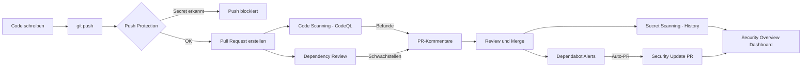

# GitHub Advanced Security

> [!ABSTRACT]
> GitHub Advanced Security (GHAS) ist eine integrierte Sicherheitsplattform für GitHub-Repositories. Sie vereint Code Scanning (CodeQL), Secret Scanning, Dependency Review und Dependabot zu einem durchgängigen DevSecOps-Werkzeug — direkt im Entwicklungs-Workflow verankert.

---

## Was ist GitHub Advanced Security?

GitHub Advanced Security (GHAS) ist eine lizenzpflichtige Erweiterung für GitHub Enterprise Cloud (GHEC) und GitHub Enterprise Server (GHES), die eine Reihe sicherheitsrelevanter Features in den Software-Development-Lifecycle integriert. Für **öffentliche Repositories** sind viele Features kostenlos verfügbar.

GHAS folgt dem Prinzip **„Shift Left"**: Sicherheitsprüfungen finden so früh wie möglich statt — bereits beim Schreiben von Code, nicht erst nach dem Deployment.

### Kernprinzipien

- **Prävention statt Reaktion** — Secrets und Schwachstellen werden vor dem Merge blockiert
- **Entwicklerfreundlich** — Befunde direkt im Pull Request, inline im Code
- **Skalierbar** — Org-weite Policies und Dashboards für Security-Teams
- **Erweiterbar** — Integration von Drittanbieter-Tools via SARIF

---

## GHAS-Komponenten im Überblick



---

## Feature-Verfügbarkeit

| Feature | Öffentliche Repos | GHAS-Lizenz (Private/Internal) |
|---|---|---|
| Code Scanning (CodeQL) | ✅ Kostenlos | ✅ Enthalten |
| Secret Scanning (Alerts) | ✅ Kostenlos | ✅ Enthalten |
| Push Protection | ✅ Kostenlos | ✅ Enthalten |
| Dependency Review | ✅ Kostenlos | ✅ Enthalten |
| Dependabot Alerts | ✅ Kostenlos | ✅ Enthalten |
| Dependabot Security Updates | ✅ Kostenlos | ✅ Enthalten |
| Dependabot Version Updates | ✅ Kostenlos | ✅ Enthalten |
| Security Overview (Org) | ❌ | ✅ Enthalten |
| Custom Secret Patterns | ❌ | ✅ Enthalten |
| CodeQL Custom Queries | ✅ Kostenlos | ✅ Enthalten |
| SBOM Export | ✅ Kostenlos | ✅ Enthalten |
| Artifact Attestations | ✅ Kostenlos | ✅ Enthalten |

---

## Code Scanning mit CodeQL

### Was ist CodeQL?

CodeQL ist Githubs statische Analyse-Engine, die Code **wie eine Datenbank** behandelt. Statt einfacher Pattern-Suche versteht CodeQL die **Semantik** des Codes — Datenfluss, Kontrollfluss und Typinformationen. So lassen sich komplexe Schwachstellen wie SQL-Injection oder Path-Traversal über mehrere Dateien hinweg erkennen.

**Unterstützte Sprachen:** C/C++, C#, Go, Java/Kotlin, JavaScript/TypeScript, Python, Ruby, Swift

### CodeQL GitHub Actions Workflow

```yaml
name: CodeQL Code Scanning

on:
  push:
    branches: [main, develop]
  pull_request:
    branches: [main]
  schedule:
    - cron: '0 3 * * 1'   # Jeden Montag um 03:00 UTC

jobs:
  analyze:
    name: CodeQL Analyse
    runs-on: ubuntu-latest
    permissions:
      actions: read
      contents: read
      security-events: write   # Erforderlich für SARIF-Upload

    strategy:
      fail-fast: false
      matrix:
        language: [javascript, python]
        # Weitere Optionen: cpp, csharp, go, java, ruby, swift

    steps:
      - name: Repository auschecken
        uses: actions/checkout@v4

      - name: CodeQL initialisieren
        uses: github/codeql-action/init@v3
        with:
          languages: ${{ matrix.language }}
          # Eigene Query-Suites einbinden:
          # queries: security-extended, security-and-quality

      - name: Automatischer Build
        uses: github/codeql-action/autobuild@v3
        # Für C/C++, C#, Go, Java/Kotlin — manuelle Build-Schritte möglich

      - name: CodeQL Analyse ausführen
        uses: github/codeql-action/analyze@v3
        with:
          category: "/language:${{ matrix.language }}"
          # SARIF-Ergebnisse werden automatisch zu GitHub hochgeladen
```

### SARIF-Format

Code-Scanning-Ergebnisse werden im **SARIF (Static Analysis Results Interchange Format)** gespeichert. SARIF ist ein offener JSON-Standard, der von Drittanbietern wie **Snyk**, **SonarCloud** oder **Checkmarx** unterstützt wird.

```yaml
# Drittanbieter-SARIF hochladen (Beispiel: Snyk)
- name: Snyk Code Scan
  uses: snyk/actions/node@master
  env:
    SNYK_TOKEN: ${{ secrets.SNYK_TOKEN }}
  with:
    args: --sarif-file-output=snyk.sarif

- name: SARIF zu GitHub hochladen
  uses: github/codeql-action/upload-sarif@v3
  with:
    sarif_file: snyk.sarif
```

> [!NOTE]
> CodeQL-Ergebnisse erscheinen direkt in Pull Requests als **Review-Kommentare** an der betroffenen Codezeile. Entwickler sehen den Befund ohne das GitHub-Security-Tab zu öffnen.

---

## Secret Scanning

### Funktionsweise

Secret Scanning scannt automatisch **alle Commits, Branches und das gesamte Git-History** eines Repositories nach bekannten Secrets wie API-Keys, Tokens und Credentials. GitHub pflegt eine umfangreiche Liste von **Partner-Patterns**, mit denen Service-Provider wie AWS oder Stripe ihre eigenen Token-Formate registrieren.

Wird ein Secret gefunden:
1. Repository-Owner und Committer erhalten eine E-Mail-Benachrichtigung
2. Der Alert erscheint im Tab **Security → Secret scanning**
3. Bei Partner-Tokens wird direkt der Service-Provider benachrichtigt (Token-Revokation)

### Secret Scanning Partner-Patterns (Auswahl)

| Provider | Erkannte Secret-Typen | Auto-Revokation |
|---|---|---|
| **AWS** | Access Key ID, Secret Access Key | ✅ Ja |
| **Azure** | Storage Account Key, Service Principal, Cosmos DB Key | ✅ Ja |
| **GitHub** | Personal Access Token (classic + fine-grained), OAuth App Secret | ✅ Ja |
| **Google** | GCP API Key, Service Account Key, OAuth Client Secret | ✅ Ja |
| **Stripe** | API Key (Live + Test), Webhook Secret | ✅ Ja |
| **Slack** | Bot Token, Webhook URL | ✅ Ja |
| **npm** | Automation Token, Publish Token | ✅ Ja |
| **Twilio** | Account SID + Auth Token | ✅ Ja |
| **SendGrid** | API Key | ✅ Ja |
| **Hashicorp Vault** | Service Token | ❌ Nein |

### Benutzerdefinierte Patterns

Mit GHAS-Lizenz lassen sich eigene Regex-Patterns definieren — für interne API-Keys, firmenspezifische Tokens oder proprietäre Formate.

```yaml
# Org-Level: .github/secret_scanning.yml
patterns:
  - name: "Interner API Key"
    regex: "MYCOMPANY-[A-Z0-9]{32}"
    secret_group: 1
    additional_match:
      - "(?i)(api.?key|apikey|token)"
```

---

## Push Protection

> [!IMPORTANT]
> Push Protection ist der **aktivste** Schutz-Mechanismus in GHAS. Er verhindert, dass Secrets überhaupt in das Repository gelangen — bevor ein Scan nötig wäre.

### Wie Push Protection funktioniert

Wenn ein Entwickler versucht, Code mit einem erkannten Secret zu pushen, blockiert GitHub den Push **vor** dem Erreichen des Remote-Repositories. Der Entwickler erhält eine Fehlermeldung mit:

- Dem erkannten Secret-Typ
- Der betroffenen Datei und Zeilennummer
- Optionen zum weiteren Vorgehen

### Bypass-Workflow

Nicht jeder „Treffer" ist ein echtes Secret (False Positives). Für legitime Ausnahmen gibt es einen kontrollierten Bypass:

```bash
# Push trotz Warnung — GitHub fragt interaktiv nach dem Grund
git push origin feature/my-branch

# Alternativ: Bypass via URL im Terminal-Prompt
# GitHub zeigt: "Visit <URL> to allow this push"
```

**Bypass-Gründe (auditiert):**
- `used_in_tests` — Secret ist nur für Tests
- `false_positive` — Kein echtes Secret
- `will_fix_later` — Bekanntes Problem, wird behoben

> [!WARNING]
> Jeder Bypass wird im **Audit Log** der Organisation protokolliert. Security-Teams können Bypass-Aktivitäten über das Security Overview Dashboard überwachen.

---

## Dependabot

### Dependency Alerts

Dependabot überwacht die Abhängigkeiten eines Repositories kontinuierlich gegen die **GitHub Advisory Database** (NVD, GitHub Security Advisories). Bei einer neuen CVE in einer verwendeten Bibliothek wird automatisch ein Alert erstellt.

**Unterstützte Ökosysteme:** npm, pip, Maven, Gradle, NuGet, RubyGems, Composer, Cargo, Go Modules, Swift, Pub (Dart), Hex (Elixir)

### Dependabot Security Updates

Bei einem aktiven Alert erstellt Dependabot automatisch einen **Pull Request**, der die betroffene Abhängigkeit auf die gepatchte Version aktualisiert. Dieser PR enthält:
- Beschreibung der CVE
- Severity-Level
- Änderungsprotokoll der Bibliothek
- Kompatibilitäts-Score

### Dependabot Version Updates (dependabot.yml)

```yaml
# .github/dependabot.yml
version: 2

updates:
  # npm Abhängigkeiten
  - package-ecosystem: "npm"
    directory: "/"
    schedule:
      interval: "weekly"
      day: "monday"
      time: "06:00"
      timezone: "Europe/Berlin"
    open-pull-requests-limit: 10
    reviewers:
      - "mein-team/security"
    labels:
      - "dependencies"
      - "automated"
    ignore:
      - dependency-name: "some-legacy-lib"
        versions: ["2.x", "3.x"]

  # Docker Base Images
  - package-ecosystem: "docker"
    directory: "/"
    schedule:
      interval: "weekly"
    commit-message:
      prefix: "chore(deps)"

  # GitHub Actions
  - package-ecosystem: "github-actions"
    directory: "/"
    schedule:
      interval: "monthly"
    groups:
      actions-minor:
        patterns: ["*"]
        update-types: ["minor", "patch"]

  # Maven (Java)
  - package-ecosystem: "maven"
    directory: "/backend"
    schedule:
      interval: "weekly"
```

> [!TIP]
> Mit dem `groups`-Feature (seit 2023) lassen sich mehrere Minor/Patch-Updates in einem einzigen PR bündeln — reduziert den PR-Overhead erheblich.

---

## Dependency Review

Dependency Review ist ein **Pull Request Check**, der neue oder geänderte Abhängigkeiten auf bekannte Schwachstellen prüft, **bevor** sie in den Main-Branch gemergt werden.

### Workflow-Integration

```yaml
name: Dependency Review

on:
  pull_request:
    branches: [main]

jobs:
  dependency-review:
    runs-on: ubuntu-latest
    permissions:
      contents: read
      pull-requests: write   # Für PR-Kommentare

    steps:
      - name: Repository auschecken
        uses: actions/checkout@v4

      - name: Dependency Review durchführen
        uses: actions/dependency-review-action@v4
        with:
          fail-on-severity: moderate   # low, moderate, high, critical
          deny-licenses: GPL-2.0, AGPL-3.0   # Lizenz-Compliance
          comment-summary-in-pr: always
```

### SBOM-Generierung

```bash
# SBOM für ein Repository herunterladen (GitHub API)
gh api \
  -H "Accept: application/vnd.github+json" \
  /repos/OWNER/REPO/dependency-graph/sbom \
  --jq '.sbom' > sbom.json

# Format: SPDX 2.3
```

---

## CodeQL Custom Queries

### QL-Sprache Grundlagen

CodeQL verwendet eine eigene deklarative Abfragesprache namens **QL**. Queries sind im Wesentlichen Datenbankabfragen über den kompilierten Code.

```ql
/**
 * @name Hardcodiertes Passwort in String-Literal
 * @description Findet String-Literale, die Passwörter enthalten könnten
 * @kind problem
 * @problem.severity warning
 * @security-severity 7.5
 * @id js/hardcoded-password-custom
 */

import javascript

from StringLiteral s
where s.getValue().regexpMatch("(?i).*(password|passwd|pwd|secret).*")
  and s.getValue().length() > 4
select s, "Mögliches hardcodiertes Passwort gefunden."
```

### CodeQL CLI

```bash
# CodeQL CLI installieren
# Download von: https://github.com/github/codeql-cli-binaries/releases

# Datenbank erstellen (JavaScript-Projekt)
codeql database create my-db \
  --language=javascript \
  --source-root=./src

# Query ausführen
codeql query run \
  --database=my-db \
  my-custom-query.ql

# Als SARIF exportieren und hochladen
codeql database analyze my-db \
  --format=sarif-latest \
  --output=results.sarif \
  javascript-security-extended.qls
```

### CodeQL Packs

CodeQL Packs ermöglichen das Verpacken und Teilen von Custom Queries über die GitHub Container Registry.

```yaml
# qlpack.yml
name: my-org/custom-security-queries
version: 1.0.0
dependencies:
  codeql/javascript-all: "*"
  codeql/javascript-queries: "*"
```

---

## Supply Chain Security 2024/2025

### Artifact Attestations

Artifact Attestations (GA seit 2024) erlauben es, in GitHub Actions gebaute Artefakte **kryptografisch zu signieren** — basierend auf der **Sigstore**-Infrastruktur (rekor, fulcio). Dies schafft eine verifizierbare Verbindung zwischen einem Artefakt und dem Workflow, der es produziert hat.

```yaml
name: Docker Image mit Attestation

on:
  push:
    branches: [main]

jobs:
  build-and-attest:
    runs-on: ubuntu-latest
    permissions:
      contents: read
      packages: write
      id-token: write       # Erforderlich für Sigstore OIDC
      attestations: write   # Erforderlich für Attestations

    steps:
      - uses: actions/checkout@v4

      - name: Docker Image bauen
        id: build
        run: |
          docker build -t ghcr.io/${{ github.repository }}:${{ github.sha }} .
          docker push ghcr.io/${{ github.repository }}:${{ github.sha }}
          DIGEST=$(docker inspect --format='{{index .RepoDigests 0}}' \
            ghcr.io/${{ github.repository }}:${{ github.sha }})
          echo "digest=${DIGEST}" >> $GITHUB_OUTPUT

      - name: Attestation erstellen
        uses: actions/attest-build-provenance@v1
        with:
          subject-name: ghcr.io/${{ github.repository }}
          subject-digest: ${{ steps.build.outputs.digest }}
          push-to-registry: true
```

```bash
# Attestation verifizieren
gh attestation verify \
  oci://ghcr.io/OWNER/REPO:TAG \
  --repo OWNER/REPO
```

### SBOM und Sigstore

```bash
# SBOM als Teil des CI/CD generieren und attestieren
- name: SBOM generieren
  uses: anchore/sbom-action@v0
  with:
    image: ghcr.io/${{ github.repository }}:${{ github.sha }}
    format: spdx-json
    output-file: sbom.spdx.json

- name: SBOM attestieren
  uses: actions/attest-sbom@v1
  with:
    subject-name: ghcr.io/${{ github.repository }}
    subject-digest: ${{ steps.build.outputs.digest }}
    sbom-path: sbom.spdx.json
```

---

## Security Overview

Das **Security Overview Dashboard** bietet Security-Teams eine zentrale, organisationsweite Sicht auf den Sicherheitsstatus aller Repositories.

### Ansichten

- **Overview** — Aggregierte Metriken: Anzahl offener Alerts nach Typ und Severity
- **Repositories** — Welche Repos haben Code Scanning aktiviert? Coverage-Prozentsatz
- **Alerts** — Alle offenen Alerts gefiltert nach Typ, Severity, Repository, Team
- **Enablement** — Welche GHAS-Features sind in welchen Repos aktiv?

### Nützliche Filter

```
# Beispiel-Filter im Security Overview
ecosystem:npm severity:critical state:open
language:javascript rule:js/sql-injection
```

---

## GHAS für GitHub Enterprise

### Enterprise-weite Security Policies

Im Enterprise-Admin-Panel lassen sich Policies definieren, die für alle Organisationen gelten:

```yaml
# Beispiel: Org-weite Code Scanning Policy (via REST API)
PATCH /orgs/{org}/code_security_configurations/{configuration_id}

{
  "name": "Standard Security Config",
  "code_scanning_default_setup": "enabled",
  "secret_scanning": "enabled",
  "secret_scanning_push_protection": "enabled",
  "dependabot_alerts": "enabled",
  "dependabot_security_updates": "enabled",
  "dependency_review_enforcement": "enabled"
}
```

### GHAS Enablement auf Enterprise-Ebene

```bash
# GHAS für alle Repos einer Organisation aktivieren (GitHub CLI)
gh api \
  --method PATCH \
  /orgs/MYORG \
  -f advanced_security_enabled_for_new_repositories=true \
  -f secret_scanning_enabled_for_new_repositories=true \
  -f secret_scanning_push_protection_enabled_for_new_repositories=true
```

---

## GHAS Lizenzierung

> [!NOTE]
> GHAS wird **pro Active Committer** lizenziert. Ein Active Committer ist jeder GitHub-Nutzer, der in den letzten **90 Tagen** mindestens einen Commit in ein privates oder internes Repository mit aktiviertem GHAS gemacht hat.

### Lizenzmodell

| Aspekt | Detail |
|---|---|
| **Einheit** | Pro Active Committer / Monat |
| **Messzeitraum** | Letzte 90 Tage (rollierend) |
| **Zählung** | Unique Committer über alle GHAS-Repos der Enterprise |
| **Public Repos** | Kostenlos, keine Lizenz erforderlich |
| **GHES** | Erfordert GHAS Add-on zur GitHub Enterprise Server Lizenz |
| **GHEC** | GHAS als Add-on zur GitHub Enterprise Cloud |

```bash
# Aktuelle Active Committer abrufen (GitHub API)
gh api /enterprises/ENTERPRISE/settings/billing/advanced-security \
  --jq '.seats[] | {login: .security_product_users[0].login, last_pushed_date}'
```

---

## Integration mit Microsoft Defender for Cloud

### DevOps Security Connector

Microsoft Defender for Cloud kann GitHub-Organisationen über einen **DevOps Security Connector** anbinden. Dies ermöglicht:

- GHAS-Alerts in Microsoft Defender for Cloud Recommendations sichtbar machen
- Security Posture Management für GitHub-Repositories
- Integration mit Microsoft Sentinel für SIEM/SOAR

### Einrichtung

```bash
# Voraussetzungen:
# 1. Azure Subscription mit Defender for Cloud (Plan: Defender CSPM oder DevOps)
# 2. GitHub Organization Owner-Rechte
# 3. GitHub App Installation autorisieren

# Im Azure Portal:
# Defender for Cloud → Environment Settings → Add Environment → GitHub
# → GitHub App autorisieren → Org/Repos auswählen → Speichern
```

**Empfangene Daten in Defender for Cloud:**
- Code Scanning Alerts (CodeQL, SARIF)
- Secret Scanning Alerts
- Dependabot Alerts
- IaC-Schwachstellen (Terraform, Bicep via MSDO-Action)

```yaml
# Microsoft Security DevOps (MSDO) Action für Defender for Cloud
- name: Microsoft Security DevOps
  uses: microsoft/security-devops-action@v1.6
  with:
    categories: IaC, code, secrets, containers
  id: msdo

- name: SARIF hochladen
  uses: github/codeql-action/upload-sarif@v3
  with:
    sarif_file: ${{ steps.msdo.outputs.sarifFile }}
```

---

## Best Practices

> [!TIP]
> **Empfohlene GHAS-Einführungsstrategie:**
> 1. **Phase 1:** Secret Scanning + Push Protection aktivieren (sofortiger Mehrwert, kein Workflow-Eingriff)
> 2. **Phase 2:** Dependabot Alerts + Security Updates aktivieren
> 3. **Phase 3:** Code Scanning mit Default Setup (keine Workflow-Datei nötig) einführen
> 4. **Phase 4:** Custom CodeQL Queries für unternehmenseigene Sicherheitsregeln

> [!DANGER]
> Niemals GHAS-Alerts pauschal als „geschlossen" markieren, ohne sie zu untersuchen. Jede Schließung wird im Audit Log protokolliert und sollte begründet werden. Nutze stattdessen den `dismissed with reason`-Workflow.

---

## Via GitHub.com (UI)

### GHAS aktivieren (Repository)

1. Öffne **[github.com](https://github.com/[org]/[repo])**
2. Navigiere zu **Settings** → **Security** → **Code security and analysis**
3. Aktiviere: **Dependency graph**, **Dependabot alerts**, **Code scanning**, **Secret scanning**
4. **Save changes**

### Code Scanning Alerts

1. Repository → **Security** Tab → **Code scanning**
2. Alert auswählen → Details, betroffene Zeile und Empfehlung einsehen
3. **Dismiss alert** oder Issue erstellen

### Secret Scanning Alerts

1. Repository → **Security** → **Secret scanning**
2. Alert öffnen → **Close as** (Revoked / Used in tests / etc.)

### Dependabot Alerts

1. Repository → **Security** → **Dependabot**
2. Alert öffnen → **Create Dependabot security update**

### Push Protection umgehen

1. Bei einem abgelehnten Push → Link in der Fehlermeldung öffnen
2. Begründung auswählen → **Allow secret**

---

## Verwandte Notizen

- [[GitHub Actions]]
- [[GitHub Enterprise]]
- [[Microsoft Defender for Cloud Apps]]
- [[GitHub Grundlagen]]
