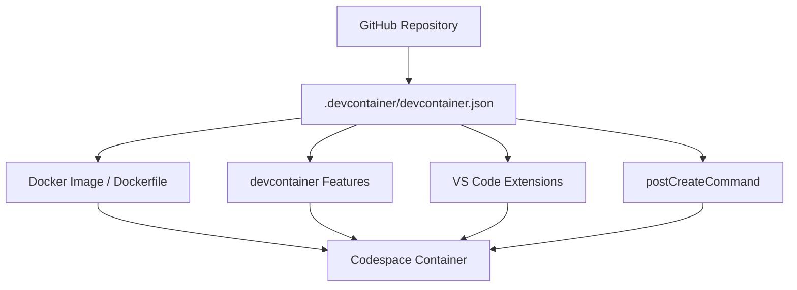
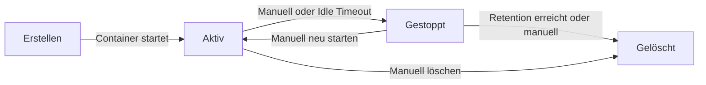
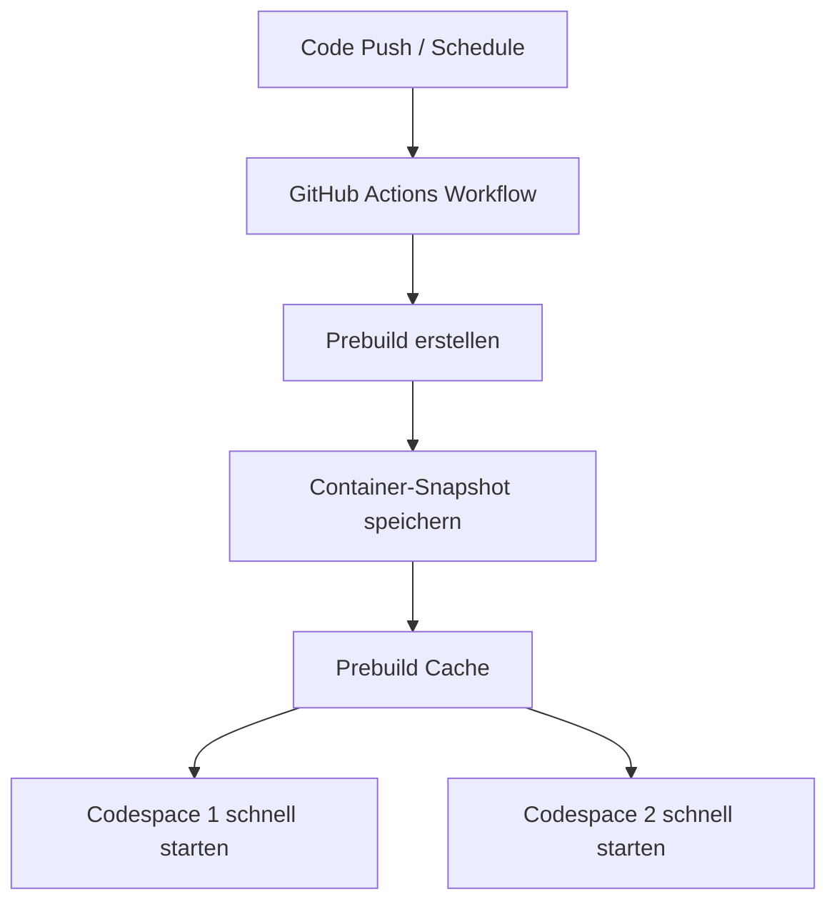
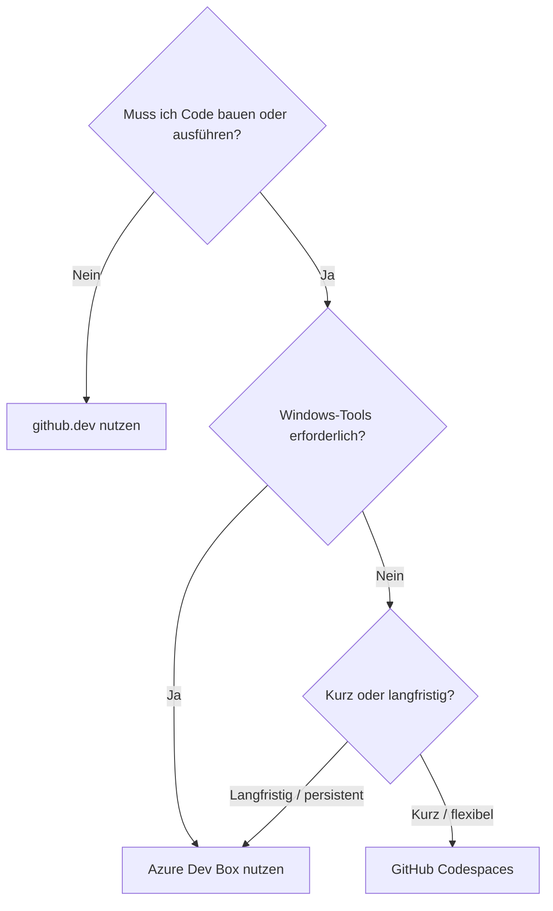

# GitHub Codespaces

> [!ABSTRACT]
> GitHub Codespaces ist eine vollständig cloudbasierte Entwicklungsumgebung, die direkt aus einem GitHub-Repository gestartet wird. Jeder Codespace ist ein isolierter, containerisierter Linux-Entwicklungsserver mit VS Code, Terminal und vorkonfigurierten Tools — ohne lokale Installation.

---

## Was ist GitHub Codespaces?

GitHub Codespaces stellt auf Knopfdruck eine vollständige Entwicklungsumgebung in der Cloud bereit. Die Umgebung basiert auf Linux-Containern (Ubuntu) und kann über VS Code im Browser, VS Code Desktop, JetBrains Gateway oder JupyterLab genutzt werden.

### Kernkonzepte

- **Cloudbasiert**: Kein lokales Setup, keine Abhängigkeiten auf dem eigenen Rechner
- **Repository-gebunden**: Jeder Codespace gehört zu einem Repository und Branch
- **Reproducible**: Konfiguration via `.devcontainer/devcontainer.json` sichert identische Umgebungen
- **Skalierbar**: Von 2-Core bis 64-Core-Maschinen wählbar
- **Temporär oder persistent**: Codespaces können gestoppt und später wieder gestartet werden

### Anwendungsfälle

| Anwendungsfall | Vorteil |
|---|---|
| Onboarding neuer Entwickler | Sofort einsatzbereit, keine lokale Einrichtung |
| Kurze Code-Reviews mit Tests | Schnelles Testen ohne Umgebungs-Wechsel |
| Open Source Contributions | Beitrag ohne lokale Klone |
| Demos und Workshops | Identische Umgebung für alle Teilnehmer |
| ML/KI-Entwicklung (GPU) | GPU-Zugang ohne eigene Hardware |

---

## Dev Container — Konzept

Dev Container (Development Container) sind der Standard, auf dem Codespaces basieren. Sie definieren die Entwicklungsumgebung als Code.

### Was ist ein Dev Container?

Ein Dev Container ist ein Docker-Container, der speziell für die Entwicklung konfiguriert ist. Die Konfiguration liegt im Repository unter `.devcontainer/devcontainer.json`.



### devcontainer Features

Features sind vorkonfigurierte Komponenten, die in einen Dev Container eingebunden werden können — ohne eigenes Dockerfile:

```json
"features": {
    "ghcr.io/devcontainers/features/node:1": {
        "version": "20"
    },
    "ghcr.io/devcontainers/features/docker-in-docker:2": {},
    "ghcr.io/devcontainers/features/github-cli:1": {}
}
```

Verfügbare Features (Auswahl):
- `node`, `python`, `java`, `go`, `dotnet`
- `docker-in-docker`, `kubectl-helm-minikube`
- `github-cli`, `azure-cli`, `aws-cli`
- `terraform`, `ansible`

> [!TIP]
> Features sind der empfohlene Weg, Software in Dev Container einzubinden. Sie sind modular, versioniert und von der Community gewartet (Container Registry: `ghcr.io/devcontainers/features`).

---

## devcontainer.json — Beispiel (Node.js)

Eine vollständige Beispielkonfiguration für ein Node.js-Projekt:

````json
{
    "name": "Node.js Projekt",
    "image": "mcr.microsoft.com/devcontainers/javascript-node:1-20-bookworm",

    "features": {
        "ghcr.io/devcontainers/features/github-cli:1": {},
        "ghcr.io/devcontainers/features/docker-in-docker:2": {
            "version": "latest"
        }
    },

    "customizations": {
        "vscode": {
            "extensions": [
                "dbaeumer.vscode-eslint",
                "esbenp.prettier-vscode",
                "github.copilot",
                "github.vscode-pull-request-github",
                "eamodio.gitlens",
                "ms-vscode.vscode-typescript-next"
            ],
            "settings": {
                "editor.formatOnSave": true,
                "editor.defaultFormatter": "esbenp.prettier-vscode",
                "terminal.integrated.defaultProfile.linux": "bash"
            }
        }
    },

    "forwardPorts": [3000, 5173, 8080],
    "portsAttributes": {
        "3000": {
            "label": "App Server",
            "onAutoForward": "openBrowser"
        },
        "5173": {
            "label": "Vite Dev Server"
        }
    },

    "postCreateCommand": "npm install && npm run db:migrate",
    "postStartCommand": "git config --global core.editor 'code --wait'",

    "remoteEnv": {
        "NODE_ENV": "development"
    },

    "remoteUser": "node",
    "mounts": [
        "source=${localWorkspaceFolder}/.git,target=/workspaces/${localWorkspaceFolderBasename}/.git,type=bind"
    ]
}
````

### Wichtige devcontainer.json Felder

| Feld | Typ | Beschreibung |
|---|---|---|
| `image` | String | Basis-Docker-Image (von mcr.microsoft.com oder ghcr.io) |
| `build` | Object | Dockerfile-basierter Build statt Image |
| `features` | Object | devcontainer Features einbinden |
| `customizations.vscode.extensions` | Array | Automatisch installierte VS Code Extensions |
| `forwardPorts` | Array | Ports die automatisch weitergeleitet werden |
| `postCreateCommand` | String/Array | Läuft einmalig beim ersten Container-Start |
| `postStartCommand` | String/Array | Läuft bei jedem Container-Start |
| `remoteUser` | String | Linux-Benutzer im Container |
| `remoteEnv` | Object | Umgebungsvariablen im Container |
| `mounts` | Array | Zusätzliche Volume-Mounts |

---

## Codespace Lifecycle

Ein Codespace durchläuft verschiedene Zustände über seine Lebensdauer.



### Lifecycle-Phasen im Detail

| Phase | Beschreibung | Kosten |
|---|---|---|
| **Erstellen** | Container-Image wird gestartet, Features installiert, Extensions geladen | Compute-Kosten laufen |
| **Aktiv (Running)** | Vollständig nutzbar, IDE verbunden | Compute + Storage |
| **Gestoppt (Stopped)** | Container pausiert, Dateisystem erhalten | Nur Storage |
| **Gelöscht (Deleted)** | Vollständig entfernt | Keine Kosten |

### Idle Timeout

Codespaces werden nach Inaktivität automatisch gestoppt:
- **Standard**: 30 Minuten Inaktivität
- **Konfigurierbar**: 5 Minuten bis 4 Stunden (User Settings)
- **Org-Policy**: Maximaler Timeout kann durch Org eingeschränkt werden

### Retention

Gestoppte Codespaces werden nach einer Retention-Period automatisch gelöscht:
- **Standard**: 30 Tage
- **Konfigurierbar**: 1–30 Tage (User Settings)
- **Org-Policy**: Maximum durch Organisation festlegbar

> [!TIP]
> Nicht benötigte Codespaces regelmäßig löschen, um Storage-Kosten zu vermeiden. Alle aktiven Codespaces sind unter `github.com/codespaces` sichtbar.

---

## Unterstützte IDEs und Clients

### VS Code Browser (github.dev → Codespace)

Der einfachste Einstieg: Im Browser auf `github.com` → Repository öffnen → `Code`-Button → `Create codespace`

- Vollständiges VS Code im Browser (keine lokale Installation)
- Terminal, Debugger, Extensions
- Basiert auf `vscode.dev` / Code OSS

### VS Code Desktop

Lokales VS Code verbindet sich per SSH-Tunnel zum Codespace:

```bash
# VS Code Command Palette:
# "Codespaces: Connect to Codespace..."
# Alternativ via GitHub Codespaces Extension (ms-vscode-remote.remote-github)
```

Vorteile: Lokale Keyboard-Shortcuts, native Performance, alle lokalen Extensions

### JetBrains Gateway

JetBrains-IDEs (IntelliJ IDEA, PyCharm, GoLand, etc.) können sich via Gateway zu Codespaces verbinden:

1. JetBrains Gateway installieren
2. `GitHub Codespaces` als Provider wählen
3. Codespace auswählen und IDE starten

> [!NOTE]
> Die JetBrains-Backend läuft im Codespace, das Frontend (UI) lokal. Die IDE-Performance ist daher von der Netzwerkverbindung abhängig.

### JupyterLab

Für Data Science und Machine Learning:
- JupyterLab direkt im Codespace starten
- Port 8888 weiterleiten
- Unterstützt Jupyter Notebooks, Python, R

```bash
# Im Codespace Terminal:
jupyter lab --no-browser --port=8888
# Port 8888 wird automatisch erkannt und weitergeleitet
```

---

## Ressourcen-Konfiguration

### Verfügbare Maschinentypen

| Maschinentyp | vCPUs | RAM | Storage | Preis/Stunde |
|---|---|---|---|---|
| 2-Core | 2 | 8 GB | 32 GB | $0,18 |
| 4-Core | 4 | 16 GB | 32 GB | $0,36 |
| 8-Core | 8 | 32 GB | 64 GB | $0,72 |
| 16-Core | 16 | 64 GB | 128 GB | $1,44 |
| 32-Core | 32 | 128 GB | 128 GB | $2,88 |
| 64-Core | 64 | 256 GB | 128 GB | $5,76 |
| GPU (T4) | 4 | 16 GB | 32 GB + 16 GB GPU | $0,07/GPU-Min |

> [!NOTE]
> Der **Standard-Maschinentyp** für neue Codespaces ist 2-Core/8GB. Für die meisten Web-Entwicklungsprojekte reicht dieser aus. Der Maschinentyp kann nach dem Erstellen geändert werden (Neustart erforderlich).

### Maschinentyp in devcontainer.json empfehlen

```json
{
    "hostRequirements": {
        "cpus": 4,
        "memory": "8gb",
        "storage": "32gb"
    }
}
```

---

## GPU Codespaces

Seit 2024 sind GPU-Codespaces mit NVIDIA Tesla T4 allgemein verfügbar (GA).

### Anwendungsfälle

- Machine Learning Training (PyTorch, TensorFlow)
- LLM Inference und Fine-Tuning
- Computer Vision Entwicklung
- CUDA-Entwicklung

### GPU Codespace konfigurieren

```json
{
    "name": "ML Development",
    "image": "mcr.microsoft.com/devcontainers/python:3.11",
    "features": {
        "ghcr.io/devcontainers/features/nvidia-cuda:1": {
            "installCudnn": true,
            "cudaVersion": "12.2"
        }
    },
    "hostRequirements": {
        "gpu": "optional"
    },
    "postCreateCommand": "pip install torch torchvision torchaudio --index-url https://download.pytorch.org/whl/cu121"
}
```

```bash
# GPU-Verfügbarkeit im Codespace prüfen
nvidia-smi
python -c "import torch; print(torch.cuda.is_available())"
```

> [!WARNING]
> GPU Codespaces sind derzeit nur in ausgewählten Regionen verfügbar und müssen in der Organization Policy explizit erlaubt werden. GPU-Stunden werden separat berechnet.

---

## Prebuilds

Prebuilds sind vorberechnete Container-Snapshots, die den Codespace-Start erheblich beschleunigen.

### Wie Prebuilds funktionieren

Ohne Prebuild: Codespace-Start = Image Pull + Features installieren + `postCreateCommand` ausführen (kann 5–15 Minuten dauern)

Mit Prebuild: Codespace-Start = Snapshot laden + verbinden (< 30 Sekunden)



### Prebuild konfigurieren

1. Repository → `Settings` → `Codespaces` → `Prebuilds`
2. Branch auswählen (z. B. `main`)
3. Region auswählen
4. Trigger: Bei Push, zeitgesteuert, oder manuell

> [!IMPORTANT]
> Prebuilds verbrauchen GitHub Actions-Minuten (aus dem Org/Repo-Kontingent). Pro Region und Branch wird ein separater Prebuild-Job ausgeführt. Prebuilds werden im Hintergrund bei jedem Push aktualisiert.

### Prebuild Kosten

| Posten | Kosten |
|---|---|
| Actions-Minuten für Prebuild-Build | Normaler Actions-Minutenpreis |
| Prebuild Storage | $0,07/GB/Monat |
| Codespace-Start (mit Prebuild) | Keine zusätzlichen Kosten |

---

## Secrets in Codespaces

### Codespace Secrets

Persönliche oder Org-Secrets für alle Codespaces:

```bash
# Via GitHub CLI
gh secret set MY_API_KEY --app codespaces
gh secret list --app codespaces
```

Im Codespace sind Secrets als Umgebungsvariablen verfügbar:
```bash
echo $MY_API_KEY
```

### Dotfiles Repository

Ein persönliches Dotfiles-Repository ermöglicht persönliche Konfiguration in allen Codespaces:

1. Repository `dotfiles` im persönlichen GitHub-Account erstellen
2. Dotfiles hinzufügen: `.bashrc`, `.gitconfig`, `.vimrc`, etc.
3. Optionales `install.sh`-Skript für zusätzliche Einrichtung
4. In GitHub Settings → Codespaces → Dotfiles aktivieren

```bash
# Beispiel install.sh im dotfiles-Repo
#!/bin/bash
ln -s $DOTFILES_DIR/.bashrc ~/.bashrc
ln -s $DOTFILES_DIR/.gitconfig ~/.gitconfig
echo "Dotfiles installiert!"
```

---

## Weiterleitung von Ports (Port Forwarding)

Dienste, die im Codespace laufen, können im Browser erreichbar gemacht werden.

### Automatische Port-Erkennung

VS Code erkennt automatisch lauschende Ports und schlägt die Weiterleitung vor.

### Port-Sichtbarkeit

| Sichtbarkeit | Beschreibung | Zugriff |
|---|---|---|
| **Private** | Nur der Codespace-Besitzer (Standard) | Nur eigener Browser mit GitHub-Auth |
| **Org** | Alle Org-Mitglieder | Authentifizierte Org-Mitglieder |
| **Public** | Öffentlich zugänglich | Jeder mit der URL |

```bash
# Port via GitHub CLI weiterleiten
gh codespace ports forward 3000:3000 --codespace <name>

# Port-Sichtbarkeit ändern
gh codespace ports visibility 3000:public --codespace <name>
```

> [!WARNING]
> Öffentliche Ports sind ohne Authentifizierung zugänglich. Niemals sensible Dienste (Datenbanken, Admin-Panels) auf `public` setzen.

---

## Organization Policies

Enterprise- und Org-Admins können Codespaces zentral steuern.

### Konfigurierbare Policies

| Policy | Optionen | Standardwert |
|---|---|---|
| Codespaces erlaubt für | Alle / Ausgewählte Repos / Keine | Alle |
| Maximaler Maschinentyp | 2-Core bis 64-Core | 32-Core |
| Idle Timeout max | 5 Min bis 4 Stunden | 4 Stunden |
| Retention max | 1–30 Tage | 30 Tage |
| Trusted Repositories | Liste vertrauenswürdiger Repos | — |
| GPU Codespaces | Erlaubt / Verboten | Verboten |
| Prebuild-Nutzung | Erlaubt / Verboten | Erlaubt |

### Policy via REST API setzen

```bash
# Maximalen Maschinentyp für Org setzen
curl -X PUT \
  -H "Authorization: Bearer <token>" \
  -H "Accept: application/vnd.github+json" \
  "https://api.github.com/orgs/<org>/codespaces/policy" \
  -d '{
    "allowed_values": ["basicLinux32gb", "standardLinux32gb"],
    "policy_type": "max_machines_per_codespace"
  }'
```

---

## Codespaces vs. github.dev vs. Azure Dev Box

### Vergleichstabelle

| Kriterium | GitHub Codespaces | github.dev | Azure Dev Box |
|---|---|---|---|
| **Zugang** | github.com → Code → Codespace | github.com → Taste `.` drücken | Microsoft Dev Box Portal |
| **Compute** | Cloud-Linux-Container | Kein Compute (nur Browser) | Cloud-Windows-VM |
| **Terminal** | Ja, vollständig | Nein | Ja (RDP, SSH) |
| **Build / Compile** | Ja | Nein | Ja |
| **Betriebssystem** | Linux (Ubuntu) | — | Windows 11 |
| **IDE** | VS Code / JetBrains / Jupyter | VS Code (eingeschränkt) | Beliebig (lokal in VM) |
| **Konfiguration** | devcontainer.json | Keine | Dev Box Definition (Bicep/ARM) |
| **Startup-Zeit** | 30 Sek (mit Prebuild) / 2–5 Min | Sofort | 5–15 Minuten |
| **Offline-Nutzung** | Nein | Nein | Ja (nach RDP-Verbindung) |
| **Kosten** | Core-Stunden + Storage | Kostenlos | Dev Box-Stunden (Windows-VM-Kosten) |
| **Zielgruppe** | Entwickler (Linux/Web/Cloud) | Schnelle Edits, Code-Review | Enterprise-Entwickler (Windows-Tools) |
| **Persistenz** | Bis zur Deletion (30 Tage default) | Keine (Änderungen committen) | Persistente VM |

> [!NOTE]
> **github.dev** (Taste `.` im Repo oder `github.dev/owner/repo`) öffnet VS Code im Browser ohne Compute. Ideal für schnelle Datei-Edits oder Code-Review — aber kein Terminal, kein Build, keine Extensions mit Server-Komponente.

### Wann welches Tool?



---

## Kosten und Abrechnung

### Kostenstruktur

GitHub Codespaces wird nach zwei Faktoren abgerechnet:

1. **Compute-Kosten**: Core-Stunden (nur wenn Codespace aktiv/running)
2. **Storage-Kosten**: GB/Monat (auch wenn Codespace gestoppt)

### Preistabelle Compute

| Maschinentyp | Core-Stunden/h | Preis/h (USD) |
|---|---|---|
| 2-Core | 2 | $0,18 |
| 4-Core | 4 | $0,36 |
| 8-Core | 8 | $0,72 |
| 16-Core | 16 | $1,44 |
| 32-Core | 32 | $2,88 |
| 64-Core | 64 | $5,76 |

### Preistabelle Storage

| Komponente | Preis |
|---|---|
| Codespace Storage | $0,07/GB/Monat |
| Prebuild Storage | $0,07/GB/Monat |

### Free-Kontingent (GitHub Free/Pro)

| Plan | Inkludierte Core-Stunden/Monat | Inkludierter Storage/Monat |
|---|---|---|
| GitHub Free | 120 Core-Stunden (= 60h auf 2-Core) | 15 GB |
| GitHub Pro | 180 Core-Stunden | 20 GB |
| GitHub Team | 0 (kostenpflichtig) | 0 |
| GitHub Enterprise | 0 (kostenpflichtig, per Org zahlbar) | 0 |

> [!TIP]
> **Kostenoptimierung**: (1) Idle Timeout auf 15–30 Minuten reduzieren. (2) Nicht benötigte Codespaces löschen. (3) Prebuilds nur für aktiv genutzte Branches aktivieren. (4) Den kleinsten ausreichenden Maschinentyp wählen — der Typ kann jederzeit geändert werden.

### Kosten-Beispielrechnung

```
Entwickler nutzt 4-Core Codespace:
- Aktiv: 6 Stunden/Tag × 22 Tage = 132 Stunden
- Gestoppt: restliche Zeit (nur Storage)
- Storage: ~20 GB

Compute: 132h × $0,36/h = $47,52
Storage: 20 GB × $0,07/Monat = $1,40
Gesamt: ~$48,92/Monat
```

> [!WARNING]
> Ohne Spending Limit (Standard: $0) werden Codespaces über das Free-Kontingent hinaus **nicht gestartet**. Ein Spending Limit muss explizit in den Billing Settings gesetzt werden, um kostenpflichtige Nutzung zu erlauben.

---

## Via GitHub.com (UI)

### Codespace erstellen

1. Öffne **[github.com](https://github.com/[org]/[repo])**
2. Klicke den grünen **Code** Button
3. Wähle den Tab **Codespaces**
4. **Create codespace on [branch]** oder **...** für Optionen (Machine Type, Region)
5. VS Code im Browser öffnet sich automatisch

### Codespace verwalten

1. Öffne **[github.com/codespaces](https://github.com/codespaces)**
2. Laufende und gestoppte Codespaces anzeigen
3. **...** Menü → **Stop** / **Delete** / **Change machine type**

### Prebuild konfigurieren

1. Repository → **Settings** → **Codespaces**
2. **Set up prebuild** → Branch, Region, Auslöser konfigurieren
3. **Create**

### Organisation Policies

1. Öffne **github.com/organizations/[org]/settings/codespaces**
2. **Policies** → Erlaubte Machine Types, maximale Idle-Timeout, etc. konfigurieren

---

## Codespaces via CLI verwalten

```bash
# Neuen Codespace erstellen
gh codespace create --repo owner/repo --branch main --machine standardLinux32gb

# Alle eigenen Codespaces auflisten
gh codespace list

# SSH-Verbindung zu Codespace
gh codespace ssh --codespace <name>

# Datei in/aus Codespace kopieren
gh codespace cp ./local-file remote:/workspaces/repo/

# Codespace stoppen
gh codespace stop --codespace <name>

# Codespace löschen
gh codespace delete --codespace <name>

# Port weiterleiten
gh codespace ports forward 3000:3000 --codespace <name>

# Logs anzeigen
gh codespace logs --codespace <name>
```

---

## Best Practices

### devcontainer.json optimieren

- **Pinned Image-Versions**: Immer spezifische Image-Tags nutzen (nicht `latest`)
- **Features bevorzugen**: Features statt `RUN apt-get` im Dockerfile
- **postCreateCommand für Deps**: `npm install` / `pip install` automatisieren
- **Extensions minimal halten**: Nur wirklich benötigte Extensions einbinden

### Sicherheit

```json
{
    "remoteUser": "vscode",
    "containerUser": "vscode"
}
```

- Niemals als `root` im Container arbeiten
- Secrets über Codespace Secrets, nicht im Code
- Dotfiles für persönliche `.gitconfig` nutzen

### Performance

- Prebuilds für aktiv genutzte Branches aktivieren
- `postCreateCommand` für einmalige Tasks, `postStartCommand` für Start-Tasks
- Node Modules und Caches in persistentem Storage (nicht im `/tmp`)

---

## Verwandte Notizen

- [[GitHub Grundlagen]]
- [[GitHub Enterprise]]
- [[GitHub Actions]]
