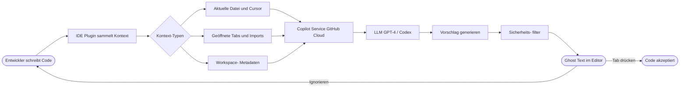
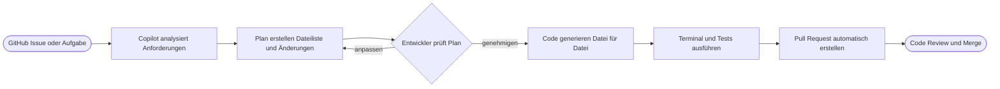

# GitHub Copilot

> [!ABSTRACT]
> GitHub Copilot ist der KI-gestützte Coding-Assistent von GitHub, der auf OpenAI Codex und GPT-4 basiert. Er bietet Code-Vervollständigung, Chat-Funktionen, CLI-Integration und – in der Enterprise-Variante – firmeneigene Knowledge Bases. Seit 2024/2025 umfasst das Ökosystem Extensions, Copilot Workspace und tiefe IDE-Integrationen für alle wichtigen Entwicklungsumgebungen.

---

## Was ist GitHub Copilot?

GitHub Copilot ist ein KI-Pair-Programmer, der direkt in der Entwicklungsumgebung arbeitet und Entwickler bei folgenden Aufgaben unterstützt:

- **Code-Generierung:** Autovervollständigung, Funktionen, Klassen, Tests
- **Code-Verständnis:** Erklärung von fremdem oder komplexem Code
- **Fehlerbehebung:** Analyse und Vorschläge zur Fehlerbehebung
- **Dokumentation:** Automatische Generierung von Kommentaren und Docs
- **CLI-Hilfe:** Erklärung und Vorschlag von Shell-Befehlen

### Technische Grundlage

Copilot basiert auf einer Kombination aus:
- **OpenAI Codex** – speziell auf Code trainiertes Modell
- **GPT-4 / GPT-4o** – für Chat-Funktionen und komplexes Reasoning
- **Kontext-Fenster:** Analyse von geöffneten Dateien, Imports, Kommentaren und Cursor-Position

### Wie Copilot funktioniert



---

## Copilot Pläne und Preise

| Feature | Free | Pro | Business | Enterprise |
|---|---|---|---|---|
| **Preis** | Kostenlos | $10/Monat oder $100/Jahr | $19/User/Monat | $39/User/Monat |
| **Code-Vervollständigung** | ✅ (begrenzt) | ✅ unbegrenzt | ✅ unbegrenzt | ✅ unbegrenzt |
| **Copilot Chat** | ✅ begrenzt | ✅ | ✅ | ✅ |
| **CLI (gh copilot)** | ✅ | ✅ | ✅ | ✅ |
| **Copilot in GitHub.com** | ❌ | ❌ | ❌ | ✅ |
| **Custom Knowledge Bases** | ❌ | ❌ | ❌ | ✅ |
| **Organisation Policies** | ❌ | ❌ | ✅ | ✅ |
| **Content Exclusions** | ❌ | ❌ | ✅ | ✅ |
| **Audit Logs** | ❌ | ❌ | ✅ | ✅ |
| **SAML SSO** | ❌ | ❌ | ✅ | ✅ |
| **Kein Training auf Code** | ❌ | ❌ | ✅ | ✅ |
| **EU Data Residency** | ❌ | ❌ | ❌ | ✅ |
| **Fine-Tuning** | ❌ | ❌ | ❌ | Roadmap |

> [!NOTE]
> Der **Free-Plan** (ab 2024 GA) bietet 2.000 Code-Vervollständigungen und 50 Chat-Nachrichten pro Monat. Für Studenten und Open-Source-Maintainer ist der Pro-Plan kostenlos über das GitHub Education Program.

---

## Copilot in der IDE

### Unterstützte Editoren

| Editor | Support-Level | Besonderheiten |
|---|---|---|
| **VS Code** | Vollständig | Alle Features, Copilot Chat, Extensions |
| **Visual Studio** | Vollständig | .NET-Optimierungen, IntelliSense-Integration |
| **JetBrains IDEs** | Vollständig | IntelliJ, PyCharm, WebStorm, Rider, etc. |
| **Neovim** | Code-Completion | Plugin via `github/copilot.vim` |
| **Xcode** | Vollständig (ab 2024) | Swift/Objective-C Unterstützung |
| **Eclipse** | Beta | Java-fokussiert |

### Installation in VS Code

```bash
# Via Extension Marketplace
# Extension: "GitHub Copilot" (github.copilot)
# Extension: "GitHub Copilot Chat" (github.copilot-chat)

# Via CLI
code --install-extension github.copilot
code --install-extension github.copilot-chat
```

---

## Code-Vervollständigung

### Ghost Text und Tab-Akzeptanz

Copilot zeigt Vorschläge als ausgegrauer "Ghost Text" direkt im Editor an:

- **`Tab`** – Vorschlag vollständig akzeptieren
- **`Ctrl+→`** (Win/Linux) / **`Cmd+→`** (Mac) – Vorschlag wortweise akzeptieren
- **`Esc`** – Vorschlag ablehnen
- **`Alt+]`** / **`Alt+[`** – Zwischen alternativen Vorschlägen wechseln
- **`Ctrl+Enter`** – Alle Vorschläge in einem Panel anzeigen

### Next Edit Suggestions (NES)

NES ist ein fortgeschrittenes Feature (ab VS Code), das nicht nur an der Cursor-Position vorschlägt, sondern **vorhersagt, welche andere Stelle** im Code als nächstes bearbeitet werden muss:

```python
# Entwickler fügt Parameter hinzu:
def calculate_area(width: int, height: int, unit: str = "m") -> float:
    return width * height
#                         ^^^^
# NES schlägt vor, die return-Anweisung zu aktualisieren:
# return f"{width * height} {unit}²"
```

### Multi-Line Completion und Funktionsgenerierung

```javascript
// Kommentar schreiben → Copilot generiert die Funktion
// Funktion: Validiert eine E-Mail-Adresse mit Regex
// Gibt true zurück wenn gültig, sonst false
function validateEmail(email) {
    // Copilot vervollständigt automatisch:
    const emailRegex = /^[^\s@]+@[^\s@]+\.[^\s@]+$/;
    return emailRegex.test(email);
}
```

> [!TIP]
> Copilot liefert bessere Vorschläge, wenn Dateien mit aussagekräftigen Namen gespeichert werden und ähnliche Beispiel-Implementierungen in geöffneten Tabs vorhanden sind.

---

## Copilot Chat

### Inline Chat (Ctrl+I / Cmd+I)

Direkter Chat an der Cursor-Position im Editor:

```
Ctrl+I → Prompt eingeben → Enter
```

Beispiel-Prompts für Inline Chat:
```
/fix Behebe den NullPointerException-Fehler in diesem Code
/explain Erkläre mir diese reguläre Ausdrucks-Syntax
/tests Erstelle Unit Tests für diese Funktion mit Jest
/docs Generiere JSDoc-Kommentare für diese Klasse
```

### Chat Panel (Seitenleiste)

Das Chat Panel bietet eine vollständige Konversations-Oberfläche mit Kontext-Variablen:

```
@workspace Wo wird die Benutzerauthentifizierung implementiert?
@workspace /explain Wie funktioniert der Datenbankverbindungspool?
@terminal Warum ist dieser npm-Fehler aufgetreten?
@vscode Wie konfiguriere ich den Debugger für TypeScript?
```

### Slash-Befehle im Detail

| Befehl | Beschreibung | Beispiel |
|---|---|---|
| `/fix` | Fehler analysieren und beheben | `/fix TypeError in Zeile 42` |
| `/explain` | Code oder Konzept erklären | `/explain Was macht dieser Regex?` |
| `/tests` | Unit Tests generieren | `/tests Erstelle Tests mit pytest` |
| `/docs` | Dokumentation generieren | `/docs Schreibe JSDoc für diese API` |
| `/simplify` | Code vereinfachen | `/simplify Refaktoriere diese verschachtelte Schleife` |
| `/new` | Neues Projekt/Datei erstellen | `/new Erstelle eine React Komponente` |

### Effektive Chat-Prompts – Beispiele

**Fehler beheben mit /fix:**
```
/fix
Der folgende Code wirft einen "Cannot read property 'map' of undefined" Fehler.
Die Variable 'users' kommt aus einer API und kann manchmal null sein.
Behebe den Fehler mit optionalem Chaining und einem Fallback-Wert.
```

**Code erklären mit /explain:**
```
/explain
Erkläre mir diesen Code Schritt für Schritt:
1. Was macht die Funktion?
2. Welche Edge Cases werden behandelt?
3. Gibt es potenzielle Performance-Probleme?
```

**Tests generieren mit /tests:**
```
/tests
Erstelle umfassende Unit Tests für diese Klasse mit Jest.
Teste folgende Szenarien:
- Normalfall mit gültigen Eingaben
- Leere Eingaben / null-Werte
- Boundary-Werte (min/max)
- Fehlerbehandlung (Error-Throws)
```

---

## Copilot für die CLI

### Installation

```bash
# GitHub CLI installieren (falls noch nicht vorhanden)
# Linux:
sudo apt install gh
# macOS:
brew install gh

# GitHub Copilot Extension installieren
gh extension install github/gh-copilot

# Authentifizieren
gh auth login
```

### Befehle erklären

```bash
# Shell-Befehl erklären lassen
gh copilot explain "awk '{print $1}' file.txt"
# Ausgabe: Erklärt, was awk hier macht

gh copilot explain "find . -name '*.log' -mtime +7 -delete"
# Erklärt: Sucht Log-Dateien älter als 7 Tage und löscht sie

gh copilot explain "git rebase -i HEAD~3"
# Erklärt den interaktiven Rebase für die letzten 3 Commits
```

### Befehle vorschlagen lassen

```bash
# Copilot schlägt einen Shell-Befehl vor
gh copilot suggest "alle Docker Container stoppen und entfernen"
# Vorschlag: docker stop $(docker ps -q) && docker rm $(docker ps -aq)

gh copilot suggest "Kubernetes Pod Logs der letzten Stunde anzeigen"
# Vorschlag: kubectl logs --since=1h <pod-name>

gh copilot suggest "Git-Commits der letzten Woche zählen"
# Vorschlag: git log --oneline --since="1 week ago" | wc -l
```

> [!TIP]
> `gh copilot suggest` unterstützt die Flags `-t gh` (GitHub CLI), `-t git` (Git) und `-t shell` (allgemeine Shell-Befehle), um den Vorschlagstyp einzugrenzen.

---

## Copilot Extensions (2024 GA)

Copilot Extensions ermöglichen die Integration von Drittanbieter-Tools direkt im Copilot Chat über das `@`-Präfix.

### Verfügbare Extensions

| Extension | Anbieter | Funktion |
|---|---|---|
| `@docker` | Docker | Container-Konfiguration, Dockerfile-Optimierung |
| `@sentry` | Sentry | Fehleranalyse aus Sentry-Projekten |
| `@datadog` | Datadog | Monitoring-Daten und Alerts im Chat |
| `@octopus` | Octopus Deploy | Deployment-Pipeline-Management |
| `@azure` | Microsoft | Azure-Ressourcen und -Dienste |
| `@mermaid-chart` | Mermaid | Diagramme im Chat generieren |
| `@mongodb` | MongoDB | Datenbank-Abfragen und -Schema |

### Beispiel-Nutzung

```
@docker Analysiere mein Dockerfile und schlage Optimierungen vor

@sentry Zeige mir die häufigsten Fehler in meinem Projekt diese Woche

@datadog Erkläre mir diesen Performance-Einbruch vom Donnerstag

@azure Wie konfiguriere ich eine Azure Function mit Managed Identity?
```

### Eigene Extensions erstellen

Entwickler können eigene Copilot Extensions als GitHub Apps erstellen:

```yaml
# Minimale Struktur einer Copilot Extension
# 1. GitHub App mit Copilot Extension Permission erstellen
# 2. Webhook-Endpoint implementieren

# Beispiel: Node.js Extension Handler
# POST /copilot-extension
# Body: { messages: [...], copilot_references: [...] }
```

> [!NOTE]
> Copilot Extensions sind als GitHub Apps implementiert. Sie empfangen den Chat-Kontext via Webhook und antworten im Server-Sent Events (SSE) Format. Extensions sind im GitHub Marketplace veröffentlichbar.

---

## Copilot Workspace (Preview 2024/2025)

Copilot Workspace ist eine vollständig KI-gestützte Entwicklungsumgebung für den gesamten Workflow von Issue bis Pull Request.

### Workflow



**Kernfunktionen:**
- **Issue → Plan:** Copilot analysiert ein GitHub Issue und erstellt einen Implementierungsplan
- **Datei-Diff:** Vorgeschlagene Änderungen werden als Diff angezeigt und können editiert werden
- **Integriertes Terminal:** Code direkt in der Browser-Umgebung ausführen
- **PR-Erstellung:** Automatische Erstellung des Pull Requests mit vollständiger Beschreibung

> [!NOTE]
> Copilot Workspace ist als Preview-Feature verfügbar und wird schrittweise ausgerollt. Zugang über die Warteliste auf copilot-workspace.githubnext.com.

---

## Copilot für Pull Requests

### Automatische PR-Zusammenfassung

Copilot kann beim Erstellen eines Pull Requests automatisch eine Beschreibung generieren:

```markdown
<!-- Im PR-Formular auf "Copilot actions" → "Summary" klicken -->
<!-- Copilot generiert: -->

## Zusammenfassung
Diese PR fügt eine Zwei-Faktor-Authentifizierung (2FA) hinzu.

## Änderungen
- `auth/totp.py`: TOTP-basierte 2FA-Implementierung
- `models/user.py`: Neues Feld `totp_secret` hinzugefügt
- `tests/test_totp.py`: Unit Tests für TOTP-Validierung
- `docs/2fa-setup.md`: Benutzeranleitung für 2FA-Einrichtung

## Tests
Alle bestehenden Tests bestehen weiterhin. Neue Tests decken
die TOTP-Generierung, -Validierung und Fehlerfälle ab.
```

### Code Review Feedback

Im PR-Review kann Copilot Chat für Code-Analyse eingesetzt werden:

```
@github Überprüfe diese Datei auf Sicherheitslücken

@github Erkläre die Auswirkungen dieser Datenbankmigrierung

@github Schlage Verbesserungen für die Performance dieser Abfrage vor
```

---

## Copilot Enterprise

### Custom Knowledge Bases

Enterprise-Kunden können eigene Wissensdatenbanken aus internen Repositories aufbauen:

```
Einrichtung:
1. GitHub.com → Organisation Settings → Copilot → Knowledge Bases
2. "New knowledge base" → Repositories auswählen
3. Indizierungszeit: abhängig von Repo-Größe (Stunden bis Tage)
4. Im Chat: @<knowledge-base-name> verwenden
```

**Anwendungsfälle:**
- Interne Coding Guidelines und Best Practices
- Firmeneigene Bibliotheken und APIs
- Legacy-Code-Dokumentation
- Architekturentscheidungen (Architecture Decision Records)

### Copilot Chat auf GitHub.com

Enterprise-Nutzer können Copilot direkt auf GitHub.com verwenden:

```
- Auf github.com im Repository: Copilot-Icon in der Seitenleiste
- Fragen zum Code stellen ohne IDE zu öffnen
- Issues und PRs direkt mit KI-Unterstützung analysieren
- Code-Suche über natürliche Sprache
```

---

## Governance und Policy

### Content Exclusions

Bestimmte Dateien oder Repositories vom Copilot-Kontext ausschließen:

```yaml
# .github/copilot-instructions.md
# Repository-weite Ausschlüsse (YAML-Konfiguration über Org-Settings)

# Ausschluss-Beispiele:
# - Credentials-Dateien: **/.env, **/secrets/**
# - Generierter Code: **/dist/**, **/generated/**
# - Sensible Configs: **/terraform.tfstate
```

**Konfiguration über die Organisation:**
```
Organisation Settings → Copilot → Content exclusions
→ Repository-Pfade eingeben (Glob-Pattern)
```

### Suggestion Matching (Public Code Blocking)

```
Organisation Settings → Copilot → Policies
→ "Suggestions matching public code" → Block

Wirkung: Vorschläge werden gefiltert, wenn sie
> 150 Zeichen mit öffentlichem Code übereinstimmen
```

### Organisation-weite Policies

| Policy | Optionen | Beschreibung |
|---|---|---|
| Copilot in IDEs | Allow / Disable | Grundlegende Aktivierung |
| Copilot Chat | Allow / Disable | Chat-Funktionen |
| Copilot CLI | Allow / Disable | CLI-Integration |
| Public Code Matching | Allow / Block | Open-Source-Übereinstimmungen |
| Content Exclusions | Datei-Patterns | Ausgeschlossene Dateien |
| Copilot Extensions | Allow / Disable | Drittanbieter-Extensions |

> [!WARNING]
> **Governance-Hinweis:** Content Exclusions gelten nur für Copilot – sie verhindern nicht, dass Entwickler Code manuell lesen oder kopieren. Für echten Zugriffsschutz sind Repository-Berechtigungen notwendig.

---

## Datenschutz und Compliance

### Datenverarbeitung nach Plan

| Aspekt | Individual/Pro | Business | Enterprise |
|---|---|---|---|
| **Prompts für Training** | Ja (opt-out möglich) | Nein | Nein |
| **Code-Snippets gespeichert** | Kurzfristig (Verarbeitung) | Kurzfristig | Kurzfristig |
| **Telemetrie** | Ja | Konfigurierbar | Konfigurierbar |
| **Daten-Hosting** | USA | USA | USA + EU (Data Residency) |
| **Audit Logs** | Nein | Ja | Ja |
| **GDPR-Compliance** | Bedingt | Ja | Ja |

### EU Data Residency (Enterprise)

```
Verfügbar für GitHub Enterprise Cloud mit Data Residency
Daten verbleiben in EU-Rechenzentren
Gilt für: Copilot Chat-Inhalte, Knowledge Bases
Aktivierung: Enterprise Settings → Data residency → EU
```

> [!IMPORTANT]
> **Business und Enterprise:** GitHub trainiert das Modell **nicht** auf Code, Prompts oder Vorschlägen aus Business/Enterprise-Subscriptions. Dies ist vertraglich garantiert und in den Terms of Service festgelegt.

> [!DANGER]
> **Kritischer Hinweis für Free/Pro-Nutzer:** Standardmäßig können Prompts und Vorschläge für Modell-Training genutzt werden. Opt-out in den GitHub-Einstellungen: Settings → Copilot → "Allow GitHub to use my code snippets" deaktivieren.

---

## Praktische Tipps und Best Practices

> [!TIP]
> **Bessere Vorschläge erhalten:**
> - Aussagekräftige Variablen- und Funktionsnamen verwenden
> - Kommentare schreiben, die die Absicht beschreiben (nicht das "Wie")
> - Ähnliche Beispiele in Nachbardateien als Kontext öffnen
> - Typen/Interfaces definieren, bevor Funktionen implementiert werden

> [!TIP]
> **Chat effektiv nutzen:**
> - Spezifisch sein: "Refaktoriere diese Funktion um async/await zu verwenden" statt "Verbessere den Code"
> - Kontext bereitstellen: Fehlermeldungen, Stacktraces vollständig einfügen
> - Iterativ arbeiten: Ersten Vorschlag als Ausgangspunkt nehmen und verfeinern

> [!NOTE]
> **Code Review vor dem Commit:** Copilot-Vorschläge immer kritisch prüfen – besonders bei Sicherheitsrelevanten Funktionen (Authentifizierung, Kryptographie, SQL-Queries). Das Modell kann veraltete Patterns oder subtile Fehler einführen.

### Keyboard Shortcuts (VS Code)

| Aktion | Windows/Linux | macOS |
|---|---|---|
| Vorschlag akzeptieren | `Tab` | `Tab` |
| Vorschlag ablehnen | `Esc` | `Esc` |
| Nächster Vorschlag | `Alt+]` | `Option+]` |
| Vorheriger Vorschlag | `Alt+[` | `Option+[` |
| Alle Vorschläge anzeigen | `Ctrl+Enter` | `Ctrl+Enter` |
| Inline Chat öffnen | `Ctrl+I` | `Cmd+I` |
| Chat Panel öffnen | `Ctrl+Alt+I` | `Ctrl+Cmd+I` |
| Wortweise akzeptieren | `Ctrl+→` | `Cmd+→` |

---

## Vergleich: Copilot vs Alternativen

| Feature | GitHub Copilot | Cursor | Tabnine | Amazon Q |
|---|---|---|---|---|
| **IDE-Integration** | Alle großen IDEs | VS Code (Fork) | Alle großen IDEs | VS Code, JetBrains |
| **Chat-Funktion** | ✅ | ✅ (Agent-Mode) | ❌ Basic | ✅ |
| **Basis-Modell** | GPT-4 / Codex | GPT-4 / Claude | Eigenes Modell | Amazon Bedrock |
| **Self-hosted** | ❌ | ❌ | ✅ Enterprise | ❌ |
| **Custom Knowledge** | ✅ Enterprise | ❌ | ✅ | ✅ |
| **Preis (Einstieg)** | $10/Monat | $20/Monat | $12/Monat | $19/Monat |
| **GitHub-Integration** | ✅ Nativ | ❌ | ❌ | ❌ |
| **CLI-Unterstützung** | ✅ gh copilot | ❌ | ❌ | ✅ |

---

## Roadmap und aktuelle Entwicklungen (2025)

- **Copilot Workspace GA:** Vollständiger GA-Release geplant
- **Multi-Model Support:** Wahl zwischen verschiedenen LLMs (Claude, Gemini)
- **Agent-Modus in VS Code:** Autonome Aufgabenausführung über mehrere Schritte
- **Fine-Tuning:** Firmenspezifisches Fine-Tuning für Enterprise-Kunden (Roadmap)
- **Copilot for Docs:** KI-gestützte technische Dokumentation
- **Erweiterte Extensions:** Mehr Drittanbieter-Integrationen im Marketplace

---

## Via GitHub.com (UI)

### Copilot aktivieren (Personal)

1. Öffne **[github.com/settings/copilot](https://github.com/settings/copilot)**
2. Wähle **Copilot Individual** oder **Business**
3. Plan auswählen → Zahlungsmethode eingeben → **Save**

### Copilot in IDE nutzen

1. VS Code: Extension **GitHub Copilot** installieren
2. Mit GitHub Account anmelden
3. Vorschläge erscheinen beim Tippen (Tab zum Akzeptieren)

### Copilot für Organisation konfigurieren

1. Öffne **github.com/organizations/[org]/settings/copilot**
2. **Policies** → Suggestion matching, Telemetry, etc. einstellen
3. **Access management** → Festlegen, welche Mitglieder Zugriff haben

### Copilot Chat in github.com

1. Öffne **[github.com](https://github.com)** → Copilot Icon (oben rechts)
2. Fragen stellen, Code-Probleme debuggen, Dokumentation generieren

### Pull Request Zusammenfassung

1. Pull Request öffnen → **Copilot** Icon im Beschreibungsfeld
2. **Summarize** → Automatische Zusammenfassung einfügen

---

## Verwandte Notizen

- [[GitHub Grundlagen]]
- [[GitHub Actions]]
- [[GitHub Enterprise]]
- [[Microsoft Copilot for M365]]
