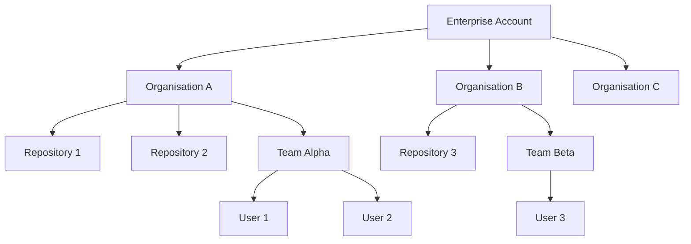
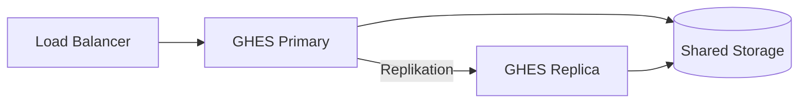
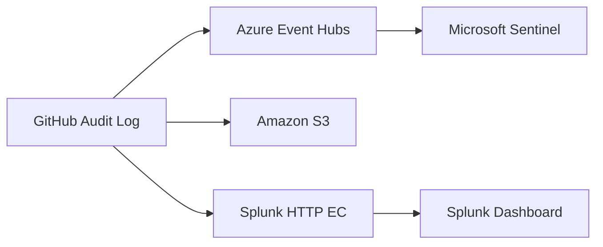
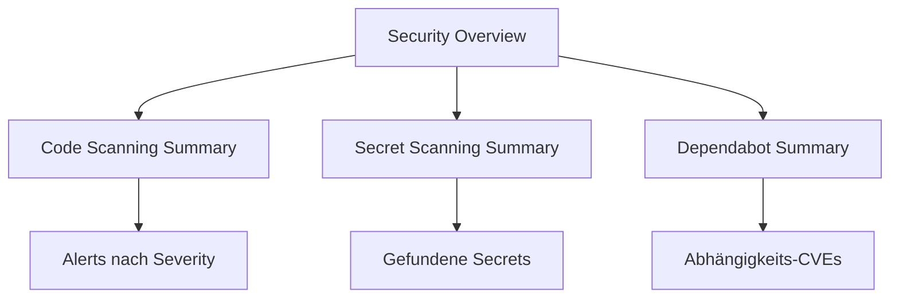

# GitHub Enterprise

> [!ABSTRACT]
> GitHub Enterprise ist die unternehmensweite Lizenzierung von GitHub für große Organisationen. Sie umfasst GitHub Enterprise Cloud (GHEC, SaaS auf GitHub.com) und GitHub Enterprise Server (GHES, On-Premises). Beide Varianten bieten erweiterte Sicherheits-, Compliance- und Verwaltungsfunktionen, die über die Standard-GitHub-Pläne hinausgehen.

---

## Was ist GitHub Enterprise?

GitHub Enterprise ist ein Lizenzmodell für Unternehmen, das erweiterte Features für Sicherheit, Compliance, Benutzerverwaltung und organisationsübergreifende Steuerung bereitstellt. Es richtet sich an Organisationen mit hohen Anforderungen an:

- **Datenschutz und Compliance** (SOC 2, ISO 27001, DSGVO, FedRAMP)
- **Zentralisierte Benutzerverwaltung** (SSO, SCIM, EMU)
- **Unternehmensweite Richtlinien** (Policies über mehrere Organisationen hinweg)
- **Erweiterte Sicherheits-Features** (GitHub Advanced Security, Secret Scanning, Code Scanning)

GitHub Enterprise existiert in zwei Ausführungen:

| Variante | Kurzname | Betriebsmodell |
|---|---|---|
| GitHub Enterprise Cloud | GHEC | SaaS auf github.com |
| GitHub Enterprise Server | GHES | On-Premises / Private Cloud |

> [!NOTE]
> Seit 2023 können GHEC und GHES unter einem einzigen **Enterprise Account** verwaltet werden. Lizenzen sind zwischen GHEC und GHES portierbar (Unified Billing).

---

## Enterprise Account

Der Enterprise Account ist die oberste Verwaltungsebene in GitHub Enterprise. Er ermöglicht es, mehrere GitHub-Organisationen zentral zu steuern.

### Hierarchie



### Enterprise Owner vs. Organization Owner

| Rolle | Bereich | Berechtigungen |
|---|---|---|
| Enterprise Owner | Enterprise Account | Policies, Billing, alle Orgs, Audit Log |
| Organization Owner | Einzelne Org | Mitglieder, Repos, Teams, Org-Settings |
| Billing Manager | Enterprise Account | Nur Rechnungs- und Lizenzverwaltung |

### Verwaltbare Einstellungen im Enterprise Account

- **Policies**: Org-übergreifende Regeln erzwingen (z. B. Repository-Sichtbarkeit, Forking, Actions)
- **Audit Log**: Alle Events über alle Orgs einsehen und exportieren
- **Billing**: Unified Billing für alle Orgs und Produkte (Actions, Packages, Copilot)
- **Security**: GHAS auf Enterprise-Ebene aktivieren, Security Overview
- **Identity**: SAML SSO, SCIM, EMU-Konfiguration

---

## GitHub Enterprise Cloud (GHEC)

GHEC ist die SaaS-Variante von GitHub Enterprise auf `github.com`. Alle Daten liegen in der GitHub-Cloud (Microsoft Azure).

### Kernfeatures

- **99,9 % SLA** für GitHub.com (monatlich gemessen)
- **GitHub Advanced Security (GHAS)**: Code Scanning, Secret Scanning, Dependabot (Add-on-Lizenz)
- **SAML SSO + SCIM**: Identity Provider Integration
- **EMU (Enterprise Managed Users)**: Vollständig verwaltete Benutzerkonten
- **IP Allow Lists**: Zugriffsbeschränkung auf definierte IP-Ranges
- **Audit Log Streaming**: Export zu Splunk, Azure Event Hubs, Amazon S3, Datadog
- **GitHub Connect**: Verbindung zu GHES-Instanzen
- **Data Residency (2024)**: EU-Datenresidenz für ausgewählte Kunden (github.eu)

### Kosten GHEC

| Produkt | Preis |
|---|---|
| GitHub Enterprise Cloud | $21 / User / Monat |
| GitHub Advanced Security | $49 / aktiver Committer / Monat |
| GitHub Copilot Enterprise | $39 / User / Monat |
| Actions (inkludiert) | 50.000 Min / Monat inklusive |
| Packages Storage (inkludiert) | 50 GB inklusive |

> [!TIP]
> Bei Microsoft-Enterprise-Agreements (EA) kann GitHub Enterprise über Microsoft bezogen werden — oft mit Rabatten durch bestehende Microsoft-Verträge.

---

## GitHub Enterprise Server (GHES)

GHES ist die selbst gehostete Variante von GitHub Enterprise. Unternehmen betreiben die GitHub-Infrastruktur auf eigener Hardware oder in einer privaten Cloud.

### Aktuelle Version: GHES 3.13 (2024)

Neue Features in GHES 3.13:
- Verbesserte Code Scanning Auto-Fix (AI-basiert)
- Copilot Enterprise Support für GHES (via GitHub Connect)
- Verbesserte SCIM-Unterstützung
- Custom Properties für Repositories
- Verbesserte Audit Log Streaming Performance

### Unterstützte Plattformen

| Plattform | Typ |
|---|---|
| VMware ESXi | Hypervisor (OVA) |
| Hyper-V | Hypervisor (VHD) |
| KVM / OpenStack | Hypervisor (QCOW2) |
| Amazon EC2 | Cloud (AMI) |
| Azure VMs | Cloud (VHD) |
| Google Cloud Platform | Cloud (GCE Image) |

### Mindestanforderungen (Produktion)

| Komponente | Minimum | Empfohlen |
|---|---|---|
| vCPUs | 8 | 16–32 |
| RAM | 32 GB | 64–128 GB |
| Datenspeicher | 200 GB | 500 GB+ |
| Root-Speicher | 200 GB | 200 GB |

### Update-Prozess

```bash
# GHES Admin Console (Port 8443) oder CLI
ghe-upgrade /path/to/github-enterprise-<version>.pkg

# Status prüfen
ghe-check-disk-usage
ghe-repl-status  # Für Hochverfügbarkeits-Replikas
```

> [!WARNING]
> GHES-Updates erfordern Wartungsfenster. Immer ein Snapshot/Backup vor dem Update erstellen. Der Upgrade-Pfad muss eingehalten werden (kein Überspringen von Major-Versionen).

### Hochverfügbarkeit (HA)

GHES unterstützt eine aktive/passive Replikations-Architektur:



---

## GHEC vs. GHES — Vergleich

| Kriterium | GHEC | GHES |
|---|---|---|
| **Deployment** | SaaS auf github.com | On-Premises / Private Cloud |
| **Updates** | Automatisch durch GitHub | Manuell durch Admin-Team |
| **Datenhoheit** | Microsoft Azure (US + EU-Option) | Vollständig beim Unternehmen |
| **Compliance** | SOC 2 Typ II, ISO 27001, FedRAMP High | Abhängig von eigener Infrastruktur |
| **SLA** | 99,9 % monatlich | Eigenverantwortlich |
| **GHAS** | Add-on verfügbar | Add-on verfügbar |
| **EMU** | Vollständig unterstützt | Nicht verfügbar (SCIM stattdessen) |
| **IP Allow Lists** | Verfügbar | Über Netzwerk-Firewall |
| **GitHub Connect** | Ziel (Cloud-Seite) | Quelle (verbindet sich zu GHEC) |
| **Kosten** | $21/User/Monat | $21/User/Monat (separat) |
| **Internet-Zugang** | Erforderlich | Optional (Air-Gap möglich) |
| **Skalierung** | Automatisch | Manuelle Skalierung |

---

## SAML SSO mit Entra ID (Azure AD)

Single Sign-On ermöglicht es Benutzern, sich mit ihren Unternehmens-Credentials bei GitHub anzumelden.

### Konfigurationsschritte in Entra ID

| Schritt | Aktion | Wert / Hinweis |
|---|---|---|
| 1 | Enterprise App in Entra ID erstellen | Azure Portal → Enterprise Applications → Neu |
| 2 | App aus Galerie wählen | „GitHub Enterprise Cloud – Organization" |
| 3 | SAML konfigurieren | Single Sign-On → SAML |
| 4 | Entity ID setzen | `https://github.com/orgs/<org>` |
| 5 | Reply URL (ACS) setzen | `https://github.com/orgs/<org>/saml/consume` |
| 6 | Zertifikat herunterladen | Base64-Zertifikat für GitHub |
| 7 | SSO-URL kopieren | Login-URL für GitHub |
| 8 | In GitHub aktivieren | Org Settings → Security → SAML SSO |

### GitHub SAML SSO Konfiguration (Org-Ebene)

```bash
# GitHub Org Settings → Authentication security
# Felder:
# - Sign on URL: https://login.microsoftonline.com/<tenant-id>/saml2
# - Issuer: https://sts.windows.net/<tenant-id>/
# - Public certificate: <Base64-Zertifikat aus Entra ID>
```

> [!IMPORTANT]
> SAML SSO erzwingt, dass alle Org-Mitglieder sich via IdP authentifizieren müssen. Personal Access Tokens (PAT) und SSH Keys müssen nach SAML-Aktivierung autorisiert werden (`SSO authorize`-Button im Token-Bereich).

### Unterstützte Identity Provider

| IdP | Protokoll | SCIM-Support |
|---|---|---|
| Microsoft Entra ID (Azure AD) | SAML 2.0 | Ja (GHEC + GHES) |
| Okta | SAML 2.0 | Ja |
| OneLogin | SAML 2.0 | Ja |
| ADFS (Active Directory) | SAML 2.0 | Begrenzt |
| Ping Identity | SAML 2.0 | Ja |
| JumpCloud | SAML 2.0 | Ja |

---

## SCIM — Automatisierte User-Provisionierung

SCIM (System for Cross-domain Identity Management) ermöglicht die automatische Verwaltung von GitHub-Benutzern basierend auf dem Identity Provider.

### SCIM-Funktionen

- **Automatisches Anlegen**: Neue Mitarbeiter im IdP → GitHub-Org-Mitgliedschaft automatisch
- **Automatisches Deaktivieren**: Mitarbeiter verlässt Unternehmen → GitHub-Zugriff sofort entzogen
- **Gruppen-Synchronisation**: IdP-Gruppen → GitHub-Teams synchronisieren
- **Attribut-Mapping**: E-Mail, Name, Abteilung aus IdP übernehmen

### SCIM mit Entra ID konfigurieren

```yaml
# Entra ID → Enterprise App → Provisioning
Provisioning Mode: Automatic
Tenant URL: https://api.github.com/scim/v2/organizations/<org>
Secret Token: <GitHub SCIM Token>

# Attribute Mappings (Standard)
userName     → emails[primary eq true].value
displayName  → displayName
externalId   → id
```

> [!NOTE]
> SCIM erfordert aktiviertes SAML SSO in der GitHub-Organisation. Das SCIM-Token wird in GitHub unter `Org Settings → Developer Settings → Personal access tokens` erstellt (klassisches PAT mit `admin:org`-Scope).

---

## Enterprise Managed Users (EMU)

EMU ist ein spezieller Enterprise-Modus, bei dem alle Benutzerkonten vollständig vom Identity Provider verwaltet werden.

### EMU vs. Standard Enterprise

| Kriterium | Standard Enterprise (SAML) | Enterprise Managed Users (EMU) |
|---|---|---|
| **Konto-Typ** | Persönliches GitHub-Konto | Dediziertes managed-Konto (`@<prefix>_username`) |
| **Konto-Erstellung** | Benutzer erstellt selbst | Vollständig durch IdP via SCIM |
| **Externe Repos** | Benutzer kann öffentliche Repos nutzen | Stark eingeschränkt (nur Enterprise-Inhalte) |
| **OSS-Beiträge** | Möglich über persönliches Konto | Nicht möglich (separates Privatkonto nötig) |
| **Isolation** | Mittel | Hoch (vollständige Trennung) |
| **Setup-Aufwand** | Mittel | Hoch (initiales Setup) |
| **Empfohlen für** | Allgemeine Unternehmen | Hochsichere Umgebungen, Compliance-intensive Branchen |

> [!IMPORTANT]
> EMU-Enterprise-Accounts können nicht zu Standard-Enterprise konvertiert werden. Die Wahl zwischen EMU und Standard SAML sollte vor der Ersteinrichtung sorgfältig getroffen werden.

### EMU Namenskonvention

Bei EMU haben alle Benutzer einen Präfix: `@<enterprise-slug>_<username>`

Beispiel: Enterprise-Slug `contoso` → Benutzer `@contoso_jsmith`

---

## IP Allow Lists

IP Allow Lists beschränken den Zugriff auf GitHub.com auf definierte IP-Adressen oder CIDR-Bereiche.

```yaml
# Enterprise Account → Settings → IP allow list
# Einträge:
- Name: "Büro Frankfurt"
  IP: 203.0.113.0/24
  
- Name: "VPN Gateway"
  IP: 198.51.100.10/32

- Name: "CI/CD Runner"
  IP: 192.0.2.50/32
```

> [!WARNING]
> IP Allow Lists gelten auch für GitHub Actions-Runner. Self-hosted Runner müssen in der Liste enthalten sein. GitHub-hosted Runner benötigen Ausnahmen oder müssen durch eigene Runner ersetzt werden.

---

## Audit Log

Das Enterprise Audit Log protokolliert alle sicherheitsrelevanten Aktionen in allen Organisationen.

### Audit Log Kategorien

| Kategorie | Beispiel-Events |
|---|---|
| `repo` | Repository erstellt, gelöscht, Sichtbarkeit geändert |
| `org` | Mitglied hinzugefügt/entfernt, Org-Settings geändert |
| `team` | Team erstellt, Mitglied hinzugefügt |
| `user` | Login, 2FA geändert, PAT erstellt |
| `business` | Enterprise Policy geändert |
| `workflows` | Action-Workflow ausgeführt |
| `secret_scanning` | Secret gefunden, Alert erstellt |

### Audit Log API-Abfrage

```bash
curl -H "Authorization: Bearer <token>" \
  "https://api.github.com/enterprises/<enterprise>/audit-log?phrase=action:repo.create&per_page=100"
```

### Audit Log Streaming

Echtzeit-Streaming zu externen SIEM-Systemen:



---

## Enterprise Policies

Enterprise Policies erzwingen Einstellungen über alle Organisationen im Enterprise Account hinweg.

### Wichtige Policy-Bereiche

| Policy | Optionen | Empfehlung |
|---|---|---|
| Repository-Sichtbarkeit | Alle erlaubt / Nur privat / Nur intern | Nur intern/privat für Unternehmen |
| Forking | Erlaubt / Verboten / Nur private Repos | Verboten für sensible Codebases |
| GitHub Actions | Alle Aktionen / Nur verifizierte / Keine | Nur verifizierte Actions |
| Copilot-Zugriff | Alle Orgs / Ausgewählte Orgs / Keine | Ausgewählte Orgs |
| Base Permissions | None / Read / Write / Admin | Read (Least Privilege) |
| 2FA-Pflicht | Ja / Nein | Immer Ja |

---

## GitHub Advanced Security (Enterprise)

Auf Enterprise-Ebene kann GHAS für alle Organisationen und Repositories aktiviert werden.

### Security Overview

Die Enterprise Security Overview bietet:
- Zusammenfassung aller Code-Scanning-Alerts über alle Orgs
- Secret-Scanning-Status und kritische Funde
- Dependabot-Alerts nach Schweregrad
- Trend-Analysen über Zeit



### GHAS auf Enterprise aktivieren

```bash
# Via API: GHAS für alle Repos einer Org aktivieren
curl -X PATCH \
  -H "Authorization: Bearer <token>" \
  -H "Accept: application/vnd.github+json" \
  "https://api.github.com/orgs/<org>" \
  -d '{"advanced_security_enabled_for_new_repositories": true}'
```

---

## GitHub Connect

GitHub Connect verbindet eine GHES-Instanz mit einem GHEC Enterprise Account.

### Verfügbare Features über GitHub Connect

| Feature | Beschreibung |
|---|---|
| **Unified Search** | GitHub.com-Repositories in GHES-Suche einbeziehen |
| **Unified Contributions** | GHES-Commits im github.com-Contribution-Graph anzeigen |
| **Server Statistics** | GHES-Nutzungsdaten an GitHub senden (opt-in) |
| **GitHub.com Actions** | Marketplace-Actions in GHES nutzen |
| **Dependabot Updates** | GHES nutzt GitHub.com-Advisories-Datenbank |
| **Copilot** | Copilot für GHES-Nutzer über GHEC-Lizenz |

> [!NOTE]
> GitHub Connect erfordert, dass die GHES-Instanz ausgehenden HTTPS-Zugriff auf `github.com` hat. In Air-Gap-Umgebungen ist GitHub Connect nicht verfügbar.

---

## GitHub Enterprise Importer — Migrationen

Der GitHub Enterprise Importer (GEI) ermöglicht die Migration von Repositories, Issues, Pull Requests und History zu GHEC oder GHES.

### Unterstützte Quellen

| Quelle | Migrationspfad | Tool |
|---|---|---|
| GitHub Enterprise Server | GHES → GHEC | GEI CLI |
| Azure DevOps | ADO → GHEC | GEI CLI |
| Bitbucket Server / DC | Bitbucket → GHEC | GEI CLI |
| GitLab (SaaS/Self-hosted) | GitLab → GHEC | GEI CLI |
| GitHub.com Orgs | Org → Org | GEI CLI |

### Migrationsprozess


### GEI CLI — Beispiel ADO Migration

```bash
# GEI CLI installieren
gh extension install github/gh-gei

# Azure DevOps Migration
gh gei migrate-repo \
  --ado-pat <ADO_PAT> \
  --ado-org <ADO_ORG> \
  --ado-repo <ADO_REPO> \
  --github-pat <GITHUB_PAT> \
  --github-org <GITHUB_ORG> \
  --github-repo <GITHUB_REPO>

# Status prüfen
gh gei wait-for-migration --migration-id <ID>
```

> [!IMPORTANT]
> Vor einer Enterprise-Migration sollte immer eine **Testmigration** in einer Nicht-Produktions-Umgebung durchgeführt werden. Wiki-Inhalte, Large File Storage (LFS) und CI/CD-Pipelines müssen separat migriert werden.

---

## GitHub für MSPs und Partner

### GitHub Partner Program

- **GitHub Reseller**: Lizenzverkauf an Endkunden über Microsoft/GitHub-Vertriebspartner
- **GitHub ISV (Independent Software Vendor)**: Integration von GitHub in eigene Produkte
- **GitHub Technology Partner**: Marketplace-App-Entwicklung, GitHub Apps und Actions

### MSP-Verwaltung mehrerer Enterprise Accounts

```yaml
# Empfohlene Struktur für MSPs
Enterprise Account A: Kunde Alpha GmbH
  - Org: alpha-development
  - Org: alpha-infra

Enterprise Account B: Kunde Beta AG  
  - Org: beta-software
  - Org: beta-security
```

> [!TIP]
> MSPs können eigene **GitHub Apps** entwickeln, die Multi-Org-Installationen unterstützen und so Verwaltungsaufgaben über mehrere Kundenmandanten automatisieren.

---

## Kosten-Übersicht

| Produkt | Preis | Enthalten |
|---|---|---|
| GitHub Enterprise Cloud | $21/User/Monat | Actions 50k Min, Packages 50 GB, Codespaces |
| GitHub Enterprise Server | $21/User/Monat | On-Prem-Lizenz, kein Cloud-Speicher |
| GitHub Advanced Security | $49/aktiver Committer/Monat | Code Scanning, Secret Scanning, Dependabot |
| GitHub Copilot Business | $19/User/Monat | IDE + CLI Copilot |
| GitHub Copilot Enterprise | $39/User/Monat | + Copilot Chat im Browser, PR Summaries |
| Actions (zusätzlich) | $0,008/Min (Linux) | Ab 50k Min inkl. |
| Packages Storage (zusätzlich) | $0,25/GB/Monat | Ab 50 GB inkl. |

> [!NOTE]
> Durch das **Microsoft Enterprise Agreement (EA)** können GitHub Enterprise-Lizenzen oft günstiger und gebündelt mit anderen Microsoft-Produkten erworben werden. GitHub ist seit 2018 Teil von Microsoft.

---

## Verwandte Notizen

- [[GitHub Grundlagen]]
- [[GitHub Advanced Security]]
- [[GitHub Copilot]]
- [[Azure DevOps]]
