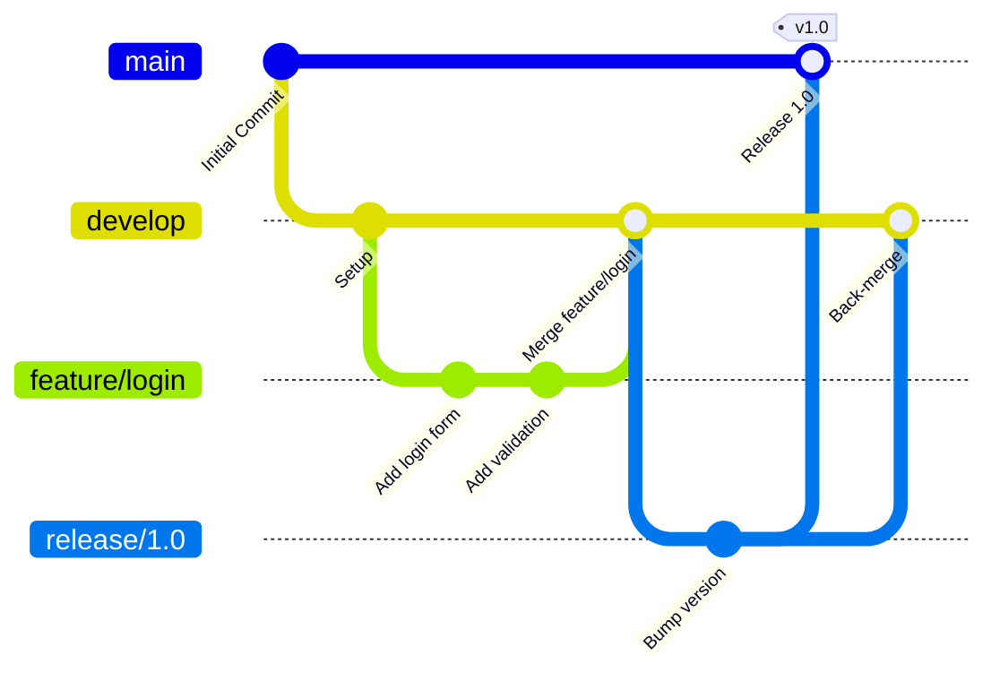
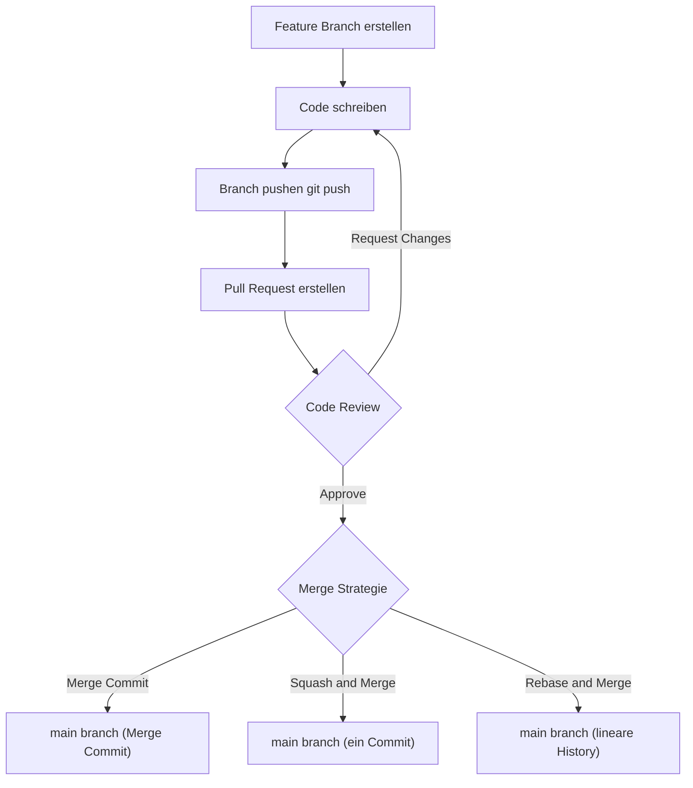
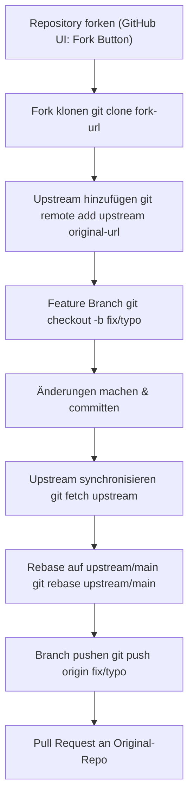

# GitHub Grundlagen

> [!ABSTRACT]
> GitHub ist die weltweit führende webbasierte Plattform für Git-Versionskontrolle und Softwareentwicklungs-Kollaboration. Sie kombiniert das verteilte Versionskontrollsystem Git mit Cloud-Hosting, Code-Review-Workflows, CI/CD-Pipelines (GitHub Actions), Issue-Tracking und Community-Features für Open Source wie kommerzielle Projekte.

---

## Was ist GitHub?

GitHub ist seit 2018 ein Microsoft-Tochterunternehmen und hostet über 330 Millionen Repositories von mehr als 100 Millionen Entwicklern weltweit. Die Plattform bietet:

- **Git-Repository-Hosting** — Öffentlich oder privat, unbegrenzte Repositories
- **Kollaborations-Features** — Pull Requests, Code Review, Issues, Discussions
- **CI/CD** — GitHub Actions für Automatisierung und Deployment
- **Sicherheit** — Dependabot, Secret Scanning, Code Scanning, GHAS
- **Entwicklertools** — GitHub CLI, GitHub Desktop, Codespaces, Copilot
- **Community** — Stars, Forks, Sponsors, Wikis, GitHub Pages

---

## Git vs. GitHub

| Aspekt | Git | GitHub |
|---|---|---|
| **Art** | Lokales DVCS-Tool (CLI) | Cloud-Hosting-Plattform |
| **Erfinder** | Linus Torvalds (2005) | Tom Preston-Werner u.a. (2008) |
| **Betrieb** | Lokal auf dem Rechner | SaaS (Software as a Service) |
| **Kollaboration** | Nicht eingebaut | Kernfeature (PRs, Reviews, Issues) |
| **CI/CD** | Kein integriertes CI/CD | GitHub Actions |
| **Oberfläche** | Terminal (git CLI) | Web-UI, CLI (gh), Desktop |
| **Alternativen** | Mercurial, SVN, Perforce | GitLab, Bitbucket, Gitea |
| **Kosten** | Komplett kostenlos | Free, Team (4 $/User/Mo), Enterprise |

> [!NOTE]
> Git ist das Werkzeug, GitHub ist die Plattform. Man kann Git ohne GitHub nutzen (z.B. mit GitLab oder einem eigenen Server) — aber GitHub ohne Git gibt es nicht.

---

## Repositories

### Repository erstellen und klonen

```bash
# Neues Repository auf GitHub erstellen (via gh CLI)
gh repo create mein-projekt --public --description "Mein erstes Projekt"

# Repository klonen
git clone https://github.com/username/mein-projekt.git
cd mein-projekt

# Oder via SSH (empfohlen für regelmäßige Nutzung)
git clone git@github.com:username/mein-projekt.git

# Lokales Verzeichnis mit GitHub verbinden
git init
git remote add origin git@github.com:username/mein-projekt.git
git branch -M main
git push -u origin main
```

### Öffentlich vs. Privat

| Eigenschaft | Öffentliches Repository | Privates Repository |
|---|---|---|
| **Sichtbarkeit** | Jeder kann lesen | Nur eingeladene Collaborators |
| **Forkbar** | Ja, jeder | Nein (außer in Organisationen) |
| **GitHub Pages** | Kostenlos verfügbar | Nur mit GitHub Pro/Team |
| **Kosten** | Kostenlos | Kostenlos (unbegrenzt mit Free Plan) |
| **Anwendungsfall** | Open Source, Portfolios | Unternehmens-Code, private Projekte |

### Fork vs. Clone

- **Clone**: Erstellt eine lokale Kopie — Änderungen können direkt gepusht werden (wenn Berechtigung vorhanden)
- **Fork**: Erstellt eine eigene GitHub-Kopie des Repositories — typisch für Open Source Contributions ohne direkten Schreibzugriff

---

## Branches und Branching-Strategien

### Git Flow



### GitHub Flow

```mermaid
gitGraph
   commit id: "main"
   branch feature/add-search
   checkout feature/add-search
   commit id: "Add search UI"
   commit id: "Add search API"
   commit id: "Tests"
   checkout main
   merge feature/add-search id: "Merge via PR" tag: "Deploy"
   branch feature/dark-mode
   checkout feature/dark-mode
   commit id: "Dark mode CSS"
   checkout main
   merge feature/dark-mode id: "Merge via PR"
```

### Vergleich der Branching-Strategien

| Kriterium | Git Flow | GitHub Flow | Trunk-Based Development |
|---|---|---|---|
| **Komplexität** | Hoch (5+ Branch-Typen) | Niedrig (main + feature) | Sehr niedrig (nur main) |
| **Release-Zyklen** | Geplante Releases | Kontinuierliche Deploys | Kontinuierliche Integration |
| **Team-Größe** | Mittel bis groß | Klein bis mittel | Klein bis sehr groß |
| **Feature Flags** | Nicht erforderlich | Optional | Oft notwendig |
| **CI/CD** | Komplexer | Einfach | Vollständig integriert |
| **Hotfixes** | Eigener hotfix/ Branch | Direkt auf main via PR | Direkt auf trunk |
| **Geeignet für** | Software mit Versionierung | Web-Apps, APIs | SaaS, Google/Meta-Scale |
| **Long-Lived Branches** | develop, release | Keine | Keine |

> [!TIP]
> Für die meisten Teams ist **GitHub Flow** der ideale Einstieg: Einfach, direkt und erzwingt regelmäßige Integration. Git Flow eignet sich für Software mit klaren Release-Zyklen (Desktop-Apps, Bibliotheken).

---

## Commits und Commit-Messages

### Conventional Commits

Conventional Commits ist ein Standard für strukturierte Commit-Messages:

```
<type>[optional scope]: <description>

[optional body]

[optional footer(s)]
```

| Typ | Bedeutung | Beispiel |
|---|---|---|
| `feat` | Neues Feature | `feat(auth): add OAuth2 login` |
| `fix` | Bugfix | `fix(api): handle null response from server` |
| `docs` | Dokumentationsänderung | `docs: update README installation steps` |
| `style` | Formatierung, kein Logik-Change | `style: format code with prettier` |
| `refactor` | Refactoring ohne Bugfix/Feature | `refactor(db): extract query builder` |
| `test` | Tests hinzufügen oder anpassen | `test: add unit tests for UserService` |
| `chore` | Build, Dependencies, CI | `chore: update dependencies to latest` |
| `perf` | Performance-Verbesserung | `perf(images): lazy load product images` |
| `ci` | CI/CD Konfigurationsänderung | `ci: add deployment workflow` |
| `build` | Build-System-Änderungen | `build: migrate to webpack 5` |
| `revert` | Commit rückgängig machen | `revert: feat(auth): add OAuth2 login` |

```bash
# Gute Commit-Praxis
git add src/auth/login.py
git commit -m "feat(auth): add OAuth2 Google login

Implements Google OAuth2 authentication flow.
Users can now sign in with their Google account.

Closes #42"

# Breaking Change kennzeichnen
git commit -m "feat!: remove deprecated API endpoints

BREAKING CHANGE: /api/v1/users endpoint removed.
Use /api/v2/users instead."
```

> [!IMPORTANT]
> **Atomic Commits**: Jeder Commit sollte genau eine logische Änderung enthalten. Das erleichtert Code Review, Git Bisect und Revert-Operationen enorm. "One commit per feature/fix" ist ein guter Grundsatz.

---

## Pull Requests

### PR-Workflow



### Draft Pull Requests

```bash
# Draft PR erstellen (noch nicht bereit für Review)
gh pr create --draft --title "WIP: Add payment integration" \
  --body "Work in progress — nicht mergen!"

# Draft in regulären PR umwandeln
gh pr ready <pr-number>
```

### Merge-Strategien im Vergleich

| Strategie | History | Wann nutzen |
|---|---|---|
| **Merge Commit** | Bewahrt vollständige Branch-History | Große Features, nachvollziehbare History |
| **Squash and Merge** | Alle Commits → ein Commit auf main | Viele WIP-Commits, saubere History |
| **Rebase and Merge** | Lineare History, keine Merge-Commits | Teams die lineare History bevorzugen |

```bash
# Lokaler Rebase vor PR (saubere Basis)
git fetch origin
git rebase origin/main

# PR via GitHub CLI erstellen
gh pr create \
  --title "feat: add dark mode support" \
  --body "Implements dark mode using CSS variables. Closes #99" \
  --reviewer colleague1,colleague2 \
  --label "enhancement"
```

---

## Issues

### Issue-Verwaltung

```bash
# Issue erstellen
gh issue create \
  --title "Bug: Login schlägt bei Sonderzeichen fehl" \
  --body "Beim Login mit @ im Passwort wird HTTP 500 zurückgegeben." \
  --label "bug,priority:high" \
  --assignee "@me"

# Issues auflisten
gh issue list --state open --label "bug"

# Issue schließen
gh issue close 42 --comment "Behoben in PR #99"
```

### Issue Templates

Erstelle `.github/ISSUE_TEMPLATE/bug_report.yml`:

```yaml
name: Bug Report
description: Einen Bug melden
title: "[Bug]: "
labels: ["bug", "triage"]
body:
  - type: markdown
    attributes:
      value: "Danke für deinen Bug-Report!"
  - type: input
    id: version
    attributes:
      label: Version
      placeholder: "z.B. v1.2.3"
    validations:
      required: true
  - type: textarea
    id: description
    attributes:
      label: Beschreibung
      description: Was ist passiert?
    validations:
      required: true
  - type: textarea
    id: steps
    attributes:
      label: Reproduktionsschritte
      placeholder: |
        1. Öffne...
        2. Klicke auf...
        3. Fehler erscheint
```

### Issues über Commits schließen

```bash
# Im Commit-Message oder PR-Description:
git commit -m "fix(auth): handle special chars in password

Fixes #42
Closes #43
Resolves #44"
```

Schlüsselwörter: `fixes`, `closes`, `resolves` (+ `#<nummer>`)

---

## Projects

GitHub Projects ist das integrierte Projektmanagement-Tool:

- **Tabellen-Ansicht** — Spreadsheet-ähnlich, anpassbare Felder
- **Kanban-Board** — Drag-and-Drop Spalten (Todo, In Progress, Done)
- **Roadmap-Ansicht** — Zeitlinien-Darstellung für Issues und PRs
- **Workflows** — Automationen (z.B. "Issue closed → move to Done")

```bash
# Project-Item erstellen via CLI
gh project item-add <project-number> \
  --owner "@me" \
  --url "https://github.com/user/repo/issues/42"
```

---

## GitHub Search

### Suchsyntax

| Suchoperator | Beschreibung | Beispiel |
|---|---|---|
| `repo:` | In bestimmtem Repository suchen | `repo:microsoft/vscode bug` |
| `org:` | In Organisation suchen | `org:github security` |
| `language:` | Nach Programmiersprache filtern | `authentication language:python` |
| `is:` | Status filtern | `is:open is:pr review:required` |
| `in:` | Suchbereich einschränken | `login in:title` |
| `author:` | Nach Autor filtern | `author:torvalds` |
| `created:` | Nach Erstelldatum filtern | `created:>2024-01-01` |
| `stars:` | Nach Sternanzahl filtern | `machine learning stars:>1000` |
| `NOT` | Ausschließen | `react NOT angular` |

```bash
# GitHub CLI Suche
gh search repos "machine learning" --language python --stars ">500"
gh search issues "login bug" --repo microsoft/vscode --state open
gh search prs --review-requested "@me" --state open
```

---

## .gitignore

```bash
# .gitignore für Python-Projekt
# Automatisch generieren mit gitignore.io
curl -sL https://www.toptal.com/developers/gitignore/api/python,vscode > .gitignore

# Globale gitignore für alle Repositories
git config --global core.excludesfile ~/.gitignore_global

# Bereits getrackede Datei aus Tracking entfernen
git rm --cached secret.env
echo "secret.env" >> .gitignore
git commit -m "chore: remove secret.env from tracking"
```

Typischer `.gitignore` Inhalt:

```
# Python
__pycache__/
*.pyc
*.pyo
.venv/
.env

# IDE
.vscode/
.idea/
*.swp

# OS
.DS_Store
Thumbs.db

# Build
dist/
build/
*.egg-info/

# Secrets
*.env
*.key
config/local.py
```

> [!DANGER]
> Secrets (API-Keys, Passwörter, Zertifikate) gehören nie in Git-Repositories — auch nicht in private. GitHub Secret Scanning erkennt bekannte Secret-Formate automatisch und warnt. Nutze Azure Key Vault, GitHub Secrets oder `.env` + `.gitignore`.

---

## GitHub CLI (gh)

Die GitHub CLI ermöglicht vollständige GitHub-Verwaltung aus dem Terminal:

```bash
# Installation (Ubuntu/Debian)
sudo apt install gh

# Authentifizierung
gh auth login

# Repository-Operationen
gh repo create mein-repo --public
gh repo clone username/repo
gh repo view --web                    # Im Browser öffnen

# Pull Request Workflow
gh pr create --fill                   # PR aus aktuellem Branch
gh pr list --state open
gh pr view 42
gh pr checkout 42                     # Branch wechseln zu PR
gh pr review 42 --approve
gh pr merge 42 --squash --delete-branch

# Issue-Management
gh issue create --title "Bug: ..." --label bug
gh issue list --assignee "@me"
gh issue view 42
gh issue close 42

# Workflow/Actions
gh workflow list
gh workflow run deploy.yml
gh run list --limit 5
gh run view 123456

# Releases
gh release create v1.0.0 --title "Version 1.0" --notes "First stable release"
gh release list

# Gist
gh gist create script.sh --public --description "Nützliches Script"
```

> [!TIP]
> `gh alias` ermöglicht eigene Shortcuts: `gh alias set prc 'pr create --fill'` → danach `gh prc` aufrufen. Mit `gh extension install` können Community-Extensions nachinstalliert werden.

---

## GitHub Desktop

GitHub Desktop ist der offizielle GUI-Client für Git/GitHub:

- **Visuelles Diff-Anzeige** — Zeilenweise Änderungen
- **Konflikt-Auflösung** — Guided Merge Conflict Resolution
- **Branch-Verwaltung** — Erstellen, wechseln, löschen
- **History-Ansicht** — Vollständige Commit-History mit Details
- **Co-Authors** — Pair-Programming Commits mit mehreren Autoren

---

## Forks und Open Source Contribution

### Contribution Workflow



```bash
# Vollständiger Fork-Workflow
# 1. Fork auf GitHub erstellen (UI oder gh CLI)
gh repo fork microsoft/vscode --clone

# 2. Upstream Remote hinzufügen
git remote add upstream https://github.com/microsoft/vscode.git
git remote -v

# 3. Feature Branch erstellen
git checkout -b fix/docs-typo

# 4. Änderungen vornehmen und committen
git add docs/README.md
git commit -m "docs: fix typo in README"

# 5. Upstream-Änderungen holen und rebasen
git fetch upstream
git rebase upstream/main

# 6. Eigenen Fork pushen
git push origin fix/docs-typo

# 7. Pull Request erstellen
gh pr create \
  --repo microsoft/vscode \
  --title "docs: fix typo in README" \
  --body "Corrects typo in the installation section."
```

---

## Wikis und Discussions

### Wikis

Wikis bieten strukturierte Dokumentation direkt im Repository:

```bash
# Wiki klonen und bearbeiten
git clone https://github.com/username/repo.wiki.git
cd repo.wiki
# Markdown-Dateien bearbeiten
git add .
git commit -m "Add architecture documentation"
git push
```

### Discussions

Discussions sind das Community-Forum innerhalb eines Repositories:

| Kategorie | Verwendungszweck |
|---|---|
| **Announcements** | Projekt-Neuigkeiten, Release-Notes |
| **Q&A** | Fragen und Antworten (mit markierbarer Lösung) |
| **Ideas** | Feature-Vorschläge und RFCs |
| **Show and tell** | Showcase von Projekten mit dem Tool |
| **General** | Allgemeine Diskussionen |

---

## GitHub Sponsors

GitHub Sponsors ermöglicht Entwicklern und Organisationen, Open Source Maintainer direkt zu finanzieren:

- **Individuelle Sponsoring-Tiers** — Monatliche Beträge mit optionalen Vorteilen
- **Einmalige Spenden** — Ohne laufende Verpflichtung
- **Organisationssponsoring** — Unternehmen können OS-Abhängigkeiten sponsern
- **GitHub Matching** — GitHub verdoppelt Sponsorings (bis zu Limit) im ersten Jahr
- **Keine Plattformgebühren** — 100% des Betrags geht an den Maintainer

> [!NOTE]
> Über 20.000 Entwickler nutzen GitHub Sponsors. Für nachhaltige Open Source Projekte empfiehlt es sich, eine `FUNDING.yml` im `.github/`-Verzeichnis anzulegen, die auf Sponsoring-Profile verweist.

---

## Best Practices Zusammenfassung

> [!IMPORTANT]
> **Branch-Schutzregeln setzen**: In Repository Settings → Branches → Branch protection rules. Empfohlen: Required PR before merging, Require status checks, Require conversation resolution, Restrict force pushes.

> [!TIP]
> **CODEOWNERS Datei**: Erstelle `.github/CODEOWNERS` um automatische Review-Anfragen bei bestimmten Dateien zu konfigurieren:
> ```
> # Alle Änderungen an docs/ → Doku-Team reviewen
> docs/ @username/docs-team
> # Alle TypeScript-Dateien → Frontend-Team
> *.ts @username/frontend-team
> ```

> [!WARNING]
> **Niemals direkt auf `main` pushen** ohne Code Review in Team-Projekten. Branch-Schutzregeln erzwingen dies technisch und verhindern versehentliche direkte Commits auf den Hauptbranch.

---

## Verwandte Notizen

- [[GitHub Actions]]
- [[GitHub Copilot]]
- [[GitHub Advanced Security]]
- [[GitHub Enterprise]]
