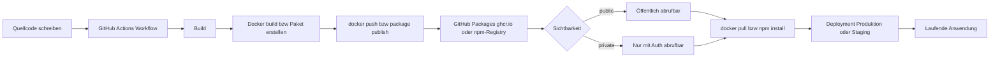

# GitHub Packages

> [!ABSTRACT]
> GitHub Packages ist das integrierte Package-Registry-System von GitHub. Es ermöglicht das Veröffentlichen, Speichern und Verteilen von Software-Paketen und Container-Images direkt neben dem Quellcode — authentifiziert über GitHub-Identitäten und vollständig in GitHub Actions integriert.

---

## Was ist GitHub Packages?

GitHub Packages fungiert als **universelles Package-Registry** innerhalb des GitHub-Ökosystems. Pakete werden direkt einem Repository zugeordnet, profitieren von GitHub-Berechtigungsmodellen und lassen sich nahtlos in CI/CD-Workflows über [[GitHub Actions]] einbinden.

### Kernvorteile

- **Einheitliche Identität** — Authentifizierung mit demselben GitHub-Token, das auch für den Code-Zugriff genutzt wird
- **Code-Paket-Nähe** — Pakete werden direkt neben dem Quellcode im Repository angezeigt
- **Granulare Zugriffssteuerung** — besonders bei `ghcr.io` unabhängig vom Repository
- **Integrierte Actions** — `GITHUB_TOKEN` reicht für Publish-Operationen im Workflow

---

## Unterstützte Package-Typen

| Package-Typ | Registry-URL | Ökosystem | Auth-Methode |
|---|---|---|---|
| **Container (Docker/OCI)** | `ghcr.io` | Docker, Podman, Helm | `GITHUB_TOKEN`, PAT |
| **npm** | `npm.pkg.github.com` | Node.js / JavaScript | `GITHUB_TOKEN`, PAT |
| **Maven** | `maven.pkg.github.com` | Java (Maven) | `GITHUB_TOKEN`, PAT |
| **Gradle** | `maven.pkg.github.com` | Java (Gradle) | `GITHUB_TOKEN`, PAT |
| **NuGet** | `nuget.pkg.github.com` | .NET / C# | `GITHUB_TOKEN`, PAT |
| **RubyGems** | `rubygems.pkg.github.com` | Ruby | `GITHUB_TOKEN`, PAT |
| **Apache Ivy** | `maven.pkg.github.com` | Java (Ivy) | `GITHUB_TOKEN`, PAT |

> [!NOTE]
> **PyPI (Python)** wird von GitHub Packages nicht nativ als Registry unterstützt. Python-Pakete können jedoch als generische Artefakte oder über `ghcr.io` als Container-Image bereitgestellt werden.

---

## Package-Lifecycle



---

## GitHub Container Registry (ghcr.io)

### Features

Die **GitHub Container Registry** (`ghcr.io`) ist die modernste und empfohlene Registry innerhalb von GitHub Packages. Sie wurde 2020 als Ersatz für die ältere `docker.pkg.github.com`-Registry eingeführt und bietet:

- **Separate Zugriffskontrolle** vom Repository — ein Image kann öffentlich sein, während das Repository privat bleibt
- **OCI-Konformität** — unterstützt Docker-Images, OCI-Manifeste und Helm Charts
- **Multi-Arch-Images** — Image-Manifests für mehrere Architekturen (amd64, arm64) möglich
- **Image-Tags und -Digests** — unveränderliche Digest-Referenzierung für Reproduzierbarkeit
- **Paket-Seite auf GitHub** — Jedes Image hat eine GitHub-Seite mit Statistiken, Versionen und Verknüpfungen

### Öffentliche vs. Private Images

| Aspekt | Öffentliches Image | Privates Image |
|---|---|---|
| **Pull ohne Auth** | ✅ Möglich | ❌ Auth erforderlich |
| **Speicherkosten** | Kostenlos | Kostenpflichtig (ab Limit) |
| **Transfer-Kosten** | Kostenlos (1 GB Free) | Kostenpflichtig (ab Limit) |
| **Sichtbarkeit** | Weltweit sichtbar | Nur autorisierte Nutzer |
| **Nutzung** | OSS, öffentliche Tools | Interne Anwendungen |

---

## Authentifizierung

### GITHUB_TOKEN in GitHub Actions

Innerhalb eines GitHub Actions Workflows steht der `GITHUB_TOKEN` automatisch zur Verfügung. Er benötigt lediglich die Berechtigung `packages: write`.

```yaml
permissions:
  contents: read
  packages: write
```

### Personal Access Token (PAT)

Für lokale Entwicklung oder externe Systeme wird ein **Personal Access Token (PAT)** mit den Scopes `read:packages` bzw. `write:packages` benötigt.

```bash
# Docker Login mit PAT (klassisch oder fine-grained)
echo $GITHUB_PAT | docker login ghcr.io \
  --username GITHUB_USERNAME \
  --password-stdin

# npm Login
npm login \
  --registry=https://npm.pkg.github.com \
  --scope=@OWNER
# Bei Aufforderung: PAT als Passwort eingeben
```

> [!WARNING]
> PATs sollten **nie** hartcodiert in Workflows oder Dockerfiles stehen. Nutze immer GitHub Secrets (`${{ secrets.MY_PAT }}`). Für Workflows innerhalb desselben Repositories reicht der `GITHUB_TOKEN` aus — kein PAT nötig.

---

## Docker Image veröffentlichen (ghcr.io)

### Vollständiger GitHub Actions Workflow

```yaml
name: Docker Image bauen und zu ghcr.io pushen

on:
  push:
    branches: [main]
    tags: ['v*.*.*']
  pull_request:
    branches: [main]

env:
  REGISTRY: ghcr.io
  IMAGE_NAME: ${{ github.repository }}

jobs:
  build-and-push:
    runs-on: ubuntu-latest
    permissions:
      contents: read
      packages: write
      attestations: write   # Für Artifact Attestations (optional)
      id-token: write       # Für Sigstore OIDC (optional)

    steps:
      - name: Repository auschecken
        uses: actions/checkout@v4

      - name: Docker Buildx einrichten
        uses: docker/setup-buildx-action@v3

      - name: Bei ghcr.io anmelden
        uses: docker/login-action@v3
        with:
          registry: ${{ env.REGISTRY }}
          username: ${{ github.actor }}
          password: ${{ secrets.GITHUB_TOKEN }}

      - name: Image-Metadaten extrahieren
        id: meta
        uses: docker/metadata-action@v5
        with:
          images: ${{ env.REGISTRY }}/${{ env.IMAGE_NAME }}
          tags: |
            type=ref,event=branch
            type=ref,event=pr
            type=semver,pattern={{version}}
            type=semver,pattern={{major}}.{{minor}}
            type=sha,prefix=sha-,format=short
          labels: |
            org.opencontainers.image.title=Meine Anwendung
            org.opencontainers.image.description=Beispiel-Anwendung
            org.opencontainers.image.vendor=MeineOrg

      - name: Docker Image bauen und pushen
        id: push
        uses: docker/build-push-action@v5
        with:
          context: .
          platforms: linux/amd64,linux/arm64
          push: ${{ github.event_name != 'pull_request' }}
          tags: ${{ steps.meta.outputs.tags }}
          labels: ${{ steps.meta.outputs.labels }}
          cache-from: type=gha
          cache-to: type=gha,mode=max

      - name: Artifact Attestation erstellen
        if: github.event_name != 'pull_request'
        uses: actions/attest-build-provenance@v1
        with:
          subject-name: ${{ env.REGISTRY }}/${{ env.IMAGE_NAME }}
          subject-digest: ${{ steps.push.outputs.digest }}
          push-to-registry: true
```

### Dockerfile-Beispiel

```dockerfile
# Multi-Stage Build für schlankes Produktions-Image
FROM node:20-alpine AS builder
WORKDIR /app
COPY package*.json ./
RUN npm ci --only=production

FROM node:20-alpine AS runtime
WORKDIR /app
COPY --from=builder /app/node_modules ./node_modules
COPY . .
EXPOSE 3000
USER node
CMD ["node", "server.js"]
```

```bash
# Manuell aus der ghcr.io-Registry pullen
docker pull ghcr.io/OWNER/REPO:latest

# Mit spezifischem Digest (unveränderlich)
docker pull ghcr.io/OWNER/REPO@sha256:abc123...
```

---

## Granulare Zugriffssteuerung (ghcr.io)

### Repository-Verknüpfung

Ein Container-Image kann mit einem oder mehreren Repositories verknüpft werden. Dadurch erhalten Nutzer mit Lese-Zugriff auf das Repository automatisch Pull-Zugriff auf das Image.

```bash
# Image mit Repository verknüpfen (GitHub CLI)
gh api \
  --method PUT \
  /user/packages/container/IMAGE_NAME/repositories/REPO_ID

# Verknüpfte Repositories anzeigen
gh api /user/packages/container/IMAGE_NAME/repositories
```

### Berechtigungsebenen

| Berechtigungstyp | Beschreibung | Konfiguration |
|---|---|---|
| **Repository-Vererbung** | Repo-Zugriffsrechte gelten auch fürs Image | Automatisch bei Verknüpfung |
| **User-Permission** | Einzelner Nutzer erhält Zugriff | Package Settings → Manage access |
| **Team-Permission** | Ganzes Team erhält Zugriff | Package Settings → Manage access |
| **Organization** | Alle Org-Mitglieder können pullen | Package Settings → Visibility |

> [!TIP]
> Bei **Organization-Packages** (nicht User-Packages) können Teams mit unterschiedlichen Rollen (`read`, `write`, `admin`) berechtigt werden. Dies ist die empfohlene Methode für Unternehmens-Workflows.

---

## npm Package veröffentlichen

### package.json konfigurieren

```json
{
  "name": "@my-org/my-package",
  "version": "1.0.0",
  "description": "Beispiel npm-Paket für GitHub Packages",
  "main": "index.js",
  "publishConfig": {
    "registry": "https://npm.pkg.github.com"
  },
  "repository": {
    "type": "git",
    "url": "https://github.com/my-org/my-repo.git"
  }
}
```

### .npmrc für Installation

```ini
# .npmrc (für Konsumenten des Pakets)
@my-org:registry=https://npm.pkg.github.com
//npm.pkg.github.com/:_authToken=${GITHUB_TOKEN}
```

### GitHub Actions Workflow (npm publish)

```yaml
name: npm Paket veröffentlichen

on:
  release:
    types: [published]

jobs:
  publish:
    runs-on: ubuntu-latest
    permissions:
      contents: read
      packages: write

    steps:
      - uses: actions/checkout@v4

      - name: Node.js einrichten
        uses: actions/setup-node@v4
        with:
          node-version: '20'
          registry-url: 'https://npm.pkg.github.com'
          scope: '@my-org'

      - name: Abhängigkeiten installieren
        run: npm ci

      - name: Tests ausführen
        run: npm test

      - name: Paket veröffentlichen
        run: npm publish
        env:
          NODE_AUTH_TOKEN: ${{ secrets.GITHUB_TOKEN }}
```

---

## NuGet Package veröffentlichen (.NET)

### .csproj konfigurieren

```xml
<Project Sdk="Microsoft.NET.Sdk">
  <PropertyGroup>
    <TargetFramework>net8.0</TargetFramework>
    <PackageId>MyOrg.MyLibrary</PackageId>
    <Version>1.0.0</Version>
    <Authors>MeineOrg</Authors>
    <Description>Beispiel NuGet-Paket für GitHub Packages</Description>
    <RepositoryUrl>https://github.com/my-org/my-repo</RepositoryUrl>
    <PackageLicenseExpression>MIT</PackageLicenseExpression>
  </PropertyGroup>
</Project>
```

### GitHub Actions Workflow (NuGet publish)

```yaml
name: NuGet Paket veröffentlichen

on:
  release:
    types: [published]

jobs:
  publish:
    runs-on: ubuntu-latest
    permissions:
      contents: read
      packages: write

    steps:
      - uses: actions/checkout@v4

      - name: .NET SDK einrichten
        uses: actions/setup-dotnet@v4
        with:
          dotnet-version: '8.0.x'
          source-url: https://nuget.pkg.github.com/${{ github.repository_owner }}/index.json
        env:
          NUGET_AUTH_TOKEN: ${{ secrets.GITHUB_TOKEN }}

      - name: Projekt bauen
        run: dotnet build --configuration Release

      - name: Tests ausführen
        run: dotnet test --no-build

      - name: NuGet-Paket erstellen
        run: dotnet pack --configuration Release --no-build --output ./nupkgs

      - name: NuGet-Paket veröffentlichen
        run: dotnet nuget push ./nupkgs/*.nupkg --skip-duplicate
        env:
          NUGET_AUTH_TOKEN: ${{ secrets.GITHUB_TOKEN }}
```

---

## Paket-Versionen und Visibility

### Visibility-Optionen

| Visibility | Beschreibung | Verfügbarkeit |
|---|---|---|
| **public** | Weltweit ohne Auth pullbar | Free, Pro, Teams, Enterprise |
| **private** | Nur autorisierte Nutzer | Pro, Teams, Enterprise |
| **internal** | Alle Org-Mitglieder (Enterprise) | GitHub Enterprise |

### Versionen verwalten

```bash
# Alle Versionen eines Packages auflisten (GitHub CLI)
gh api /user/packages/container/IMAGE_NAME/versions \
  --jq '.[] | {id: .id, name: .name, created_at: .created_at}'

# Specific Version löschen
gh api \
  --method DELETE \
  /user/packages/container/IMAGE_NAME/versions/VERSION_ID
```

---

## Retention und Cleanup

### Ungetaggte Images löschen (Actions Workflow)

```yaml
name: Alte Container Images aufräumen

on:
  schedule:
    - cron: '0 2 * * 0'   # Jeden Sonntag um 02:00 UTC
  workflow_dispatch:

jobs:
  cleanup:
    runs-on: ubuntu-latest
    permissions:
      packages: write

    steps:
      - name: Ungetaggte Images löschen
        uses: actions/delete-package-versions@v5
        with:
          package-name: 'my-image'
          package-type: 'container'
          min-versions-to-keep: 5
          delete-only-untagged-versions: 'true'
          # Alternativ: Versionen älter als X Tage löschen
          # ignore-versions: '^(latest|v\d+\.\d+\.\d+)$'
```

### Manuelle Cleanup-Strategie

```bash
# Alle ungetaggten Versionen eines org-Packages auflisten und löschen
gh api /orgs/MY_ORG/packages/container/IMAGE_NAME/versions \
  --paginate \
  --jq '.[] | select(.metadata.container.tags | length == 0) | .id' \
  | xargs -I {} gh api \
      --method DELETE \
      /orgs/MY_ORG/packages/container/IMAGE_NAME/versions/{}
```

> [!WARNING]
> Das Löschen von Paket-Versionen ist **unwiderruflich**. Stelle sicher, dass keine aktiven Deployments auf die zu löschenden Versionen verweisen. Nutze unveränderliche **Digest-Referenzen** (`@sha256:...`) in Produktions-Deployments statt Tags.

---

## Vergleich: GitHub Packages vs. Azure Container Registry vs. Docker Hub

| Kriterium | GitHub Packages (ghcr.io) | Azure Container Registry | Docker Hub |
|---|---|---|---|
| **Anbieter** | GitHub (Microsoft) | Microsoft Azure | Docker Inc. |
| **Primäre Nutzung** | GitHub-Workflows | Azure-Deployments | Allgemein / OSS |
| **Auth-Integration** | GitHub Token / OIDC | Azure AD / OIDC | Docker Hub Account |
| **CI/CD-Integration** | Nativ in GitHub Actions | Azure DevOps, GitHub Actions | Universell |
| **Geo-Replikation** | ❌ Nein | ✅ Premium-Tier | ❌ Nein |
| **Vulnerability Scanning** | Via Dependabot / GHAS | ✅ Microsoft Defender | ✅ Docker Scout |
| **Privater Speicher (kostenlos)** | 500 MB | Kostenloser Tier begrenzt | 1 privates Repo |
| **Transfer (kostenlos)** | 1 GB / Monat | Kein kostenloses Tier | 1 GB / Monat (Auth) |
| **Helm Chart Support** | ✅ OCI Helm | ✅ Nativ | ✅ OCI Helm |
| **Multi-Arch Images** | ✅ | ✅ | ✅ |
| **Granulare Zugriffssteuerung** | ✅ User/Team/Org | ✅ RBAC via Azure AD | ⚠️ Begrenzt |
| **Image Signing** | ✅ Sigstore / Cosign | ✅ Notary v2 | ✅ Docker Content Trust |
| **Geo-Nähe zu Workloads** | Global (GitHub CDN) | Azure Regions wählbar | Global |
| **Preis-Modell** | Pay-as-you-go ab Limit | Pay-as-you-go (SKU-basiert) | Abo-Modell |

> [!TIP]
> **Empfehlung:** Für reine GitHub-Workflows ist `ghcr.io` die erste Wahl — kein zusätzlicher Service, einheitliche Auth. Für Deployments auf Azure Kubernetes Service (AKS) bietet ACR tiefere Integration (ACR Tasks, AKS Image Pull ohne Secrets). Docker Hub eignet sich primär für öffentliche OSS-Images mit breiter Reichweite.

---

## Kosten und Speicher

### Free-Plan-Limits

| Ressource | GitHub Free / GitHub Pro | GitHub Teams | GitHub Enterprise |
|---|---|---|---|
| **Speicher (öffentliche Pakete)** | Unbegrenzt kostenlos | Unbegrenzt kostenlos | Unbegrenzt kostenlos |
| **Speicher (private Pakete)** | 500 MB inklusive | 2 GB inklusive | 50 GB inklusive |
| **Transfer (privat, ausgehend)** | 1 GB / Monat | 10 GB / Monat | 100 GB / Monat |
| **Transfer (öffentlich)** | Unbegrenzt kostenlos | Unbegrenzt kostenlos | Unbegrenzt kostenlos |

### Pay-as-you-go Preise (2024/2025)

```
Speicher:        $0.008 USD pro GB / Tag (≈ $0.25 USD pro GB / Monat)
Datentransfer:   $0.50 USD pro GB (ausgehend, nach Inklusiv-Kontingent)
```

> [!NOTE]
> Datentransfer **innerhalb von GitHub Actions** (also: Image in einem Workflow pullen, der im selben GitHub-Netzwerk läuft) ist **kostenlos** und zählt nicht gegen das Transfer-Kontingent.

---

## Maven/Gradle Package veröffentlichen (Java)

### settings.xml für Maven

```xml
<!-- ~/.m2/settings.xml oder im Workflow via MAVEN_CONFIG -->
<settings>
  <servers>
    <server>
      <id>github</id>
      <username>${env.GITHUB_ACTOR}</username>
      <password>${env.GITHUB_TOKEN}</password>
    </server>
  </servers>
</settings>
```

### pom.xml Repository konfigurieren

```xml
<distributionManagement>
  <repository>
    <id>github</id>
    <name>GitHub Packages</name>
    <url>https://maven.pkg.github.com/OWNER/REPO</url>
  </repository>
</distributionManagement>
```

### GitHub Actions Workflow (Maven publish)

```yaml
name: Maven Paket veröffentlichen

on:
  release:
    types: [published]

jobs:
  publish:
    runs-on: ubuntu-latest
    permissions:
      contents: read
      packages: write

    steps:
      - uses: actions/checkout@v4

      - name: JDK 21 einrichten
        uses: actions/setup-java@v4
        with:
          java-version: '21'
          distribution: 'temurin'
          server-id: github
          settings-path: ${{ github.workspace }}

      - name: Mit Maven veröffentlichen
        run: mvn --batch-mode deploy -DskipTests
        env:
          GITHUB_TOKEN: ${{ secrets.GITHUB_TOKEN }}
```

---

## Paket mit Repository verknüpfen

Die Verknüpfung eines Packages mit einem Repository aktiviert:
- Anzeige des Packages auf der Repository-Seite
- Vererben von Repository-Berechtigungen
- Direkten Link zur Source-Code-Basis

```bash
# Automatische Verknüpfung: Wenn ein Workflow mit GITHUB_TOKEN veröffentlicht,
# wird das Package automatisch mit dem auslösenden Repository verknüpft.

# Manuelle Verknüpfung (API)
gh api \
  --method PUT \
  -H "Accept: application/vnd.github+json" \
  /repos/OWNER/REPO/actions/permissions \
  -f allowed_actions=all
```

### OCI-Labels für automatische Verknüpfung

```dockerfile
# Diese Labels aktivieren die automatische Verknüpfung mit dem Repository
LABEL org.opencontainers.image.source="https://github.com/OWNER/REPO"
LABEL org.opencontainers.image.description="Meine Anwendung"
LABEL org.opencontainers.image.licenses="MIT"
```

---

## Best Practices

> [!IMPORTANT]
> **Unveränderliche Image-Referenzen in Produktion:** Nutze immer `@sha256:DIGEST` statt Tags wie `:latest` oder `:v1.0` in Produktions-Kubernetes-Manifests oder Docker Compose-Dateien. Tags können überschrieben werden — Digests nie.

```yaml
# Kubernetes Deployment — unsicher (Tag kann sich ändern)
image: ghcr.io/my-org/my-app:latest

# Kubernetes Deployment — sicher (Digest ist unveränderlich)
image: ghcr.io/my-org/my-app:v1.2.3@sha256:a1b2c3d4e5f6...
```

> [!TIP]
> **Layer-Caching in GitHub Actions:** Nutze `cache-from: type=gha` und `cache-to: type=gha,mode=max` im `docker/build-push-action`, um Docker-Layer in GitHub Actions Cache zu speichern. Dies reduziert Build-Zeiten erheblich bei unveränderten Basis-Layern.

```yaml
# Empfohlene Caching-Konfiguration
- uses: docker/build-push-action@v5
  with:
    cache-from: type=gha
    cache-to: type=gha,mode=max
```

---

## Verwandte Notizen

- [[GitHub Actions]]
- [[GitHub Enterprise]]
- [[GitHub Grundlagen]]
