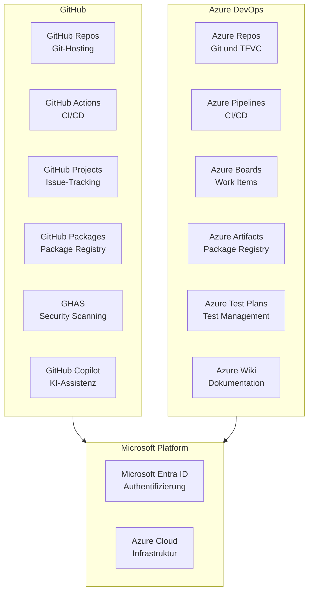

---
tags:
  - github
  - azure-devops
  - vergleich
  - devops
  - migration
aliases:
  - GitHub vs ADO
  - GitHub Azure DevOps
---

# GitHub vs Azure DevOps Vergleich

> [!ABSTRACT]
> Sowohl GitHub als auch Azure DevOps sind Microsoft-Produkte — mit unterschiedlicher Philosophie. GitHub ist die developer-first Plattform für moderne Software-Entwicklung. Azure DevOps ist die vollständige ALM-Plattform mit tiefer Enterprise-Integration. Dieser Vergleich hilft bei der Entscheidung für 2024/2025.

---

## Überblick

Microsoft akquirierte GitHub im Jahr 2018 für 7,5 Milliarden Dollar. Seitdem existieren beide Plattformen parallel — mit zunehmend unterschiedlichen Entwicklungspfaden.

| Aspekt              | GitHub                          | Azure DevOps                          |
|---------------------|---------------------------------|---------------------------------------|
| Gründung            | 2008                            | 2013 (als Visual Studio Online)       |
| Philosophie         | Developer-first, Open-Source    | Enterprise-ALM, vollständige Plattform|
| Primäre Zielgruppe  | Entwickler, Open-Source-Projekte| Enterprise-Teams, Microsoft-Kunden    |
| Strategische Richtung | Primäre Microsoft Dev Platform | Stable / Maintenance Mode             |
| Community           | Größte Dev-Community weltweit   | Enterprise-fokussiert                 |
| Copilot-Integration | Native und tief integriert      | Eingeschränkt / via Azure             |

> [!IMPORTANT]
> Microsoft hat klar kommuniziert: **GitHub ist die primäre Entwicklerplattform** für neue Projekte. Azure DevOps wird weiterhin gepflegt, erhält aber weniger neue Features. Neue Innovationen (KI, Security, Collaboration) erscheinen zuerst in GitHub.

---

## Microsoft DevOps Ecosystem



---

## Pipelines: GitHub Actions vs. Azure Pipelines

### Syntax-Vergleich

| Element               | GitHub Actions                          | Azure Pipelines                         |
|-----------------------|-----------------------------------------|-----------------------------------------|
| Trigger (Push)        | `on: push: branches: [main]`            | `trigger: branches: include: [main]`    |
| PR-Trigger            | `on: pull_request: branches: [main]`    | `pr: branches: include: [main]`         |
| Job-Definition        | `jobs: build: runs-on: ubuntu-latest`   | `pool: vmImage: ubuntu-latest`          |
| Schritt (Script)      | `- run: dotnet build`                   | `- script: dotnet build`                |
| Schritt (Action/Task) | `- uses: actions/checkout@v4`           | `- task: UseDotNet@2`                   |
| Umgebungsvariablen    | `env: MY_VAR: value`                    | `variables: MY_VAR: value`              |
| Secrets               | `${{ secrets.MY_SECRET }}`             | `$(MY_SECRET)`                          |
| Bedingte Ausführung   | `if: github.ref == 'refs/heads/main'`  | `condition: eq(variables['Build.SourceBranch'], 'refs/heads/main')` |
| Artefakt hochladen    | `actions/upload-artifact@v4`            | `PublishBuildArtifacts@1`               |
| Matrix-Build          | `strategy: matrix:`                     | `strategy: matrix:`                     |

### GitHub Actions YAML Beispiel

```yaml
# .github/workflows/build.yml
name: Build and Test

on:
  push:
    branches: [main]
  pull_request:
    branches: [main]

jobs:
  build:
    runs-on: ubuntu-latest

    steps:
      - name: Checkout Code
        uses: actions/checkout@v4

      - name: Setup dotnet
        uses: actions/setup-dotnet@v4
        with:
          dotnet-version: '8.x'

      - name: Restore Dependencies
        run: dotnet restore

      - name: Build
        run: dotnet build --no-restore --configuration Release

      - name: Run Tests
        run: dotnet test --no-build --verbosity normal --configuration Release

      - name: Publish Test Results
        uses: dorny/test-reporter@v1
        if: always()
        with:
          name: Test Results
          path: '**/TestResults/*.trx'
          reporter: dotnet-trx
```

### Azure Pipelines YAML Beispiel

```yaml
# azure-pipelines.yml
trigger:
  branches:
    include:
      - main

pr:
  branches:
    include:
      - main

pool:
  vmImage: 'ubuntu-latest'

variables:
  buildConfiguration: 'Release'

steps:
  - task: UseDotNet@2
    displayName: 'Setup dotnet 8'
    inputs:
      packageType: 'sdk'
      version: '8.x'

  - script: dotnet restore
    displayName: 'Restore Dependencies'

  - script: dotnet build --no-restore --configuration $(buildConfiguration)
    displayName: 'Build'

  - task: DotNetCoreCLI@2
    displayName: 'Run Tests'
    inputs:
      command: 'test'
      arguments: '--no-build --configuration $(buildConfiguration) --logger trx'

  - task: PublishTestResults@2
    displayName: 'Publish Test Results'
    inputs:
      testResultsFormat: 'VSTest'
      testResultsFiles: '**/*.trx'
```

### Stärken und Schwächen im Vergleich

| Kriterium                   | GitHub Actions               | Azure Pipelines              |
|-----------------------------|------------------------------|------------------------------|
| Marketplace / Extensions    | 20.000+ Actions              | Azure DevOps Extensions      |
| YAML-Einfachheit            | Einfach, intuitiv            | Mächtiger, aber komplexer    |
| Wiederverwendbare Templates | Reusable Workflows           | YAML-Templates (mächtiger)   |
| Container-native            | Sehr gut (Docker, Compose)   | Gut                          |
| Azure-Integration           | Gut (via Actions)            | Nativ und tief               |
| Deployment Groups           | Environments                 | Deployment Groups (mächtiger)|
| Release Management          | Environments + Approvals     | Klassische Releases (mächtiger)|
| Self-Hosted                 | Runners (einfache Verwaltung)| Agent Pools (mächtigere Verwaltung)|
| Kosten (Free)               | 2.000 Min/Monat (privat)     | 1.800 Min/Monat (1 paralleler Job)|

> [!NOTE]
> GitHub Actions hat durch den enormen Marketplace einen praktischen Vorteil: Für fast jede Aufgabe existiert eine fertige Action. Azure Pipelines glänzt bei komplexen Enterprise-Deployment-Szenarien mit mehrstufigen Release-Pipelines.

---

## Repositories: GitHub vs. Azure Repos

| Feature                     | GitHub Repositories           | Azure Repos                        |
|-----------------------------|-------------------------------|------------------------------------|
| Versionskontrolle           | Git                           | Git und TFVC                       |
| Größenlimit (Repo)          | 100 GB (empfohlen)            | Unbegrenzt (Azure DevOps Services) |
| Branch-Schutz               | Branch Protection Rules       | Branch Policies                    |
| Required Reviewers          | Ja (CODEOWNERS)               | Ja (Required Reviewers)            |
| Build-Validierung           | Status Checks                 | Build Validation Policies          |
| Code-Review                 | Pull Requests mit Inline-Kommentaren | Pull Requests mit Inline-Kommentaren |
| Security Scanning           | GHAS (CodeQL, Secret Scanning)| Extensions (Mend, Snyk) — kein Built-in|
| Forking Workflow            | Ja (Community-Standard)       | Ja                                 |
| Open-Source-Sichtbarkeit    | Weltweite Community           | Primär intern                      |
| Wikis                       | Ja (GitHub Wiki)              | Ja (Azure Wiki)                    |

> [!TIP]
> Azure Repos ist die einzige Plattform, die noch **TFVC (Team Foundation Version Control)** unterstützt. Für Organisationen mit bestehenden TFVC-Repositories ist Azure Repos die natürliche erste Station vor einer Git-Migration.

---

## Issue-Tracking: GitHub Issues + Projects vs. Azure Boards

### Azure Boards

Azure Boards bietet eine vollständige **Agile ALM**-Lösung mit tiefer Scrum- und Kanban-Unterstützung.

**Work Item Hierarchie (Scrum):**
```
Epic
└── Feature
    └── User Story / Product Backlog Item
        └── Task
        └── Bug
            └── Test Case
```

**Unterstützte Prozessvorlagen:**
- **Scrum** — Product Backlog Items, Sprints, Velocity
- **Agile** — User Stories, Sprints
- **CMMI** — Change Requests, formale Reviews
- **Basic** — Issues, Tasks (einfachstes Modell)

### GitHub Issues + Projects

GitHub Projects hat sich 2023–2024 stark verbessert und bietet nun:

- **Tabellen-View** (wie ein Spreadsheet)
- **Kanban-Board** mit anpassbaren Spalten
- **Roadmap-View** mit Timeline
- **Custom Fields** (Text, Zahl, Datum, Dropdown, Iteration)
- **Automationen** (z.B. Issue geschlossen → Karte archivieren)

### Vergleich: Issue-Tracking

| Feature                  | GitHub Issues + Projects | Azure Boards              |
|--------------------------|--------------------------|---------------------------|
| Kanban                   | Ja                       | Ja                        |
| Scrum / Sprints          | Iterations (vereinfacht) | Vollständig               |
| Work Item Hierarchie     | Nein (nur Issues/Tasks)  | Epic→Feature→Story→Task   |
| Velocity Charts          | Nein                     | Ja                        |
| Burndown Charts          | Nein                     | Ja                        |
| Custom Fields            | Ja (2023+)               | Ja (umfangreich)          |
| Query-Engine             | Filter/Suche             | Leistungsstarke Queries   |
| Backlogs                 | Begrenzt                 | Vollständig               |
| Portfolio-Planung        | Roadmap (begrenzt)       | Portfolio Backlogs        |
| Reporting / Dashboards   | Begrenzt                 | Umfangreich               |

> [!NOTE]
> Für Teams mit strikten Scrum-Anforderungen, komplexer Work-Item-Hierarchie und detailliertem Reporting bleibt **Azure Boards** die bessere Wahl. Für kleinere Teams reicht GitHub Projects mittlerweile oft aus.

---

## Package Management: GitHub Packages vs. Azure Artifacts

| Feature                  | GitHub Packages              | Azure Artifacts                  |
|--------------------------|------------------------------|----------------------------------|
| NuGet                    | Ja                           | Ja                               |
| npm                      | Ja                           | Ja                               |
| Maven / Gradle           | Ja                           | Ja                               |
| Docker / OCI             | Ja                           | Ja                               |
| Python (PyPI)            | Ja                           | Ja                               |
| RubyGems                 | Ja                           | Nein                             |
| Universal Packages       | Nein                         | Ja (einzigartig)                 |
| Upstream Sources         | Eingeschränkt                | Ja (npmjs, NuGet Gallery, etc.)  |
| Speicher (Free)          | 500 MB (GitHub Free)         | 2 GB (Azure DevOps Free)         |
| Preis (Zusatz)           | $0,008 / GB                  | $2 / GB / Monat                  |
| Private Registry         | Ja                           | Ja                               |

> [!NOTE]
> **Universal Packages** (beliebige binäre Dateien als versionierte Pakete) sind eine Azure Artifacts-Exklusivfunktion ohne direktes GitHub-Äquivalent.

---

## Security: GHAS vs. Azure DevOps Security

### GitHub Advanced Security (GHAS)

GHAS ist in GitHub Enterprise Cloud und Server verfügbar (kostenpflichtig zusätzlich) und umfasst:

| Funktion               | Beschreibung                                                   |
|------------------------|----------------------------------------------------------------|
| Code Scanning          | Statische Analyse mit **CodeQL** — erkennt Sicherheitslücken im Code |
| Secret Scanning        | Erkennt committed Secrets (API Keys, Tokens, Passwörter) automatisch |
| Partner Patterns       | 100+ Partner (AWS, Azure, GitHub etc.) für Secret Scanning     |
| Push Protection        | Blockiert Commits mit erkannten Secrets **vor** dem Push       |
| Dependabot Alerts      | Erkennt anfällige Dependencies                                 |
| Dependabot Security    | Erstellt automatische PRs für Security-Fixes                   |
| Dependabot Updates     | Hält alle Dependencies aktuell                                 |
| Supply Chain (SBOM)    | Software Bill of Materials generieren                          |

### Azure DevOps Security

Azure DevOps verfügt über **keine nativen** Security-Scanning-Features vergleichbar mit GHAS:

| Funktion               | Azure DevOps                                           |
|------------------------|--------------------------------------------------------|
| Code Scanning          | Via Extension: **Microsoft Security DevOps** (Bandit, Binskim, Checkov, Terrascan) |
| Secret Scanning        | **Nicht vorhanden** — keine native Funktion            |
| Dependency Scanning    | Via Extension: **Mend (WhiteSource), Snyk, OWASP**     |
| Container Scanning     | Via Extension oder Azure Defender for DevOps           |
| Defender for DevOps    | Microsoft Defender-Integration (kostenpflichtig)       |

> [!WARNING]
> Azure DevOps hat **keine native Secret Scanning Funktionalität**. Secrets, die versehentlich committed werden, bleiben unentdeckt — es sei denn, Drittanbieter-Extensions werden installiert und konfiguriert. Bei Security-Anforderungen ist **GHAS + GitHub** klar im Vorteil.

---

## Test Plans: Azure DevOps vs. GitHub

| Feature                  | Azure Test Plans               | GitHub                          |
|--------------------------|--------------------------------|---------------------------------|
| Manuelle Tests           | Ja (vollständig)               | Nein                            |
| Exploratives Testen      | Ja (Browser Extension)         | Nein                            |
| Test Cases               | Ja                             | Nein                            |
| Test Suites              | Ja                             | Nein                            |
| Test Plans               | Ja                             | Nein                            |
| Automatisierte Tests     | Ja (via Pipelines)             | Ja (via Actions)                |
| Testergebnis-Reporting   | Ja (umfangreich)               | Via Actions (Test-Reporter)     |
| Preis                    | $52 / Nutzer / Monat           | Nicht verfügbar                 |

> [!IMPORTANT]
> Azure DevOps **Test Plans** ist ein Alleinstellungsmerkmal ohne direktes Pendant in GitHub. Teams mit **formalen QA-Prozessen**, manuellen Testzyklen oder Compliance-Anforderungen (z.B. medizinische Software, regulierte Branchen) können Azure DevOps nicht vollständig ersetzen.

---

## Authentifizierung und SSO

| Feature                  | GitHub Enterprise              | Azure DevOps                        |
|--------------------------|--------------------------------|-------------------------------------|
| Microsoft Entra ID (SAML)| Ja                             | Ja (nativ)                          |
| SCIM-Provisioning        | Ja                             | Ja                                  |
| Azure AD Gruppen-Sync    | Ja (Teams via SCIM)            | Ja (direkt)                         |
| Conditional Access       | Ja (via Entra ID)              | Ja (via Entra ID)                   |
| Enterprise Managed Users | Ja (EMU) — Identitäten vollständig durch IdP | Nein (Azure AD direkt) |
| Personal Accounts        | Ja (Standard)                  | Microsoft Account / AAD             |
| SSH / Token Auth         | Ja                             | Ja (PAT, SSH)                       |

**GitHub Enterprise Managed Users (EMU):**
Bei EMU werden Benutzerkonten vollständig durch den Identity Provider (Entra ID) verwaltet. Nutzer haben **kein persönliches GitHub-Konto** — alle Identitäten sind unternehmenskontrolliert. Ideal für stark regulierte Unternehmen.

---

## Großer Feature-Vergleich

| Feature-Bereich            | GitHub                      | Azure DevOps                | Gewinner (aktuell)    |
|----------------------------|-----------------------------|-----------------------------|-----------------------|
| Versionskontrolle (Git)    | Exzellent                   | Sehr gut                    | GitHub                |
| TFVC-Support               | Nein                        | Ja                          | Azure DevOps          |
| Pull Requests              | Exzellent                   | Sehr gut                    | GitHub                |
| Code Review                | Exzellent                   | Sehr gut                    | GitHub                |
| CI/CD (Einfachheit)        | GitHub Actions (sehr einfach)| Azure Pipelines (komplexer) | GitHub                |
| CI/CD (Enterprise)         | Gut (wächst)                | Exzellent                   | Azure DevOps          |
| Issue-Tracking             | Gut (wächst)                | Sehr gut (vollständig)      | Azure DevOps          |
| Scrum / Sprints            | Begrenzt                    | Exzellent                   | Azure DevOps          |
| Package Registry           | Gut                         | Sehr gut (Universal Packages)| Azure DevOps         |
| Container Registry         | Ja (GHCR)                   | Ja (via ACR)                | Gleichwertig          |
| Code Scanning              | CodeQL (native)             | Via Extensions              | GitHub                |
| Secret Scanning            | Ja (native, Push Protection)| Nein                        | GitHub                |
| Dependency Scanning        | Dependabot (native)         | Via Extensions              | GitHub                |
| Test Management (manuell)  | Nein                        | Azure Test Plans (exzellent)| Azure DevOps          |
| Wiki                       | Ja                          | Ja                          | Gleichwertig          |
| Dashboards                 | Begrenzt                    | Umfangreich                 | Azure DevOps          |
| SSO / Entra ID             | Ja                          | Ja (tiefer integriert)      | Azure DevOps (knapp)  |
| KI-Unterstützung           | Copilot (exzellent)         | Begrenzt                    | GitHub                |
| Marketplace                | 20.000+ Actions             | Extensions (weniger)        | GitHub                |
| Open Source Community      | Größte weltweit             | Enterprise-fokussiert       | GitHub                |
| Preis Einstieg             | $0 (Free)                   | $0 (5 Nutzer Free)          | Gleichwertig          |
| Preis Enterprise           | $21 / Nutzer / Monat        | $6 / Nutzer + Add-ons       | Azure DevOps (knapp)  |

---

## Kosten-Vergleich

### GitHub Pläne

| Plan              | Preis                   | Actions-Minuten | Besonderheiten                          |
|-------------------|-------------------------|-----------------|-----------------------------------------|
| Free              | $0                      | 2.000 / Monat   | Public Repos unbegrenzt                 |
| Pro               | $4 / Monat              | 3.000 / Monat   | Pages für private Repos                 |
| Team              | $4 / Nutzer / Monat     | 3.000 / Monat   | Code Owners, Protected Branches         |
| Enterprise Cloud  | $21 / Nutzer / Monat    | 50.000 / Monat  | SAML SSO, EMU, GHAS (extra)             |
| GHAS Add-on       | $49 / Nutzer / Monat    | —               | Code Scanning, Secret Scanning          |

### Azure DevOps Pläne

| Plan              | Preis                      | CI/CD-Minuten       | Besonderheiten                            |
|-------------------|----------------------------|---------------------|-------------------------------------------|
| Free              | $0                         | 1.800 / Monat       | 5 Nutzer (Basic), 1 paralleler Job        |
| Basic             | $6 / Nutzer / Monat        | Inklusive           | Ab dem 6. Nutzer                          |
| Basic + Test Plans| $52 / Nutzer / Monat       | Inklusive           | Vollständige Test Plans Funktionalität    |
| Parallele Jobs    | $40 / zusätzlicher Job     | —                   | Für mehr parallele CI/CD-Ausführungen     |

---

## Migration: Azure DevOps → GitHub

### GitHub Enterprise Importer (GEI)

Der **GitHub Enterprise Importer** ist das offizielle Migrations-Tool von Microsoft/GitHub.

#### Migrations-Checkliste

| Element                    | Migrierbar       | Tool / Methode          | Aufwand      |
|----------------------------|------------------|-------------------------|--------------|
| Git-Repository             | Ja (vollständig) | GEI                     | Gering       |
| Git-History                | Ja (vollständig) | GEI                     | Gering       |
| Pull Request History       | Ja               | GEI                     | Gering       |
| PR-Kommentare              | Ja (meistens)    | GEI                     | Gering       |
| Branch Policies            | Teilweise        | Manuell                 | Mittel       |
| Azure Pipelines            | Nein             | Manuell neu schreiben   | Sehr hoch    |
| Azure Boards Work Items    | Teilweise        | GEI / CSV-Export        | Mittel–Hoch  |
| Work Item Felder           | Begrenzt         | Manuell / Skript        | Hoch         |
| Azure Artifacts            | Nein             | Manuell re-publish      | Mittel       |
| Test Plans / Test Cases    | Nein             | Kein Tool verfügbar     | Sehr hoch    |
| Build-Artefakte (History)  | Nein             | Nicht migrierbar        | —            |
| Service Connections        | Nein             | Manuell neu konfigurieren| Mittel      |
| Wikis                      | Ja               | GEI                     | Gering       |
| Release-Definitionen       | Nein             | Manuell (zu Actions)    | Sehr hoch    |

> [!WARNING]
> Die **Azure Pipelines → GitHub Actions Migration** ist der aufwändigste Teil jeder ADO-zu-GitHub-Migration. Es gibt kein automatisches Konvertierungs-Tool. Jede Pipeline muss manuell umgeschrieben werden. Zeitaufwand realistisch einplanen: 1–3 Tage pro komplexer Pipeline.

### GEI Installations- und Nutzungsbeispiel

```bash
# GitHub Enterprise Importer via GitHub CLI installieren
gh extension install github/gh-gei

# Azure DevOps Organisation nach GitHub migrieren (Beispiel)
gh gei migrate-repo \
  --ado-pat "$ADO_PAT" \
  --github-pat "$GITHUB_PAT" \
  --ado-org "meine-ado-org" \
  --ado-team-project "MeinProjekt" \
  --ado-repo "MeinRepository" \
  --github-org "meine-github-org" \
  --github-repo "MeinRepository"
```

---

## Hybride Nutzung: Azure Pipelines + GitHub

Ein sehr verbreitetes Szenario in der Praxis: **GitHub als Repository**, **Azure Pipelines für CI/CD**.

**Warum dieser Ansatz?**
- Bestehende, komplexe Azure Pipelines behalten
- GitHub als Ziel-Plattform für Repos einführen
- Schrittweise Migration (Repos zuerst, CI/CD später)

**Konfiguration:**

```yaml
# azure-pipelines.yml — GitHub-Repo als Quelle
resources:
  repositories:
    - repository: myGitHubRepo
      type: github
      endpoint: MyGitHubServiceConnection
      name: meine-org/mein-repo

trigger:
  - main
```

**Azure Boards + GitHub Issues Integration:**
- `AB#1234` in GitHub-Commits oder PR-Beschreibungen verknüpft automatisch Azure Boards Work Items
- GitHub Pull Requests werden in Azure Boards im Work Item sichtbar
- Status-Updates zwischen beiden Systemen synchronisieren sich

---

## Microsofts Strategie 2024/2025

> [!IMPORTANT]
> Microsoft investiert primär in **GitHub** als Entwicklerplattform der Zukunft. Azure DevOps befindet sich offiziell im "Stable Mode" — bestehende Funktionalität wird gepflegt und verbessert, aber der Innovationsschwerpunkt liegt bei GitHub.

**Wichtige strategische Signale:**

- **GitHub Copilot** ist die führende KI-Entwicklerunterstützung — tief in GitHub integriert
- **GitHub Advanced Security** erhält kontinuierlich neue Features
- **GitHub Actions** Marketplace wächst rasant (20.000+ Actions)
- **GitHub Projects** wurde 2023–2024 stark ausgebaut (nähert sich Azure Boards an)
- Microsoft empfiehlt **GitHub für Neuprojekte** explizit
- Azure DevOps bleibt für Teams mit **Test Plans**, **TFVC** und **komplexem Release Management**
- **"Co-existence"** ist die offizielle Microsoft-Strategie — keine erzwungene Migration

---

## Entscheidungshilfe: Wann welche Plattform?

| Use Case / Anforderung                           | Empfehlung           | Begründung                                                   |
|--------------------------------------------------|----------------------|--------------------------------------------------------------|
| Neues Greenfield-Projekt                         | **GitHub**           | Moderner Stack, Copilot, Actions Marketplace                 |
| Bestehendes ADO-Projekt (läuft gut)              | **Azure DevOps**     | Migration bringt kurzfristig keinen Mehrwert                 |
| Open-Source-Projekt                              | **GitHub**           | Größte Community, Sichtbarkeit, Forks, Stars                 |
| Manuelle Test-Verwaltung (QA-Teams)              | **Azure DevOps**     | Azure Test Plans ohne Alternative                           |
| Regulierte Branchen (Medizin, Finance)           | **Azure DevOps**     | Formale Prozesse, Test Plans, Audit-Trail                    |
| GHAS / Security Scanning                         | **GitHub**           | Natives CodeQL, Secret Scanning, Dependabot                  |
| TFVC-Repository                                  | **Azure DevOps**     | Einzige Plattform mit TFVC-Support                           |
| Azure-Integration wichtig                        | **Beide möglich**    | Azure Pipelines + GitHub Repo ist ein guter Hybrid           |
| Microsoft 365 / Entra ID Enterprise              | **Beide**            | Beide unterstützen Entra ID SAML SSO vollständig             |
| ISV / Software-Hersteller                        | **GitHub**           | Community, Sichtbarkeit, Copilot                             |
| Government / Compliance (US Gov Cloud)           | **Azure DevOps**     | Azure Government Cloud verfügbar                             |
| KI-gestützte Entwicklung                         | **GitHub**           | Copilot-Integration unübertroffen                            |
| Sehr kleines Team (1–5 Personen)                 | **GitHub Free**      | Kostenlos, einfach, alle wesentlichen Features               |
| Scrum-Team mit Sprint-Planung                    | **Azure DevOps**     | Azure Boards bietet vollständiges Scrum-Toolset              |

---

## Fazit

**GitHub wählen wenn:**
Neue Projekte gestartet werden, KI-Unterstützung (Copilot) wichtig ist, Security-Scanning (GHAS) benötigt wird, das Team modern und community-orientiert ist, oder Open-Source eine Rolle spielt.

**Azure DevOps behalten wenn:**
Bestehende komplexe Pipelines und Test Plans existieren, TFVC noch genutzt wird, formale QA-Prozesse mit manuellen Tests notwendig sind, oder der Azure Government Cloud genutzt wird.

**Hybrid-Ansatz erwägen wenn:**
GitHub-Repos mit Azure Pipelines oder Azure Boards kombiniert werden sollen — dieser Ansatz ist vollständig unterstützt und eine sinnvolle Übergangsstrategie.

---

## Verwandte Notizen

- [[GitHub Actions]]
- [[Azure DevOps]]
- [[GitHub Enterprise]]
- [[GitHub Grundlagen]]
