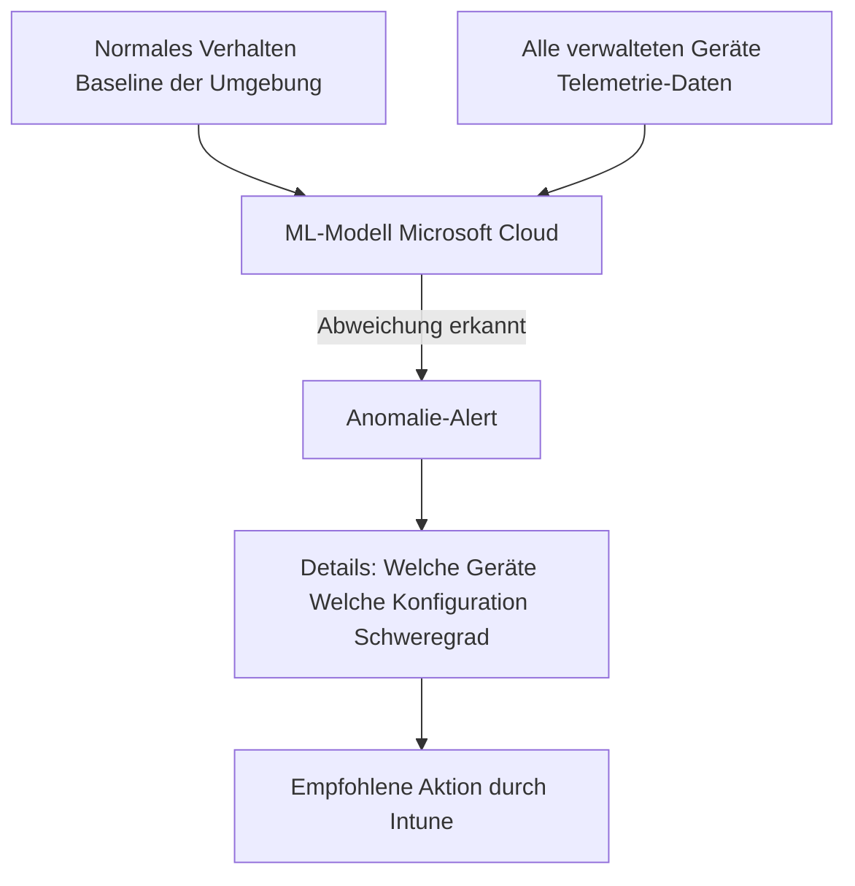
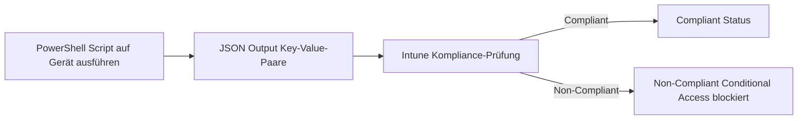
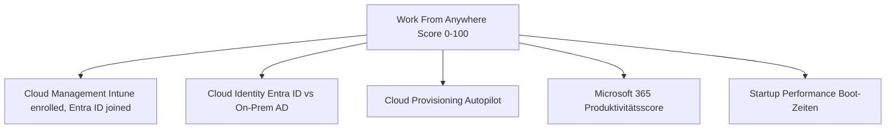

---
tags:
  - intune
  - intune-suite
  - endpoint-analytics
  - advanced-analytics
  - monitoring
  - remediations
  - anomaly-detection
  - ki
aliases:
  - Advanced Endpoint Analytics
  - Erweiterte Endpoint Analytics
  - Advanced Analytics Intune
---

# Advanced Endpoint Analytics

> [!ABSTRACT] TL;DR
> Advanced Endpoint Analytics ist die Premium-Erweiterung der kostenlosen Endpoint Analytics in Intune. Es fügt KI-basierte Anomalie-Erkennung, erweiterte Gerätezeitlinien, Custom Compliance Scripts und tiefere Diagnose-Insights hinzu. Enthalten im Intune Suite Bundle ($10/User/Monat). Die Basis-Endpoint-Analytics ist kostenlos in Intune Plan 1.

---

## Basis vs. Advanced: Was ist der Unterschied?

| Feature | Basis Endpoint Analytics | Advanced (Suite) |
|---------|--------------------------|------------------|
| **Startup Performance Score** | ✅ | ✅ + Details |
| **Work From Anywhere Score** | ✅ | ✅ + Details |
| **Recommended Software** | ✅ | ✅ |
| **Proactive Remediations** | ✅ Basic | ✅ Erweitert |
| **Anomaly Detection (KI)** | ❌ | ✅ |
| **Enhanced Device Timeline** | ❌ | ✅ |
| **Custom Compliance Scripts** | ❌ | ✅ |
| **Battery Reports** | ❌ | ✅ |
| **Log Analytics Integration** | ❌ | ✅ |
| **Power BI Export** | ❌ | ✅ |

> [!NOTE] Basis-Endpoint-Analytics aktivieren
> Basis-Endpoint-Analytics ist kostenlos, muss aber explizit aktiviert werden: **Intune Admin Center** → Reports → Endpoint Analytics → Settings → Enable Endpoint Analytics.

---

## Anomaly Detection: KI-basierte Erkennung

### Konzept

Anomaly Detection analysiert Geräteverhalten und Konfigurationen mit KI/ML-Algorithmen und erkennt Abweichungen vom Normalzustand:



### Anomalie-Kategorien

| Kategorie | Beispiele | Schweregrad |
|-----------|---------|------------|
| **Application anomalies** | App stürzt auf vielen Geräten ab, hohe Fehlerrate | Hoch |
| **Device anomalies** | Ungewöhnlich hoher RAM-Verbrauch, viele Reboots | Mittel |
| **Configuration anomalies** | Konfigurationsänderung korreliert mit Problemen | Hoch |
| **Update anomalies** | Update verursacht Abstürze auf bestimmten Hardware-Modellen | Hoch |

### Anomalie-Details aufrufen

**Intune Admin Center** → Reports → Endpoint Analytics → Anomaly Detection:

- **Anomalie-Liste:** Alle erkannten Anomalien nach Schweregrad
- **Betroffene Geräte:** Welche Geräte sind betroffen
- **Zeitliche Korrelation:** Wann hat die Anomalie begonnen
- **Korrelierte Events:** Welche Änderungen korrellieren zeitlich (z.B. Update deployed)

> [!TIP] Proaktive Problemlösung
> Anomaly Detection erkennt Probleme oft **bevor** Benutzer sich beschweren. Ein App-Absturzmuster das auf 5% der Geräte beginnt, wird erkannt bevor es sich auf alle ausbreitet.

---

## Enhanced Device Timeline

### Was ist die Device Timeline?

Die Enhanced Device Timeline zeigt eine **chronologische Ereignishistorie** pro Gerät für tiefe Diagnose:

```
Gerät: DESKTOP-CONTOSO01
Zeitraum: 17.01.2025 08:00 – 17.01.2025 17:00

08:12  📦  Update KB5034441 installiert
08:15  🔄  Neustart durchgeführt (Post-Update)
08:22  ✅  Gerät online (Boot-Zeit: 47 Sekunden)
09:05  ⚠️  App Absturz: Outlook.exe (0xC0000005)
09:06  ⚠️  App Absturz: Outlook.exe (Wiederholung)
10:30  🔧  Compliance Check: Bestanden
11:45  📋  Policy Update empfangen
15:30  ⚠️  Hohe CPU-Auslastung erkannt (>90% für 15 Min)
16:00  🔄  Neustart durch Benutzer
```

### Timeline-Ereignistypen

| Symbol | Ereignistyp | Beschreibung |
|--------|------------|-------------|
| App Crash | Anwendungsabsturz mit Error Code |
| System Reboot | Neustart (geplant, ungeplant, Update) |
| Policy Change | Neue Policy oder Konfigurationsänderung |
| Compliance Check | Compliance-Prüfung Ergebnis |
| Update Event | Patch installiert/deinstalliert |
| Connectivity | Netzwerkverbindungsänderung |
| User Logon/Logoff | An-/Abmeldung |

### Timeline für Diagnose nutzen

**Szenario:** Benutzer meldet, Outlook stürzt seit gestern ab.

1. **Gerät suchen** → Enhanced Timeline öffnen
2. **Zeitraum auf gestern** beschränken
3. **Korrelation erkennen:** Update KB5034441 installiert → danach Outlook-Abstürze
4. **Ursache identifiziert:** Update inkompatibel
5. **Lösung:** Update rückgängig machen oder Hotfix deployen

---

## Custom Compliance Scripts

### Konzept

Custom Compliance Scripts erweitern die eingebauten Compliance-Checks um beliebige **PowerShell-basierte Prüfungen**:



### Script-Anforderungen

Das PowerShell-Script muss ein **JSON-Objekt** mit Key-Value-Paaren ausgeben:

```powershell
# Beispiel: Prüfen ob Bitlocker auf allen Laufwerken aktiv
$results = @{}

# C: Laufwerk Bitlocker Status
$bitlockerStatus = Get-BitLockerVolume -MountPoint "C:" -ErrorAction SilentlyContinue
$results["BitlockerCDrive"] = if ($bitlockerStatus.ProtectionStatus -eq "On") { $true } else { $false }

# Mindest-RAM prüfen (8 GB)
$ramGB = [math]::Round((Get-CimInstance Win32_ComputerSystem).TotalPhysicalMemory / 1GB)
$results["RAM_8GB_Minimum"] = $ramGB -ge 8

# Secure Boot Status
$secureBoot = Confirm-SecureBootUEFI -ErrorAction SilentlyContinue
$results["SecureBootEnabled"] = if ($secureBoot -eq $true) { $true } else { $false }

# TPM 2.0 vorhanden
$tpm = Get-Tpm -ErrorAction SilentlyContinue
$results["TPM2_Present"] = ($tpm.TpmPresent -and $tpm.TpmReady)

# JSON ausgeben (Pflichtformat für Custom Compliance)
return $results | ConvertTo-Json
```

**Ausgabe:**
```json
{
  "BitlockerCDrive": true,
  "RAM_8GB_Minimum": true,
  "SecureBootEnabled": true,
  "TPM2_Present": true
}
```

### Compliance Rules für Custom Script definieren

Nach dem Script-Upload in Intune werden **Regeln** für jeden Wert definiert:

```
Script: BitlockerCompliance.ps1

Regeln:
- BitlockerCDrive = true → Compliant
- RAM_8GB_Minimum = true → Compliant  
- SecureBootEnabled = true → Compliant
- TPM2_Present = true → Compliant

Nicht-konforme Meldungen:
- BitlockerCDrive false: "BitLocker auf C: ist nicht aktiviert. Bitte IT kontaktieren."
- RAM_8GB_Minimum false: "Gerät hat weniger als 8 GB RAM – nicht für Enterprise-Nutzung geeignet."
```

### Erweiterte Custom Compliance-Szenarien

```powershell
# Prüfen ob bestimmte Software installiert ist
$officeVersion = Get-ItemProperty HKLM:\Software\Microsoft\Office\ClickToRun\Configuration `
    -ErrorAction SilentlyContinue

$results["Office365Installed"] = $null -ne $officeVersion
$results["OfficeVersion"] = $officeVersion.VersionToReport ?? "NotInstalled"

# Registry-Wert prüfen
$regValue = Get-ItemProperty -Path "HKLM:\SOFTWARE\Policies\Microsoft\Windows\WindowsUpdate" `
    -Name "DisableWindowsUpdateAccess" -ErrorAction SilentlyContinue
$results["WUPolicyCompliant"] = ($regValue.DisableWindowsUpdateAccess -ne 1)

# Letzte Backup-Zeit prüfen
$lastBackup = Get-Item "C:\BackupStatus.txt" -ErrorAction SilentlyContinue
$backupDate = if ($lastBackup) { [datetime]$lastBackup.LastWriteTime } else { [datetime]::MinValue }
$results["BackupInLast7Days"] = ((Get-Date) - $backupDate).TotalDays -le 7
```

---

## Startup Performance

### Boot-Analyse

Advanced Endpoint Analytics zeigt detaillierte Boot-Metriken pro Gerät und aggregiert für die gesamte Umgebung:

| Metrik | Beschreibung | Guter Wert |
|--------|-------------|-----------|
| **Core Boot Time** | Kernel-Startzeit | < 15 Sekunden |
| **Group Policy Time** | GP-Anwendungszeit beim Boot | < 30 Sekunden |
| **Sign-in Time** | Zeit bis zum Desktop nach Anmeldung | < 30 Sekunden |
| **Responsive Desktop Time** | Zeit bis Desktop vollständig nutzbar | < 60 Sekunden |
| **Background Processes** | Prozesse die Boot verlangsamen | < 10 |

### Langsame Geräte identifizieren

**Intune Admin Center** → Reports → Endpoint Analytics → Startup Performance:

- **Scores nach Abteilung:** Welche Abteilung hat die schlechteste Performance
- **Gerätemodell-Vergleich:** Dell vs. HP vs. Lenovo Performance
- **Boot-Regression:** Welche Geräte wurden langsamer (nach Updates?)
- **Top 25 langsame Geräte:** Liste mit Details

---

## Work From Anywhere Score

Bewertet die **Remote-Work-Bereitschaft** der Umgebung anhand von Kriterien:



| Kategorie | Punkte | Kriterien |
|-----------|--------|----------|
| **Cloud Management** | 0-25 | Intune-enrolled, co-managed oder MECM-only |
| **Cloud Identity** | 0-25 | Entra ID joined / Hybrid Join / nur AD |
| **Cloud Provisioning** | 0-25 | Autopilot-fähig, Modern Provisioning |
| **Startup Performance** | 0-25 | Boot-Zeit-Score der Geräte |

---

## Proactive Remediations (Remediations)

### Konzept

Remediations sind PowerShell-Script-Paare die **automatisch Probleme erkennen und beheben**:

- **Detection Script:** Prüft ob ein Problem vorhanden ist (Exit Code 0 = OK, 1 = Problem)
- **Remediation Script:** Behebt das Problem (wird nur ausgeführt wenn Detection = Problem)

### Beispiel: Veraltete DNS-Cache-Einträge löschen

```powershell
# Detection Script (detect-dns-cache.ps1)
# Prüft ob DNS-Cache mehr als 500 Einträge hat

$dnsEntries = (Get-DnsClientCache | Measure-Object).Count

if ($dnsEntries -gt 500) {
    Write-Output "DNS Cache zu groß: $dnsEntries Einträge"
    exit 1  # Problem erkannt
} else {
    exit 0  # Alles OK
}
```

```powershell
# Remediation Script (remediate-dns-cache.ps1)
# Leert den DNS-Cache

try {
    Clear-DnsClientCache
    Write-Output "DNS Cache erfolgreich geleert"
    exit 0
} catch {
    Write-Error "Fehler beim Leeren des DNS-Cache: $_"
    exit 1
}
```

### Weitere nützliche Remediations

```powershell
# Detection: Prüfen ob Windows Time Service läuft
$w32tm = Get-Service W32Time -ErrorAction SilentlyContinue
if ($w32tm.Status -ne "Running") { exit 1 } else { exit 0 }
```

```powershell
# Remediation: Windows Time Service starten und synchronisieren
Start-Service W32Time
w32tm /resync /force
exit 0
```

```powershell
# Detection: Temporäre Dateien > 5 GB
$tempSize = (Get-ChildItem $env:TEMP -Recurse -ErrorAction SilentlyContinue | 
    Measure-Object Length -Sum).Sum / 1GB
if ($tempSize -gt 5) { exit 1 } else { exit 0 }
```

```powershell
# Remediation: Temp-Ordner bereinigen
Remove-Item -Path "$env:TEMP\*" -Recurse -Force -ErrorAction SilentlyContinue
exit 0
```

### Remediation-Schedule

Remediations können mit folgenden Zeitplänen ausgeführt werden:
- **Einmalig:** Sofort nach Zuweisung
- **Stündlich:** Alle 1/2/4/8/12 Stunden
- **Täglich:** Zu einem definierten Zeitpunkt

---

## Log Analytics Integration

### Workspace verbinden

```
Intune Admin Center → Reports → Endpoint Analytics → Settings → Log Analytics:
→ Log Analytics Workspace auswählen (Azure)
→ Daten-Export aktivieren
```

### KQL-Abfragen auf Endpoint Analytics Daten

```kql
// Top 10 häufigste App-Abstürze in der letzten Woche
UCDeviceAlert
| where AlertType == "AppCrash"
| where TimeGenerated > ago(7d)
| summarize CrashCount = count() by AppName, AppVersion
| order by CrashCount desc
| take 10
```

```kql
// Geräte mit Boot-Zeit > 90 Sekunden (langsame Geräte)
UCClientReadinessStatus
| where BootTime > 90
| project DeviceName, BootTime, OsVersion, Model
| order by BootTime desc
```

---

## Power BI Export

Advanced Endpoint Analytics-Daten können in **Power BI** exportiert werden für benutzerdefinierte Dashboards:

```
Intune Admin Center → Reports → Endpoint Analytics → Export:
→ Export to Power BI
→ PowerBI Desktop Connector nutzen
→ Daten-Refresh: Täglich oder On-Demand
```

**Mögliche Power BI Berichte:**
- Boot-Performance-Trend über Zeit
- Anomalie-Dashboard nach Kategorie
- Compliance-Score-Verteilung
- Remediation-Erfolgsquote

---

## Verwandte Notizen

- [[Microsoft Intune Suite Überblick]]
- [[Endpoint Analytics]]
- [[Intune Grundlagen]]
- [[Compliance Policies]]
- [[Konfigurationsprofile]]
- [[Windows Update for Business]]
- [[Endpoint Privilege Management EPM]]
