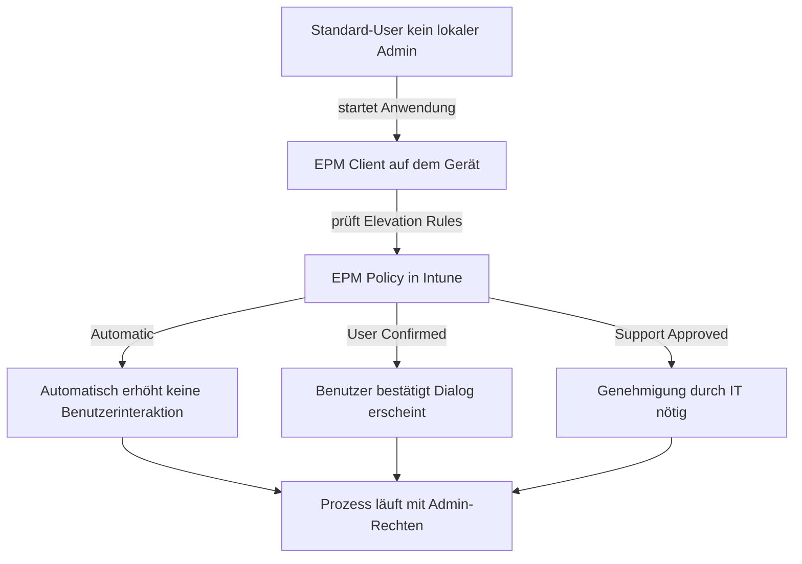
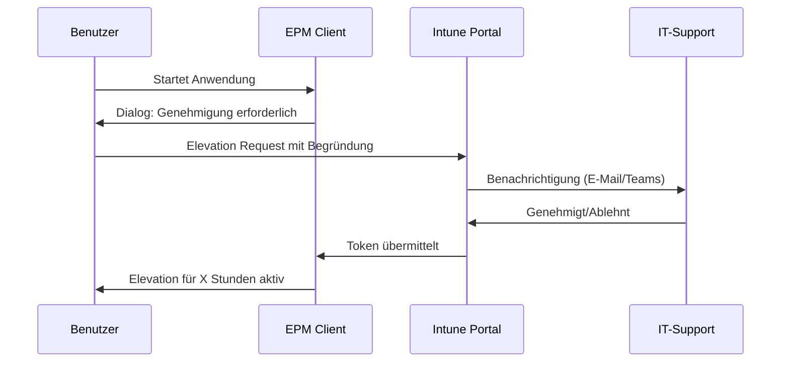

---
tags:
  - intune
  - intune-suite
  - epm
  - endpoint-privilege-management
  - least-privilege
  - sicherheit
  - windows
aliases:
  - EPM
  - Endpoint Privilege Management
  - Least Privilege Windows
---

# Endpoint Privilege Management EPM

> [!ABSTRACT] TL;DR
> Endpoint Privilege Management (EPM) ist ein Intune Suite Add-on, das das Least-Privilege-Prinzip für Windows-Geräte durchsetzt. Standard-User erhalten temporäre Admin-Rechte nur für spezifische, vorab definierte Prozesse oder Anwendungen — ohne dauerhafter lokaler Administrator zu sein. Kosten: ~3 USD/User/Monat als Einzellizenz oder im Intune Suite Bundle ($10/User/Monat).

---

## Konzept: Least Privilege für Windows

Das klassische Problem in Windows-Umgebungen: Viele Anwendungen benötigen administrative Rechte für Installation oder Ausführung. Die traditionellen Lösungen sind entweder unsicher (Benutzer dauerhaft als lokaler Admin) oder zu restriktiv (vollständiges Least-Privilege ohne Ausnahmen).

**EPM löst dieses Dilemma:** Benutzer arbeiten als Standard-User, können aber für explizit definierte Anwendungen oder Prozesse temporäre Admin-Rechte anfordern oder automatisch erhalten.



**Vorteile gegenüber dauerhafter Admin-Berechtigung:**
- Angriffsfläche drastisch reduziert (Malware kann keine Admin-Rechte eskalieren)
- Vollständiges Audit-Log aller Elevation-Events
- Granulare Kontrolle: welche App darf erhöht werden, welche nicht
- Kein lokales Admin-Konto mehr nötig

---

## Lizenzierung und Voraussetzungen

### Lizenzoptionen

| Option | Preis | Enthält |
|--------|-------|---------|
| **EPM Einzellizenz** | ~$3/User/Monat | Nur EPM |
| **Intune Suite Bundle** | $10/User/Monat | EPM + Cloud PKI + Remote Help + Advanced Analytics + Tunnel for MAM + weitere |
| **Intune Plan 2** | $4/User/Monat | Nicht enthalten, Plan 2 ≠ Suite |

> [!IMPORTANT] Voraussetzung: Intune Plan 1
> EPM erfordert zwingend eine bestehende **Intune Plan 1** Lizenz ($8/User/Monat oder in M365 E3/E5 enthalten). EPM ist ein **Add-on**, keine eigenständige Lösung.

### Gerätevoraussetzungen

- Windows 10 Version 20H2 oder höher
- Windows 11 (alle Versionen)
- Intune-Enrollment (MDM oder Co-Management)
- EPM-Client (wird als Intune App deployed)
- Kein Support für: macOS, Linux, iOS, Android

---

## Elevation Rule Typen

EPM kennt drei Typen von Elevation Rules, die das Verhalten bei Elevation-Anfragen steuern:

### 1. Automatic Elevation

Der Prozess wird **ohne Benutzerinteraktion** automatisch mit Admin-Rechten gestartet. Geeignet für:
- Interne Tools/Scripts die regelmäßig Admin-Rechte benötigen
- Hintergrunddienste
- Bekannte, vollständig vertrauenswürdige Anwendungen

```
Elevation Type: Automatic
→ Kein Dialog, kein Klick, kein Audit-Request
→ Anwendung startet direkt mit erhöhten Rechten
→ Event wird dennoch geloggt
```

> [!WARNING] Vorsicht bei Automatic Elevation
> Automatic Elevation sollte nur für vollständig bekannte und hash-verifizierte Anwendungen verwendet werden. Eine Malware die die gleiche Signatur imitiert, könnte sonst automatisch erhöht werden.

### 2. User Confirmed Elevation

Der Benutzer **muss aktiv bestätigen**, dass er die Elevation wünscht. Ein Dialog erscheint mit:
- Informationen über die Elevation
- Optionalem Pflichtfeld für Begründung (Business Justification)
- Bestätigungs-Button

Geeignet für:
- Installer/Setup-Dateien
- Selten benötigte Admin-Tools
- Anwendungen wo Benutzerawareness erwünscht ist

### 3. Support Approved Elevation

Der Benutzer muss eine **Genehmigung durch den IT-Support** einholen:



**Konfigurierbare Parameter:**
- **Approval Validity:** Wie lange ist die Genehmigung gültig? (z.B. 1-24 Stunden)
- **Approval Message:** Pflicht-Begründung durch den Benutzer
- **Approver Assignment:** Wer kann genehmigen (Gruppe in Entra ID)

> [!TIP] Teams-Integration für Approver
> Approver erhalten eine **Microsoft Teams Benachrichtigung** mit Direkt-Link zur Genehmigung. Das beschleunigt den Prozess erheblich gegenüber E-Mail-basierter Genehmigung.

---

## EPM Policy konfigurieren

### Schritt 1: EPM aktivieren

Im **Intune Admin Center** → Endpoint Security → Endpoint Privilege Management → Policies:

**Elevation Settings Policy** (Basis-Konfiguration):
```
Policy Type: Elevation Settings
- Endpoint Privilege Management: Enabled
- Default Elevation Response: Deny (empfohlen) oder User Confirmed
- Validation: Certificate, Path, Hash (mehrere kombinierbar)
```

> [!NOTE] Default Elevation Response
> Mit **Deny** als Default werden alle nicht explizit geregelten Elevation-Anfragen abgelehnt. Mit **User Confirmed** können Benutzer jede beliebige Anwendung nach Bestätigung erhöhen — weniger sicher, aber pragmatischer Einstieg.

### Schritt 2: Elevation Rules erstellen

**Elevation Rules Policy** — jede Regel definiert eine spezifische Anwendung:

| Parameter | Beschreibung | Beispiel |
|-----------|-------------|---------|
| **File Path** | Absoluter Pfad zur Executable | `C:\Program Files\Tool\tool.exe` |
| **File Hash** | SHA-256 Hash der Datei | `A1B2C3...` |
| **Publisher** | Signatur des Publishers | `Microsoft Corporation` |
| **Product Name** | Name aus Datei-Metadaten | `My Enterprise Tool` |
| **Elevation Type** | Automatic/User Confirmed/Support Approved | `User Confirmed` |
| **Child Process** | Kindprozesse auch erhöhen? | Disabled (empfohlen) |

**Empfohlene Validierungsmethode: Hash + Publisher** (beide müssen passen):

```json
{
  "elevationRule": {
    "name": "Spezifisches Tool erhöhen",
    "description": "IT-Admin Tool für Netzwerkdiagnose",
    "elevationType": "userConfirmed",
    "validation": {
      "filePath": "C:\\Program Files\\NetworkTool\\nettool.exe",
      "fileHash": "SHA256:A1B2C3D4E5F6...",
      "publisher": "Contoso IT GmbH",
      "requireSignature": true
    },
    "childProcessBehavior": "denyElevation"
  }
}
```

### Schritt 3: Policy zuweisen

Policies werden wie normale Intune-Policies Benutzer- oder Gerätegruppen zugewiesen. EPM-Policies wirken auf Benutzerebene (User-Based Assignments empfohlen).

---

## Approval Workflow: Support Approved im Detail

### Benutzerseite (Endpunkt)

1. Benutzer startet eine Anwendung die Support Approved benötigt
2. EPM-Dialog erscheint: „Diese Anwendung erfordert eine Genehmigung"
3. Benutzer gibt **Business Justification** ein (Pflichtfeld konfigurierbar)
4. Anfrage wird an Intune übermittelt
5. Benutzer kann Status prüfen: „Ausstehend / Genehmigt / Abgelehnt"
6. Nach Genehmigung: Anwendung starten → läuft mit Admin-Rechten für konfigurierte Zeit

### IT-Support Seite (Approver)

1. Benachrichtigung in **Microsoft Teams** oder per E-Mail
2. Intune Admin Center → Endpoint Privilege Management → Approval Requests
3. Details anzeigen: Benutzer, Gerät, Anwendung, Begründung, Hash
4. Genehmigen mit optionalem Kommentar
5. Ablehnen mit Begründung (Benutzer sieht Ablehnungsgrund)

> [!TIP] Zeitbegrenzung konfigurieren
> Genehmigte Elevations können auf **1-24 Stunden** begrenzt werden. Nach Ablauf erlischt die Berechtigung automatisch — kein manuelles Entziehen nötig.

---

## Reporting und Monitoring

### Elevation Reports im Intune Admin Center

**Intune Admin Center** → Reports → Endpoint Privilege Management:

| Report | Inhalt |
|--------|--------|
| **Elevation report** | Alle Elevation-Events: Benutzer, Gerät, App, Zeitstempel, Typ |
| **Managed elevations** | Elevations durch EPM-Policies (Automatic/Confirmed) |
| **Unmanaged elevations** | Elevations ohne EPM-Regel (nur wenn Default = User Confirmed) |
| **Denied elevations** | Abgelehnte Elevation-Anfragen |

### Risk Score und Insights

EPM berechnet einen **Risk Score** für jedes Gerät basierend auf:
- Häufigkeit von Elevation-Anfragen
- Anzahl unbekannter Anwendungen die erhöht werden
- Muster die auf Privilege Escalation hindeuten

**Dashboard-Metriken:**
- Top Elevation-Requests (welche Apps am häufigsten)
- Geräte mit höchstem Elevation-Risiko
- Trend: Mehr oder weniger Elevations über Zeit

---

## Via Microsoft Intune Admin Center (UI)

### EPM Policy erstellen

1. Öffne **[intune.microsoft.com](https://intune.microsoft.com)**
2. Navigiere zu **Endpunktsicherheit** → **Endpoint Privilege Management**
3. Klicke auf **Richtlinien** → **+ Richtlinie erstellen**
4. Wähle **Plattform:** Windows und den gewünschten **Policy-Typ:**
   - **Windows Elevation Settings Policy** — Basiseinstellungen (EPM aktivieren, Default-Verhalten)
   - **Windows Elevation Rules Policy** — Regeln für spezifische Anwendungen
5. Vergib einen **Namen** und optional eine **Beschreibung**
6. Konfiguriere die **Elevation Settings** (für Settings Policy):
   - **Endpoint Privilege Management:** Aktiviert
   - **Default Elevation Response:** Ablehnen *(empfohlen)* oder Benutzer bestätigt
   - **Validierung:** Zertifikat, Pfad und/oder Hash
7. Konfiguriere **Elevation Rules** (für Rules Policy):
   - Klicke **+ Regel hinzufügen**
   - Gib **Dateiname/Pfad**, **Datei-Hash (SHA-256)**, **Publisher** und **Produktname** ein
   - Wähle **Elevation-Typ:** Automatisch / Benutzer bestätigt / Vom Support genehmigt
   - Konfiguriere **Kindprozessverhalten** (empfohlen: Elevation ablehnen)
8. **Zuweisung:** Zielgruppen (Benutzer- oder Gerätegruppen) auswählen
9. **Überprüfen und erstellen** → **Erstellen**

### Approval Requests verwalten

1. Navigiere zu **Endpunktsicherheit** → **Endpoint Privilege Management** → **Genehmigungsanfragen**
2. Ausstehende Anfragen anzeigen: Benutzer, Gerät, Anwendung, Begründung, Datei-Hash
3. Klicke auf eine Anfrage → **Genehmigen** oder **Ablehnen**
4. Optional: Kommentar zur Entscheidung hinzufügen

### EPM Reports aufrufen

1. Navigiere zu **Berichte** → **Endpoint Analytics** → **Endpoint Privilege Management**
2. Verfügbare Report-Typen:
   - **Elevation Report** — Alle Elevation-Events mit Benutzer, Gerät, App, Zeitstempel
   - **Verwaltete Elevations** — Elevations durch EPM-Policies (Automatisch/Bestätigt)
   - **Nicht verwaltete Elevations** — Elevations ohne passende EPM-Regel
   - **Abgelehnte Elevations** — Abgelehnte Elevation-Anfragen
3. Filter nach Zeitraum, Benutzer oder Gerät anwenden
4. **Exportieren** für weitere Analyse in Excel/CSV

---

## PowerShell und Microsoft Graph für EPM-Audit

### Graph API: Elevation Reports abfragen

```powershell
# Authentifizierung mit Microsoft Graph
Connect-MgGraph -Scopes "DeviceManagementConfiguration.Read.All", "DeviceManagementManagedDevices.Read.All"

# Alle EPM Elevation Events der letzten 7 Tage
$startDate = (Get-Date).AddDays(-7).ToString("yyyy-MM-ddTHH:mm:ssZ")

$elevationEvents = Invoke-MgGraphRequest -Method GET `
    -Uri "https://graph.microsoft.com/beta/deviceManagement/privilegeManagementElevations?`$filter=createdDateTime ge $startDate" `
    -OutputType PSObject

$elevationEvents.value | Select-Object `
    @{N="Benutzer"; E={$_.upn}},
    @{N="Gerät"; E={$_.deviceName}},
    @{N="Anwendung"; E={$_.filePath}},
    @{N="Typ"; E={$_.elevationType}},
    @{N="Zeitstempel"; E={$_.createdDateTime}},
    @{N="Status"; E={$_.elevationRequestState}} |
    Format-Table -AutoSize
```

```powershell
# EPM Policies auflisten
$epmPolicies = Invoke-MgGraphRequest -Method GET `
    -Uri "https://graph.microsoft.com/beta/deviceManagement/configurationPolicies?`$filter=templateReference/templateFamily eq 'endpointSecurityEndpointPrivilegeManagement'" `
    -OutputType PSObject

$epmPolicies.value | Select-Object name, description, createdDateTime, lastModifiedDateTime |
    Format-Table -AutoSize
```

```powershell
# Approval Requests anzeigen (Support Approved)
$approvalRequests = Invoke-MgGraphRequest -Method GET `
    -Uri "https://graph.microsoft.com/beta/deviceManagement/elevationRequests" `
    -OutputType PSObject

$approvalRequests.value | Select-Object `
    @{N="Antragsteller"; E={$_.requestedByUserId}},
    @{N="Status"; E={$_.requestState}},
    @{N="Datei"; E={$_.applicationDetail.fileName}},
    @{N="Begründung"; E={$_.requestJustification}},
    @{N="Erstellt"; E={$_.createdDateTime}} |
    Format-Table -AutoSize
```

### Elevations nach Anwendung aggregieren (Audit-Report)

```powershell
# Top 10 erhöhten Anwendungen
$elevations = Invoke-MgGraphRequest -Method GET `
    -Uri "https://graph.microsoft.com/beta/deviceManagement/privilegeManagementElevations" `
    -OutputType PSObject

$elevations.value |
    Group-Object -Property filePath |
    Sort-Object Count -Descending |
    Select-Object -First 10 |
    Select-Object Count, Name |
    Format-Table -AutoSize -Property @{N="Anzahl Elevations"; E={$_.Count}}, @{N="Anwendungspfad"; E={$_.Name}}
```

---

## Best Practices

### Deployment-Strategie

1. **Phase 1 – Audit Mode:** Default Elevation = User Confirmed, alle Elevations beobachten
2. **Phase 2 – Rule Erstellung:** Für häufig erhöhte Apps Automatic/Confirmed Rules erstellen
3. **Phase 3 – Lockdown:** Default auf Deny setzen, nur noch explizit definierte Apps werden erhöht
4. **Phase 4 – Optimierung:** Unmanaged Elevations analysieren, neue Rules ergänzen

### Sicherheitsempfehlungen

| Empfehlung | Begründung |
|-----------|-----------|
| Immer File Hash + Publisher kombinieren | Verhindert Hash-Spoofing und Publisher-Spoofing einzeln |
| Child Process Behavior = Deny | Verhindert Privilege Escalation über Kindprozesse |
| Business Justification für Confirmed Elevation | Accountability und Audit-Trail |
| Approval Validity maximal 4 Stunden | Minimiert Missbrauchsfenster |
| Regel-Review monatlich | Veraltete Regeln für nicht mehr genutzte Apps entfernen |

> [!DANGER] Nie Automatic für cmd.exe oder PowerShell.exe
> Eine Automatic Elevation Regel für Shell-Interpreter würde jedem Benutzer faktisch vollständige Admin-Rechte geben, da beliebige Befehle ausgeführt werden können.

---

## Vergleich: EPM vs. traditionelle Ansätze

| Ansatz | Sicherheit | Aufwand | Benutzerfreundlichkeit |
|--------|-----------|---------|----------------------|
| **Benutzer = lokaler Admin** | ❌ Sehr niedrig | ✅ Kein Aufwand | ✅ Maximale Freiheit |
| **Standard-User ohne Ausnahmen** | ✅ Sehr hoch | ✅ Geringer Aufwand | ❌ Frustration, Helpdesk-Tickets |
| **EPM mit Elevation Rules** | ✅ Hoch | ⚠️ Initialer Aufwand | ✅ Gut – gezielte Ausnahmen |
| **Manuelle Admin-Anfragen ohne EPM** | ⚠️ Mittel | ❌ Hoher Aufwand (manuell) | ❌ Langwierig |

---

## Verwandte Notizen

- [[Microsoft Intune Suite Überblick]]
- [[Intune Grundlagen]]
- [[Endpoint Security]]
- [[Compliance Policies]]
- [[Conditional Access]]
- [[Advanced Endpoint Analytics]]
