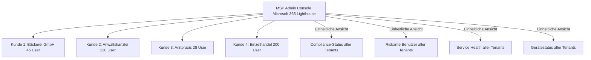

---
tags:
  - microsoft365
  - lighthouse
  - msp
  - multi-tenant
  - gdap
  - csp
  - managed-service-provider
aliases:
  - Microsoft 365 Lighthouse
  - Lighthouse
  - M365 Lighthouse
  - MSP Verwaltung
---

# Microsoft 365 Lighthouse

> [!ABSTRACT] TL;DR
> Microsoft 365 Lighthouse ist ein kostenloses MSP-Tool (Managed Service Provider) zur zentralen Verwaltung aller Kundentenant aus einer Konsole. Es bietet Tenant-übergreifende Sicherheitsbaselines, Compliance-Monitoring, Risikobenutzer-Überwachung und delegierte Administration via GDAP. Kostenlos für qualifizierte CSP-Partner.

---

## Konzept: Multi-Tenant-Verwaltung für MSPs

Ohne Lighthouse müssen MSPs für jeden Kundentenant:
- Separaten Browser-Tab öffnen
- Sich einzeln anmelden
- Probleme manuell pro Tenant suchen

**Lighthouse konsolidiert** alles in einer Übersicht:



---

## Lizenzierung

| Komponente | Kosten |
|-----------|--------|
| **Microsoft 365 Lighthouse** | **Kostenlos** für qualifizierte CSP-Partner |
| **Kundentenant-Voraussetzungen** | M365 Business Premium, E3 oder E5 (mind. 1 Lizenz) |
| **Max. Benutzer pro Kundentenant** | 2.500 verwaltete Benutzer (Lighthouse-Limit) |

> [!IMPORTANT] Nur für CSP-Partner
> Lighthouse ist **ausschließlich** für Microsoft Cloud Solution Provider (CSP) Partner verfügbar. Direkte Kunden ohne CSP-Partnerschaft können Lighthouse nicht nutzen.

---

## Voraussetzungen für Tenant-Onboarding

### MSP-Seite (Partner)

- Active Microsoft CSP-Partnerschaft (Indirect Reseller oder Direct Bill)
- GDAP-Beziehung (Granular Delegated Admin Privileges) mit dem Kundentenant
- Partner Center-Account mit aktiver CSP-Membership

### Kundentenant

| Anforderung | Details |
|------------|---------|
| **Lizenz** | M365 Business Basic, Business Standard, Business Premium, E3 oder E5 |
| **Intune** | Optional, aber empfohlen für Device-Management-Features |
| **GDAP-Einladung** | Kunde muss GDAP-Beziehung akzeptieren |
| **Keine DAP mehr** | Legacy DAP (Delegated Admin Privileges) läuft aus → GDAP ist Nachfolger |

---

## GDAP: Granular Delegated Admin Privileges

GDAP ist das moderne Berechtigungsmodell für CSP-Partner und ersetzt das veraltete DAP:

### GDAP vs. DAP Vergleich

| Aspekt | DAP (Legacy) | GDAP (Aktuell) |
|--------|-------------|----------------|
| **Granularität** | Vollzugriff (Global Admin + HelpDesk) | Spezifische Entra ID Rollen |
| **Zeitbegrenzung** | Unbegrenzt | 1 Tag bis 2 Jahre |
| **Kundenzustimmung** | Einmalig | Pro GDAP-Beziehung |
| **Sicherheit** | Niedrig | Hoch (Least Privilege) |
| **Lighthouse** | Eingeschränkt | Vollständig unterstützt |

### GDAP-Beziehung einrichten

**Im Partner Center:**

```
Partner Center → Customers → [Kunde auswählen]
→ Account → Admin Relationships → Request
→ Rollen auswählen (nur benötigte):
    - Global Reader (für Monitoring)
    - Intune Administrator (für Device Management)
    - Security Administrator (für Security-Baseline)
    - User Administrator (für User-Management)
    - Helpdesk Administrator (für Support)
→ Gültigkeitsdauer: 1 Jahr (empfohlen)
→ Einladungslink an Kunden senden
```

**Beim Kunden:**
```
Kunde erhält E-Mail mit Link
→ Globaler Admin des Kunden genehmigt GDAP
→ GDAP-Beziehung aktiv
→ Tenant erscheint in Lighthouse
```

> [!TIP] Prinzip der minimalen Rechte
> Vergib über GDAP **nur die tatsächlich benötigten** Rollen. Für reines Monitoring reicht Global Reader. Für Intune-Konfiguration Intune Administrator. Vermeide Global Administrator — außer wenn explizit erforderlich.

---

## Tenant Onboarding in Lighthouse

Nach eingerichteter GDAP-Beziehung:

**Schritt 1: Lighthouse öffnen**
```
portal.azure.com → Alle Dienste → Microsoft 365 Lighthouse
oder direkt: lighthouse.microsoft.com
```

**Schritt 2: Tenant-Onboarding starten**
```
Lighthouse → Tenants → [Tenant auswählen]
→ "Begin Onboarding"
→ Automatische Prüfung: Lizenzen, GDAP, Compliance-Status
→ Status: "In Progress" → "Active" (dauert 24-48 Stunden)
```

---

## Baseline-Deployment

Lighthouse ermöglicht das Deployen von **Sicherheitsbaselines** für alle Kunden-Tenants:

### Standard-Baseline Inhalte

| Baseline-Element | Was wird konfiguriert |
|-----------------|----------------------|
| **MFA aktivieren** | Entra ID Conditional Access: MFA für alle User |
| **SSPR aktivieren** | Self-Service Password Reset für Benutzer |
| **Legacy Authentication blockieren** | CA-Richtlinie gegen Basic Auth |
| **Device Compliance** | Intune-Compliance-Policy für Windows-Geräte |
| **Microsoft Defender** | Defender Antivirus aktivieren |
| **Intune Enrollment** | Enrollment-Restrictions konfigurieren |
| **Conditional Access** | Risiko-basierte CA-Richtlinien |

### Baseline deployen

```
Lighthouse → Baselines → [Baseline auswählen: Standard baseline]
→ "Deploy baseline"
→ Tenants auswählen (einzeln oder mehrere)
→ Review → Apply

Status pro Tenant:
  ✅ Compliant    - Baseline bereits konfiguriert
  ⚠️ Not Compliant - Abweichung erkannt
  ℹ️  Not Licensed  - Fehlende Lizenz für dieses Feature
  🔄 Deploying     - Deployment läuft
```

> [!WARNING] Baselines prüfen vor Deployment
> Baseline-Deployments ändern aktiv Konfigurationen in Kundentenant! Immer erst **prüfen** ob die Konfiguration für den Kunden geeignet ist (z.B. MFA-Enforcing könnte Shared-Accounts brechen).

---

## Risky Users Monitoring

Lighthouse zeigt **riskante Anmeldungen und Benutzer** über alle Tenants in einer Ansicht:

### Übersicht

**Lighthouse → Users → Risky Users:**

| Spalte | Beschreibung |
|--------|-------------|
| **User** | UPN des betroffenen Benutzers |
| **Tenant** | Kundentenant |
| **Risk Level** | High / Medium / Low |
| **Risk State** | At Risk / Remediated / Dismissed |
| **Last Risk Detection** | Zeitpunkt der letzten Risikoerkennung |
| **Detection** | z.B. Atypical travel, Impossible travel, Leaked credentials |

### Aktionen direkt in Lighthouse

```
Risky User in Lighthouse:
→ "Confirm user compromised" → Sitzungen werden gesperrt
→ "Dismiss user risk" → Risiko als false positive markieren  
→ "Reset password" → Passwort-Reset erzwingen
→ "Block sign-in" → Benutzer temporär sperren
```

---

## Device Compliance über alle Tenants

**Lighthouse → Devices → Device compliance:**

Zeigt den Compliance-Status aller Geräte **aller Kundentenant** in einer Ansicht:

```
Compliance-Übersicht (Beispiel):
╔══════════════════════╦═══════╦═══════╦═════════╦═══════════╗
║ Tenant               ║ Total ║ Comp. ║ Non-C.  ║ Not Reg.  ║
╠══════════════════════╬═══════╬═══════╬═════════╬═══════════╣
║ Bäckerei GmbH        ║  45   ║  42   ║   3     ║    0      ║
║ Anwaltskanzlei       ║ 120   ║  98   ║  15     ║    7      ║
║ Arztpraxis           ║  28   ║  28   ║   0     ║    0      ║
╚══════════════════════╩═══════╩═══════╩═════════╩═══════════╝
```

---

## Service Health über alle Tenants

**Lighthouse → Service Health:**

Zeigt M365-Service-Ausfälle für **alle Kundentenant**:

- Exchange Online Down bei Kunde X → Sofort sichtbar
- SharePoint-Incident bei 3 Tenants → Aggregierte Ansicht
- Direkt-Link zu offiziellem Microsoft Status: status.office365.com

---

## Alerts und Notifications

Konfigurierbare Alerts in Lighthouse:

```
Lighthouse → Alerts → Create Alert Rule:

Alert-Typen:
- Risky User erkannt (High Risk) → Teams-Benachrichtigung
- Device Compliance fällt unter X% → E-Mail Alert
- Baseline-Abweichung erkannt → Alert
- Service-Health-Incident → Sofort-Alert

Benachrichtigungskanäle:
- E-Mail
- Microsoft Teams Webhook
- Azure Monitor (über Log Analytics)
```

---

## Audit Logs und PowerShell-Zugriff

### Audit-Logs in Lighthouse

```
Lighthouse → Audit Logs:
- Alle Aktionen des MSP-Admins in Kundentenant
- Zeitstempel, Action, Target-Tenant, Ergebnis
- Export als CSV für Compliance-Nachweise
```

### PowerShell als MSP-Admin auf Kundentenant

```powershell
# Verbindung zu Kundentenant via GDAP
Connect-MgGraph -TenantId "kunden-tenant-id" -Scopes "User.Read.All", "DeviceManagementConfiguration.Read.All"

# Beispiel: Alle risikobehafteten Anmeldungen im Kundentenant
$riskySignIns = Invoke-MgGraphRequest -Method GET `
    -Uri "https://graph.microsoft.com/v1.0/identityProtection/riskyUsers?`$filter=riskLevel eq 'high'" `
    -OutputType PSObject

$riskySignIns.value | Select-Object userDisplayName, userPrincipalName, riskLevel, riskState |
    Format-Table -AutoSize
```

```powershell
# Alle Kundentenant-Geräte-Compliance-Status abfragen
Connect-MgGraph -TenantId "kunden-tenant-id"

$complianceStatus = Invoke-MgGraphRequest -Method GET `
    -Uri "https://graph.microsoft.com/v1.0/deviceManagement/managedDevices?`$select=deviceName,complianceState,osVersion,lastSyncDateTime" `
    -OutputType PSObject

$complianceStatus.value | 
    Group-Object complianceState |
    Select-Object Count, Name |
    Format-Table @{N="Anzahl"; E={$_.Count}}, @{N="Compliance-Status"; E={$_.Name}}
```

---

## Via Microsoft Intune Admin Center (UI)

### Tenant Onboarding in Lighthouse

1. Öffne **[lighthouse.microsoft.com](https://lighthouse.microsoft.com)**
2. Navigiere zu **Mandanten** → **+ Mandant hinzufügen**
3. Wähle den Kundenmandanten aus der Liste der GDAP-Beziehungen
4. Bestätige die **GDAP-Beziehung** und die erforderlichen Berechtigungen
5. Überwache den **Onboarding-Status** in der Mandantenübersicht:
   - **Aktiv** — Vollständig ongeboardet
   - **In Bearbeitung** — Onboarding läuft
   - **Inaktiv** — Voraussetzungen nicht erfüllt
6. Bei Problemen: Auf den Mandanten klicken → **Onboarding-Status** → Fehlermeldungen prüfen

### Baseline deployen

1. Navigiere zu **Bereitstellungspläne** *(Deployment Plans)*
2. Einen vorhandenen **Baseline**-Plan auswählen oder **+ Erstellen**
3. Klicke auf **Mandanten zuweisen** → Kundenmandanten aus der Liste wählen
4. **Vergleichsansicht:** Baseline-Sollzustand vs. aktueller Ist-Zustand des Mandanten
5. Klicke **Bereitstellen** für einzelne Konfigurationsschritte
6. **Deployment-Status überwachen:** Konform / Nicht konform / In Bearbeitung pro Mandant

### Risky Users überwachen und behandeln

1. Navigiere zu **Benutzer** → **Riskante Benutzer**
2. **Filter nach Mandant** über das Dropdown oben
3. Sortiere nach **Risikoebene** (Hoch / Mittel / Niedrig)
4. Benutzer anklicken für Details: Risikoereignisse, letzte Anmeldungen, MFA-Status
5. Verfügbare **Aktionen:**
   - **Kennwort zurücksetzen** — Sofortiger Kennwortwechsel erzwingen
   - **MFA-Registrierung erzwingen** — Nächste Anmeldung erfordert MFA-Setup
   - **Alle Sitzungen sperren** — Alle aktiven Tokens widerrufen
   - **Als sicher bestätigen** — Risiko-Flag entfernen (nach Untersuchung)

### Device Compliance über alle Mandanten prüfen

1. Navigiere zu **Geräte** → **Gerätekonformität**
2. Gesamtübersicht aller Mandanten auf einen Blick
3. **Filter** nach Mandant, Konformitätsstatus oder OS-Typ
4. Nicht konforme Geräte anklicken → Richtlinie und Fehlerdetails anzeigen

### Service Health überwachen

1. Navigiere zu **Dienstintegrität** *(Service Health)*
2. Alle aktiven M365-Vorfälle und geplanten Wartungen aller Mandanten
3. **Filter nach Mandant** oder Dienst (Exchange, Teams, Intune, etc.)
4. Klicke auf einen Vorfall für Zeitplan, Auswirkungen und Workarounds

---

## PowerShell: Tenant-übergreifende Automation

### Alle Lighthouse-Tenants abrufen

```powershell
# Lighthouse-verwaltete Tenants via Graph API auflisten
Connect-MgGraph -Scopes "ManagedTenants.Read.All"

$tenants = Invoke-MgGraphRequest -Method GET `
    -Uri "https://graph.microsoft.com/beta/tenantRelationships/managedTenants/tenants" `
    -OutputType PSObject

$tenants.value | Select-Object `
    @{N="Tenant"; E={$_.displayName}},
    @{N="Status"; E={$_.tenantStatusInformation.onboardingStatus}},
    @{N="Benutzer"; E={$_.tenantStatusInformation.workloadStatuses.Count}} |
    Format-Table -AutoSize
```

### Risky Users über alle Tenants

```powershell
# Alle Hochrisiko-Benutzer über alle verwalteten Tenants
$allRiskyUsers = @()

foreach ($tenant in $tenants.value) {
    $riskyUsers = Invoke-MgGraphRequest -Method GET `
        -Uri "https://graph.microsoft.com/beta/tenantRelationships/managedTenants/riskyUsers?`$filter=tenantId eq '$($tenant.tenantId)' and riskLevel eq 'high'" `
        -OutputType PSObject
    
    foreach ($user in $riskyUsers.value) {
        $allRiskyUsers += [PSCustomObject]@{
            Tenant     = $tenant.displayName
            Benutzer   = $user.userDisplayName
            UPN        = $user.userPrincipalName
            RiskLevel  = $user.riskLevel
            RiskState  = $user.riskState
        }
    }
}

$allRiskyUsers | Format-Table -AutoSize
```

---

## Lighthouse vs. Entra ID Multi-Tenant Management

| Aspekt | Microsoft 365 Lighthouse | Entra ID External Identities |
|--------|--------------------------|------------------------------|
| **Zielgruppe** | MSP/CSP mit Kundentenant | B2B/B2C-Szenarien |
| **Zugriff** | Über GDAP (delegiert) | Gastkonten im eigenen Tenant |
| **Monitoring** | Tenant-übergreifend in einer Konsole | Nur eigener Tenant |
| **Baseline-Deployment** | ✅ | ❌ |
| **Kosten** | Kostenlos für CSP | Kostenlos (Basis) |

---

## Verwandte Notizen

- [[Microsoft Intune Suite Überblick]]
- [[Intune Grundlagen]]
- [[Compliance Policies]]
- [[Conditional Access]]
- [[Endpoint Security]]
- [[Windows Autopilot]]
