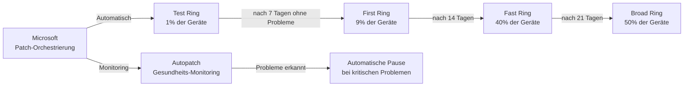
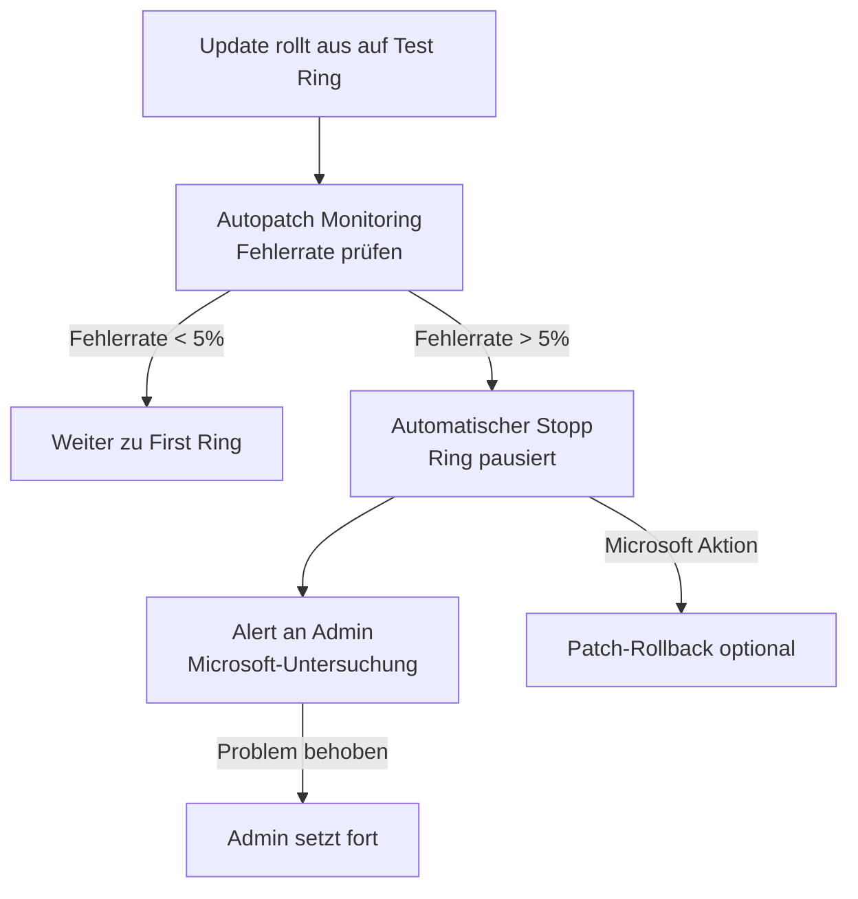

---
tags:
  - intune
  - autopatch
  - patch-management
  - windows-updates
  - microsoft365-apps
  - edge
  - automatisierung
aliases:
  - Microsoft Autopatch
  - Autopatch
  - Automatisches Patch Management
---

# Microsoft Autopatch

> [!ABSTRACT] TL;DR
> Microsoft Autopatch automatisiert das Windows-Patching vollständig — keine manuellen Update-Ringe, keine ADRs (Automatic Deployment Rules), keine Wartungsfenster-Konfiguration. Microsoft übernimmt die Orchestrierung für Windows Quality Updates, Feature Updates, Microsoft 365 Apps, Edge und Teams. Verfügbar ab Windows 10/11 Enterprise E3 — keine separate Suite-Lizenz nötig.

---

## Konzept: Was übernimmt Autopatch?

Traditionelles Patch Management erfordert erheblichen manuellen Aufwand:
- Windows Server Update Services (WSUS) oder MECM konfigurieren
- Deployment Rings manuell anlegen und pflegen
- ADRs (Automatic Deployment Rules) pro Produkt erstellen
- Wartungsfenster definieren
- Fehlerbehandlung bei gescheiterten Updates

**Microsoft Autopatch übernimmt all das:**



---

## Abgedeckte Produkte

| Produkt | Autopatch-Abdeckung |
|---------|---------------------|
| **Windows Quality Updates** | ✅ Vollständig automatisiert (Sicherheitspatches) |
| **Windows Feature Updates** | ✅ Konfigurierbar (z.B. auf 23H2 halten oder automatisch upgraden) |
| **Microsoft 365 Apps** | ✅ Monthly Enterprise Channel Updates |
| **Microsoft Edge** | ✅ Stable Channel Updates |
| **Microsoft Teams** | ✅ automatische Updates |
| **Windows Defender** | ❌ Separat über Intune/MDE |
| **Drittanbieter-Apps** | ❌ Nicht in Autopatch |

> [!NOTE] Nur Microsoft-Produkte
> Autopatch verwaltet ausschließlich Microsoft-Produkte. Drittanbieter-Patching (Chrome, Adobe, Java, etc.) bleibt Aufgabe von Intune Software-Deployment, MECM oder eines Third-Party-Patching-Tools.

---

## Lizenzierung und Voraussetzungen

### Lizenz-Voraussetzungen

| Lizenz | Autopatch verfügbar? |
|--------|---------------------|
| **Windows 10/11 Enterprise E3** | ✅ |
| **Windows 10/11 Enterprise E5** | ✅ |
| **Microsoft 365 E3** | ✅ (enthält Enterprise E3) |
| **Microsoft 365 E5** | ✅ |
| **Windows 10/11 Business** | ❌ |
| **Windows 10/11 Pro** | ❌ |
| **Microsoft 365 Business Premium** | ❌ |

> [!IMPORTANT] Kein Intune Suite Add-on
> Autopatch ist **nicht** im Intune Suite Bundle enthalten und erfordert keine Suite-Lizenz. Es ist in Windows Enterprise E3/E5 enthalten — was auch M365 E3/E5 bedeutet.

### Geräte-Voraussetzungen

- Windows 10 Version 1809 oder höher, Windows 11
- Intune-Enrollment (oder Co-Management mit Intune als Authority)
- Entra ID Join oder **Hybrid Entra ID Join**
- Telemetrie: Windows Diagnostic Data mindestens "Required"
- Keine Konflikte mit bestehenden Windows Update Policies

---

## Deployment Rings: Standard-Konfiguration

Autopatch teilt Geräte automatisch in vier Ringe auf:

| Ring | Anteil | Beschreibung | Wartezeit |
|------|--------|-------------|-----------|
| **Test** | ~1% | Frühe Tester, IT-Geräte | Sofort bei Patch Tuesday |
| **First** | ~9% | Power User, IT-affine Mitarbeiter | 7 Tage nach Test |
| **Fast** | ~40% | Breite Benutzergruppe | 14 Tage nach Test |
| **Broad** | ~50% | Alle verbleibenden Geräte | 21 Tage nach Test |

### Beispiel-Zeitplan für Sicherheitspatch (Patch Tuesday)

```
Dienstag (Patch Tuesday):
  14. Januar: Test Ring → 1% der Geräte erhalten KB-Patch

Woche 2:
  21. Januar: First Ring → 9% der Geräte (wenn kein Stopp)

Woche 3:
  28. Januar: Fast Ring → 40% der Geräte

Woche 4:
  4. Februar: Broad Ring → 50% der Geräte
```

> [!TIP] Test Ring bewusst befüllen
> Weise dem **Test Ring** explizit IT-Geräte oder Test-VMs zu. Diese Geräte erhalten Updates zuerst und ermöglichen frühzeitige Problemerkennung vor dem Rollout an alle Benutzer.

---

## Autopatch Groups: Benutzerdefinierte Ringe

**Autopatch Groups** (ab 2023) ermöglichen benutzerdefinierte Ring-Strukturen für verschiedene Abteilungen oder Standorte:

### Warum Autopatch Groups?

- Verschiedene Abteilungen haben unterschiedliche Risikotoleranz
- Kritische Systeme (Produktion) brauchen längere Wartezeiten
- Standort-basierte Rollouts für globale Unternehmen
- Separate Gruppen für VIP-Benutzer (C-Level)

### Autopatch Group konfigurieren

**Intune Admin Center** → Devices → Windows Updates → Autopatch Groups → Create:

```
Autopatch Group: "Finance-Team"

Deployment Rings:
  Ring 1 (Test):   Gruppe: grp-finance-test-devices    (10 Geräte)
  Ring 2 (Pilot):  Gruppe: grp-finance-powerusers      (50 Geräte)
  Ring 3 (Broad):  Gruppe: grp-finance-all             (restliche Geräte)

Update-Verzögerung:
  Ring 1 → Ring 2: 5 Tage (wenn kein Problem)
  Ring 2 → Ring 3: 10 Tage
```

### Updatepolicies pro Group

Jede Autopatch Group kann separate Policies haben:
- **Quality Update Deferral:** Zusätzliche Verzögerung (0-30 Tage)
- **Feature Update Version:** Auf welcher Windows-Version halten (z.B. 22H2)
- **Deadline:** Maximale Zeit bis erzwungener Install
- **Aktivzeiten:** Wann dürfen Neustarts stattfinden (Active Hours)

---

## Aktivierung: Autopatch einschalten

### Schritt-für-Schritt Aktivierung

**Schritt 1: Voraussetzungen prüfen**

```powershell
# Autopatch Readiness prüfen (über Graph API)
Connect-MgGraph -Scopes "DeviceManagementConfiguration.ReadWrite.All"

$readiness = Invoke-MgGraphRequest -Method GET `
    -Uri "https://graph.microsoft.com/beta/deviceManagement/autopatchTenantStatus" `
    -OutputType PSObject

$readiness | Select-Object onboardingStatus, tenantRegistrationUrl | Format-List
```

**Schritt 2: Autopatch im Admin Center aktivieren**

```
Intune Admin Center → Devices → Windows Updates → Autopatch:
→ "Enroll" oder "Get Started"
→ Service Agreement akzeptieren
→ Tenant wird für Autopatch registriert (einmalig, dauert ca. 30 Min)
```

**Schritt 3: Geräte registrieren**

```
Intune Admin Center → Devices → Windows Updates → Autopatch → Devices:
→ "Register Devices"
→ Entra ID-Gruppe auswählen (z.B. grp-autopatch-all-windows)
→ Geräte werden automatisch auf die vier Standard-Ringe verteilt
```

**Schritt 4: Ring-Zuweisung anpassen (optional)**

```
Devices → Windows Updates → Release Management:
→ Test Ring: IT-Geräte explizit hinzufügen
→ Überprüfen: Verteilung der Geräte auf Ringe
```

---

## Reporting: Update Health Dashboard

**Intune Admin Center** → Reports → Windows Updates:

### Update Compliance Report

| Spalte | Beschreibung |
|--------|-------------|
| **Device** | Gerätename |
| **Ring** | Test/First/Fast/Broad |
| **OS Version** | Aktuelle Windows-Version |
| **Patch Status** | Up to date / Needs attention / In progress |
| **Last Check-in** | Letzter Kontakt |

### Windows Update Health

Übersicht über den Update-Status der gesamten Umgebung:

```
Windows Update Health Report:
- Aktuelle Windows-Version pro Ring (Prozent)
- Geräte mit ausstehenden Updates
- Fehlgeschlagene Updates (mit Error Code)
- Alerts: Geräte die seit >21 Tagen kein Update erhalten haben
```

### Alerts bei Problemen

Autopatch generiert automatisch Alerts bei:
- Hohe Fehlerrate bei einem Patch (> 5% der Geräte)
- Patch Tuesday passed, aber Ring hat Update noch nicht erhalten
- Gerät seit >30 Tagen nicht eingecheckt
- Windows Diagnostic Data deaktiviert (Autopatch kann nicht funktionieren)

---

## Automatischer Stopp und Rollback

Autopatch überwacht die Update-Gesundheit aktiv:



> [!IMPORTANT] Kein vollautomatischer Rollback
> Autopatch **pausiert** den Rollout automatisch, führt aber keinen automatischen Rollback durch. Rollbacks müssen manuell durch den Admin ausgelöst werden (oder durch Wiederherstellungspunkt).

---

## Vergleich: Autopatch vs. Windows Update for Business vs. MECM

| Aspekt | Autopatch | WUfB Rings | MECM/ConfigMgr |
|--------|-----------|-----------|----------------|
| **Konfigurationsaufwand** | Minimal (einmalig) | Mittel | Hoch |
| **Granularität** | Mittel (Ringe) | Hoch | Sehr hoch |
| **On-Premises Infra** | Nicht nötig | Nicht nötig | Server nötig |
| **Microsoft 365 Apps** | ✅ | ❌ | ✅ |
| **Edge Updates** | ✅ | ❌ | ✅ |
| **Drittanbieter-Apps** | ❌ | ❌ | ✅ |
| **Feingranulare Kontrolle** | ❌ | ✅ | ✅ |
| **Rollback-Automatismus** | Pause | Manuell | Manuell |
| **Zielgruppe** | M365 E3/E5 Cloud-First | Intune-Kunden | Enterprise/Hybrid |

---

## Fehlerbehebung: Häufige Autopatch-Probleme

### Gerät erscheint nicht in Autopatch

```powershell
# Autopatch Enrollment-Status prüfen
Connect-MgGraph -Scopes "DeviceManagementConfiguration.Read.All"

$device = Invoke-MgGraphRequest -Method GET `
    -Uri "https://graph.microsoft.com/beta/deviceManagement/autopatchDeviceRegistrations?`$filter=deviceName eq 'DESKTOP-CONTOSO01'" `
    -OutputType PSObject

$device.value | Select-Object deviceName, registrationStatus, lastUpdatedDateTime | Format-List
```

**Häufige Ursachen:**
| Problem | Lösung |
|---------|--------|
| Windows Diagnostic Data deaktiviert | GPO/Intune: Diagnostic Data = Required |
| Windows Update blockiert (WSUS-Redirect) | WSUS-Override entfernen, Windows Update direkt |
| Falsche Windows-Edition (Pro statt Enterprise) | Upgrade auf Enterprise E3/E5 |
| Gerät nicht Hybrid-joined | Entra ID Join oder Hybrid Join konfigurieren |
| Concurrent Policy-Konflikt | Bestehende WUfB-Policies deaktivieren |

### Update-Pause manuell aufheben

```
Intune Admin Center → Devices → Windows Updates → Release Management:
→ [Ring auswählen] → "Resume deployment"
→ Oder: Pause für spezifisches Update aufheben
```

---

## Integration mit Windows Update for Business

Autopatch und WUfB (Windows Update for Business) können **nicht parallel** auf denselben Geräten aktiv sein. Autopatch deaktiviert conflicting WUfB-Policies automatisch:

```
Warnung: "Conflicting policy detected"
→ Vorhandene WUfB-Deferral-Policies werden von Autopatch überschrieben
→ Empfehlung: WUfB-Policies für Autopatch-Geräte entfernen
→ Autopatch übernimmt die vollständige Update-Orchestrierung
```

> [!NOTE] Co-existenz möglich für nicht-Autopatch-Geräte
> WUfB bleibt weiterhin nutzbar für Geräte, die **nicht** in Autopatch enrolled sind (z.B. Windows Pro, Server, Nicht-E3-lizenzierte Geräte).

---

## Autopatch Service Health

Microsoft veröffentlicht Status-Updates für den Autopatch-Dienst:
- **Service Health Dashboard:** M365 Admin Center → Health → Service Health → Microsoft Intune
- Bei Autopatch-Dienststörungen: Automatische Pause aller Ring-Deployments
- Kommunikation über M365 Message Center

---

## Verwandte Notizen

- [[Microsoft Intune Suite Überblick]]
- [[Intune Grundlagen]]
- [[Windows Update for Business]]
- [[Konfigurationsprofile]]
- [[Compliance Policies]]
- [[Windows Autopilot]]
- [[Advanced Endpoint Analytics]]
