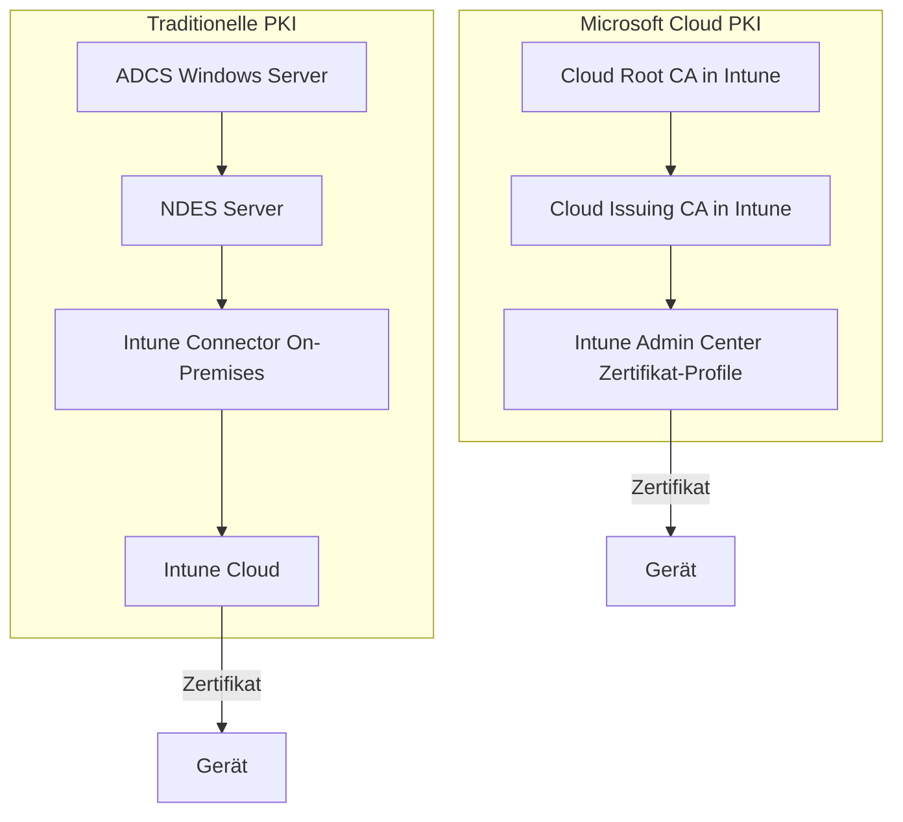

---
tags:
  - intune
  - intune-suite
  - cloud-pki
  - zertifikate
  - pki
  - scep
  - pkcs
  - sicherheit
aliases:
  - Cloud PKI
  - Microsoft Cloud PKI
  - Intune PKI
  - PKI Intune
---

# Microsoft Cloud PKI

> [!ABSTRACT] TL;DR
> Microsoft Cloud PKI ist eine vollständig verwaltete Public Key Infrastructure direkt in Intune — ohne On-Premises Active Directory Certificate Services (ADCS). Root CA und Issuing CA werden in der Cloud erstellt, Zertifikate über SCEP/PKCS-Profile verteilt. Anwendungsfälle: Wi-Fi, VPN, S/MIME, App-Authentifizierung. Enthalten im Intune Suite Bundle ($10/User/Monat).

---

## Konzept und Motivation

Traditionell erfordert die Zertifikatverteilung an Endpoints eine **On-Premises PKI-Infrastruktur**:
- Windows Server mit Active Directory Certificate Services (ADCS)
- Network Device Enrollment Service (NDES) für SCEP
- Intune Certificate Connector auf einem Windows-Server
- Hochverfügbarkeit, Backup, Patching der Server

**Microsoft Cloud PKI** ersetzt diese gesamte Infrastruktur durch eine vollständig in Intune verwaltete Lösung:



**Vorteile Cloud PKI:**
- Keine On-Premises Server mehr
- Kein Intune Certificate Connector
- Eingebaute Hochverfügbarkeit (Microsoft-managed)
- Automatische Erneuerung und Revocation
- Zentrales Monitoring im Intune Admin Center

---

## Lizenzierung

| Option | Preis | Hinweis |
|--------|-------|---------|
| **Intune Suite Bundle** | $10/User/Monat | Cloud PKI enthalten |
| **Cloud PKI als Einzellizenz** | ~$10/User/Monat | Selten sinnvoll, Bundle effizienter |
| **Intune Plan 2** | $4/User/Monat | Enthält Cloud PKI **nicht** |

> [!IMPORTANT] Voraussetzung: Intune Plan 1
> Wie alle Suite-Add-ons benötigt Cloud PKI eine bestehende Intune Plan 1 Lizenz. Die Root CA-Kapazität im Bundle: bis zu 2 Cloud Root CAs und 6 Cloud Issuing CAs pro Tenant.

---

## Architektur: Cloud Root CA und Issuing CA

### Cloud Root CA erstellen

**Intune Admin Center** → Tenant Administration → Cloud PKI → Create → Root CA:

| Parameter | Empfehlung |
|-----------|-----------|
| **CA Name** | Contoso Root CA 01 |
| **Validity Period** | 10 Jahre (Root CA langlebig) |
| **Key Size** | RSA 4096 bit |
| **Hash Algorithm** | SHA-384 |
| **Subject** | CN=Contoso Root CA 01, O=Contoso GmbH, C=DE |

> [!NOTE] Root CA ist offline
> Die Cloud Root CA verhält sich wie eine traditionelle **Offline Root CA** — sie stellt selbst keine Zertifikate für Endgeräte aus, sondern nur für Issuing CAs. Das entspricht PKI Best Practices.

### Cloud Issuing CA erstellen

**Intune Admin Center** → Cloud PKI → Create → Issuing CA:

| Parameter | Empfehlung |
|-----------|-----------|
| **CA Name** | Contoso Issuing CA 01 |
| **Root CA** | Contoso Root CA 01 (auswählen) |
| **Validity Period** | 5 Jahre |
| **Key Size** | RSA 2048 bit |
| **Subject** | CN=Contoso Issuing CA 01, O=Contoso GmbH, C=DE |
| **CRL Distribution Point** | Automatisch (Microsoft CDN) |

Nach der Erstellung:
- CRL Distribution Points werden automatisch konfiguriert
- OCSP (Online Certificate Status Protocol) ist integriert
- Die CA ist sofort bereit für Zertifikat-Profile

### PKI-Hierarchie-Übersicht

```
Contoso Root CA 01 (Cloud Root CA, 10 Jahre)
└── Contoso Issuing CA 01 (Cloud Issuing CA, 5 Jahre)
    ├── Geräte-Zertifikate (Wi-Fi, VPN) – 1 Jahr
    ├── Benutzer-Zertifikate (S/MIME, Wi-Fi) – 1 Jahr
    └── App-Zertifikate – konfigurierbar
```

---

## SCEP-Zertifikat-Profile deployen

**SCEP** (Simple Certificate Enrollment Protocol) ist der empfohlene Mechanismus für Geräte- und Benutzerzertifikate in Intune.

### SCEP-Profil erstellen

**Intune Admin Center** → Devices → Configuration Profiles → Create → Templates → SCEP Certificate:

```
Platform: Windows 10 and later
Profile Type: SCEP Certificate

Konfiguration:
- Certificate Type: Device (für Gerätezertifikate) oder User (für Benutzerzertifikate)
- Subject Name Format: CN={{DeviceId}} oder CN={{UserPrincipalName}}
- Subject Alternative Name: 
    - User Principal Name (UPN): {{UserPrincipalName}}
    - DNS: {{DeviceName}}.contoso.com
- Certificate Validity Period: 1 Year
- Key Storage Provider (KSP): Enroll to Trusted Platform Module (TPM) if present
- Key Usage: Digital Signature, Key Encipherment
- Extended Key Usage: Client Authentication (1.3.6.1.5.5.7.3.2)
- Renewal Threshold: 20%
- SCEP Server URLs: [automatisch durch Cloud PKI ausgefüllt]
- Root Certificate: [Trusted Certificate Profile auswählen]
```

> [!TIP] Trusted Certificate Profile zuerst
> Bevor SCEP-Profile deployt werden, muss ein **Trusted Certificate Profile** mit dem Root CA Zertifikat deployt werden. Das SCEP-Profil referenziert dieses Profil für die Chain-Validierung.

### Trusted Certificate Profile (Root CA)

```
Platform: Windows 10 and later
Profile Type: Trusted Certificate

Certificate File: [Root CA .cer Datei aus Intune/Cloud PKI herunterladen]
Destination Store: Computer certificate store - Root
```

### SCEP für verschiedene Plattformen

| Plattform | Subject Format | Besonderheit |
|-----------|---------------|-------------|
| **Windows** | `CN={{DeviceId}}` | TPM-Binding möglich |
| **iOS/iPadOS** | `CN={{UserPrincipalName}}` | Keychain-Storage |
| **Android** | `CN={{DeviceId}}` | Android Keystore |
| **macOS** | `CN={{DeviceId}}` | Keychain, User-Zertifikate |

---

## PKCS-Zertifikat-Profile (PKCS#12)

**PKCS** (Public-Key Cryptography Standards) exportiert Zertifikate inkl. privatem Schlüssel — geeignet für S/MIME und Szenarien wo der private Schlüssel exportierbar sein muss.

> [!WARNING] PKCS vs. SCEP Sicherheit
> Bei PKCS generiert Intune das Schlüsselpaar **serverseitig** — der private Schlüssel verlässt kurzzeitig das Gerät. Bei SCEP wird das Schlüsselpaar **auf dem Gerät** generiert (sicherer). SCEP bevorzugen wo möglich.

### PKCS-Profil erstellen

```
Platform: Windows 10 and later
Profile Type: PKCS Certificate

- Certification Authority: [Cloud PKI Issuing CA auswählen]
- Certification Authority name: Contoso Issuing CA 01
- Certificate template name: User (oder angepasster Template-Name)
- Certificate Type: User
- Subject Name Format: CN={{UserPrincipalName}}
- Subject Alternative Name: UPN = {{UserPrincipalName}}
- Certificate Validity Period: 1 Year
- Key Storage Provider: Software KSP
- Key Usage: Digital Signature, Key Encipherment, Data Encipherment
- Extended Key Usage: 
    - Secure Email (1.3.6.1.5.5.7.3.4) für S/MIME
    - Client Authentication (1.3.6.1.5.5.7.3.2)
```

---

## Anwendungsfälle

### Wi-Fi-Authentifizierung mit Zertifikaten

802.1X Enterprise Wi-Fi mit Zertifikatsauthentifizierung (EAP-TLS):

```
Intune Wi-Fi Profil:
- Authentication Method: Certificate (EAP-TLS)
- Certificate: [SCEP Profil auswählen]
- Root Certificate for Server Validation: [Trusted Certificate Profil]
- Wi-Fi Type: WPA2-Enterprise
- EAP Type: EAP-TLS
```

**Ablauf:**
1. Gerät verbindet sich mit SSID
2. RADIUS-Server fordert Zertifikat an
3. Intune-SCEP-Zertifikat wird präsentiert
4. RADIUS validiert gegen CA Chain
5. Zugriff gewährt ohne Benutzername/Passwort

### VPN-Zertifikate

Für Zertifikat-basierte VPN-Authentifizierung (IKEv2, SSTP, Always On VPN):

```
VPN Profil in Intune:
- Connection Type: IKEv2 / Microsoft Tunnel / Always On VPN
- Authentication Method: Certificate
- Client Certificate: [SCEP Profil – Device oder User]
```

### S/MIME für E-Mail-Verschlüsselung

```
- PKCS-Zertifikat (User, Secure Email EKU)
- Deployed via Intune auf Windows/iOS/Android
- Outlook verknüpft automatisch mit S/MIME-Einstellung
- Aktivierung: Intune Email Profil → S/MIME = Enable
```

### App-Authentifizierung

Für Apps die Mutual TLS (mTLS) gegen interne APIs benötigen:
- SCEP-Zertifikat auf dem Gerät deployen
- App referenziert Zertifikat aus Windows Certificate Store
- Keine Passwörter im App-Code

---

## Zertifikat-Revocation

### Revocation über Intune

**Automatische Revocation:**
- Gerät wird aus Intune entfernt (Retire/Wipe) → Zertifikat wird automatisch revoked
- Benutzer verlässt Organisation → Gerätezertifikate revoked

**Manuelle Revocation:**
```
Intune Admin Center → Devices → [Gerät auswählen] → Certificates
→ [Zertifikat auswählen] → Revoke
```

### CRL und OCSP

Cloud PKI stellt automatisch bereit:
- **CRL (Certificate Revocation List):** Wird über Microsoft CDN verteilt, kurze TTL
- **OCSP Responder:** Online-Status-Check für Clients die OCSP unterstützen

> [!NOTE] Revocation für externe Ressourcen
> Wenn Zertifikate gegen externe RADIUS-Server oder Firewalls validiert werden, müssen diese CDN-Endpunkte für CRL/OCSP erreichbar sein.

---

## Monitoring und Ablauf-Überwachung

### Zertifikat-Übersicht im Intune Admin Center

**Intune Admin Center** → Devices → Monitor → Certificates:
- Alle ausgestellten Zertifikate pro Gerät
- Ablaufdatum
- Status (Active/Revoked/Expired)
- Zugehöriges Profil

### PowerShell: Ablaufende Zertifikate abfragen

```powershell
Connect-MgGraph -Scopes "DeviceManagementConfiguration.Read.All"

# Alle Geräte-Zertifikate die in 30 Tagen ablaufen
$expiryDate = (Get-Date).AddDays(30).ToString("yyyy-MM-ddTHH:mm:ssZ")

$expiring = Invoke-MgGraphRequest -Method GET `
    -Uri "https://graph.microsoft.com/beta/deviceManagement/managedDevices?`$expand=deviceConfigurationStates" `
    -OutputType PSObject

# Zertifikat-Details über Graph
$certs = Invoke-MgGraphRequest -Method GET `
    -Uri "https://graph.microsoft.com/beta/deviceManagement/deviceConfigurations/{profileId}/deviceStatuses" `
    -OutputType PSObject
```

```powershell
# Zertifikatdetails eines Geräts prüfen (lokal auf dem Gerät)
Get-ChildItem -Path Cert:\LocalMachine\My | Where-Object {
    $_.NotAfter -lt (Get-Date).AddDays(30) -and
    $_.Issuer -like "*Contoso Issuing CA*"
} | Select-Object Subject, Issuer, NotAfter, Thumbprint | Format-Table -AutoSize
```

---

## Migration von On-Premises ADCS zu Cloud PKI

### Migrationsstrategie


### Checkliste Migration

- [ ] Cloud Root CA und Issuing CA in Intune erstellen
- [ ] Trusted Certificate Profile für neue Root CA deployen
- [ ] SCEP/PKCS Profile für Cloud PKI erstellen
- [ ] Pilotgruppe (10% der Geräte) auf Cloud PKI umstellen
- [ ] Zertifikats-basierte Services (Wi-Fi, VPN) testen
- [ ] Graduelle Ausweitung auf alle Geräte
- [ ] ADCS-ausgestellte Zertifikate ablaufen lassen (nicht zwingend revoken)
- [ ] NDES Server, Intune Connector abschalten
- [ ] ADCS-Server außer Betrieb nehmen

> [!TIP] Parallelbetrieb möglich
> Während der Migration können ADCS-alte Zertifikate und Cloud PKI-neue Zertifikate gleichzeitig auf Geräten existieren. Services validieren beide CAs solange beide Trusted Certificate Profiles deployt sind.

---

## Verwandte Notizen

- [[Microsoft Intune Suite Überblick]]
- [[Intune Grundlagen]]
- [[Konfigurationsprofile]]
- [[Endpoint Security]]
- [[Microsoft Tunnel]]
- [[Conditional Access]]
