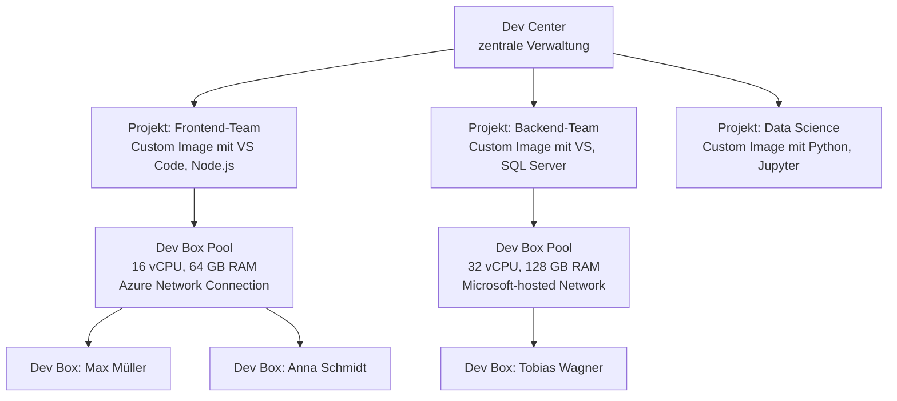
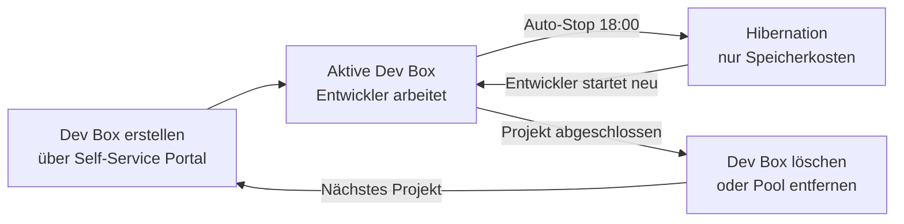

---
tags:
  - microsoft365
  - dev-box
  - entwickler
  - cloud-workstation
  - azure
  - developer-tools
  - devops
aliases:
  - Microsoft Dev Box
  - Dev Box
  - Cloud Developer Workstation
  - Entwickler-Workstation Cloud
---

# Microsoft Dev Box

> [!ABSTRACT] TL;DR
> Microsoft Dev Box stellt Cloud-basierte Entwicklerworkstations zur Verfügung — vollständig verwaltet, Intune-enrolled, mit Self-Service-Portal für Entwickler. Architektur: Dev Center → Projekte → Dev Box Pools → individuelle Dev Box. Kosten: Abrechnung nach Active Hours + Speicher, Hibernation spart Kosten. Separat lizenziert, nicht im Intune Suite Bundle.

---

## Konzept und Motivation

Traditionelle Entwickler-Workstations haben mehrere Probleme:
- **Onboarding dauert Tage** (Hardware bestellen, einrichten, Software installieren)
- **Hardware-Heterogenität** verursacht "Works on my machine"-Probleme
- **Sicherheit:** Entwickler oft lokale Admins, sensible Code-Repositories auf physischen Geräten
- **Remote-Work:** Leistungsstarke Workstations nicht überall verfügbar

**Dev Box löst das:**



---

## Lizenzierung und Kosten

### Lizenzoptionen

| Lizenz | Enthält | Preis |
|--------|---------|-------|
| **Microsoft 365 E3/E5** | Dev Box Verwaltung (Intune-Teil) | Im M365-Bundle |
| **Dev Box Compute** | Separate Abrechnung nach SKU | Siehe Tabelle unten |
| **Dev Box Standalone** | Ohne M365-Bundle | $10–$60/User/Monat (SKU-abhängig) |

> [!IMPORTANT] Dev Box ist nicht im Intune Suite Bundle
> Microsoft Dev Box ist **separat lizenziert** und nicht im Intune Suite ($10/User/Monat) enthalten. Abrechnung erfolgt nach genutzter Compute-SKU.

### Dev Box SKUs und Preise (2024/2025)

| SKU | vCPU | RAM | SSD | Preis/Stunde |
|-----|------|-----|-----|-------------|
| **General Purpose 8c** | 8 | 32 GB | 256 GB | ~$0.68/Stunde |
| **General Purpose 16c** | 16 | 64 GB | 512 GB | ~$1.36/Stunde |
| **General Purpose 32c** | 32 | 128 GB | 1024 GB | ~$2.72/Stunde |
| **Premium 8c** | 8 | 32 GB | 256 GB + GPU | ~$1.08/Stunde |
| **Premium 16c** | 16 | 64 GB | 512 GB + GPU | ~$2.16/Stunde |

> [!TIP] Hibernation = Kosteneinsparung
> Mit **Hibernation** werden Dev Boxes bei Inaktivität automatisch in den Ruhezustand versetzt. Abrechnung stoppt — nur Speicher wird weiter berechnet (~$0.05/GB/Monat). Entwickler arbeiten täglich 8 Stunden → ~40% Kostenreduktion gegenüber dauerhaftem Betrieb.

---

## Architektur: Dev Center → Projekte → Pools → Dev Box

### Dev Center

Ein **Dev Center** ist die übergeordnete Verwaltungseinheit:
- An eine Azure Subscription gebunden
- Enthält Projekte, Image-Definitionen, Netzwerk-Verbindungen
- Intune-Integration: automatisches Enrollment aller Dev Boxes

**Erstellen:**
```
Azure Portal → Dev Centers → Create Dev Center
→ Name: contoso-dev-center
→ Resource Group: rg-devcenter-prod
→ Region: West Europe
→ Microsoft Hosted Network oder eigenes VNet
→ Intune-Integration aktivieren (empfohlen)
```

### Projekte

Projekte segmentieren Dev Boxes nach Team, Anwendung oder Zweck:

```
Dev Center: contoso-dev-center
├── Projekt: webapp-frontend
│   ├── Dev Box Definition: Frontend-Dev (16c, 64GB, Win11 + VS Code)
│   └── Dev Box Pool: Pool-Frontend-WestEurope
├── Projekt: api-backend
│   ├── Dev Box Definition: Backend-Dev (32c, 128GB, Win11 + VS 2022)
│   └── Dev Box Pool: Pool-Backend-WestEurope
└── Projekt: mobile-app
    ├── Dev Box Definition: Mobile-Dev (16c, 64GB, Win11 + Android Studio)
    └── Dev Box Pool: Pool-Mobile-WestEurope
```

### Dev Box Pools

Ein Pool definiert:
- **Dev Box Definition** (Image + SKU)
- **Netzwerk-Verbindung** (Microsoft-hosted oder eigenes VNet)
- **Region** (wo die Dev Box läuft)
- **Lizenz-Typ** (Windows-Lizenz aus M365 oder eigene)
- **Auto-Stop/Hibernation** (z.B. täglich um 18:00 Uhr)

---

## Images: Marketplace und Custom Images

### Azure Marketplace Images

Vorkonfigurierte Images direkt aus dem Azure Marketplace:

| Image | Enthält |
|-------|---------|
| **Windows 11 Enterprise + Microsoft 365 Apps** | Basis-Entwickler-Image |
| **Visual Studio 2022 Enterprise** | VS 2022, .NET, C++ Tools |
| **Visual Studio 2022 + GitHub Copilot** | VS 2022 + Copilot |
| **Windows 11 + Dev Tools** | VS Code, Git, Node.js, Python |

### Custom Images (Azure Compute Gallery)

Für organisationsspezifische Software:

**Schritt 1: Basis-Image anpassen**
```powershell
# Dev Box mit Marketplace-Image erstellen
# Entwickler-Software installieren:
winget install Microsoft.VisualStudioCode
winget install Git.Git
winget install Microsoft.DotNet.SDK.8
winget install JetBrains.Rider

# Alle Windows-Updates installieren
# Sysprep vorbereiten (wird von Azure automatisch ausgeführt)
```

**Schritt 2: Image in Azure Compute Gallery speichern**
```
Azure Portal → Compute Gallery → [Gallery auswählen]
→ Image Definitions → Create
→ VM-Definition erstellen: Windows 11, x64, Gen2
→ Image Version aus Dev Box erstellen
→ Replizierung: West Europe, North Europe
```

**Schritt 3: Custom Image in Dev Center nutzen**
```
Dev Center → Dev Box Definitions → Create
→ Image: Custom Image aus Compute Gallery
→ SKU: 16 vCPU, 64 GB RAM, 512 GB SSD
→ Name: contoso-developer-image-v2
```

---

## Netzwerk-Optionen

### Microsoft-hosted Network

- **Kein eigenes Azure VNet nötig**
- Dev Box hat Internetzugang über Microsoft-Infrastruktur
- **Kein Zugriff** auf on-premises oder Azure-interne Ressourcen
- Einfachste Option für rein Cloud-native Entwicklung
- Microsoft Tunnel oder Always-On VPN für On-Prem-Zugriff kombinierbar

### Azure Network Connection (ANC)

Dev Box wird in ein **eigenes Azure VNet** eingebunden:

```
Azure Portal → Dev Centers → Network Connections → Create
→ Network Type: Azure AD Join (für rein Cloud) 
              oder Hybrid AD Join (für On-Prem-Zugriff)
→ VNet: vnet-devcenter-prod
→ Subnet: snet-devbox
→ Domain: corp.contoso.com (nur bei Hybrid Join)
```

**Vorteile ANC:**
- Direkter Zugriff auf interne Ressourcen (Git-Server, Artifact-Server, Datenbanken)
- Keine VPN-Konfiguration für Entwickler nötig
- Network Security Groups für Zugriffssteuerung

| Option | Kosten | Internetzugang | On-Prem Zugriff |
|--------|--------|---------------|-----------------|
| Microsoft-hosted | Keine zusätzlichen | ✅ | ❌ (ohne VPN) |
| ANC (Azure VNet) | VNet-Kosten | ✅ | ✅ |

---

## Intune-Integration und Conditional Access

### Automatisches Intune-Enrollment

Dev Boxes werden automatisch bei Erstellung in **Microsoft Intune** enrolled:
- Entra ID Join (Azure AD Join)
- Intune MDM-Enrollment automatisch
- Compliance-Policies greifen sofort
- Konfigurationsprofile werden angewendet

### Conditional Access für Dev Boxes

```
Conditional Access Richtlinie für Dev Boxes:
- Ziel: Cloud Apps = Microsoft Dev Box
- Bedingungen:
    - Device Platform: Windows
    - Compliance: Compliant required
- Gewähren: Zugriff erlauben (wenn compliant)
```

> [!NOTE] Dev Box als verwaltetes Gerät
> Da Dev Boxes automatisch in Intune enrolled sind, können alle normalen Intune-Features genutzt werden: EPM, Defender, Compliance-Policies, Configuration-Profiles, etc.

---

## Entwickler-Self-Service-Portal

Entwickler erstellen ihre Dev Boxes selbst — kein IT-Ticket nötig:

**Portal:** [https://devbox.microsoft.com](https://devbox.microsoft.com)

```
Entwickler öffnet devbox.microsoft.com:
1. Anmeldung mit Unternehmens-Account (Entra ID)
2. Verfügbare Projekte: [webapp-frontend] [api-backend]
3. "New Dev Box" klicken
4. Projekt wählen, Pool wählen (bei mehreren Optionen)
5. Name eingeben: max-devbox-01
6. "Create" klicken
→ Dev Box wird erstellt (ca. 20-30 Minuten)
→ Verbindung via Browser (Windows App / RDP / Web Client)
```

### Verbindungsoptionen

| Client | Beschreibung |
|--------|-------------|
| **Windows App** | Natives Windows-Client (beste Performance) |
| **Webbrowser** | Kein Client-Installation nötig (HTML5) |
| **Remote Desktop Client** | Klassisches RDP |
| **VS Code Remote** | VS Code direkt gegen Dev Box (Dev Tunnels) |

---

## Vergleich: Dev Box vs. GitHub Codespaces vs. Azure Virtual Desktop

| Aspekt | Dev Box | GitHub Codespaces | Azure Virtual Desktop |
|--------|---------|------------------|-----------------------|
| **Zielgruppe** | Entwickler (Windows) | Entwickler (Browser/VS Code) | Alle Benutzer |
| **OS** | Windows 11 | Linux (Container) | Windows 10/11 |
| **Intune-Enrollment** | ✅ Automatisch | ❌ | ✅ Möglich |
| **Persistent Storage** | ✅ (SSD im Image) | ⚠️ Begrenzt | ✅ (Azure Files) |
| **GPU-Unterstützung** | ✅ Premium SKU | ❌ | ✅ |
| **Self-Service** | ✅ devbox.microsoft.com | ✅ github.com/codespaces | ⚠️ Eingeschränkt |
| **Abrechnung** | Nach Active Hours | Nach Core Hours | Nach Sessions/Pools |
| **Hibernation** | ✅ | ⚠️ Auto-Timeout | ❌ |
| **Eigene Images** | ✅ Azure Compute Gallery | ✅ Dev Container | ✅ |
| **Windows-Anwendungen** | ✅ Vollständig | ❌ | ✅ |

---

## Cost Management: Dev Box Kosten optimieren

### Auto-Stop konfigurieren

```
Dev Box Pool → Settings → Auto-stop:
→ Schedule: Täglich um 18:00 Uhr (Zeitzone: Europe/Berlin)
→ Action: Stop (Hibernate)
→ Wochentage: Montag–Freitag
```

### Kostenberechnung Beispiel

```
Dev Box: 16 vCPU, 64 GB RAM, 512 GB SSD
SKU-Preis: ~$1.36/Stunde

Szenario A: Immer an (24/7)
→ $1.36 × 24h × 30 Tage = $979/Monat

Szenario B: Arbeitszeit + Hibernation (8h/Tag, 5 Tage/Woche)
→ Active: $1.36 × 8h × 22 Arbeitstage = ~$239
→ Speicher: 512 GB × $0.05 = ~$26
→ Gesamt: ~$265/Monat (73% Ersparnis)

Szenario C: Keine Nutzung (Urlaub/Wochenende) → Nur Speicherkosten
→ $0.05 × 512 GB = ~$26/Monat
```

> [!TIP] Hibernation vs. Stop
> **Hibernation** speichert den aktuellen Zustand (offene Dateien, Browser-Tabs) und startet schneller wieder. **Stop** (Deallocate) spart mehr Kosten, aber der Startvorgang dauert länger (Cold Start).

---

## Dev Box Sicherheit: Intune + Defender

Da Dev Boxes automatisch Intune-enrolled sind, gelten alle Sicherheitsfeatures:

```powershell
# Compliance Policy für Dev Boxes (Beispiel)
# Strenge Compliance da Entwickler oft elevated Zugriff haben:
{
  "displayName": "Dev Box Compliance Policy",
  "scheduledActionsForRule": [...],
  "deviceCompliancePolicyScript": null,
  "complianceSettings": {
    "bitLockerEnabled": true,
    "secureBootEnabled": true,
    "codeIntegrityEnabled": true,
    "storageRequireEncryption": true,
    "defenderEnabled": true,
    "defenderVersion": "1.1.19700.4",
    "osMinimumVersion": "10.0.19041"
  }
}
```

**Microsoft Defender for Endpoint** Integration:
- Automatisch auf Dev Boxes verfügbar
- EDR (Endpoint Detection & Response) aktiv
- Defender-Alerts erscheinen in Microsoft Defender Portal
- Isolierung einer kompromittierten Dev Box direkt aus MDE

---

## Dev Box Lifecycle Management



**Best Practice:**
- Dev Box-Namen konventionieren: `{username}-{projekt}-{nummer}` (z.B. mmueller-webapp-01)
- Inaktive Dev Boxes nach 30 Tagen automatisch löschen (Auto-delete Policy)
- Custom Images monatlich aktualisieren (Basis-Image + Patches)

---

## Verwandte Notizen

- [[Microsoft Intune Suite Überblick]]
- [[Intune Grundlagen]]
- [[Windows Autopilot]]
- [[Compliance Policies]]
- [[Conditional Access]]
- [[Endpoint Privilege Management EPM]]
