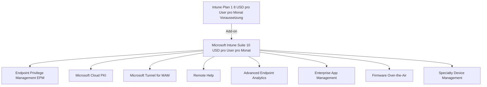
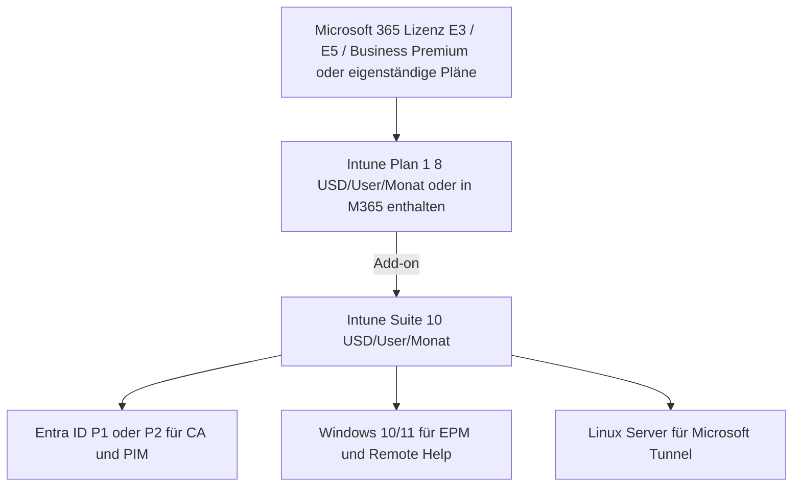
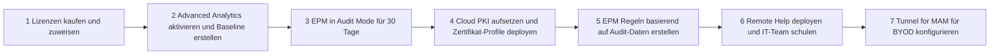
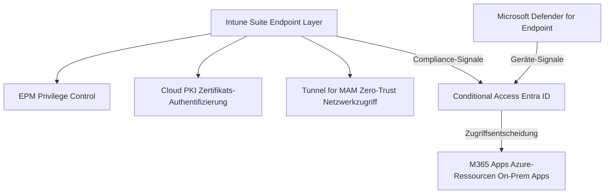

---
tags:
  - intune
  - intune-suite
  - überblick
  - lizenzierung
  - add-ons
  - microsoft365
  - endpoint-management
aliases:
  - Intune Suite
  - Intune Suite Überblick
  - Microsoft Intune Suite
  - Intune Add-ons
---

# Microsoft Intune Suite Überblick

> [!ABSTRACT] TL;DR
> Die Microsoft Intune Suite ist ein Add-on-Bundle zu Intune Plan 1, das premium Endpoint-Management-Funktionen für $10/User/Monat bündelt. Enthaltene Komponenten: Endpoint Privilege Management, Cloud PKI, Tunnel for MAM, Remote Help, Advanced Analytics, Enterprise App Management und mehr. Microsoft Autopatch und Lighthouse sind separate Angebote und nicht im Bundle.

---

## Was ist die Intune Suite?

Die **Microsoft Intune Suite** (ab März 2023 verfügbar) bündelt premium Add-ons für erweiterte Endpoint-Verwaltung und -Sicherheit in einem einzigen SKU. Statt jede Funktion einzeln zu lizenzieren, erhalten Kunden alle Suite-Komponenten zu einem Paketpreis.



---

## Alle Suite-Komponenten im Überblick

### Im Intune Suite Bundle enthaltene Add-ons

| Komponente | Zweck | Zielgruppe |
|-----------|-------|-----------|
| **[[Endpoint Privilege Management EPM]]** | Least-Privilege für Windows: temporäre Admin-Rechte für spezifische Apps | Alle Windows-Umgebungen |
| **[[Microsoft Cloud PKI]]** | Vollverwaltete PKI-Infrastruktur ohne On-Premises CA | Alle die Zertifikate für Wi-Fi/VPN/S/MIME benötigen |
| **[[Microsoft Tunnel]] for MAM** | VPN für BYOD-Geräte ohne MDM-Enrollment | BYOD-Szenarien |
| **[[Remote Help]]** | Integrierter Remote-Support direkt aus Intune | IT-Support-Teams |
| **[[Advanced Endpoint Analytics]]** | KI-Anomalie-Erkennung, Device Timeline, Custom Scripts | Mittlere und große Unternehmen |
| **Enterprise App Management** | App-Katalog mit automatischen App-Updates | Unternehmen mit vielen Win32-Apps |
| **Firmware Over-the-Air Updates** | BIOS/Firmware-Updates für Surface und DFCI-fähige Geräte | Surface-Kunden, DFCI-Hardware |
| **Specialty Device Management** | AR/VR-Headsets, Smart Displays, Konferenzraum-Geräte | Unternehmen mit Spezialgeräten |

> [!NOTE] Enterprise App Management
> Enterprise App Management (EAM) bietet einen kurierten App-Katalog (Chrome, Firefox, Zoom, VLC, etc.) mit automatischer Patch-Erkennung und Deployment. Ab 2024 im Suite-Bundle enthalten.

---

## Nicht im Bundle: Separate Add-ons und Produkte

| Produkt | Lizenzierung | Grund |
|---------|-------------|-------|
| **[[Microsoft Autopatch]]** | In Windows Enterprise E3/E5 enthalten | Separate Lizenz, kein Suite-Add-on |
| **[[Microsoft 365 Lighthouse]]** | Kostenlos für CSP-Partner | Separate Plattform |
| **[[Microsoft Dev Box]]** | Separate SKU (nach Compute-Stunden) | Azure-Dienst, nicht Intune Suite |
| **Intune Plan 2** | $4/User/Monat | Bietet Teilmenge der Suite-Features |

---

## Lizenzierung: Preise 2024/2025

### Vollständige Preisübersicht

| SKU | Preis/User/Monat | Enthält |
|-----|-----------------|---------|
| **Intune Plan 1** | $8,00 | Basis MDM/MAM, Kern-Intune-Features |
| **Intune Plan 2** (Add-on) | $4,00 | Tunnel für MDM, Advanced Analytics (Basis), Firmware OTA |
| **Intune Suite** (Add-on) | $10,00 | Plan 2 + EPM + Cloud PKI + Tunnel for MAM + Remote Help + EAM + mehr |

**Gesamtkosten pro Benutzer:**
```
Intune Plan 1 + Intune Suite = $8 + $10 = $18/User/Monat

In Microsoft 365 E3/E5 enthalten:
M365 E3 ($36/User/Monat) enthält Intune Plan 1 → + $10 Suite = $46/User/Monat gesamt
```

> [!TIP] Bundle vs. Einzellizenz-Vergleich
> Wenn mehr als 2 Einzellizenz-Add-ons benötigt werden, ist das **Suite-Bundle preiswerter**:
> - EPM einzeln: ~$3/User/Monat
> - Remote Help einzeln: ~$3/User/Monat
> - Cloud PKI einzeln: ~$5/User/Monat (enthalten im Suite)
> **Summe Einzeln: ~$11 > Suite: $10** → Suite-Bundle meist sinnvoller

### Einzellizenz-Add-ons (wenn Suite zu groß)

| Add-on | Preis | Für wen sinnvoll |
|--------|-------|-----------------|
| **Remote Help** | ~$3/User/Monat | Nur Support-Teams brauchen Remote Help |
| **EPM** | ~$3/User/Monat | Nur spezifische Windows-Flotten |
| **Enterprise App Management** | ~$2/User/Monat | Nur App-Patching-Bedarf |

---

## Welches Add-on für welches Szenario?

### Entscheidungsmatrix

| Szenario | Empfohlene Lösung |
|----------|------------------|
| **Windows-Benutzer müssen gelegentlich Software installieren** | [[Endpoint Privilege Management EPM]] |
| **Wi-Fi-Authentifizierung ohne On-Prem ADCS** | [[Microsoft Cloud PKI]] |
| **BYOD iPhones/Android sollen auf interne Apps zugreifen** | [[Microsoft Tunnel]] (MAM-Tunnel) |
| **IT-Support braucht Remotezugriff ohne TeamViewer** | [[Remote Help]] |
| **Geräte werden langsamer, Ursache unklar** | [[Advanced Endpoint Analytics]] |
| **Patch-Management soll vollautomatisch werden** | [[Microsoft Autopatch]] |
| **MSP verwaltet mehrere Kundentenant** | [[Microsoft 365 Lighthouse]] |
| **Entwickler brauchen schnelle, sichere Workstations** | [[Microsoft Dev Box]] |
| **Alle oben genannten in Enterprise-Umgebung** | **Intune Suite Bundle** |

---

## Voraussetzungen für die Intune Suite



**Checkliste Voraussetzungen:**

- [ ] Intune Plan 1 Lizenz vorhanden (oder in M365-Lizenz enthalten)
- [ ] Geräte in Intune enrolled (MDM)
- [ ] Entra ID P1 (für Conditional Access, empfohlen)
- [ ] Windows 10/11 für EPM und Remote Help
- [ ] Linux-Server für Microsoft Tunnel (falls genutzt)

---

## Roadmap und neue Features 2025

### Bereits verfügbar (2024)

| Feature | Status |
|---------|--------|
| Enterprise App Management | ✅ GA (Generally Available) |
| Advanced Endpoint Analytics | ✅ GA |
| Firmware Over-the-Air Updates (Surface) | ✅ GA |
| MAM-Tunnel für iOS/Android | ✅ GA |
| Specialty Device Management | ✅ Public Preview |

### Angekündigt/In Entwicklung (2025)

| Feature | Status |
|---------|--------|
| macOS Full Control in Remote Help | 🔄 In Entwicklung (H1 2025) |
| EPM für macOS | 🔄 Roadmap |
| Erweiterte AI-Features in Endpoint Analytics | 🔄 Roadmap |
| Intune Suite für GCC/GCC High (Government) | 🔄 Rollout |

> [!NOTE] Aktuelle Roadmap
> Die offizielle Microsoft 365 Roadmap: [aka.ms/m365roadmap](https://www.microsoft.com/en-us/microsoft-365/roadmap) — nach "Intune Suite" filtern für aktuelle Features.

---

## Suite aktivieren: Schritt-für-Schritt

### Schritt 1: Lizenzen erwerben

```
Microsoft 365 Admin Center → Billing → Purchase Services:
→ Suche: "Microsoft Intune Suite"
→ Lizenzanzahl = Anzahl verwalteter Benutzer
→ Kaufen (monatlich oder jährlich)
```

### Schritt 2: Lizenzen zuweisen

```powershell
# Intune Suite Lizenz via PowerShell zuweisen (Bulk-Zuweisung)
Connect-MgGraph -Scopes "User.ReadWrite.All", "Directory.ReadWrite.All"

# Service Plan ID für Intune Suite ermitteln
$skus = Get-MgSubscribedSku
$intuneSuiteSku = $skus | Where-Object { $_.SkuPartNumber -like "*INTUNE_SUITE*" }

# Lizenz einer Gruppe zuweisen (Gruppenbasierte Lizenzierung empfohlen)
# Alternativ: M365 Admin Center → Users → [Benutzer] → Lizenzen
```

### Schritt 3: Feature-spezifische Konfiguration

Nach der Lizenz-Zuweisung: Jedes Feature separat in Intune Admin Center aktivieren:

| Feature | Aktivierung unter |
|---------|-----------------|
| EPM | Endpoint Security → Endpoint Privilege Management |
| Cloud PKI | Tenant Administration → Cloud PKI |
| Remote Help | Tenant Administration → Remote Help |
| Advanced Analytics | Reports → Endpoint Analytics → Settings |
| Tunnel | Tenant Administration → Microsoft Tunnel Gateway |

---

## Vergleich Intune Plan 1 vs. Plan 2 vs. Suite

| Feature | Plan 1 | Plan 2 | Suite |
|---------|--------|--------|-------|
| **MDM für Windows/iOS/Android/macOS** | ✅ | ✅ | ✅ |
| **MAM ohne Enrollment** | ✅ | ✅ | ✅ |
| **Endpoint Analytics (Basis)** | ✅ | ✅ | ✅ |
| **Compliance Policies** | ✅ | ✅ | ✅ |
| **Microsoft Tunnel (MDM)** | ❌ | ✅ | ✅ |
| **Firmware OTA Updates** | ❌ | ✅ | ✅ |
| **Advanced Endpoint Analytics** | ❌ | ✅ | ✅ |
| **Endpoint Privilege Management** | ❌ | ❌ | ✅ |
| **Microsoft Cloud PKI** | ❌ | ❌ | ✅ |
| **Microsoft Tunnel for MAM (BYOD)** | ❌ | ❌ | ✅ |
| **Remote Help** | ❌ | ❌ | ✅ |
| **Enterprise App Management** | ❌ | ❌ | ✅ |
| **Specialty Device Management** | ❌ | ❌ | ✅ |
| **Preis (Add-on zu Plan 1)** | - | $4 | $10 |

---

## Häufige Fragen zur Lizenzierung

### Braucht jeder Benutzer die Suite-Lizenz?

```
Frage: Wir haben 500 Benutzer aber nur 100 nutzen EPM — müssen alle 500 lizenziert werden?

Antwort: Ja. Microsoft Intune Suite ist eine User-Lizenz und muss für alle
Benutzer erworben werden die von Suite-Features profitieren — auch indirekt.
Ausnahme: Shared-Device-Szenarien können Device-basierte Lizenzierung nutzen.
```

### Was passiert wenn Suite-Lizenz entfernt wird?

| Feature | Nach Lizenz-Entfernung |
|---------|----------------------|
| **EPM** | Elevation Rules werden nicht mehr ausgeführt, Geräte fallen zurück auf Standard-Verhalten |
| **Cloud PKI** | Bestehende Zertifikate bleiben gültig bis Ablauf, keine neuen werden ausgestellt |
| **Remote Help** | Neue Sitzungen nicht möglich, laufende Sitzungen enden |
| **Advanced Analytics** | Daten werden 30 Tage aufbewahrt, keine neuen Daten |

> [!WARNING] Grace Period
> Microsoft gewährt typischerweise eine **30-tägige Grace Period** nach Lizenz-Ablauf, während der Features noch funktionieren. Danach werden Suite-spezifische Features deaktiviert.

---

## Deployment-Reihenfolge Empfehlung

Für eine erfolgreiche Intune Suite Einführung empfohlene Reihenfolge:



### Phase 1: Sichtbarkeit (Woche 1-2)
- **Advanced Endpoint Analytics** aktivieren → Baseline-Metriken sammeln
- Aktuellen Elevation-Behavior beobachten (EPM Audit Mode)
- Zertifikat-Infrastruktur inventarisieren (welche CAs existieren?)

### Phase 2: Quick Wins (Woche 3-6)
- **Remote Help** deployen → Sofortiger Mehrwert für IT-Support
- **Cloud PKI** für neue Zertifikat-Anforderungen nutzen
- EPM Elevation Rules für häufigste Apps erstellen

### Phase 3: Sicherheitshärtung (Monat 2-3)
- EPM **Default auf Deny** setzen (alle ungeregelten Elevations blockieren)
- **MAM-Tunnel** für BYOD aktivieren
- Anomaly Detection Alerts konfigurieren

---

## Intune Suite im Security-Kontext

Die Intune Suite ergänzt die Microsoft-Sicherheitsarchitektur auf Endpoint-Ebene:



### Zero Trust mit Intune Suite

| Zero-Trust-Prinzip | Intune Suite Komponente |
|-------------------|------------------------|
| **Verify explicitly** | Cloud PKI → Zertifikats-Identität statt Passwort |
| **Use least privilege** | EPM → Nur temporäre Admin-Rechte wenn nötig |
| **Assume breach** | Advanced Analytics → Anomalie-Erkennung |
| **Secure access** | MAM-Tunnel → VPN ohne vollständiges Gerät-Trust |

---

## Verwandte Notizen

- [[Intune Grundlagen]]
- [[Endpoint Privilege Management EPM]]
- [[Microsoft Cloud PKI]]
- [[Microsoft Tunnel]]
- [[Remote Help]]
- [[Advanced Endpoint Analytics]]
- [[Microsoft Autopatch]]
- [[Microsoft 365 Lighthouse]]
- [[Microsoft Dev Box]]
- [[Conditional Access]]
- [[Endpoint Security]]
- [[Windows Autopilot]]
