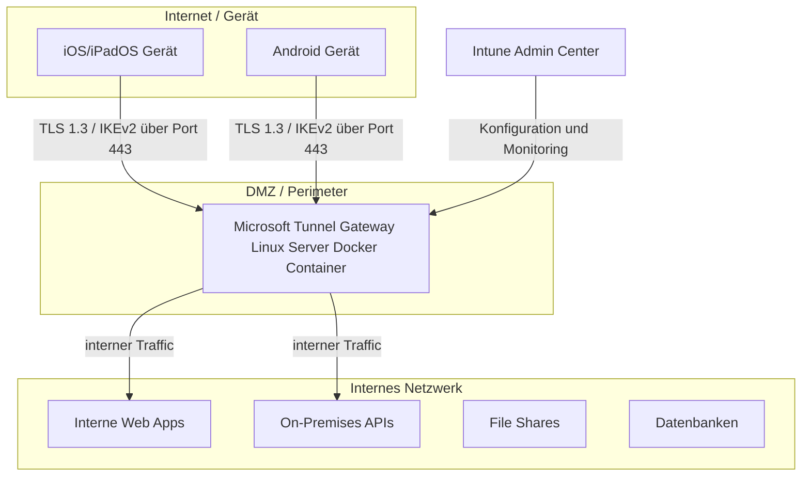
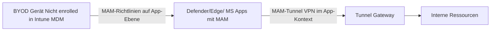
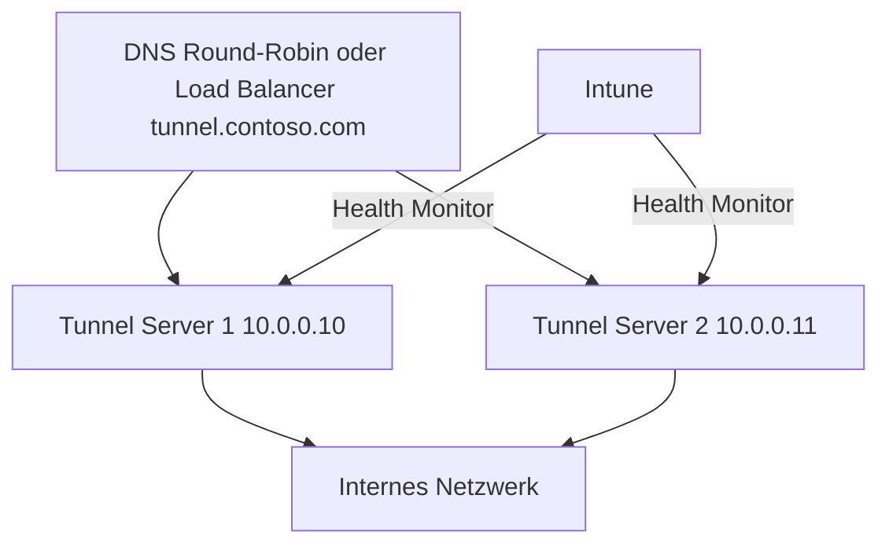

---
tags:
  - intune
  - intune-suite
  - microsoft-tunnel
  - vpn
  - mam
  - byod
  - netzwerk
  - linux
aliases:
  - Microsoft Tunnel
  - Intune Tunnel
  - MAM Tunnel
  - Tunnel Gateway
---

# Microsoft Tunnel

> [!ABSTRACT] TL;DR
> Microsoft Tunnel ist ein VPN-Gateway für iOS/iPadOS und Android, das auf einem Linux-Server (Docker-Container) betrieben wird. Besonderes Merkmal: **MAM-Tunnel** erlaubt VPN-Zugriff auf interne Ressourcen für BYOD-Geräte **ohne vollständige Geräteregistrierung**. Enthalten im Intune Suite Bundle ($10/User/Monat), der MAM-Tunnel separat.

---

## Architektur-Übersicht

Microsoft Tunnel besteht aus zwei Hauptkomponenten: dem **Tunnel Gateway** (Linux-Server) und dem **Tunnel Client** (auf dem Endgerät).



### Site-Konzept

Ein **Site** ist ein logischer Ort (z.B. ein Rechenzentrum oder Standort), dem ein oder mehrere Tunnel-Server zugeordnet sind:

| Ebene | Beschreibung |
|-------|-------------|
| **Site** | Logischer Standort (z.B. Berlin RZ, Azure West Europe) |
| **Server** | Physische/virtuelle Linux-Instanz einem Site zugeordnet |
| **Hochverfügbarkeit** | Mehrere Server pro Site = HA (Load Balancing über Intune) |

---

## Lizenzierung

| Komponente | Lizenz | Preis |
|-----------|--------|-------|
| **Tunnel für MDM-Geräte** | Intune Plan 2 oder Suite | $4/$10/User/Monat |
| **MAM-Tunnel (BYOD)** | **Intune Suite** (nicht Plan 2!) | $10/User/Monat |
| **Intune Plan 1** | Basis-Voraussetzung | $8/User/Monat |

> [!IMPORTANT] MAM-Tunnel nur in Intune Suite
> Der **MAM-Tunnel** (Tunnel ohne Geräteregistrierung für BYOD) ist **ausschließlich** im Intune Suite Bundle enthalten — nicht im günstigeren Intune Plan 2. Das ist ein wichtiges Kaufargument für die Suite.

---

## Unterstützte Plattformen

| Plattform | MDM-Tunnel | MAM-Tunnel (ohne Enrollment) |
|-----------|-----------|------------------------------|
| **iOS 14+** | ✅ | ✅ |
| **iPadOS 14+** | ✅ | ✅ |
| **Android Enterprise 10+** | ✅ | ✅ |
| **Android AOSP** | ✅ | ❌ |
| **Windows** | ❌ | ❌ |
| **macOS** | ❌ | ❌ |

---

## Linux-Server: Voraussetzungen und Installation

### Serveranforderungen

| Komponente | Mindestanforderung | Empfohlen |
|-----------|-------------------|-----------|
| **CPU** | 4 vCPUs | 8 vCPUs |
| **RAM** | 4 GB | 8 GB |
| **Speicher** | 20 GB | 40 GB |
| **OS** | RHEL 7.4+ / Ubuntu 18.04+ / CentOS 7.4+ | Ubuntu 22.04 LTS |
| **Docker** | Docker CE 19+ oder Podman 3+ | Docker CE 24+ |
| **Python** | Python 3.6+ | Python 3.10+ |
| **Port (eingehend)** | TCP/UDP 443 | TCP/UDP 443 |

> [!NOTE] Netzwerkanforderungen
> Der Tunnel-Server benötigt ausgehende Verbindungen zu Microsoft-Endpunkten (*.manage.microsoft.com, *.microsoftonline.com). Detaillierte URL-Liste: [Intune Network Endpoints Dokumentation](https://docs.microsoft.com/intune/fundamentals/intune-endpoints).

### Schritt-für-Schritt: Tunnel-Server Installation

**Schritt 1: Linux-Server vorbereiten (Ubuntu 22.04)**

```bash
# System aktualisieren
sudo apt update && sudo apt upgrade -y

# Docker installieren
sudo apt install -y apt-transport-https ca-certificates curl gnupg lsb-release

curl -fsSL https://download.docker.com/linux/ubuntu/gpg | sudo gpg --dearmor -o /usr/share/keyrings/docker-archive-keyring.gpg

echo "deb [arch=amd64 signed-by=/usr/share/keyrings/docker-archive-keyring.gpg] \
  https://download.docker.com/linux/ubuntu $(lsb_release -cs) stable" | \
  sudo tee /etc/apt/sources.list.d/docker.list > /dev/null

sudo apt update && sudo apt install -y docker-ce docker-ce-cli containerd.io

# Python 3 und Abhängigkeiten
sudo apt install -y python3 python3-pip

# IP-Forwarding aktivieren
sudo sysctl -w net.ipv4.ip_forward=1
echo "net.ipv4.ip_forward=1" | sudo tee -a /etc/sysctl.conf
```

**Schritt 2: Intune Tunnel Installer herunterladen**

```bash
# Tunnel-Installer von Intune Admin Center herunterladen
# (Intune Admin Center → Tenant Administration → Microsoft Tunnel Gateway → Download mstunnel-setup)

# Installer ausführbar machen
chmod +x mstunnel-setup

# Installation starten
sudo ./mstunnel-setup
```

**Schritt 3: Interaktive Konfiguration**

```
1. Azure Tenant-ID eingeben
2. Site auswählen oder neu erstellen
3. TLS-Zertifikat konfigurieren (Let's Encrypt oder eigenes Zertifikat)
4. IP-Bereich für VPN-Clients konfigurieren (z.B. 172.16.0.0/16)
5. DNS-Server für VPN-Clients (z.B. 10.0.0.10)
6. Installation abschließen
```

**Schritt 4: Status prüfen**

```bash
# Tunnel-Container Status
sudo docker ps | grep mstunnel

# Tunnel-Logs anzeigen
sudo docker logs mstunnel-agent

# Tunnel-Service Status
sudo systemctl status mstunnel
```

---

## Site und Server-Konfiguration in Intune

### Site erstellen

**Intune Admin Center** → Tenant Administration → Microsoft Tunnel Gateway → Sites → Create:

| Parameter | Beschreibung | Beispiel |
|-----------|-------------|---------|
| **Site Name** | Eindeutiger Name | Berlin-Datacenter |
| **Public IP/FQDN** | Extern erreichbare Adresse des Servers | tunnel.contoso.com |
| **Port** | TCP/UDP Port (Standard: 443) | 443 |
| **IP Bereich** | VPN-Client IP-Pool | 172.16.0.0/16 |
| **DNS-Server** | Interne DNS-Server für Clients | 10.0.0.10, 10.0.0.11 |
| **DNS Suffix** | Internes DNS-Suffix | corp.contoso.com |

---

## VPN-Profil-Typen

### Split Tunneling

Nur Traffic zu definierten internen Netzwerken wird durch den Tunnel geleitet. Alle anderen Verbindungen gehen direkt ins Internet:

```
VPN-Profil Konfiguration:
- Split Tunneling: Enabled
- Include Routes:
    - 10.0.0.0/8     (internes Netzwerk)
    - 172.16.0.0/12  (DC-Netzwerke)
    - 192.168.0.0/16 (Management-Netze)
- Exclude Routes:
    - Alle anderen (gehen direkt)
```

**Vorteile Split Tunneling:**
- Geringere Last auf dem Tunnel-Server
- Microsoft 365 Traffic geht direkt (optimal)
- Nur interne Ressourcen durch Tunnel

### Per-App VPN

Nur definierte Apps nutzen den Tunnel, alle anderen Apps kommunizieren direkt:

```
VPN-Profil:
- Per-App VPN: Enabled
- Associated Apps:
    - com.contoso.internalapp
    - com.microsoft.intune (für MAM-Szenarien)
    - com.contoso.salestool
```

**Einsatzszenarien:**
- Browser für interne Intranet-Seiten: Tunnel
- Microsoft Teams: direkt
- Interne LOB-App: Tunnel
- Alle anderen Apps: direkt

### Always-On VPN

Gerät verbindet sich automatisch mit dem Tunnel beim Hochfahren:

```
VPN-Profil:
- Always On: Enabled
- Per-App VPN: Disabled (gesamter Tunnel-Traffic)
- Lock Down Mode: Optional (verhindert Traffic außerhalb Tunnel)
```

> [!WARNING] Always-On mit Lock Down
> **Lock Down Mode** verhindert jeglichen Netzwerktraffic wenn der Tunnel nicht verbunden ist. Das ist sehr sicher, aber kann bei Tunnel-Ausfällen alle Netzwerk-Aktivität blockieren. Nur in Hochsicherheitsszenarien empfehlenswert.

---

## MAM-Tunnel: VPN für BYOD ohne Enrollment

Der **MAM-Tunnel** ist das differenzierende Feature der Intune Suite gegenüber Plan 2:

### Konzept



**Voraussetzungen MAM-Tunnel:**
- App muss Intune App SDK unterstützen (Microsoft-Apps: Edge, Outlook, Teams, Word, etc.)
- MAM-App-Schutzrichtlinie muss konfiguriert sein
- Microsoft Defender (als MAM-Tunnel-Client) auf iOS/Android
- **Kein MDM-Enrollment des Geräts nötig**

### MAM-Tunnel konfigurieren

**Schritt 1: App-Konfigurationsrichtlinie für MAM-Tunnel**

```json
{
  "appConfig": {
    "com.microsoft.intune.mam.managedbrowser.TunnelAvailable": "true",
    "com.microsoft.intune.mam.managedbrowser.TunnelSite": "Berlin-Datacenter",
    "TunnelConfiguration": {
      "tunnelEnabled": true,
      "tunnelSiteId": "xxxxxxxx-xxxx-xxxx-xxxx-xxxxxxxxxxxx"
    }
  }
}
```

**Schritt 2: App-Schutzrichtlinie mit Tunnel verknüpfen**

```
App Protection Policy (iOS):
- Apps: Microsoft Edge, Outlook, Word, Excel
- Data Transfer: Managed apps only
- Tunnel: Enabled
- Tunnel Site: [Site auswählen]
```

> [!TIP] BYOD mit MAM-Tunnel: Datenschutz-Vorteil
> Da das Gerät nicht enrolled ist, hat die IT **keinen Zugriff** auf persönliche Daten. Nur die in den MAM-Richtlinien verwalteten Apps kommunizieren durch den Tunnel. Ideal für BYOD-Szenarien wo Datenschutz wichtig ist.

---

## Conditional Access Integration

Der Tunnel-Zugriff kann mit Conditional Access-Richtlinien verknüpft werden:

```
Conditional Access Richtlinie:
- Cloud App: Microsoft Tunnel
- Bedingungen:
    - Gerät: Compliant required
    - Plattformen: iOS, Android
    - Standort: Außerhalb Unternehmens-IPs
- Gewähren: Zugriff erlauben wenn compliant
```

**Effekt:** Nicht-konforme Geräte können keine Verbindung zum Tunnel herstellen — auch wenn die VPN-Konfiguration vorhanden ist.

---

## Monitoring und Health-Check

### Tunnel-Server Health im Intune Admin Center

**Intune Admin Center** → Tenant Administration → Microsoft Tunnel Gateway → Health:

| Metrik | Beschreibung | Normal-Wert |
|--------|-------------|------------|
| **CPU Usage** | Prozessorauslastung | < 80% |
| **Memory Usage** | RAM-Auslastung | < 80% |
| **Connections** | Aktive VPN-Verbindungen | Abhängig von Lizenz |
| **Throughput** | Netzwerkdurchsatz | Abhängig von Uplink |
| **Last Check-in** | Letzter Kontakt zu Intune | < 5 Minuten |

### Logs analysieren

```bash
# Tunnel-Agent Logs (Echtzeit)
sudo docker logs -f mstunnel-agent

# Tunnel-Server Logs
sudo docker logs -f mstunnel-server

# Alle Container-Logs mit Zeitstempel
sudo docker logs --timestamps mstunnel-agent 2>&1 | tail -100

# Systemd-Logs für Tunnel-Dienst
sudo journalctl -u mstunnel -f

# Verbindungsstatistiken
sudo docker exec mstunnel-server mstunnel stats
```

### Häufige Probleme

| Problem | Ursache | Lösung |
|---------|---------|--------|
| Server Not Reachable | Firewall blockiert Port 443 | Eingehend TCP/UDP 443 öffnen |
| Certificate Error | TLS-Zertifikat abgelaufen | Zertifikat erneuern |
| Agents Offline | Docker nicht gestartet | `sudo systemctl start docker` |
| Client Can't Connect | Conditional Access blockiert | CA-Richtlinie prüfen |
| Slow Performance | Zu wenig CPU/RAM | Server skalieren |

---

## Hochverfügbarkeit

Für Produktionsumgebungen mehrere Server pro Site konfigurieren:



- Intune erkennt ausgefallene Server automatisch
- Clients werden zu verfügbaren Servern umgeleitet
- Keine manuelle Failover-Konfiguration nötig

---

## Verwandte Notizen

- [[Microsoft Intune Suite Überblick]]
- [[Intune Grundlagen]]
- [[App Management MAM]]
- [[Conditional Access]]
- [[Compliance Policies]]
- [[Microsoft Cloud PKI]]
