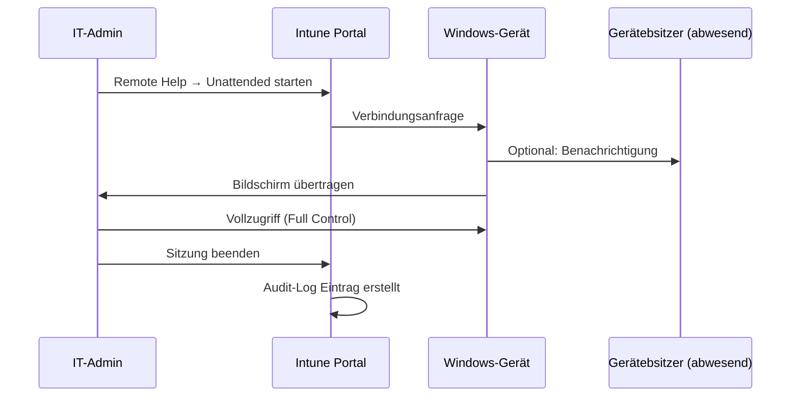

---
tags:
  - intune
  - intune-suite
  - remote-help
  - support
  - remotezugriff
  - helpdesk
  - rbac
aliases:
  - Remote Help
  - Intune Remote Help
  - Remote-Support Intune
  - Remotezugriff Intune
---

# Remote Help

> [!ABSTRACT] TL;DR
> Remote Help ist ein in Intune integriertes Remote-Support-Tool, das direkt aus dem Intune Admin Center gestartet wird. Support-Mitarbeiter können Windows-, macOS- und Android-Geräte aus der Ferne steuern oder anzeigen. Alle Sitzungen werden vollständig auditiert. Kosten: ~$3/User/Monat als Einzellizenz oder im Intune Suite Bundle ($10/User/Monat).

---

## Konzept und Abgrenzung

Remote Help ist kein generisches Fernzugrifftool wie TeamViewer, sondern tief in den Intune-Workflow integriert:

- **Authentifizierung:** Helfer und Benutzer authentifizieren sich mit Microsoft Entra ID
- **Autorisierung:** RBAC-Rollen steuern wer auf wen zugreifen darf
- **Enrollment-Kontext:** Geräteinformationen aus Intune sind direkt sichtbar
- **Audit-Logging:** Jede Sitzung wird im Intune Audit Log protokolliert
- **Kein externer Dienst:** Kein separates Konto bei Drittanbieter nötig

### Vergleich mit Alternativen

| Feature | Remote Help | TeamViewer | Quick Assist | BeyondTrust |
|---------|-------------|-----------|--------------|-------------|
| **Intune-Integration** | ✅ Nativ | ❌ Extern | ⚠️ Begrenzt | ❌ Extern |
| **Entra ID Auth** | ✅ | ❌ eigenes Auth | ✅ | ❌ |
| **Intune RBAC** | ✅ | ❌ | ❌ | ❌ |
| **Audit Logs in Intune** | ✅ | ❌ extern | ❌ | ❌ extern |
| **Unattended Access** | ✅ Enterprise | ✅ | ❌ | ✅ |
| **macOS Support** | ✅ View only (2024) | ✅ Full | ❌ | ✅ |
| **Android Support** | ✅ View | ✅ | ❌ | ✅ |
| **Kosten** | Im Intune Suite | Separat | Kostenlos | Separat |

---

## Lizenzierung

| Lizenz | Preis | Hinweis |
|--------|-------|---------|
| **Remote Help Einzellizenz** | ~$3/User/Monat | Nur für Benutzer die Hilfe empfangen |
| **Intune Suite Bundle** | $10/User/Monat | Remote Help + EPM + Cloud PKI + weitere |

> [!NOTE] Wer braucht die Lizenz?
> Die Remote Help Lizenz wird nur für **Benutzer die Hilfe empfangen** benötigt — nicht zwingend für Helfer (Help Desk). In der Praxis empfiehlt Microsoft das Lizenzieren aller verwalteten Benutzer.

---

## Unterstützte Plattformen und Modi

### Windows

| Modus | Beschreibung | Voraussetzung |
|-------|-------------|--------------|
| **Full Control** | Vollständige Fernsteuerung des Desktops | Benutzer muss anwesend sein |
| **View Only** | Nur Bildschirm anzeigen | Benutzer muss anwesend sein |
| **Elevated Session** | Support-Mitarbeiter nutzt Admin-Rechte | Remote Help Admin RBAC-Rolle |
| **Unattended Access** | Zugriff ohne Benutzer | Windows 10/11 Enterprise, EPM |

### macOS

```
Ab macOS Remote View Support (ab 2024):
- Modus: View Only (kein Full Control)
- Voraussetzung: Remote Help App installiert
- Steuerung: Nicht möglich (nur Bildschirm anzeigen)
- Sitzung: Benutzer muss anwesend sein und bestätigen
```

> [!NOTE] macOS Full Control in Entwicklung
> Zum Stand 2024 ist macOS nur im **View-only Modus** unterstützt. Microsoft hat Full Control für macOS auf der Roadmap angekündigt (H1 2025 geplant).

### Android

```
Android Remote View:
- Modus: View Only
- Voraussetzung: Enrolled in Intune (Android Enterprise)
- Support-Mitarbeiter kann Bildschirm des Benutzers sehen
- Benutzer muss Sitzung erlauben
- Annotation-Tool: Helfer kann Markierungen auf dem Bildschirm zeichnen
```

---

## RBAC-Rollen

Remote Help nutzt das Intune RBAC-System mit zwei dedizierten Rollen:

### Help Desk Operator

```
Berechtigungen:
- Remote Help View: Erlaubt (Bildschirm anzeigen)
- Remote Help Take Full Control: Erlaubt (Windows Full Control)
- Remote Help Unattended Control: NICHT erlaubt
- Geräte aus Intune entfernen: NICHT erlaubt (nur Support-Tätigkeiten)
```

Geeignet für: Reguläre IT-Support-Mitarbeiter, First-Level-Support

### Remote Help Administrator

```
Berechtigungen:
- Alle Help Desk Operator Berechtigungen
- Remote Help Unattended Control: Erlaubt
- Elevated Session: Erlaubt (Admin-Rechte im Remote-Kontext)
- Geräte-Informationen einsehen: Vollständig
```

Geeignet für: Senior IT-Administratoren, Second/Third-Level-Support

> [!IMPORTANT] Least Privilege für Help Desk
> Weise **Help Desk Operator** (nicht Remote Help Administrator) für regulären Support zu. Unattended Access und Elevated Sessions sollten auf wenige Senior-Admins beschränkt sein.

---

## Via Microsoft Intune Admin Center (UI)

### Remote Help aktivieren und konfigurieren

1. Öffne **[intune.microsoft.com](https://intune.microsoft.com)**
2. Navigiere zu **Mandantenverwaltung** → **Remote Help**
3. Klicke auf **Einstellungen** → **Konfigurieren**
4. Aktiviere **Remote Help:** Umschalter auf **Aktiviert**
5. Konfiguriere organisationsweite Einstellungen:
   - **Unbeaufsichtigter Zugriff:** Aktivieren für Windows Enterprise
   - **Chat-Funktion:** Aktivieren oder deaktivieren
   - **Benachrichtigung des Benutzers:** Immer anzeigen (empfohlen)
   - **Kamera-Sharing:** Aktivieren oder deaktivieren
6. **Speichern**

### RBAC-Rollen für Remote Help zuweisen

1. Navigiere zu **Mandantenverwaltung** → **Rollen** → **Alle Rollen**
2. Rolle auswählen:
   - **Remote Help Administrator** — Vollzugriff inkl. Unattended Access
   - **Help Desk Operator** — Nur beaufsichtigter Zugriff
3. Klicke **Zuweisungen** → **+ Zuweisen**
4. **Gruppen** zuweisen (Entra ID-Gruppe der Help-Desk-Mitarbeiter)
5. **Speichern**

### Remote Help App deployen

1. Navigiere zu **Apps** → **Alle Apps** → **+ Hinzufügen**
2. **App-Typ:** Microsoft-App
3. Wähle **Remote Help** aus der Liste
4. **Zuweisung:** Alle Geräte oder spezifische Gerätegruppen
5. **Erstellen**

### Sitzung als Helfer starten

1. **Remote Help App** auf dem Helfer-Gerät öffnen (oder über Browser: **aka.ms/remotehelp**)
2. Mit **Entra ID-Konto** anmelden
3. Sitzungstyp wählen: **Vollständige Kontrolle** oder **Nur anzeigen**
4. **Sitzungscode** dem Benutzer mitteilen (per Teams, Telefon, etc.)

5. *Alternativ direkt aus Intune:*
   - Navigiere zu **Geräte** → Gerät suchen → **Remote Help**
   - Klicke **Remote Help starten** → Verbindung wird initiiert

### Audit-Logs prüfen

1. Navigiere zu **Mandantenverwaltung** → **Remote Help** → **Berichte**
2. Alle Remote-Help-Sitzungen anzeigen: Helfer, Benutzer, Gerät, Dauer, Sitzungstyp
3. **Filter** nach Zeitraum, Helfer oder Gerät
4. **Exportieren** als CSV für Compliance-Nachweise

---

## Attended Access: Windows Sitzung starten

### Aus Intune Admin Center (Helfer-Seite)

1. **Intune Admin Center** → Devices → [Gerät suchen] → Remote Help
2. **Sitzungstyp wählen:** Full Control oder View Only
3. **Verbindung wird initiiert** — Benutzer erhält Benachrichtigung

### Remote Help App (Client-Seite)

```
Remote Help App starten:
1. Benutzer öffnet Remote Help App (muss vorinstalliert sein)
2. Anmeldung mit Entra ID Account des Benutzers
3. Bildschirm erscheint: "Warten auf Support-Verbindung" oder
4. Benutzer teilt Session-Code (alternativ)
```

### Voraussetzungen auf dem Endpunkt

```
Windows:
- Remote Help App installiert (aus Microsoft Store oder Intune)
- Internetzugang zu *.remotehelp.microsoft.com
- Windows 10 20H2 oder höher / Windows 11
- Intune-Enrollment

macOS:
- Remote Help App installiert
- macOS 12 Monterey oder höher
- Screen Recording Permission erteilt (Systemeinstellungen → Datenschutz)
- Accessibility Permission (für View-only)
```

### Deployment der Remote Help App via Intune

```powershell
# Remote Help App kann direkt aus Intune deployt werden:
# Intune Admin Center → Apps → All Apps → Add
# App Type: Microsoft app
# Wähle: Remote Help
# Assign to: All Devices (oder spezifische Gruppen)
```

---

## Unattended Access (Windows Enterprise)

Unattended Access erlaubt Support-Mitarbeitern, auf Windows-Geräte zuzugreifen ohne dass der Benutzer anwesend sein muss:

### Voraussetzungen

- Windows 10/11 **Enterprise** (nicht Pro oder Home)
- Remote Help Administrator RBAC-Rolle
- Unattended Access in Remote Help Einstellungen aktiviert
- Gerät muss enrolled und online sein

### Konfiguration

**Intune Admin Center** → Tenant Administration → Remote Help → Settings:

```
Unattended Access:
- Enable Unattended Access: Enabled
- Require device to be Intune-enrolled: Enabled (empfohlen)
- Notification to user: Enabled (Benutzer wird benachrichtigt, kann Sitzung beenden)
```

> [!DANGER] Unattended Access Sicherheitsaspekte
> - Nur für vertrauenswürdige IT-Admins (Remote Help Administrator Rolle)
> - Audit-Log prüfen bei ungewöhnlichen Zugriffen
> - Benachrichtigung an Benutzer empfohlen (auch wenn nicht zu Hause)
> - **Nie** für regulären First-Level-Support freischalten

### Sitzungsablauf Unattended



---

## Audit-Logging

Alle Remote-Sitzungen werden vollständig in Intune protokolliert:

### Audit-Log Inhalt

**Intune Admin Center** → Tenant Administration → Audit Logs → Remote Help Filter:

| Feld | Inhalt |
|------|--------|
| **Date/Time** | Start und Ende der Sitzung |
| **Helper** | UPN des Support-Mitarbeiters |
| **Sharer** | UPN des Benutzers (oder Gerät bei Unattended) |
| **Device** | Gerätename, OS |
| **Session Type** | Full Control / View / Unattended / Elevated |
| **Duration** | Sitzungsdauer in Sekunden |
| **Session ID** | Eindeutige ID für Compliance |

### Graph API: Remote Help Sitzungen abfragen

```powershell
Connect-MgGraph -Scopes "DeviceManagementConfiguration.Read.All"

# Remote Help Audit-Logs der letzten 30 Tage
$remoteHelpLogs = Invoke-MgGraphRequest -Method GET `
    -Uri "https://graph.microsoft.com/beta/deviceManagement/remoteHelpSessions" `
    -OutputType PSObject

$remoteHelpLogs.value | Select-Object `
    @{N="Helfer"; E={$_.helperEmail}},
    @{N="Benutzer"; E={$_.sharerEmail}},
    @{N="Gerät"; E={$_.deviceName}},
    @{N="Typ"; E={$_.sessionType}},
    @{N="Start"; E={$_.startDateTime}},
    @{N="Ende"; E={$_.endDateTime}},
    @{N="Dauer (Min)"; E={[math]::Round(($_.endDateTime - $_.startDateTime).TotalMinutes, 1)}} |
    Format-Table -AutoSize
```

```powershell
# Sitzungen nach Helfer aggregieren (Workload-Analyse)
$remoteHelpLogs.value |
    Group-Object -Property helperEmail |
    Sort-Object Count -Descending |
    Select-Object Count, Name |
    Format-Table @{N="Sitzungen"; E={$_.Count}}, @{N="Support-Mitarbeiter"; E={$_.Name}}
```

---

## Netzwerkanforderungen

### Firewall-Regeln (ausgehend vom Gerät)

| URL | Port | Zweck |
|-----|------|-------|
| `*.remotehelp.microsoft.com` | TCP 443 | Remote Help Service |
| `*.servicebus.windows.net` | TCP 443 | Azure Service Bus (Signaling) |
| `*.aadcdn.microsoftonline-p.com` | TCP 443 | Entra ID Auth |
| `*.manage.microsoft.com` | TCP 443 | Intune Service |

> [!NOTE] Proxy-Unterstützung
> Remote Help unterstützt HTTPS-Proxys. Proxy-Einstellungen werden aus Windows-Systemeinstellungen übernommen oder können via Intune konfiguriert werden.

---

## Best Practices

### Deployment-Empfehlungen

1. **Remote Help App via Intune deployen** (nicht manuelle Installation)
2. **RBAC strikt konfigurieren:** Help Desk Operator für Standard-Support
3. **Unattended Access** nur für explizit benannte Senior-Admins
4. **Audit-Log Review** monatlich — ungewöhnliche Zugriffsmuster erkennen
5. **macOS Screen Recording** Permission proaktiv via MDM erteilen

### Ticketing-Integration

```
Empfehlung: Remote Help + ServiceNow/Jira-Integration:
1. Ticket öffnen in ITSM-System
2. Remote Help direkt aus Intune Admin Center oder Intune-Gerätekarte starten
3. Session-ID aus Audit-Log im Ticket dokumentieren
4. Audit-Logs für Compliance-Nachweise exportierbar
```

---

## Verwandte Notizen

- [[Microsoft Intune Suite Überblick]]
- [[Intune Grundlagen]]
- [[Endpoint Privilege Management EPM]]
- [[Compliance Policies]]
- [[Endpoint Security]]
- [[Conditional Access]]
