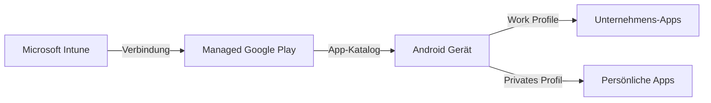
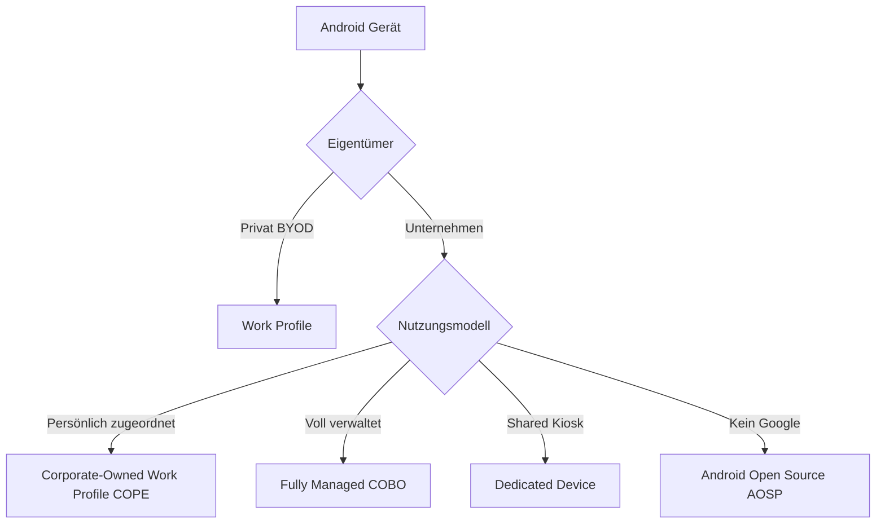
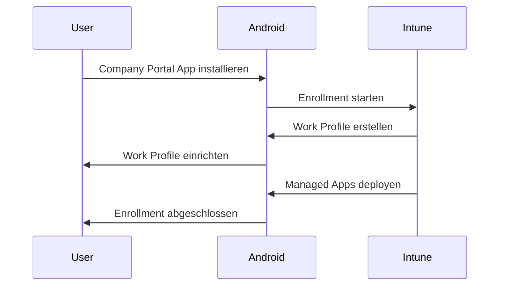
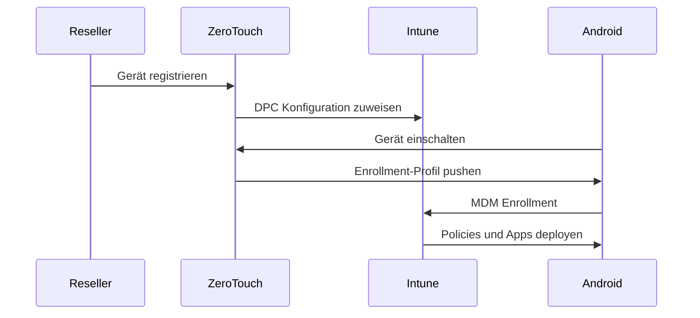
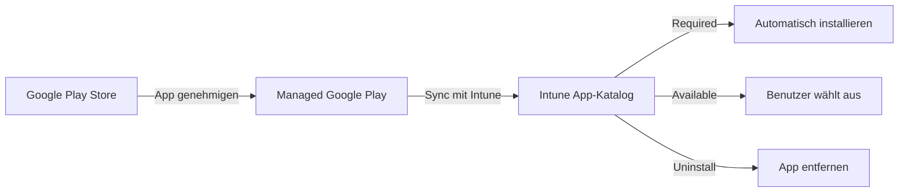

---
tags:
  - microsoft365
  - intune
  - android
  - enrollment
  - android-enterprise
aliases:
  - Android MDM Enrollment
  - Android Enterprise Intune
---

# Android Enrollment

> [!ABSTRACT] TL;DR
> Android-Geräte werden in Intune über **Android Enterprise** verwaltet — Googles offizielle MDM-Schnittstelle. Die vier Hauptszenarien sind: Work Profile (BYOD), Corporate-Owned Work Profile (COPE), Fully Managed (COBO) und Dedicated Devices (Kiosk). Alle Szenarien erfordern die Verbindung von Intune mit **Managed Google Play**.

---

## Android Enterprise Übersicht

**Android Enterprise (AE)** ist Googles Framework für die Unternehmensverwaltung von Android-Geräten. Intune nutzt AE als primäre Verwaltungsschnittstelle.

### Voraussetzung: Managed Google Play



**Managed Google Play verbinden:**
1. **Intune Admin Center** → Devices → Android → **Managed Google Play**
2. Mit Unternehmens-Google-Account verbinden
3. Managed Google Play bestätigen und genehmigen

---

## Enrollment-Typen Übersicht



### Vergleich der Android Enrollment-Typen

| Merkmal | Work Profile | COPE | Fully Managed | Dedicated |
|---------|-------------|------|---------------|-----------|
| **Geräteeigentum** | Privat | Unternehmen | Unternehmen | Unternehmen |
| **Privates Profil** | Ja | Ja | Nein | Nein |
| **Unternehmens-Profil** | Ja | Ja | Ganzes Gerät | Ganzes Gerät |
| **Benutzer zugeordnet** | Ja | Ja | Ja | Nein (Shared) |
| **Managed Play Zugang** | Privat + Work | Ja | Nur Managed | Eingeschränkt |
| **Remote Wipe** | Nur Work | Vollständig | Vollständig | Vollständig |
| **Kiosk-Modus** | Nein | Nein | Nein | Ja |
| **Factory Reset Prevention** | Nein | Ja | Ja | Ja |

---

## Work Profile (BYOD)

**Android Work Profile** ist für **private Geräte (BYOD)** — es erstellt einen isolierten Container für Unternehmens-Apps, während persönliche Apps getrennt bleiben.

### Eigenschaften

- Doppeltes App-Icon (mit Aktentaschen-Badge für Work-Apps)
- Getrennte Speicher (Work und Privat)
- Getrennte Kontakte, Kalender, Benachrichtigungen
- Unternehmens-IT hat **keinen Zugriff** auf persönliche Daten
- Nur Work Profile kann vollständig gelöscht werden (Selective Wipe)

### Enrollment-Ablauf



---

## Corporate-Owned Work Profile (COPE)

**COPE** (Corporate-Owned Personally-Enabled) kombiniert vollständige Unternehmenskontrolle über das Gerät mit einem persönlichen Bereich für den Benutzer.

### Eigenschaften

| Merkmal | COPE |
|---------|------|
| Geräteeigentum | Unternehmen |
| Persönliche Nutzung | Erlaubt (konfigurierbar einschränkbar) |
| Geräteverwaltung | Vollständig |
| App-Deployment | Silent Install im Work und geräteübergreifend |
| Remote Wipe | Vollständig |
| Factory Reset Prevention | Ja |

### Enrollment via Zero-Touch oder NFC

1. Gerät über **Google Zero-Touch** oder **NFC-Enrollment** mit Profil versehen
2. Beim ersten Start: Profil wird automatisch angewendet
3. Work Profile wird erstellt und Unternehmens-Apps deployed

---

## Corporate-Owned Fully Managed (COBO)

**COBO** (Corporate-Owned Business-Only) — das gesamte Gerät ist Unternehmensgut, kein persönlicher Bereich vorhanden.

### Eigenschaften

- Vollständige IT-Kontrolle über das Gerät
- Kein persönlicher Google Account
- Managed Google Play Account (automatisch erstellt)
- Ideal für: Außendienst-Mitarbeiter, dedizierte Arbeitsstationen

### Enrollment-Methoden im Vergleich

| Methode | Beschreibung |
|---------|-------------|
| **NFC Bump** | Gerät-zu-Gerät Enrollment via NFC |
| **QR-Code** | Enrollment-QR-Code beim Setup einscannen |
| **Zero-Touch Enrollment** | Vollautomatisch ab Werk |
| **DPC Identifier** | `afw#setup` im Setup-Bildschirm eingeben |
| **Knox Mobile Enrollment** | Samsung-spezifisch |

### DPC Identifier Enrollment (afw#setup)

```
Ablauf:
  1. Android Gerät auf Werkseinstellungen zurücksetzen
  2. Im Setup-Bildschirm (WLAN-Auswahl) die Zeichenkette eingeben: afw#setup
  3. Enrollment-App wird heruntergeladen
  4. QR-Code oder Enrollment-Token eingeben
  5. Intune übernimmt vollständige Verwaltung des Geräts
```

---

## Dedicated Devices (Kiosk-Modus)

**Dedicated Devices** sind firmeneigene, gemeinsam genutzte Geräte für einen spezifischen Zweck (Kiosk, Warehouse Scanner, Shared Tablet, etc.).

### Kiosk-Modi

| Modus | Beschreibung |
|-------|-------------|
| **Single App Kiosk** | Nur eine App sichtbar und nutzbar |
| **Multi-App Kiosk** | Ausgewählte Apps erlaubt, Managed Home Screen |
| **Virtual Reality** | Für VR-Headsets |

### Managed Home Screen

**Managed Home Screen** ist Microsofts eigener Android Launcher für Dedicated Devices:

```json
{
  "applications": [
    {
      "packageName": "com.microsoft.launcher.enterprise",
      "installType": "FORCE_INSTALLED"
    }
  ],
  "kioskModeApps": [
    {
      "appId": "com.example.myapp"
    }
  ],
  "kioskModeScreenSaverConfigurationEnabled": false
}
```

> [!TIP]
> Der **Managed Home Screen** kann vollständig über Intune App-Konfigurationsrichtlinien angepasst werden — inklusive Hintergrundbild, Schaltflächen und erlaubte Apps.

---

## Google Zero-Touch Enrollment

**Zero-Touch Enrollment** ermöglicht das automatische Enrollment von Android-Geräten direkt ab Werk — vergleichbar mit Windows Autopilot.

### Voraussetzungen

- Gerät muss Zero-Touch-kompatibel sein (Android 8.0+)
- Gerät muss über einen autorisierten Zero-Touch-Reseller gekauft werden
- Zero-Touch-Portal: **https://partner.android.com/zerotouch**

### Ablauf



---

## Samsung Knox Mobile Enrollment

**Samsung Knox** bietet eine alternative Enrollment-Methode für Samsung-Geräte über das **Knox Mobile Enrollment (KME)** Portal.

### Vorteile Samsung Knox

- Enrollment bereits ab Android 5.0 unterstützt
- Eigenes Knox-Portal (https://www2.samsungknox.com)
- Knox Platform for Enterprise: zusätzliche Sicherheitsfeatures
- Knox Attestation: Hardware-gestützte Sicherheitsattestierung

### KME Setup

1. Samsung Knox Portal → Reseller-Geräte registrieren
2. MDM-Profil erstellen (Intune als MDM-Provider angeben)
3. Profil den Geräten zuweisen
4. Geräte werden beim ersten Start automatisch enrolled

---

## Android Open Source Project (AOSP)

**AOSP-Enrollment** ermöglicht die Verwaltung von Android-Geräten **ohne Google Mobile Services (GMS)** — relevant für spezifische Hardware (Industrie-Scanner, dedizierte Devices ohne Play Store).

### Unterstützte Szenarien

| Szenario | Beschreibung |
|---------|-------------|
| **AOSP Userless** | Keine Benutzeranmeldung, Shared Device |
| **AOSP User-associated** | Dediziertem Benutzer zugeordnet |

> [!WARNING]
> AOSP-Geräte haben **keinen Managed Google Play Zugang**. App-Deployment erfolgt über direktes APK-Sideloading oder gerätespezifische Store-Konfigurationen.

---

## App-Deployment via Managed Google Play

### App-Typen für Android Enterprise

| App-Typ | Beschreibung |
|---------|-------------|
| **Managed Google Play Apps** | Öffentliche Apps aus dem Play Store |
| **Private Managed Google Play Apps** | Interne Apps (APK hochladen) |
| **Web Apps** | Webseiten als App-Shortcut |
| **Android Enterprise System Apps** | Vorinstallierte System-Apps aktivieren |

### App genehmigen und deployen

1. **Intune Admin Center** → Apps → Android → **Managed Google Play App**
2. App suchen und "Approve" klicken
3. Berechtigungen genehmigen
4. App erscheint jetzt als verwaltbare App in Intune
5. App-Zuweisung konfigurieren (Required, Available, Uninstall)



---

## Via Microsoft Intune Admin Center (UI)

### Android Enterprise über die UI einrichten und verwalten

1. Öffne das **Microsoft Intune Admin Center** unter [intune.microsoft.com](https://intune.microsoft.com)

#### Managed Google Play verbinden (Voraussetzung)

2. Navigiere zu **Geräte → Android → Android Enrollment → Verwaltetes Google Play**
3. Klicke auf **Ich stimme zu** und dann auf **Starten**
4. Melde dich mit dem Unternehmens-Google-Account an und bestätige die Verbindung mit Intune
5. Klicke auf **Fertig stellen**

#### Android Enterprise Enrollment-Profil erstellen (Work Profile / BYOD)

6. Navigiere zu **Geräte → Android → Android Enrollment → Arbeitsprofile für persönliche Geräte**
7. Klicke auf **+ Erstellen**
8. Konfiguriere den **Namen** und optionale Beschreibung
9. Weise das Profil einer Entra ID-Gruppe zu → **Weiter → Erstellen**

#### Vollständig verwaltete Geräte (COBO / COPE) einrichten

10. Navigiere zu **Geräte → Android → Android Enrollment → Vollständig verwaltete Geräte**
11. Klicke auf **Unternehmenseigene Vollständig verwaltete Benutzergeräte** → wähle die gewünschte Enrollment-Methode:
    - **QR-Code:** zum Scannen beim Geräte-Setup
    - **NFC-Token:** für NFC-basiertes Enrollment
    - **Enrollment-Token:** alphanumerischer Token für die manuelle Eingabe
12. Notiere oder lade den Enrollment-Token / QR-Code herunter

#### Managed Google Play App genehmigen

13. Navigiere zu **Apps → Android → + Hinzufügen → Verwaltete Google Play App**
14. Suche nach der App → klicke auf **Genehmigen** → genehmige die angeforderten Berechtigungen
15. Klicke auf **Genehmigt halten** → **Wählen**
16. Klicke auf **Synchronisieren** um die App in Intune verfügbar zu machen
17. Weise die App einer Gruppe mit dem gewünschten **Intent** (Erforderlich / Verfügbar) zu

> [!TIP]
> Nutze den **Managed Home Screen** (Microsoft Launcher for Business) für Dedicated Devices (Kiosk-Szenarien): **Apps → Android → + Hinzufügen → Verwaltete Google Play App** → suche nach „Managed Home Screen".

---

## Fehlerbehebung Android Enrollment

### Häufige Probleme

| Problem | Ursache | Lösung |
|---------|---------|--------|
| Managed Google Play Verbindung fehlt | Kein Google-Account verbunden | Managed Google Play in Intune einrichten |
| Work Profile erstellt sich nicht | Android-Version zu alt | Android 8.0+ erforderlich |
| Apps installieren nicht | App nicht in Managed Play genehmigt | App in Intune genehmigen |
| Zero-Touch funktioniert nicht | Gerät nicht kompatibel | Zero-Touch Kompatibilität prüfen |
| Knox Enrollment schlägt fehl | Knox Token abgelaufen | Knox Token erneuern |
| Factory Reset Prevention aktiv | Gerät von anderem MDM verwaltet | Gerät vollständig zurücksetzen |

### Diagnose-Tools

```bash
# Android Debug Bridge (ADB) - Enrollment Logs
adb logcat -s ManagedProvisioning

# Device Policy Controller Logs
adb shell dumpsys device_policy

# Work Profile Status prüfen
adb shell pm list users
```

```powershell
# Android Enrollment Status via Graph API
Connect-MgGraph -Scopes "DeviceManagementManagedDevices.Read.All"
$androidDevices = Invoke-MgGraphRequest -Method GET `
    -Uri "https://graph.microsoft.com/v1.0/deviceManagement/managedDevices?`$filter=operatingSystem eq 'Android'"
$androidDevices.value | Select-Object deviceName, enrolledDateTime, complianceState, managedDeviceOwnerType
```

---

## Verwandte Notizen

- [[Intune Grundlagen]]
- [[App Management MAM]]
- [[Compliance Policies]]
- [[Konfigurationsprofile]]
- [[Endpoint Security]]
